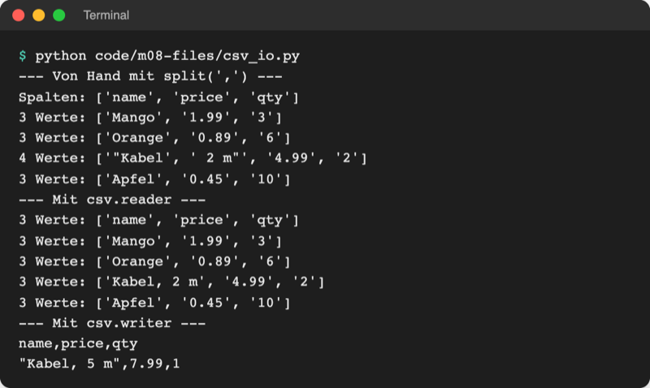
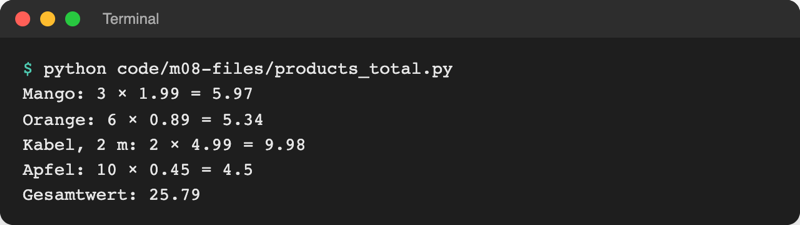
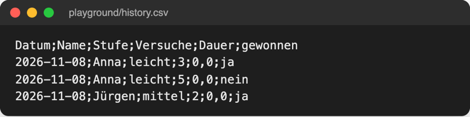

# Lab 8.3: CSV

**Leitfragen:**

<details>
<summary>Wie tauschen zwei Abteilungen eine Tabelle aus, wenn eine kein Excel hat?</summary>

Über ein einfaches Textformat, das jedes Programm öffnen kann: eine Zeile pro Datensatz, Werte durch ein Trennzeichen getrennt. Das ist CSV; Excel, LibreOffice, Numbers, Google Tabellen und Python lesen es.

</details>

<details>
<summary>Was passiert mit dem Produkt „Kabel, 2 m“ beim Zerlegen an Kommas?</summary>

Es zerfällt in zwei Teile, `"Kabel` und ` 2 m"`, und alle folgenden Werte rutschen eine Spalte weiter. CSV schützt solche Werte mit Anführungszeichen; das Modul `csv` beachtet sie, `split(",")` nicht.

</details>

<details>
<summary>JSON oder CSV für den Spielverlauf – wofür spricht was?</summary>

Der Verlauf ist eine flache Tabelle (eine Zeile pro Runde, immer dieselben Spalten) und soll in Excel landen: CSV. Die Bestenliste bleibt JSON, weil Programme sie mit Typen (Zahl, `true`) zurücklesen.

</details>

- CSV (Comma-Separated Values) ist die einfachste Tabelle als Text: Die erste Zeile enthält die Spaltennamen, jede weitere Zeile einen Datensatz.
- Das Modul `csv` aus der Standardbibliothek liest und schreibt CSV korrekt, auch mit Trennzeichen in Werten und mit dem Semikolon des deutschen Excel.

## Begriffe

| Begriff | Bedeutung |
| --- | --- |
| CSV | Textdatei mit einer Tabellenzeile pro Zeile; Werte durch ein Trennzeichen getrennt |
| Trennzeichen (Delimiter) | Zeichen zwischen zwei Werten: `,` international, `;` im deutschen Excel |
| Kopfzeile (Header) | erste Zeile mit den Spaltennamen |
| Anführungszeichen (Quoting) | `"Kabel, 2 m"`: Ein Wert in `"` darf das Trennzeichen enthalten |
| `csv.reader` / `csv.writer` | lesen und schreiben Zeilen als Listen |
| `csv.DictReader` / `csv.DictWriter` | lesen und schreiben Zeilen als Dictionaries mit den Spaltennamen als Schlüssel |
| `newline=""` | Python ändert die Zeilenenden nicht; das `csv`-Modul setzt sie selbst |
| BOM / `utf-8-sig` | unsichtbare Markierung am Dateianfang, an der Excel UTF-8 erkennt; `utf-8-sig` schreibt sie und überspringt sie beim Lesen |

## Das Format

[data/products.csv](../../project/data/products.csv) im Editor:

```text
name,price,qty
Mango,1.99,3
Orange,0.89,6
"Kabel, 2 m",4.99,2
Apfel,0.45,10
```

Ein Tabellenprogramm zeigt dieselbe Datei als Raster: Spalten `name`, `price`, `qty`, vier Datenzeilen. Die Datei selbst bleibt reiner Text; Formeln, Farben und mehrere Blätter kennt CSV nicht.

## Erst von Hand, dann mit dem csv-Modul

Datei: [code/m08-files/csv_io.py](../../project/code/m08-files/csv_io.py). Erst zerlegt `split(",")` (Lab 2.4) jede Zeile, dann liest `csv.reader` dieselbe Datei, zum Schluss schreibt `csv.writer` eine eigene.

```python
for line in lines[1:]:  # ab Zeile 2: die Daten
    values = line.strip().split(",")
    print(len(values), "Werte:", values)  # "Kabel, 2 m" zerfällt in zwei Teile

with open(products_file, encoding="utf-8", newline="") as file:
    reader = csv.reader(file)  # beachtet Anführungszeichen
    for row in reader:
        print(len(row), "Werte:", row)

with open(copy_file, "w", encoding="utf-8", newline="") as file:
    writer = csv.writer(file)
    writer.writerow(["name", "price", "qty"])  # eine Zeile = eine Liste
    writer.writerow(["Kabel, 5 m", 7.99, 1])  # setzt Anführungszeichen selbst
```



_Quelle: eigener Screenshot, Kurs-Repo, 08.11.2026._

`newline=""` gehört bei CSV in jedes `open()`: Sonst entstehen beim Schreiben unter Windows leere Zeilen zwischen den Datensätzen.

## DictReader: Zeilen als Dictionaries

Datei: [code/m08-files/products_total.py](../../project/code/m08-files/products_total.py) berechnet den Gesamtwert aller Produkte.

```python
total = 0
with open(products_file, encoding="utf-8", newline="") as file:
    reader = csv.DictReader(file)  # erste Zeile = Spaltennamen
    for row in reader:  # jede Zeile ist ein Dictionary
        price = float(row["price"])  # alle Werte kommen als Text
        qty = int(row["qty"])
        value = round(price * qty, 2)
        print(f"{row['name']}: {qty} × {price} = {value}")
        total += value
```



_Quelle: eigener Screenshot, Kurs-Repo, 08.11.2026._

CSV kennt keine Typen: Jeder Wert ist ein String, auch `"3"`. Rechnen geht erst nach `int()` oder `float()`.

Original: [Python-Dokumentation: csv.DictReader mit Erklärung von fieldnames und Beispiel mit newline=''](https://docs.python.org/3.14/library/csv.html#csv.DictReader), Stand 08.11.2026.

## Deutsches Excel: Semikolon, Dezimalkomma, BOM

Excel mit deutscher Einstellung trennt mit `;`, weil das Komma schon das Dezimalzeichen ist, und speichert „CSV UTF-8“ mit BOM. [data/inventory.csv](../../project/data/inventory.csv) ist so eine Datei:

```text
Produkt;Kategorie;Preis;Lagerbestand
Laptop Pro 15;Elektronik;1299,99;24
Smartphone X200;Elektronik;899,50;52
```

Datei: [code/m08-files/inventory.py](../../project/code/m08-files/inventory.py) liest sie und schreibt eine Bruttopreisliste mit `DictWriter`:

```python
with open(INVENTORY_FILE, encoding="utf-8-sig", newline="") as file:
    products = list(csv.DictReader(file, delimiter=";"))

with open(PRICE_FILE, "w", encoding="utf-8-sig", newline="") as file:
    writer = csv.DictWriter(file, fieldnames=["Produkt", "Brutto"], delimiter=";")
    writer.writeheader()  # Kopfzeile aus fieldnames
    for product in products:
        gross = to_number(product["Preis"]) * VAT  # "1299,99" -> 1299.99
        writer.writerow({"Produkt": product["Produkt"], "Brutto": to_text(gross)})
```

`to_number` ersetzt das Komma durch einen Punkt, bevor `float()` rechnet; `to_text` macht es umgekehrt mit zwei Nachkommastellen (`:.2f`, wie `:.1f` aus Lab 6.3). `list(...)` sammelt alle Zeilen in einer Liste.

## JSON oder CSV?

| | JSON | CSV |
| --- | --- | --- |
| Form | verschachtelt: Listen in Dictionaries in Listen | flach: Zeilen und Spalten |
| Typen | Zahl, Text, `true`/`false`, `null` bleiben erhalten | alles ist Text |
| Spaltennamen | in jedem Datensatz | einmal in der Kopfzeile |
| Öffnen mit | Editor, Programme, Web-APIs | Excel, LibreOffice, Numbers, Editor |
| Anhängen | Datei komplett neu schreiben | neue Zeile mit Modus `"a"` anhängen |
| Python | `json.dump`/`json.load` | `csv.DictWriter`/`csv.DictReader` |
| Im Spiel | Bestenliste `highscores.json` | Spielverlauf `history.csv` |

## Im Spiel: jede Runde in history.csv

`storage.append_history(result)` macht aus dem Ergebnis-Dictionary eine Zeile mit deutschen Spaltennamen, Dezimalkomma und „ja“/„nein“ und hängt sie an. Die Kopfzeile kommt nur, wenn die Datei neu ist:

```python
is_new = not HISTORY_FILE.exists()  # Kopfzeile nur beim ersten Mal
with open(HISTORY_FILE, "a", encoding="utf-8-sig", newline="") as file:
    writer = csv.DictWriter(file, fieldnames=HISTORY_COLUMNS, delimiter=";")
    if is_new:
        writer.writeheader()
    writer.writerow(row)
```

Nach zwei Sitzungen im Editor (Python schreibt die BOM nur einmal am Dateianfang, auch beim Anhängen):



_Quelle: eigener Screenshot, Kurs-Repo, 08.11.2026 (Testlauf mit festem Zufallswert, daher Dauer 0,0)._

Excel mit deutscher Ländereinstellung erwartet genau dieses Format (`;`, Dezimalkomma, UTF-8 mit BOM) und verteilt die Werte beim Öffnen auf sechs Spalten. Bei anderer Einstellung hilft in Excel **Daten → Aus Text/CSV** mit Trennzeichen „Semikolon“.

## Typische Fehler

| Symptom | Ursache | Lösung |
| --- | --- | --- |
| Excel zeigt alles in Spalte A | Trennzeichen `,`, Excel erwartet `;` | `delimiter=";"` beim Schreiben |
| `KeyError: 'Produkt'`, obwohl die Spalte da ist | Datei mit BOM als `utf-8` gelesen, der erste Schlüssel heißt `'Produkt'` | `encoding="utf-8-sig"` |
| Eine Zeile mit allen Werten als ein Schlüssel | `;`-Datei ohne `delimiter=";"` gelesen | Trennzeichen angeben |
| Leerzeilen zwischen den Datensätzen (Windows) | `newline=""` fehlt | bei jedem CSV-`open()` ergänzen |
| `TypeError: unsupported operand type(s)` beim Rechnen | Werte sind Strings | `int()` / `float()`; Dezimalkomma vorher ersetzen |
| Umlaute in Excel kaputt | als `utf-8` ohne BOM geschrieben | `encoding="utf-8-sig"` |
| Kopfzeile steht mehrfach in der Datei | `writeheader()` bei jedem Anhängen | nur aufrufen, wenn die Datei neu ist |

## Fazit

- CSV ist eine Tabelle als Text; das Modul `csv` beachtet Anführungszeichen, `split(",")` nicht.
- `DictReader`/`DictWriter` arbeiten mit Spaltennamen; `newline=""` immer, `delimiter=";"` und `utf-8-sig` für deutsches Excel.
- JSON für verschachtelte Daten mit Typen, CSV für flache Tabellen, die in Excel landen.

In der Übung schreibt das Spiel jede Runde als Zeile in `history.csv`; damit ist Spiel v2 fertig.
