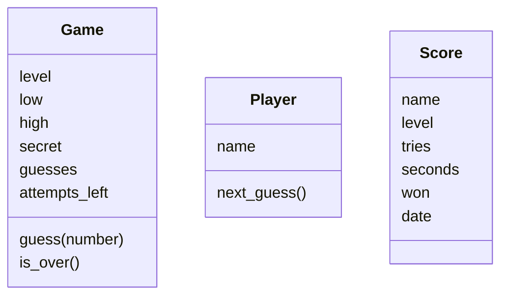

# Lab 9.1 – Lösung: Das Spiel als Modell

Es gibt mehr als ein gutes Modell. Die Lösung unten ist das Modell, das der Kurs in den nächsten Labs programmiert; abweichende Namen sind in Ordnung, solange „weiß“ und „kann“ sauber getrennt sind.

## Aufgabe 1: Substantive und Verben

1. Eine **Spielerin** _gibt_ ihren **Namen** _ein_ und _wählt_ eine **Stufe**.
2. Das **Spiel** _zieht_ passend zur **Stufe** eine **Geheimzahl** aus einem **Bereich** und _erlaubt_ eine feste Zahl von **Versuchen**.
3. Die **Spielerin** _gibt_ **Tipps** _ab_. Das **Spiel** _prüft_ jeden **Tipp**, _merkt sich_ die bisherigen **Tipps** und _meldet_ „zu hoch“, „zu niedrig“ oder „richtig“.
4. Das **Spiel** _ist vorbei_, wenn die **Zahl** _getroffen_ ist oder keine **Versuche** mehr übrig sind.
5. Am Ende _entsteht_ ein **Ergebnis** mit **Name**, **Stufe**, **Versuchen**, **Dauer**, gewonnen ja/nein und **Datum**. Gewonnene **Ergebnisse** _kommen_ in die **Bestenliste**, _sortiert_ nach den wenigsten **Versuchen**.

## Aufgabe 2: Drei Dinge

- **Spiel** (`Game`): viele Werte, die sich während einer Runde ändern, und Regeln dazu.
- **Spieler** (`Player`): hat einen Namen und liefert Tipps; später auch ein Computer, der selbst rät.
- **Ergebnis** (`Score`): bündelt sechs Werte einer Runde und wird ausgegeben und mit anderen verglichen.

Kein eigenes Ding: **Tipp**, **Stufe**, **Geheimzahl**, **Datum** sind einzelne Werte ohne eigenes Verhalten, also Attribute. Die **Bestenliste** (`Scoreboard`) ist ein guter vierter Kandidat: Sie weiß alle Ergebnisse und kann laden, speichern, sortieren.

## Aufgabe 3: Tabelle

| Ding (Klasse) | weiß (Attribute) | kann (Methoden) |
| --- | --- | --- |
| `Game` | Stufe, Bereich (`low`, `high`), Geheimzahl, bisherige Tipps, verbleibende Versuche | `guess(number)` (Tipp prüfen, Hinweis liefern), `is_over()` |
| `Player` | Name | nächsten Tipp liefern |
| `Score` | Name, Stufe, Versuche, Dauer, gewonnen, Datum | sich ausgeben, sich mit einem anderen Ergebnis vergleichen |
| `Scoreboard` (optional) | alle Ergebnisse, Dateiname | laden, speichern, Ergebnis hinzufügen, beste fünf liefern |

Im Kurs entstehen die Klassen nacheinander: `Game` in Lab 9.2, `Player` in Lab 10.1, `Scoreboard` in Lab 10.3, `Score` in Lab 11.1.

## Aufgabe 4: Funktionen zuordnen

| Funktion aus v2 | gehört zu | Grund |
| --- | --- | --- |
| `draw_secret` | `Game` | das Spiel zieht seine Geheimzahl beim Start |
| `check_guess` | `Game` | Regel des Spiels (Tipp im Bereich?); `guess()` nutzt sie |
| `is_guess_correct` | `Game` | wird Teil von `guess(number)` |
| `is_game_over` | `Game` | wird `is_over()`; das Spiel kennt Versuche und Treffer selbst |
| `ask_number` | `Player` (über die Ein-/Ausgabe) | ein Spieler liefert den nächsten Tipp; die Eingabe selbst bleibt in `ui.py` |
| `show_hint` | Ein-/Ausgabe | nur Anzeige; das Spiel liefert den Hinweis als Text |
| `top_five` | `Scoreboard` | sortiert alle Ergebnisse |

## Aufgabe 5: Klassendiagramm

Der Name gehört zum **Spieler**: Er bleibt über alle Runden gleich, während jede Runde ein neues Spiel ist. Solange es noch keine Klasse `Player` gibt, merkt sich `Game` in Lab 9.2 den Namen selbst; ab Lab 10.3 fragt das Spiel seinen Spieler.

## Erweiterung

| Ding (Klasse) | weiß (Attribute) | kann (Methoden) |
| --- | --- | --- |
| `Member` | Name, Ausweisnummer, ausgeliehene Bücher | ausleihen, zurückgeben |
| `Book` | Titel, Autor, ausgeliehen ja/nein | ausleihen lassen, zurücknehmen |
| `Loan` (Ausleihe) | Mitglied, Buch, Rückgabedatum | prüfen, ob verspätet |

Die Bibliothek selbst kann eine vierte Klasse sein (weiß alle Bücher und Ausleihen, kann mahnen).
