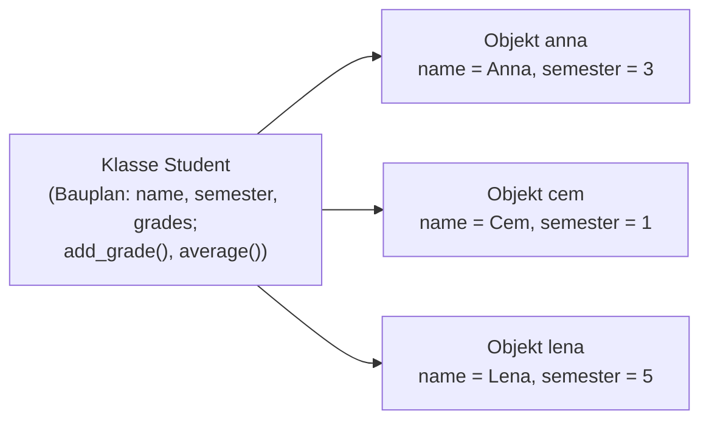
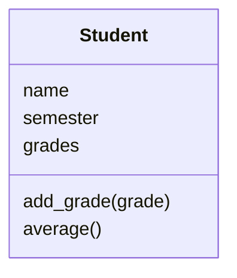

# Lab 9.1: Warum Objekte?

**Leitfragen:**

<details>
<summary>Welche Informationen gehören zu einem Spieler, welche zu einem Spiel?</summary>

Zum Spieler gehört, was über eine Runde hinaus gleich bleibt, vor allem der Name. Zum Spiel gehört, was jede Runde neu entsteht: Stufe, Bereich, Geheimzahl, Tipps, verbleibende Versuche.

</details>

<details>
<summary>Woher „weiß“ <code>"anna".upper()</code>, was zu tun ist?</summary>

Der String `"anna"` ist ein Objekt der Klasse `str`. Die Klasse legt fest, welche Methoden jeder String mitbringt; `upper()` ist eine davon und arbeitet mit genau diesem Text.

</details>

<details>
<summary>Was ist der Unterschied zwischen dem Plan eines Autos und dem Auto vor der Tür?</summary>

Mit dem Plan lässt sich nicht fahren; er beschreibt nur, was jedes Auto hat und kann. Nach einem Plan entstehen viele Autos, jedes mit eigener Farbe und eigenem Kilometerstand. Plan = Klasse, Auto = Objekt.

</details>

- Bis Tag 2 sind Daten (Variablen, Listen, Dictionaries) und Verhalten (Funktionen) getrennt. Jede Funktion bekommt die Daten, die sie braucht, als Parameter.
- Objektorientierung bündelt beides: Ein **Objekt** trägt seine Daten und die passenden Funktionen mit sich. Die **Klasse** ist der Bauplan dafür.

## Begriffe

| Begriff | Bedeutung |
| --- | --- |
| Objektorientierte Programmierung (OOP) | Programme aus Objekten aufbauen, die Daten und Verhalten zusammenhalten |
| Klasse | Bauplan: legt fest, was jedes Objekt dieser Art weiß und kann; wie die Ausstechform für Plätzchen |
| Objekt (Instanz, Exemplar) | ein nach dem Bauplan gebautes Ding mit eigenen Werten; wie ein einzelnes Plätzchen |
| Attribut | Wert, den ein Objekt sich merkt („weiß“), z. B. Name oder Kontostand |
| Methode | Funktion, die zu einem Objekt gehört („kann“), Aufruf mit Punkt: `name.upper()` (aus Lab 2.4) |
| prozedural | Programmierstil mit Daten und getrennten Funktionen, wie bisher im Kurs |
| Klassendiagramm (UML) | Zeichnung einer Klasse als Kasten: Name, Attribute, Methoden; UML ist die übliche Zeichensprache dafür |

## Das Problem: dieselben Werte wandern überall hin

Im Spiel v2 hält `play_round` eine Runde in vielen einzelnen Variablen fest, und jede Hilfsfunktion bekommt ihren Teil davon als Parameter (Auszug aus `examples/m08-files/l03-csv/guess_game/ui.py`):

```python
    low, high, max_tries = logic.LEVELS[level]
    secret = logic.draw_secret(low, high)
    tries = 0
    guesses = []
    tried = set()
    won = False
    # ...
    while not logic.is_game_over(tries, max_tries):
        # ...
            logic.check_guess(guess, low, high)
        # ...
        if logic.is_guess_correct(guess, secret):
```

- Zehn Variablen (mit `started` und `start` für die Zeitmessung) beschreiben **ein** Spiel, aber nichts im Code sagt, dass sie zusammengehören.
- Jede neue Regel braucht wieder `secret`, `tries` oder `low`/`high` als Parameter.
- Zwei Spiele gleichzeitig (Anna und Cem) hießen: alle zehn Variablen doppelt, `secret_anna`, `secret_cem` …

Die Lösung: ein Ding „Spiel“, das seine Werte selbst kennt und gefragt wird: „Ist dieser Tipp richtig?“, „Ist die Runde vorbei?“.

## Objektorientierung auf einen Blick

**Bild:** Ein Architekt zeichnet einen Bauplan für ein Reihenhaus. Nach diesem einen Plan entstehen zehn Häuser. Alle haben Türen, Fenster und eine Klingel, aber jedes hat eigene Bewohner und eine eigene Hausnummer. Der Plan ist die **Klasse**, jedes Haus ein **Objekt**.



**Definition:** Ein Objekt fasst **Attribute** (was es weiß) und **Methoden** (was es kann) zusammen. Die Klasse beschreibt beides einmal; jedes Objekt hat eigene Attributwerte und teilt die Methoden mit allen Objekten derselben Klasse.

**Geschichte:**

| Jahr | Ereignis |
| --- | --- |
| 1967 | **Simula 67** (Ole-Johan Dahl, Kristen Nygaard, Norwegian Computing Center, Oslo) führt Klassen, Objekte und Vererbung (Lab 10.1) ein; gedacht für Simulationen |
| 1972–1980 | **Smalltalk** bei Xerox PARC (Team um Alan Kay): alles ist ein Objekt, Objekte schicken sich Nachrichten; Smalltalk-80 ist die erste öffentlich verfügbare Version |
| 1985 | C++ übernimmt die Klassen aus Simula |
| 1991 | Erste Veröffentlichung von **Python** (Februar 1991), schon mit Klassen |
| 1995 | Java, ebenfalls nach dem Vorbild von Simula; OOP wird Standard in Firmen |
| heute | Python, Java, C#, JavaScript, Kotlin, Swift: viele verbreitete Sprachen haben Klassen |

_Quellen: Wikipedia „Simula“ (https://en.wikipedia.org/wiki/Simula), „Smalltalk“ (https://en.wikipedia.org/wiki/Smalltalk), „History of Python“ (https://en.wikipedia.org/wiki/History_of_Python), abgerufen am 08.11.2026._


_Quelle: Wikimedia Commons, „Smalltalk-76.popup.png“ (https://commons.wikimedia.org/wiki/File:Smalltalk-76.popup.png), SUMIM.ST, CC BY-SA 4.0, abgerufen am 08.11.2026. Schon 1976 war die ganze Oberfläche aus Klassen aufgebaut; links oben die Liste der Klassen._

**Wo Objekte vorkommen:**

| Programm | Ding (Klasse) | weiß (Attribute) | kann (Methoden) |
| --- | --- | --- | --- |
| Banking-App | Konto | Inhaber, Kontostand | einzahlen, abheben |
| Onlineshop | Warenkorb | Artikel, Summe | Artikel hinzufügen, bestellen |
| Spiel | Spielfigur | Position, Leben | laufen, springen |
| Uni-Verwaltung | Student | Name, Semester, Noten | Note eintragen, Schnitt berechnen |

## Alles in Python ist ein Objekt

Seit Lab 2.2 antwortet `type(5)` mit `<class 'int'>`: Das Wort `class` war schon damals wörtlich gemeint. Jede Zahl, jeder String, jede Liste ist ein Objekt einer eingebauten Klasse. Die Python-Dokumentation sagt es so: „All data in a Python program is represented by objects“ (https://docs.python.org/3/reference/datamodel.html, abgerufen am 08.11.2026).

Datei: [code/m09-oop-basics/oop.py](../../project/code/m09-oop-basics/oop.py)

```python
def shout(text):
    """Gibt den Text in Großbuchstaben mit Ausrufezeichen zurück."""
    return text.upper() + "!"


print(shout("hallo"))  # Funktion: die Daten werden von außen übergeben

name = "anna"
print(name.upper())  # Methode: der String bringt sein Verhalten selbst mit

guesses = [5, 8]
guesses.append(10)  # die Liste ändert sich selbst
```

![Terminal: oop.py zeigt für 5, 2.5, anna, eine Liste, ein Dictionary und None jeweils die Klasse, danach HALLO!, ANNA, 2, [5, 8, 10] und <class 'function'>](https://raw.githubusercontent.com/kodschul/kodschul-python-5-open/assets/m09/oop-run.png)

_Quelle: eigener Screenshot, Kurs-Repo, 08.11.2026._

`name.upper()` und `guesses.append(10)` sind Methodenaufrufe, wie seit Lab 2.4 und 4.1 gewohnt. Neu ist ab Lab 9.2 nur: eigene Klassen mit eigenen Methoden schreiben.

## Prozedural oder objektorientiert?

| | prozedural (bis Tag 2) | objektorientiert (ab Lab 9.2) |
| --- | --- | --- |
| Daten | lose Variablen, Dictionaries | Attribute eines Objekts |
| Verhalten | Funktionen, Daten als Parameter | Methoden, kennen ihre Daten selbst |
| Aufruf | `logic.is_game_over(tries, max_tries)` | `game.is_over()` |
| Zwei Spiele | alle Variablen doppelt | zwei Objekte derselben Klasse |
| passt gut für | kurze Skripte, einzelne Rechenschritte | Dinge mit Zustand, der sich ändert |

Beide Stile sind gutes Python. Kleine Skripte bleiben prozedural; sobald mehrere Werte immer zusammen auftreten und Regeln für sie gelten, lohnt sich eine Klasse.

## Klassendiagramm: der Bauplan als Kasten

Ein Klassendiagramm zeigt eine Klasse als Kasten mit drei Fächern: oben der Name, in der Mitte die Attribute, unten die Methoden (mit `()`). So sieht der Bauplan `Student` aus, den Lab 9.2 programmiert:



In echten Projekten zeichnen Teams so ihre Klassen, bevor sie programmieren. Ein Beispiel aus dem Bankwesen mit vier Klassen; Linien mit „has“ zeigen, welches Ding welches andere besitzt:


_Quelle: Wikimedia Commons, „Bank account (UML class diagram).svg“ (https://commons.wikimedia.org/wiki/File:Bank_account_%28UML_class_diagram%29.svg), Frap, CC0, abgerufen am 08.11.2026._

## Im Spiel: Dinge finden

Eine einfache Methode zum Modellieren: den Ablauf in Sätzen beschreiben, dann **Substantive** als Kandidaten für Klassen und Attribute markieren, **Verben** als Kandidaten für Methoden.

> Ein **Spiel** hat eine **Stufe** und denkt sich eine **Geheimzahl** aus. Es **prüft** jeden Tipp …

Ansatz für das erste Ding: **Spiel** weiß Stufe und Geheimzahl, kann einen Tipp prüfen. Den Rest des Modells erarbeitet die Übung.

## Typische Fehler

| Symptom | Ursache | Lösung |
| --- | --- | --- |
| Eine Klasse „Programm“ weiß und kann alles | zu grob modelliert | je Ding aus dem Ablauf eine Klasse |
| Klasse `Tipp` ohne eigenes Verhalten | jedes Substantiv zur Klasse gemacht | einfacher Wert → Attribut (Liste `guesses`) |
| Methode `name` oder Attribut `prüfen` | weiß und kann vertauscht | Werte = Attribute, Tätigkeiten (Verben) = Methoden |
| Klassenname `Spiele` | Plural für den Bauplan | Einzahl: ein Bauplan beschreibt **ein** Ding |

## Fazit

- Eine Klasse ist der Bauplan, ein Objekt das gebaute Exemplar mit eigenen Werten.
- Attribute = was ein Objekt weiß, Methoden = was es kann.
- Python-Werte waren schon immer Objekte: `type(5)` zeigt die Klasse `int`.
- OOP lohnt sich, wenn Werte zusammengehören und ein Zustand sich ändert, wie bei einem Spiel.

In der Übung entsteht das Modell des Zahlenratespiels als Tabelle „Ding | weiß | kann“.
