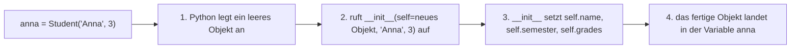
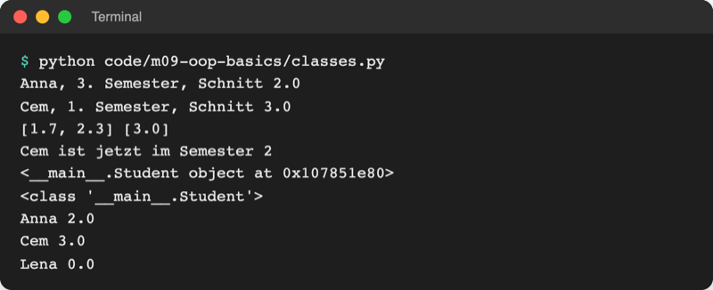
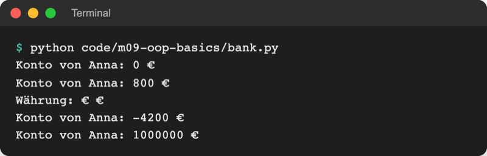
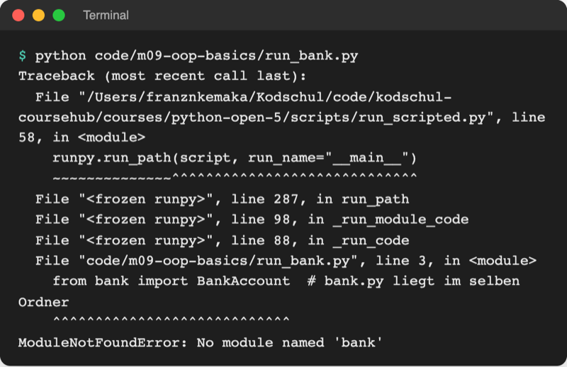

# Lab 9.2: Klassen, `__init__`, self, Methoden

**Leitfragen:**

<details>
<summary>Wie kann ein Programm zwei Spiele gleichzeitig verwalten?</summary>

Mit losen Variablen nur durch doppelte Namen (`secret_anna`, `secret_cem`). Mit einer Klasse entstehen zwei Objekte, `Game("Anna")` und `Game("Cem")`, jedes mit eigener Geheimzahl und eigenen Tipps.

</details>

<details>
<summary>Welche Funktionen von gestern gehören eigentlich zum Spiel selbst?</summary>

Alle, die Spielwerte als Parameter brauchen: `is_guess_correct(guess, secret)` und `is_game_over(tries, max_tries)`. Als Methoden kennt das Spiel `secret` und die Versuche selbst; aus beiden wird `guess()` und `is_over()`.

</details>

<details>
<summary>Woher weiß eine Methode, zu welchem Konto sie gehört?</summary>

Python übergibt das Objekt vor dem Punkt automatisch als ersten Parameter. Bei `anna.deposit(100)` ist dieser Parameter `self` das Konto von Anna.

</details>

- Eine Klasse wird mit `class` geschrieben und beschreibt Attribute und Methoden einmal. Jeder Aufruf der Klasse wie eine Funktion baut ein neues Objekt.
- Drei Bausteine tragen fast jede Klasse: `__init__` (Startwerte setzen), `self` (das aktuelle Objekt) und Methoden (Funktionen im Klassenblock).

## Begriffe

| Begriff | Bedeutung |
| --- | --- |
| `class` | Schlüsselwort: beginnt den Bauplan, z. B. `class Student:`; Klassennamen schreibt man in CamelCase (`BankAccount`) |
| Objekt erzeugen (instanziieren) | Klasse wie eine Funktion aufrufen: `anna = Student("Anna", 3)` |
| `__init__` | besondere Methode, die Python beim Erzeugen automatisch aufruft; setzt die Startwerte (Konstruktor) |
| `self` | erster Parameter jeder Methode: das Objekt, mit dem gerade gearbeitet wird („ich selbst“) |
| Instanzattribut | Wert, der zu einem einzelnen Objekt gehört: `self.name = name` |
| Klassenattribut | Wert im Klassenblock, gilt für alle Objekte gemeinsam: `currency = "€"` |
| Methode | Funktion im Klassenblock mit `self` als erstem Parameter; Aufruf `objekt.methode()` |
| Punkt-Schreibweise | `objekt.attribut` liest oder ändert ein Attribut, `objekt.methode()` ruft eine Methode auf |

## Die erste Klasse

Datei: [code/m09-oop-basics/classes.py](../../project/code/m09-oop-basics/classes.py)

```python
class Student:
    """Bauplan: Jede Studentin, jeder Student hat Namen, Semester und Noten."""

    def __init__(self, name, semester):
        # self = das Objekt, das gerade gebaut wird
        self.name = name  # Instanzattribut: gehört nur zu diesem Objekt
        self.semester = semester
        self.grades = []  # jedes Objekt bekommt seine eigene, leere Liste

    def add_grade(self, grade):
        """Hängt eine Note an die Notenliste dieses Objekts an."""
        self.grades.append(grade)

    def average(self):
        """Gibt den Notendurchschnitt zurück, ohne Noten 0.0."""
        if len(self.grades) == 0:
            return 0.0
        return round(sum(self.grades) / len(self.grades), 2)
```

- Alles, was unter `class Student:` eingerückt ist, gehört zum Bauplan. Die Methoden sind normale `def`-Funktionen (Lab 5.1), nur eine Ebene tiefer eingerückt.
- `self.name = name`: links das Attribut des Objekts, rechts der Parameter. Beide heißen gleich, sind aber zwei verschiedene Dinge.
- Methoden lesen und ändern die Attribute über `self`: `self.grades.append(grade)`.

## Objekte erzeugen: was bei `Student("Anna", 3)` passiert



`__init__` wird nie direkt aufgerufen und gibt nichts zurück; der Aufruf der Klasse liefert das fertige Objekt.

## self: „dieses Objekt“

Eine Methode existiert nur einmal, im Bauplan. Damit sie weiß, **welches** Objekt gemeint ist, setzt Python das Objekt vor dem Punkt als ersten Parameter ein:

| Aufruf im Code | was Python daraus macht | `self` ist | `grade` ist |
| --- | --- | --- | --- |
| `anna.add_grade(1.7)` | `Student.add_grade(anna, 1.7)` | `anna` | `1.7` |
| `cem.add_grade(3.0)` | `Student.add_grade(cem, 3.0)` | `cem` | `3.0` |

- Deshalb hat `add_grade(self, grade)` zwei Parameter, der Aufruf aber nur ein Argument: Das erste trägt Python selbst ein.
- Vergleich: Ein Formular mit „Mein Name: …“ füllt jede Person mit ihrem eigenen Namen aus. `self` ist dieses „mein“.
- `self` ist nur eine Konvention, aber eine feste: Jede Methode bekommt ihn als ersten Parameter, und jedes Attribut im Klassenblock wird mit `self.` angesprochen.

## Attribute lesen, ändern, ausgeben

```python
anna = Student("Anna", 3)  # ruft __init__ auf, self ist das neue Objekt
cem = Student("Cem", 1)

anna.add_grade(1.7)  # Python macht daraus: Student.add_grade(anna, 1.7)
print(anna.grades, cem.grades)  # [1.7] []: jede Liste gehört zu ihrem Objekt
cem.semester = 2  # Attribut von außen ändern
print(anna)  # <__main__.Student object at 0x107851e80>
```



_Quelle: eigener Screenshot, Kurs-Repo, 08.11.2026._

`print(anna)` zeigt ohne weitere Angabe nur Klasse und Speicheradresse (die Hex-Zahl ist bei jedem Start anders). Eine lesbare Ausgabe für eigene Objekte folgt in Lab 11.1.

Die offizielle Python-Einführung erklärt Klassen mit demselben Muster (Stand: 08.11.2026, Python 3.14):

Original: [Python-Dokumentation, Abschnitt 9.3.2 Class Objects: `MyClass` mit Attribut `i` und Methode `f(self)`, Erzeugen mit `x = MyClass()` und `__init__(self)`](https://docs.python.org/3.14/tutorial/classes.html#class-objects), Stand 08.11.2026.

## Beispiel: Bankkonto mit Klassenattribut

Datei: [code/m09-oop-basics/bank.py](../../project/code/m09-oop-basics/bank.py)

```python
class BankAccount:
    """Ein Bankkonto mit Inhaber und Kontostand."""

    currency = "€"  # Klassenattribut: gilt für alle Konten gemeinsam

    def __init__(self, owner):
        self.owner = owner  # Instanzattribute: jedes Konto hat eigene Werte
        self.balance = 0

    def deposit(self, amount):
        """Zahlt einen Betrag auf dieses Konto ein."""
        self.balance += amount

    def withdraw(self, amount):
        """Hebt einen Betrag von diesem Konto ab."""
        self.balance -= amount  # prüft nichts: Konto kann ins Minus gehen

    def show_balance(self):
        """Gibt Inhaber und Kontostand aus."""
        print(f"Konto von {self.owner}: {self.balance} {self.currency}")
```

| | Instanzattribut | Klassenattribut |
| --- | --- | --- |
| steht | in `__init__` mit `self.` | direkt im Klassenblock, ohne `self` |
| gehört | einem Objekt | allen Objekten der Klasse gemeinsam |
| Beispiel | `self.balance = 0` | `currency = "€"` |
| lesen | `account.balance` | `BankAccount.currency` oder `account.currency` |



_Quelle: eigener Screenshot, Kurs-Repo, 08.11.2026._

Die letzten zwei Zeilen zeigen ein Problem: Das Konto geht ins Minus, und jeder Code kann `account.balance = 1000000` setzen. Lab 9.3 schützt den Kontostand.

## Mehrere Objekte und Objekte in Listen

Datei: [code/m09-oop-basics/run_bank.py](../../project/code/m09-oop-basics/run_bank.py) importiert die Klasse aus `bank.py` (Import aus Lab 6.1):

```python
alice = BankAccount("Alice")
bob = BankAccount("Bob")
alice.deposit(1000)
transfer(alice, bob, 200)  # eigene Funktion in run_bank.py bekommt zwei Objekte

accounts = [alice, bob, BankAccount("Cem")]  # Objekte in einer Liste
total = 0
for account in accounts:
    total += account.balance
```



_Quelle: eigener Screenshot, Kurs-Repo, 08.11.2026._

## Im Spiel: die Klasse `Game`

Die Werte einer Runde wandern aus `play_round` in `logic.py` als Attribute eines `Game`-Objekts; `is_guess_correct` und `is_game_over` werden Methoden (Auszug aus `examples/m09-oop-basics/l02-classes/guess_game/logic.py`):

```python
class Game:
    """Ein Spiel: Geheimzahl, verbleibende Versuche und bisherige Tipps."""

    def __init__(self, name, level="leicht"):
        self.name = name
        self.level = level
        self.low, self.high, self.max_tries = LEVELS[level]
        self.secret = draw_secret(self.low, self.high)
        self.attempts_left = self.max_tries
        # ... guesses, won, started, start_time, seconds

    def is_over(self):
        """Gibt True zurück, wenn gewonnen oder alle Versuche verbraucht sind."""
        return self.won or self.attempts_left == 0
```

`guess(number)` prüft den Tipp und gibt nur einen Hinweistext zurück (`"zu hoch"`, `"zu niedrig"`, `"richtig"`, `"schon getippt"`); die Ausgabe bleibt in `ui.py`. Die Schleife in `ui.play_round(game)` fragt nur noch das Objekt:

```python
    while not game.is_over():
        guess = ask_number("Tipp: ")
        try:
            hint = game.guess(guess)  # das Spiel wertet aus
```

Doppelte Tipps erkennt `Game` jetzt mit `number in self.guesses`; die eigene Menge `tried` aus Lab 4.2 entfällt, weil die Liste der Tipps schon alle Zahlen enthält.

## Typische Fehler

| Symptom | Ursache | Lösung |
| --- | --- | --- |
| `TypeError: Student.add_grade() takes 1 positional argument but 2 were given` | `self` in der Methode vergessen | `def add_grade(self, grade):` |
| `NameError: name 'name' is not defined` in einer Methode | Attribut ohne `self.` angesprochen | `self.name` statt `name` |
| `AttributeError: 'Student' object has no attribute 'grades'` | Attribut in `__init__` nie mit `self.` angelegt (nur `grades = []`) | `self.grades = []` |
| `TypeError: Student() takes no arguments` | `__init__` falsch geschrieben, z. B. `__init` oder `_init_` | je zwei Unterstriche vor und nach `init` |
| `TypeError: Student.__init__() missing 1 required positional argument: 'semester'` | beim Erzeugen ein Argument vergessen | `Student("Anna", 3)` |
| `<__main__.Student object at 0x…>` statt Inhalt | Objekt direkt mit `print` ausgegeben | Attribute ausgeben: `print(anna.name)` |

## Fazit

- `class Name:` schreibt den Bauplan, `Name(...)` baut ein Objekt und ruft dabei `__init__` auf.
- `self` ist das Objekt vor dem Punkt; jede Methode bekommt es als ersten Parameter, jedes eigene Attribut heißt `self.attribut`.
- Instanzattribute gehören einem Objekt, Klassenattribute allen; Objekte lassen sich in Listen sammeln und an Funktionen übergeben.

In der Übung läuft das eigene Spiel über ein `Game`-Objekt.
