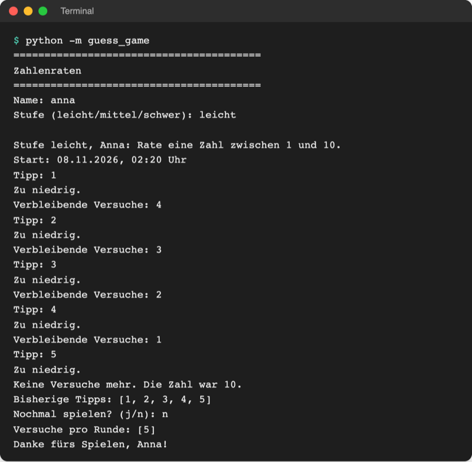

# Lab 9.3 – Lösung: Geheimzahl schützen

Fertiger Stand: [project/examples/m09-oop-basics/l03-encapsulation/guess_game/](../../project/examples/m09-oop-basics/l03-encapsulation/guess_game/) (geändert: `logic.py`, `ui.py`). Test im Ordner `project/`: `cd examples/m09-oop-basics/l03-encapsulation`, dann `python -m guess_game`.

## Aufgabe 1: `_max_tries` und `__secret`

```python
    def __init__(self, name, level="leicht"):
        self.name = name
        self.level = level
        self.low, self.high, self._max_tries = LEVELS[level]
        self.__secret = draw_secret(self.low, self.high)  # privat: nur in Game
        self.guesses = []
        self.started = datetime.now()  # Datum und Uhrzeit des Starts
        self.start_time = time.perf_counter()  # Stoppuhr starten
        self.seconds = 0.0
```

In `guess()` heißt der Vergleich jetzt `if number > self.__secret:`. Innerhalb der Klasse funktioniert `self.__secret` ganz normal; nur von außen ist der Name versteckt. `_max_tries` braucht kein Versteck: Der Unterstrich sagt „intern“, gelesen wird der Wert von außen über `attempts_left`.

## Aufgabe 2: Properties statt gespeicherter Werte

```python
    @property
    def attempts_left(self):
        """Verbleibende Versuche, nur lesbar und immer aus den Tipps berechnet."""
        return self._max_tries - len(self.guesses)

    @property
    def is_won(self):
        """True, wenn die Geheimzahl unter den Tipps ist."""
        return self.__secret in self.guesses

    def guess(self, number):
        """Wertet einen Tipp aus und gibt den Hinweis als Text zurück."""
        check_guess(number, self.low, self.high)  # löst ValueError aus
        if number in self.guesses:
            return "schon getippt"  # kostet keinen Versuch
        self.guesses.append(number)
        if self.is_over():  # Stoppuhr anhalten
            self.seconds = round(time.perf_counter() - self.start_time, 1)
        if self.is_won:
            return "richtig"
        if number > self.__secret:
            return "zu hoch"
        return "zu niedrig"

    def is_over(self):
        """Gibt True zurück, wenn gewonnen oder alle Versuche verbraucht sind."""
        return self.is_won or self.attempts_left == 0
```

`guess()` ist kürzer geworden: `self.attempts_left -= 1` und `self.won = True` entfallen, weil beide Werte jetzt aus `guesses` berechnet werden. Es gibt nur noch eine Stelle, die den Spielstand ändert (`self.guesses.append(number)`), und keine zwei Werte, die sich widersprechen können. In `result()` steht `"won": self.is_won`.

## Aufgabe 3: `reveal_secret()`

```python
    def reveal_secret(self):
        """Verrät die Geheimzahl, aber erst, wenn das Spiel vorbei ist."""
        if self.is_over():
            return self.__secret
        return None
```

## Aufgabe 4: `ui.py`

```python
    if game.is_won:
        duration = format_seconds(game.seconds)
        console.print(
            f"Richtig, {game.name}! Benötigte Versuche: {len(game.guesses)}"
            f" · Dauer: {duration} s",
            style="green",
        )
    else:
        print(f"Keine Versuche mehr. Die Zahl war {game.reveal_secret()}.")
```

`game.is_won` ohne Klammern (Property), `game.reveal_secret()` mit Klammern (Methode). `game.attempts_left` in der Schleife bleibt wörtlich gleich, obwohl es jetzt eine Property ist: Genau das ist der Vorteil von Properties.

## Aufgabe 5: Testen

Verlorene Runde (Eingaben `anna leicht 1 2 3 4 5 n`): `reveal_secret()` liefert die Zahl, weil das Spiel vorbei ist.



_Quelle: eigener Screenshot, Kurs-Repo, 08.11.2026._

Python-Konsole im Ordner `playground/` (die Geheimzahl ist zufällig):


_Quelle: eigener Screenshot, Kurs-Repo, 08.11.2026._

- `game.attempts_left = 99` scheitert: Property ohne Setter (Leitfrage 1 gelöst).
- `game.__secret` scheitert, `game._Game__secret` zeigt die Zahl: Schummeln geht nur mit Absicht.
- `game.__secret = 99` legt ein neues Attribut an; die echte Geheimzahl bleibt.

## Erweiterung

```python
# Studierende mit gekapselten Noten: nur gültige Noten, Schnitt nur lesbar


class Student:
    """Bauplan: Jede Studentin, jeder Student hat Namen, Semester und Noten."""

    def __init__(self, name, semester):
        self.name = name
        self.semester = semester
        self.__grades = []  # privat: nur add_grade ändert die Liste

    def add_grade(self, grade):
        """Hängt eine Note an; Noten außerhalb von 1.0 bis 5.0 lösen ValueError aus."""
        if grade < 1.0 or grade > 5.0:
            raise ValueError(f"Ungültige Note: {grade}. Erlaubt sind 1.0 bis 5.0.")
        self.__grades.append(grade)

    @property
    def average(self):
        """Notendurchschnitt, nur lesbar; ohne Noten 0.0."""
        if len(self.__grades) == 0:
            return 0.0
        return round(sum(self.__grades) / len(self.__grades), 2)

    def describe(self):
        """Gibt einen Satz über dieses Objekt aus."""
        print(f"{self.name}, {self.semester}. Semester, Schnitt {self.average}")


anna = Student("Anna", 3)
anna.add_grade(1.7)
anna.add_grade(2.3)

try:
    anna.add_grade(6.0)
except ValueError as error:
    print("ValueError:", error)

anna.describe()
print("Schnitt:", anna.average)  # Property: ohne Klammern

try:
    anna.average = 1.0
except AttributeError as error:
    print("AttributeError:", error)
```

```text
ValueError: Ungültige Note: 6.0. Erlaubt sind 1.0 bis 5.0.
Anna, 3. Semester, Schnitt 2.0
Schnitt: 2.0
AttributeError: property 'average' of 'Student' object has no setter
```

Aus `self.average()` in `describe()` wird `self.average` ohne Klammern; sonst endet der Aufruf mit `TypeError: 'float' object is not callable`. Die Zeilen am Ende der Originaldatei, die `anna.grades` oder `student.average()` nutzen, entfallen oder werden entsprechend angepasst.
