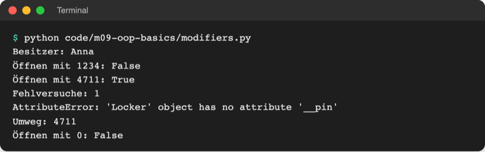
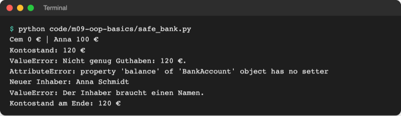

# Lab 9.3: Kapselung und Properties

**Leitfragen:**

<details>
<summary>Was passiert, wenn irgendein Code <code>game.attempts_left = 99</code> setzt?</summary>

Im Stand von Lab 9.2 nimmt Python das ohne Murren an: Die Runde hat plötzlich 99 Versuche. Nichts im Objekt prüft, ob der Wert zu den Regeln passt.

</details>

<details>
<summary>Warum zeigt ein Geldautomat den Kontostand, lässt ihn aber nicht direkt ändern?</summary>

Der Kontostand darf sich nur über geprüfte Wege ändern: einzahlen, abheben, überweisen. Jeder Weg prüft Regeln (Deckung, Betrag größer 0). Lesen ist harmlos, direktes Schreiben nicht.

</details>

<details>
<summary>Wie verhindert man Schummeln, ohne Python abzuschließen?</summary>

Python kennt kein echtes „verboten“. Es gibt Namenskonventionen (`_intern`), eine Namensverschleierung (`__privat`) und Properties, die nur lesen lassen. Wer bewusst schummeln will, kann es; versehentliche Fehler fallen sofort auf.

</details>

- **Kapselung** heißt: Ein Objekt verwaltet seine Daten selbst. Von außen gibt es nur die Wege, die die Klasse anbietet; die Regeln stehen an einer Stelle.
- Python setzt das mit Namenskonventionen und **Properties** um: Methoden, die sich lesen wie ein Attribut.

## Begriffe

| Begriff | Bedeutung |
| --- | --- |
| Kapselung | Daten und Regeln im Objekt halten; von außen nur über Methoden ändern, wie beim Geldautomaten |
| öffentlich | normaler Name (`owner`): jeder Code darf lesen und ändern |
| `_intern` | ein Unterstrich: Abmachung „nur innerhalb der Klasse benutzen“; Python prüft das nicht |
| `__privat` | zwei Unterstriche: Python benennt das Attribut intern um (Namensverschleierung, englisch name mangling) |
| Getter / Setter | Methoden, die einen Wert lesen (`get_balance()`) bzw. geprüft setzen (`set_balance(x)`) |
| Property | Methode, die sich von außen wie ein Attribut liest: `account.balance` ohne `()` |
| `@property` | Markierung über einer Methode, die sie zur Property macht; diese `@`-Schreibweise heißt Decorator |
| schreibgeschützt (read-only) | Property ohne Setter: lesen ja, zuweisen nein |
| Methodenüberladung | in anderen Sprachen: mehrere Methoden gleichen Namens mit verschiedenen Parametern; in Python stattdessen Standardwerte |

## Das Problem: jeder darf alles

Das Konto aus Lab 9.2 (`bank.py`) prüft nichts: `account.withdraw(5000)` macht den Kontostand negativ, `account.balance = 1000000` ändert ihn direkt. Im Spiel könnte jeder Code `game.secret` lesen oder `game.attempts_left = 99` setzen.

Viele Sprachen (Java, C#, C++) sperren solche Zugriffe mit Schlüsselwörtern. Im Klassendiagramm stehen dafür Zeichen vor jedem Namen: `+` öffentlich, `#` geschützt, `-` privat:


_Quelle: Wikimedia Commons, „UML class diagram with access modifiers.svg“ (https://commons.wikimedia.org/wiki/File:UML_class_diagram_with_access_modifiers.svg), Frap, CC0, abgerufen am 08.11.2026._

## Python: Konventionen statt Schlösser

| Schreibweise | Bedeutung | von außen |
| --- | --- | --- |
| `self.owner` | öffentlich | lesen und ändern erlaubt |
| `self._failed_tries` | intern (Konvention) | technisch möglich, aber „Finger weg“ |
| `self.__pin` | privat (Namensverschleierung) | unter `__pin` nicht erreichbar; Python speichert es als `_Locker__pin` |

Datei: [code/m09-oop-basics/modifiers.py](../../project/code/m09-oop-basics/modifiers.py)

```python
class Locker:
    """Ein Schließfach mit Besitzer, Fehlversuchen und geheimer PIN."""

    def __init__(self, owner, pin):
        self.owner = owner  # öffentlich: darf jeder lesen und ändern
        self._failed_tries = 0  # _intern: „bitte nicht von außen anfassen“
        self.__pin = pin  # __privat: Python versteckt den Namen

    def open(self, pin):
        """Gibt True zurück, wenn die PIN stimmt; zählt Fehlversuche mit."""
        if pin == self.__pin:  # innerhalb der Klasse ganz normal nutzbar
            self._failed_tries = 0
            return True
        self._failed_tries += 1
        return False
```



_Quelle: eigener Screenshot, Kurs-Repo, 08.11.2026._

- `locker.__pin` von außen ergibt `AttributeError`; innerhalb der Klasse heißt es ganz normal `self.__pin`.
- `locker.__pin = 0` von außen legt nur ein **neues** Attribut an; die echte PIN bleibt unverändert.
- Der Umweg `locker._Locker__pin` funktioniert: Namensverschleierung schützt vor Versehen, nicht vor Absicht.

Die Python-Dokumentation sagt es deutlich: „Private“ Variablen, die von außen gar nicht erreichbar sind, gibt es in Python nicht (Stand: 08.11.2026, Python 3.14):

Original: [Python-Dokumentation, Abschnitt 9.6 Private Variables: Konvention mit einem Unterstrich, name mangling für Namen mit zwei Unterstrichen, Ersetzung durch _classname__spam](https://docs.python.org/3.14/tutorial/classes.html#private-variables), Stand 08.11.2026.

## Getter und Setter: der umständliche Weg

In Java üblich: Attribut privat, dazu je eine Methode zum Lesen und zum Setzen mit Prüfung.

```python
    def get_balance(self):
        return self.__balance

    def set_balance(self, amount):
        if amount < 0:
            raise ValueError("Der Kontostand darf nicht negativ sein.")
        self.__balance = amount
```

Das funktioniert, aber jeder Aufruf wird länger (`account.get_balance()` statt `account.balance`), und vorhandener Code mit `account.balance` müsste umgeschrieben werden.

## `@property`: lesen wie ein Attribut, geschützt wie eine Methode

Datei: [code/m09-oop-basics/safe_bank.py](../../project/code/m09-oop-basics/safe_bank.py)

```python
class BankAccount:
    """Ein Bankkonto, dessen Kontostand nie unter 0 fällt."""

    def __init__(self, owner, balance=0):  # Standardwert statt Überladung
        self.owner = owner  # nutzt schon den Setter unten (prüft den Namen)
        self.__balance = balance  # privat: nur die Methoden ändern ihn

    @property
    def balance(self):
        """Kontostand: lesbar wie ein Attribut, aber ohne Setter nicht änderbar."""
        return self.__balance

    @property
    def owner(self):
        """Inhaber des Kontos."""
        return self.__owner

    @owner.setter
    def owner(self, name):
        """Prüft den neuen Namen, bevor er gespeichert wird."""
        if name.strip() == "":
            raise ValueError("Der Inhaber braucht einen Namen.")
        self.__owner = name.strip()

    def withdraw(self, amount):
        """Hebt ab; ein negativer Kontostand löst ValueError aus."""
        if amount > self.__balance:
            raise ValueError(f"Nicht genug Guthaben: {self.__balance} €.")
        self.__balance -= amount
```

- **Schreibweise:** `@property` steht direkt über `def`. Das `@` markiert die Methode als Property; wie diese Decorator-Schreibweise im Inneren funktioniert, zeigt Lab 13.1.
- **Nur lesbar:** `balance` hat nur `@property`. `account.balance` liefert den Wert (ohne `()`), `account.balance = 1000000` löst `AttributeError: property 'balance' of 'BankAccount' object has no setter` aus.
- **Setter mit Prüfung:** `@owner.setter` über einer zweiten Methode gleichen Namens. Jede Zuweisung `account.owner = "…"` läuft durch diese Methode, auch die in `__init__`.
- **Regeln in Methoden:** `withdraw` löst `ValueError` aus (`raise` aus Lab 7.3), statt ins Minus zu gehen. Der Kontostand ändert sich nur über `deposit` und `withdraw`.



_Quelle: eigener Screenshot, Kurs-Repo, 08.11.2026._

## Überladung? Standardwerte!

In Java oder C# kann eine Klasse zwei Konstruktoren haben: einen mit Inhaber, einen mit Inhaber und Startguthaben. In Python ersetzt ein zweites `def __init__` einfach das erste. Stattdessen bekommt ein Parameter einen Standardwert (Lab 5.2):

```python
empty = BankAccount("Cem")  # balance = 0 (Standardwert)
account = BankAccount("Anna", 100)  # balance = 100
```

## Im Spiel: Geheimzahl privat, Versuche als Property

Auszug aus `examples/m09-oop-basics/l03-encapsulation/guess_game/logic.py`:

```python
        self.low, self.high, self._max_tries = LEVELS[level]
        self.__secret = draw_secret(self.low, self.high)  # privat: nur in Game
```

```python
    @property
    def attempts_left(self):
        """Verbleibende Versuche, nur lesbar und immer aus den Tipps berechnet."""
        return self._max_tries - len(self.guesses)

    @property
    def is_won(self):
        """True, wenn die Geheimzahl unter den Tipps ist."""
        return self.__secret in self.guesses
```

- `attempts_left` und `is_won` sind keine gespeicherten Werte mehr, sondern werden bei jedem Lesen aus `guesses` berechnet. Sie können nie falsch sein, und `game.attempts_left = 99` scheitert.
- `reveal_secret()` gibt die Geheimzahl nur zurück, wenn das Spiel vorbei ist; `ui.py` nutzt sie für „Die Zahl war …“.
- `is_won` ist eine Property (`game.is_won`, ohne `()`), `is_over()` bleibt eine Methode (`game.is_over()`, mit `()`). Faustregel: Ein Zustand, der sich wie ein Wert liest, wird Property; eine Frage oder Tätigkeit bleibt Methode. Beides ist erlaubt; wichtig ist, beim Aufruf die richtige Form zu treffen.

## Typische Fehler

| Symptom | Ursache | Lösung |
| --- | --- | --- |
| `TypeError: 'int' object is not callable` | Property mit `()` aufgerufen: `account.balance()` | ohne Klammern: `account.balance` |
| `AttributeError: property 'balance' of 'BankAccount' object has no setter` | Zuweisung an eine nur lesbare Property | Wert über eine Methode ändern (`deposit`) |
| `RecursionError: maximum recursion depth exceeded` | in der Property `return self.balance` statt `return self.__balance` | intern den privaten Namen verwenden |
| `AttributeError: 'Game' object has no attribute '__secret'` | privates Attribut von außen gelesen | Methode anbieten (`reveal_secret()`) |
| Zuweisung `obj.__pin = 0` „wirkt nicht“ | legt von außen ein neues Attribut an | Wert über eine Methode der Klasse ändern |

## Fazit

- `_name` heißt „intern“, `__name` wird verschleiert; beides schützt vor Versehen, nicht vor Absicht.
- `@property` macht eine Methode lesbar wie ein Attribut; ohne Setter ist sie schreibgeschützt, ein Setter prüft jede Zuweisung.
- Regeln gehören in die Klasse: Verstöße lösen `ValueError` aus. Statt Überladung gibt es Standardwerte.

In der Übung wird die Geheimzahl des eigenen Spiels privat, Versuche und Gewinn werden Properties.
