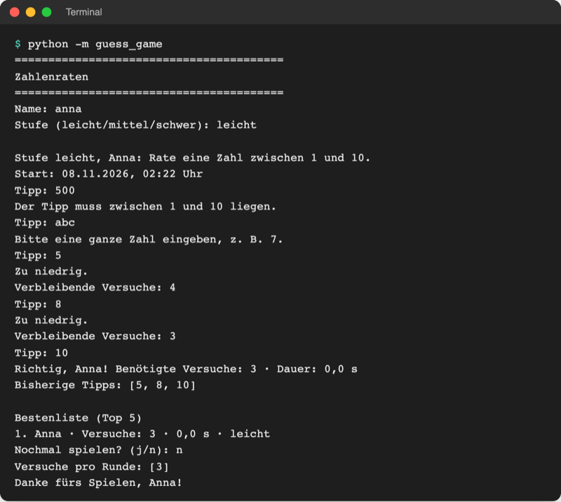
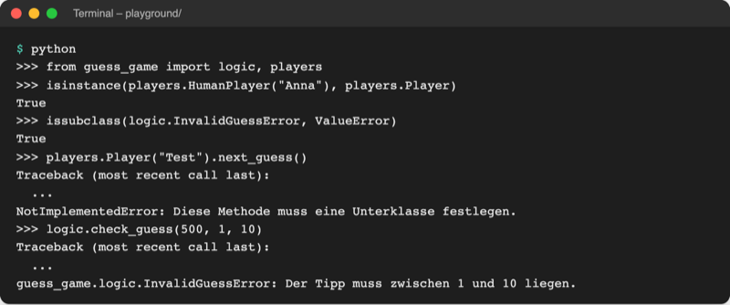

# Lab 10.1 – Lösung: Vererbung

Fertiger Stand: [project/examples/m10-class-relations/l01-inheritance/guess_game/](../../project/examples/m10-class-relations/l01-inheritance/guess_game/). Test im Ordner `project/`: `cd examples/m10-class-relations/l01-inheritance`, dann `python -m guess_game`.

## Aufgabe 1: InvalidGuessError in logic.py

```python
class InvalidGuessError(ValueError):
    """Spielfehler: Der Tipp verletzt eine Regel, z. B. außerhalb des Bereichs."""


def check_guess(guess, low, high):
    """Löst InvalidGuessError aus, wenn der Tipp nicht zwischen low und high liegt."""
    if guess < low or guess > high:
        raise InvalidGuessError(f"Der Tipp muss zwischen {low} und {high} liegen.")
```

Die Klasse braucht keinen eigenen Code: Meldung und Traceback erbt sie von `ValueError`. Im Kommentar von `Game.guess` steht jetzt `# löst InvalidGuessError aus`.

## Aufgabe 2: players.py mit Player

```python
# Spieler: wer den nächsten Tipp liefert

from guess_game import ui


class Player:
    """Basisklasse für alle Spieler: hat einen Namen und liefert Tipps."""

    def __init__(self, name):
        self.name = name

    def next_guess(self):
        """Gibt den nächsten Tipp zurück; jede Unterklasse legt fest, wie."""
        raise NotImplementedError("Diese Methode muss eine Unterklasse festlegen.")
```

`players.py` importiert `ui`, `ui` importiert `players` nicht: So entsteht kein Kreis-Import.

## Aufgabe 3: HumanPlayer

```python
class HumanPlayer(Player):
    """Ein Mensch, der seine Tipps im Terminal eingibt."""

    def next_guess(self):
        """Fragt den Tipp per input ab (überschreibt Player.next_guess)."""
        return ui.ask_number("Tipp: ")
```

`HumanPlayer("Anna")` nutzt das geerbte `__init__` von `Player` und hat damit `name`.

## Aufgabe 4: play_round(game, player)

```python
def play_round(game, player):
    """Spielt eine Runde: player tippt, game wertet aus; gibt das Ergebnis zurück."""
    print(
        f"\nStufe {game.level}, {game.name}: "
        f"Rate eine Zahl zwischen {game.low} und {game.high}."
    )
    print(f"Start: {game.started.strftime('%d.%m.%Y, %H:%M')} Uhr")

    while not game.is_over():
        guess = player.next_guess()  # wer tippt, entscheidet das Spieler-Objekt
        try:
            hint = game.guess(guess)  # das Spiel wertet aus
        except logic.InvalidGuessError as error:  # kein Versuch verbraucht
            print(error)
            continue
        # ... Rest unverändert
```

`ask_number` behält sein `except ValueError`: Dort scheitert `int("abc")`, also ein eingebauter `ValueError`, kein Spielfehler.

## Aufgabe 5: __main__.py und Test

```python
from guess_game import logic, players, storage, ui


def main():
    """Hauptablauf: Name fragen, Runden spielen, bis niemand mehr will."""
    ui.show_banner()
    name = ui.ask_name()
    player = players.HumanPlayer(name)
    all_tries = []
    play_again = "j"
    while play_again == "j":
        level = ui.ask_level()
        game = logic.Game(player.name, level)  # ein neues Spiel-Objekt pro Runde
        result = ui.play_round(game, player)
        # ... Rest unverändert
```



_Quelle: eigener Screenshot, Kurs-Repo, 08.11.2026 (Testlauf mit festem Zufallswert, daher Dauer 0,0 s)._

REPL-Prüfung im Ordner `playground/`:



_Quelle: eigener Screenshot, Kurs-Repo, 08.11.2026._

Im Traceback steht der volle Name `guess_game.logic.InvalidGuessError`: Paket, Modul, Klasse.

## Erweiterung

Ergänzung am Ende von `playground/shapes.py`:

```python
class Square(Rectangle):
    """Quadrat: ein Rechteck mit gleicher Breite und Höhe."""

    def __init__(self, side):
        super().__init__(side, side)  # Rechteck mit zwei gleichen Seiten
        self.name = "Quadrat"  # Namen aus Rectangle überschreiben


square = Square(4)
print(square.describe())
print("Quadrat ist eine Form:", isinstance(square, Shape))
print("Quadrat ist ein Rechteck:", isinstance(square, Rectangle))
```

```text
$ python shapes.py
...
Quadrat: Fläche 16 cm²
Quadrat ist eine Form: True
Quadrat ist ein Rechteck: True
```

`Square` braucht kein eigenes `area()`: Die Fläche von `Rectangle` (Breite · Höhe) stimmt auch für das Quadrat. Die Kette `Square → Rectangle → Shape` zeigt, dass Vererbung über mehrere Stufen geht.
