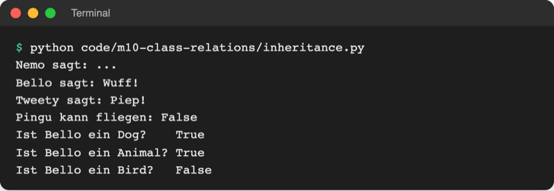
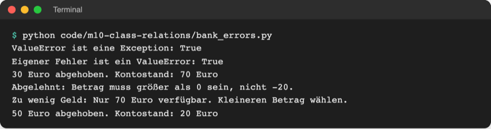
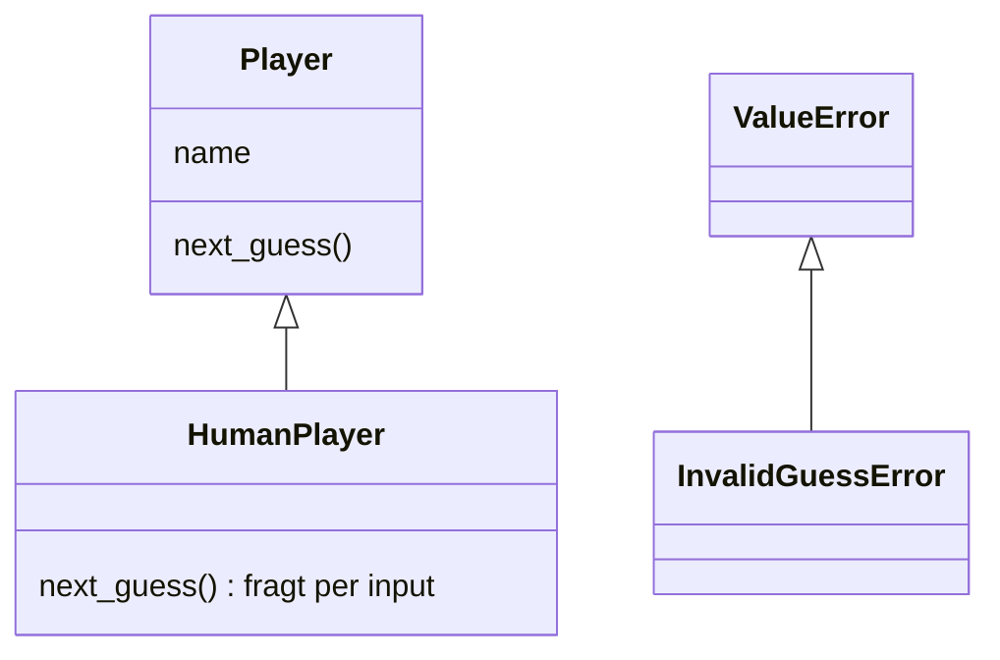

# Lab 10.1: Vererbung

**Leitfragen:**

<details>
<summary>Was haben ein Kreis und ein Rechteck gemeinsam, was nicht?</summary>

Beide sind Formen mit Namen und Fläche. Verschieden ist, was sie beschreibt (Radius bzw. Breite und Höhe) und wie die Fläche entsteht (π · r² bzw. Breite · Höhe). Das Gemeinsame gehört in eine Basisklasse, das Unterschiedliche in die Unterklassen.

</details>

<details>
<summary>Wie würde ein Spieler aussehen, der nicht tippt, sondern selbst rät?</summary>

Er hat wie jeder Spieler einen Namen und liefert den nächsten Tipp, nur holt er ihn nicht per `input`, sondern rechnet ihn aus. Gleiche Frage („nächster Tipp?“), andere Antwort: genau dafür gibt es Unterklassen (Computer-Spieler in Lab 10.2).

</details>

<details>
<summary>Ein Tipp außerhalb des Bereichs ist ein Spielfehler und zugleich ein falscher Wert – welche <code>except</code>-Klausel sollte ihn fangen?</summary>

Am besten eine, die nur Spielfehler fängt: `except InvalidGuessError`. Weil `InvalidGuessError` von `ValueError` erbt, würde auch `except ValueError` ihn fangen, aber zusammen mit allen anderen falschen Werten.

</details>

- Vererbung beschreibt eine „ist ein“-Beziehung: Ein Kreis **ist eine** Form, ein Mensch am Terminal **ist ein** Spieler.
- Die abgeleitete Klasse übernimmt alles von der Basisklasse und ändert nur, was bei ihr anders ist. Code, der für alle gilt, steht so nur einmal im Programm.

## Begriffe

| Begriff | Bedeutung |
| --- | --- |
| Vererbung | Eine Klasse übernimmt Attribute und Methoden einer anderen; wie ein Rezept „Schokokuchen = Rührkuchen + Kakao“ |
| Basisklasse (Oberklasse) | die allgemeine Klasse, von der geerbt wird, z. B. `Shape`, `Player` |
| abgeleitete Klasse (Unterklasse) | die speziellere Klasse, die erbt, z. B. `Circle(Shape)`; der Name der Basisklasse steht in Klammern |
| „ist ein“-Beziehung | Prüffrage für Vererbung: „Ist ein Kreis eine Form?“ Ja → Vererbung passt |
| Methode überschreiben | Die Unterklasse schreibt eine Methode mit demselben Namen neu; ihre Version gewinnt |
| `super()` | „die Basisklasse“: `super().__init__(name)` ruft das `__init__` der Basisklasse auf |
| `isinstance(obj, Klasse)` | `True`, wenn `obj` zu der Klasse oder einer ihrer Unterklassen gehört |
| `issubclass(A, B)` | `True`, wenn Klasse `A` von Klasse `B` erbt (direkt oder über Zwischenstufen) |
| eigene Fehlerklasse | Klasse, die von einer eingebauten Ausnahme erbt, z. B. `class InvalidGuessError(ValueError)` |
| `NotImplementedError` | eingebaute Ausnahme für „diese Methode muss eine Unterklasse erst festlegen“ |

## Die Idee: gemeinsamer Teil oben, Besonderheiten unten


_Quelle: Wikimedia Commons, „KP-UML-Generalization-20060325.svg“ von Karl Pietrzak (https://commons.wikimedia.org/wiki/File:KP-UML-Generalization-20060325.svg), gemeinfrei, abgerufen am 08.11.2026._

So zeichnet man Vererbung in einem Klassendiagramm (UML): Der Pfeil mit hohler Spitze zeigt von der Unterklasse zur Basisklasse. `Student` und `Professor` haben automatisch `name` und `age`, dazu je ein eigenes Attribut.

## Erben, überschreiben, erweitern

Datei: [code/m10-class-relations/inheritance.py](../../project/code/m10-class-relations/inheritance.py)

```python
class Animal:
    def __init__(self, name):
        self.name = name

    def speak(self):
        return "..."

    def introduce(self):
        print(f"{self.name} sagt: {self.speak()}")


class Dog(Animal):          # Dog erbt alles von Animal
    def speak(self):        # überschreibt Animal.speak
        return "Wuff!"


class Bird(Animal):
    def __init__(self, name, can_fly=True):
        super().__init__(name)   # Basisklasse setzt self.name
        self.can_fly = can_fly   # nur Vögel haben dieses Attribut

    def speak(self):
        return "Piep!"
```



_Quelle: eigener Screenshot, Kurs-Repo, 08.11.2026._

| Was die Unterklasse tut | Wie | Beispiel |
| --- | --- | --- |
| erben | nichts schreiben | `Dog` hat `__init__` und `introduce`, ohne sie zu enthalten |
| überschreiben | Methode mit gleichem Namen neu schreiben | `Dog.speak` liefert „Wuff!“ |
| erweitern | eigene Methode schreiben und darin `super().methode(...)` aufrufen | `Bird.__init__` lässt `Animal` den Namen setzen und ergänzt `can_fly` |

- **Suchweg:** Ruft Code `bello.speak()` auf, sucht Python zuerst in `Dog`, dann in `Animal`. Die erste gefundene Methode gewinnt.
- **`introduce` ruft `self.speak()`:** Für Bello ist das `Dog.speak`. Die Basisklasse nutzt so automatisch die Version der Unterklasse.
- **Ohne `super().__init__(name)`** in `Bird` fehlt `self.name`: `AttributeError` beim ersten `introduce()`.

## Basisklasse als Vorgabe: Shape → Circle, Rectangle

Datei: [code/m10-class-relations/shape.py](../../project/code/m10-class-relations/shape.py). `math.pi` kommt aus dem Modul `math` (Lab 6.1).

```python
class Shape:
    def __init__(self, name):
        self.name = name

    def area(self):
        raise NotImplementedError("Diese Methode muss eine Unterklasse festlegen.")

    def describe(self):
        return f"{self.name}: Fläche {round(self.area(), 2)} cm²"


class Circle(Shape):
    def __init__(self, radius):
        super().__init__("Kreis")
        self.radius = radius

    def area(self):
        return math.pi * self.radius**2
```

`Rectangle(width, height)` ist genauso gebaut und liefert `self.width * self.height`. Ausgabe:

```text
Kreis: Fläche 50.27 cm²
Rechteck: Fläche 375 cm²
Kreis ist eine Form: True
Kreis ist ein Rechteck: False
Fehler: Diese Methode muss eine Unterklasse festlegen.
```

- `describe` steht nur einmal in `Shape` und funktioniert für jede Form, weil jede Form ihr eigenes `area()` hat.
- `Shape("Irgendwas").describe()` löst `NotImplementedError` aus: eine eingebaute Ausnahme mit der Bedeutung „noch nicht festgelegt“. Sie erinnert daran, dass jede Unterklasse `area()` selbst schreiben muss (strenger wird das in Lab 11.3).
- `isinstance(circle, Shape)` ist `True`: Ein Objekt einer Unterklasse zählt auch als Objekt der Basisklasse.

## Fehlerklassen sind auch Klassen

Die eingebauten Ausnahmen aus Modul 7 bilden selbst eine Vererbungs-Hierarchie. `ValueError` **ist eine** `Exception`; `except Exception` würde deshalb auch jeden `ValueError` fangen.

Original: [Python-Dokumentation, Abschnitt Exception hierarchy: Baum ab BaseException über Exception zu ArithmeticError, LookupError mit IndexError und KeyError, ValueError und weiteren](https://docs.python.org/3.14/library/exceptions.html#exception-hierarchy), Stand 08.11.2026.

Eine eigene Fehlerklasse erbt von der passenden eingebauten. Der Körper darf nur aus einem Docstring bestehen: Alles andere (Meldung, Traceback) kommt von der Basisklasse.

Datei: [code/m10-class-relations/bank_errors.py](../../project/code/m10-class-relations/bank_errors.py) (Konto-Beispiel aus Lab 7.3)

```python
class InvalidAmountError(ValueError):
    """Der Betrag ist kein gültiger Wert, z. B. 0 oder negativ."""


class InsufficientFundsError(ValueError):
    """Auf dem Konto ist nicht genug Geld."""


try:
    balance = withdraw(balance, amount)
except InsufficientFundsError as error:   # gezielt: eigener Hinweis
    print(f"Zu wenig Geld: {error} Kleineren Betrag wählen.")
except ValueError as error:               # fängt alle übrigen ValueErrors
    print(f"Abgelehnt: {error}")
```



_Quelle: eigener Screenshot, Kurs-Repo, 08.11.2026._

Python prüft die `except`-Klauseln von oben nach unten; die erste passende gewinnt. Die speziellere Klasse steht deshalb **vor** ihrer Basisklasse.

## Im Spiel: Spieler-Klassen und InvalidGuessError

Neue Datei `players.py`: `Player` ist die Basisklasse, `HumanPlayer` holt den Tipp per Eingabe. Die Spielschleife fragt nur noch `player.next_guess()`.



```python
class Player:
    """Basisklasse für alle Spieler: hat einen Namen und liefert Tipps."""

    def __init__(self, name):
        self.name = name

    def next_guess(self):
        """Gibt den nächsten Tipp zurück; jede Unterklasse legt fest, wie."""
        raise NotImplementedError("Diese Methode muss eine Unterklasse festlegen.")
```

`HumanPlayer(Player)` hat kein eigenes `__init__` (es erbt das von `Player`) und überschreibt nur `next_guess`. In `logic.py` ersetzt `InvalidGuessError(ValueError)` den `ValueError` aus Lab 7.3; `ui.play_round` fängt gezielt `except logic.InvalidGuessError`. Die Ausgabe des Spiels bleibt gleich.

## Typische Fehler

| Symptom | Ursache | Lösung |
| --- | --- | --- |
| `AttributeError: 'Bird' object has no attribute 'name'` | eigenes `__init__` in der Unterklasse ohne `super().__init__(...)` | `super().__init__(name)` als erste Zeile |
| `TypeError: Animal.__init__() missing 1 required positional argument: 'name'` | `super().__init__()` ohne das Argument, das die Basisklasse braucht | Argumente wie bei der Basisklasse übergeben |
| `NotImplementedError: Diese Methode muss eine Unterklasse festlegen.` | Objekt der Basisklasse erzeugt oder Methode in der Unterklasse nicht überschrieben (Tippfehler im Namen) | Unterklasse verwenden; Methodennamen prüfen |
| Unterklasse ignoriert die eigene Methode | Name weicht ab, z. B. `next_Guess` statt `next_guess` | exakt gleicher Name wie in der Basisklasse |
| speziellerer `except`-Block läuft nie | `except ValueError` steht vor `except InvalidGuessError` | spezielle Klasse zuerst |
| `NameError: name 'InvalidGuessError' is not defined` in `ui.py` | Klasse liegt in `logic.py` | `logic.InvalidGuessError` schreiben |

## Fazit

- Vererbung = „ist ein“: Die Unterklasse übernimmt alles und ändert nur, was bei ihr anders ist (überschreiben, mit `super()` erweitern).
- `isinstance` zählt Unterklassen mit; Fehlerklassen bilden ebenfalls eine Hierarchie.
- Eigene Fehlerklassen machen Spielfehler gezielt abfangbar.

In der Übung bekommt das eigene Spiel `players.py` mit `Player` und `HumanPlayer` sowie den Spielfehler `InvalidGuessError`.
