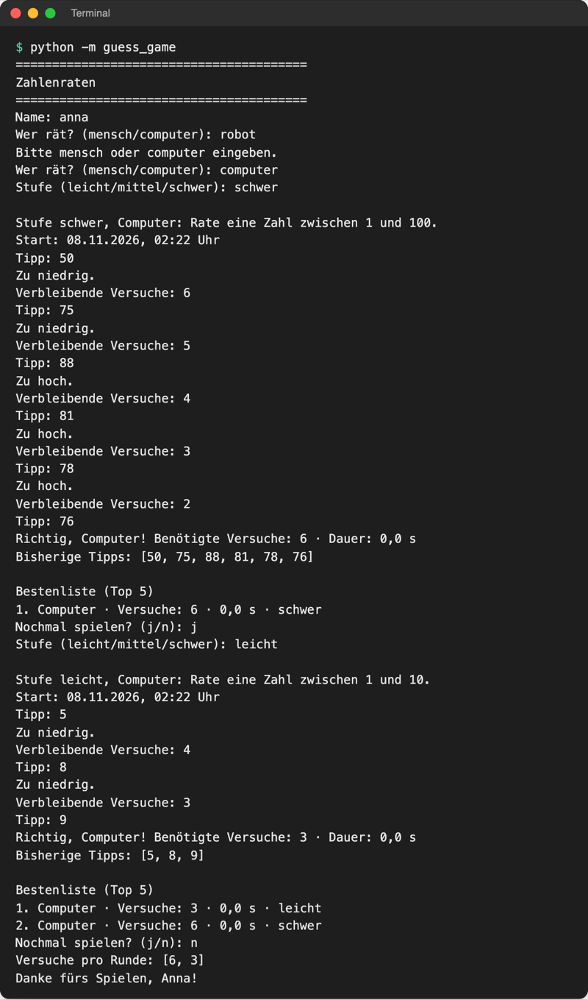

# Lab 10.2 – Lösung: Polymorphie

Fertiger Stand: [project/examples/m10-class-relations/l02-polymorphism/guess_game/](../../project/examples/m10-class-relations/l02-polymorphism/guess_game/). Test im Ordner `project/`: `cd examples/m10-class-relations/l02-polymorphism`, dann `python -m guess_game`.

## Aufgabe 1: Player mit start_round und on_hint

```python
class Player:
    """Basisklasse für alle Spieler: hat einen Namen und liefert Tipps."""

    def __init__(self, name):
        self.name = name
        self.low = 0  # Zahlenbereich der aktuellen Runde, setzt start_round
        self.high = 0

    def start_round(self, low, high):
        """Merkt sich zu Beginn jeder Runde den Zahlenbereich."""
        self.low = low
        self.high = high

    def next_guess(self):
        """Gibt den nächsten Tipp zurück; jede Unterklasse legt fest, wie."""
        raise NotImplementedError("Diese Methode muss eine Unterklasse festlegen.")

    def on_hint(self, guess, hint):
        """Bekommt den Hinweis zum letzten Tipp; Standard: nichts tun."""
        pass
```

`HumanPlayer` erbt `start_round` und `on_hint` und bleibt dadurch unverändert: Ein Mensch liest den Hinweis selbst im Terminal.

## Aufgabe 2: ComputerPlayer mit super() und next_guess

```python
class ComputerPlayer(Player):
    """Der Computer rät per Intervallhalbierung: immer die Mitte des Bereichs."""

    def __init__(self):
        super().__init__("Computer")  # fester Name, Rest erledigt die Basisklasse

    def next_guess(self):
        """Tippt die Mitte des Bereichs und zeigt den Tipp an."""
        guess = (self.low + self.high) // 2
        ui.show_guess(guess)
        return guess
```

`ComputerPlayer()` braucht keinen Namen als Argument; `super().__init__("Computer")` setzt ihn und legt `low`/`high` an.

## Aufgabe 3: on_hint halbiert den Bereich

```python
    def on_hint(self, guess, hint):
        """Halbiert den Bereich: zu hoch -> untere Hälfte, zu niedrig -> obere."""
        # self.low und self.high: Bereich, in dem die Zahl noch liegen kann
        if hint == "zu hoch":
            self.high = guess - 1
        elif hint == "zu niedrig":
            self.low = guess + 1
```

Bei `"richtig"` ist die Runde vorbei, nichts zu tun.

## Aufgabe 4: ui.py

```python
def ask_player_type():
    """Fragt, ob ein Mensch oder der Computer rät, und gibt die Antwort zurück."""
    player_type = input("Wer rät? (mensch/computer): ").strip().lower()
    while player_type not in ["mensch", "computer"]:
        print("Bitte mensch oder computer eingeben.")
        player_type = input("Wer rät? (mensch/computer): ").strip().lower()
    return player_type


def show_guess(guess):
    """Zeigt einen Tipp an, den nicht ein Mensch eingegeben hat."""
    print(f"Tipp: {guess}")
```

In `play_round`:

```python
    player.start_round(game.low, game.high)

    while not game.is_over():
        guess = player.next_guess()  # wer tippt, entscheidet das Spieler-Objekt
        try:
            hint = game.guess(guess)  # das Spiel wertet aus
        except logic.InvalidGuessError as error:  # kein Versuch verbraucht
            print(error)
            continue
        player.on_hint(guess, hint)  # Computer lernt daraus, Mensch liest es
```

## Aufgabe 5: __main__.py und Test

```python
    name = ui.ask_name()
    if ui.ask_player_type() == "computer":
        player = players.ComputerPlayer()
    else:
        player = players.HumanPlayer(name)
```

Dies ist die einzige Stelle, die zwischen Mensch und Computer unterscheidet: beim Erzeugen. Danach behandelt das Programm beide gleich. Der Abschied nennt weiter den eingegebenen Namen.



_Quelle: eigener Screenshot, Kurs-Repo, 08.11.2026 (Testlauf mit festem Zufallswert, daher Dauer 0,0 s)._

Gewinne des Computers landen ebenfalls in `highscores.json` und `history.csv`, mit dem Namen „Computer“.

## Erweiterung

```python
import random

from guess_game import ui

# ... Player, HumanPlayer, ComputerPlayer wie oben


class RandomPlayer(ComputerPlayer):
    """Rät zufällig im verbleibenden Bereich statt in der Mitte."""

    def __init__(self):
        super().__init__()  # ComputerPlayer setzt den Namen "Computer"
        self.name = "Zufall"

    def next_guess(self):
        """Tippt eine zufällige Zahl zwischen low und high."""
        guess = random.randint(self.low, self.high)
        ui.show_guess(guess)
        return guess
```

Testlauf (drei Runden schwer, Auszug):

```text
Stufe schwer, Zufall: Rate eine Zahl zwischen 1 und 100.
Keine Versuche mehr. Die Zahl war 76.
Bisherige Tipps: [70, 75, 87, 85, 83, 81, 80]
Stufe schwer, Zufall: Rate eine Zahl zwischen 1 und 100.
Keine Versuche mehr. Die Zahl war 9.
Bisherige Tipps: [78, 2, 63, 19, 10, 4, 8]
Stufe schwer, Zufall: Rate eine Zahl zwischen 1 und 100.
Richtig, Zufall! Benötigte Versuche: 5 · Dauer: 0,0 s
```

Der Zufall nutzt die Hinweise zwar auch (geerbtes `on_hint`), streicht aber oft nur ein kleines Stück. In einer Simulation mit 10 000 Runden auf schwer verlor er knapp jede zweite; die Intervallhalbierung verliert nie. `RandomPlayer` ändert eine einzige Methode, alles andere kommt aus `ComputerPlayer` und `Player`.
