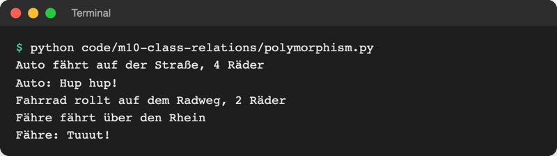
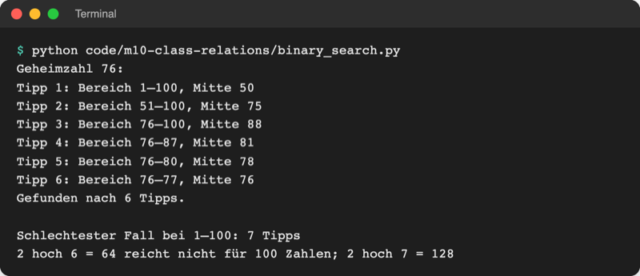

# Lab 10.2: Polymorphie

**Leitfragen:**

<details>
<summary>Wie rät man eine Zahl zwischen 1 und 100 am schnellsten?</summary>

Immer die Mitte des Bereichs tippen, in dem die Zahl noch liegen kann: erst 50, bei „zu niedrig“ dann 75 usw. Jeder Tipp streicht die Hälfte der verbleibenden Zahlen.

</details>

<details>
<summary>Muss die Spielschleife wissen, wer gerade spielt?</summary>

Nein. Sie braucht nur einen nächsten Tipp. Ob ein Mensch ihn eintippt oder der Computer ihn ausrechnet, entscheidet das Spieler-Objekt selbst; die Schleife ruft bei beiden dieselbe Methode `next_guess()` auf.

</details>

<details>
<summary>Warum reichen bei 1–100 immer sieben Versuche?</summary>

Jeder Tipp halbiert den Rest: 100 → 50 → 25 → 12 → 6 → 3 → 1. Nach sechs Halbierungen bleibt höchstens eine Zahl übrig, der siebte Tipp trifft sie. Mit sieben Tipps lassen sich bis zu 2⁷ = 128 Zahlen unterscheiden.

</details>

- Polymorphie (griechisch „Vielgestaltigkeit“): derselbe Methodenaufruf, unterschiedliches Verhalten je nach Objekt. `player.next_guess()` fragt beim Menschen per Eingabe, beim Computer rechnet es.
- Code, der nur Methoden aufruft, funktioniert so mit Klassen, die es beim Schreiben noch gar nicht gab.

## Begriffe

| Begriff | Bedeutung |
| --- | --- |
| Polymorphie | gleicher Aufruf, anderes Verhalten; wie „Bitte starten“ beim Auto (Motor an) und beim Fahrrad (in die Pedale treten) |
| Schnittstelle | die Methoden, die ein Objekt anbietet und auf die sich anderer Code verlässt, z. B. `next_guess()` |
| Duck Typing | Python prüft nicht die Klasse, sondern nur, ob die Methode da ist: „Wenn es watschelt wie eine Ente und quakt wie eine Ente, ist es eine Ente.“ |
| `pass` | Schlüsselwort für einen leeren Block: „hier passiert nichts“; nötig, weil nach `:` mindestens eine Zeile stehen muss |
| Intervallhalbierung (binäre Suche) | Suchstrategie: immer die Mitte eines sortierten Bereichs prüfen und die falsche Hälfte streichen |
| Standardverhalten | Methode der Basisklasse, die eine Unterklasse übernehmen oder überschreiben kann |

## Ein Aufruf, drei Verhaltensweisen

Datei: [code/m10-class-relations/polymorphism.py](../../project/code/m10-class-relations/polymorphism.py)

```python
class Vehicle:
    def __init__(self, name):
        self.name = name

    def move(self):
        return "bewegt sich irgendwie"

    def honk(self):
        """Standard: kein Laut. pass = leerer Block, hier passiert nichts."""
        pass


class Car(Vehicle):
    def move(self):
        return "fährt auf der Straße, 4 Räder"

    def honk(self):
        print(f"{self.name}: Hup hup!")


class Bicycle(Vehicle):          # übernimmt honk() von Vehicle: stumm
    def move(self):
        return "rollt auf dem Radweg, 2 Räder"


def start_trip(vehicle):
    """Kennt nur die Methoden move() und honk(), nicht die Klasse."""
    print(f"{vehicle.name} {vehicle.move()}")
    vehicle.honk()
```



_Quelle: eigener Screenshot, Kurs-Repo, 08.11.2026._

- `start_trip` enthält kein `if`, das nach der Art des Fahrzeugs fragt. Ein neues Fahrzeug braucht nur eigene `move()`/`honk()`; `start_trip` bleibt unverändert.
- **`pass`:** `Vehicle.honk` soll nichts tun. Ein Block nach `def …:` darf aber nicht leer sein, sonst meldet Python `IndentationError: expected an indented block`. `pass` füllt die Lücke. (Ein Docstring allein würde auch reichen, wie bei `InvalidGuessError` in Lab 10.1; `pass` macht „absichtlich leer“ sichtbar.)
- **Duck Typing:** Die Klasse `Ferry` in der Datei erbt **nicht** von `Vehicle`, hat aber auch `move()` und `honk()`. `start_trip(Ferry("Fähre"))` funktioniert trotzdem. Python prüft nicht, ob es ein `Vehicle` ist, sondern ruft einfach die Methode auf.

Original: [Python-Glossar, Eintrag duck-typing: Programmierstil, der nicht den Typ eines Objekts prüft, sondern die Methode einfach aufruft](https://docs.python.org/3.14/glossary.html#term-duck-typing), Stand 08.11.2026.

| | Vererbung | Duck Typing |
| --- | --- | --- |
| Voraussetzung | Klasse erbt von gemeinsamer Basisklasse | Objekt hat die Methode, egal welche Klasse |
| Vorteil | gemeinsamer Code (z. B. `__init__`) steht einmal in der Basisklasse | völlig unabhängige Klassen passen zusammen |
| Fehler bei fehlender Methode | Basisklasse kann Standard liefern oder `NotImplementedError` auslösen | `AttributeError` erst beim Aufruf |
| Im Spiel | `HumanPlayer`, `ComputerPlayer` erben von `Player` | `play_round` ruft nur `player.next_guess()` auf |

## Strategie des Computers: Intervallhalbierung

Der Computer merkt sich den Bereich, in dem die Zahl noch liegen kann (`low` bis `high`), tippt die Mitte und streicht nach dem Hinweis die falsche Hälfte.


_Quelle: Wikimedia Commons, „Binary Search Example.png“ von Kurt Kaiser (https://commons.wikimedia.org/wiki/File:Binary_Search_Example.png), CC0, abgerufen am 08.11.2026. L = linke Grenze (`low`), H = rechte Grenze (`high`), M = Mitte._

Zahlenstrahl im Spiel (Geheimzahl 76, Stufe schwer):

```text
Tipp 1:  1 ─────────────────── 50 ─────────────────── 100   zu niedrig → low = 51
Tipp 2:                        51 ─────── 75 ──────── 100   zu niedrig → low = 76
Tipp 3:                                   76 ── 88 ── 100   zu hoch    → high = 87
Tipp 4:                                   76 ─ 81 ─ 87      zu hoch    → high = 80
Tipp 5:                                   76 ─ 78 ─ 80      zu hoch    → high = 77
Tipp 6:                                   76 ─ 77           Mitte 76   → richtig
```

Datei: [code/m10-class-relations/binary_search.py](../../project/code/m10-class-relations/binary_search.py) spielt genau das durch und probiert danach alle 100 Geheimzahlen aus:

```python
guess = (low + high) // 2  # Mitte, // schneidet die Nachkommastelle ab (Lab 2.3)
if guess > secret:         # zu hoch: obere Hälfte fällt weg
    high = guess - 1
else:                      # zu niedrig: untere Hälfte fällt weg
    low = guess + 1
```



_Quelle: eigener Screenshot, Kurs-Repo, 08.11.2026._

`guess - 1` und `guess + 1`: Die getippte Zahl selbst ist schon ausgeschlossen. Deshalb schrumpft der Bereich mit jedem Tipp mindestens um die Hälfte.

## Im Spiel: Mensch oder Computer rät

`Player` bekommt zwei weitere Methoden mit Standardverhalten; `ComputerPlayer` überschreibt `next_guess` und `on_hint`:

| Methode | Wann ruft `play_round` sie auf | `Player` (Standard) | `HumanPlayer` | `ComputerPlayer` |
| --- | --- | --- | --- | --- |
| `start_round(low, high)` | einmal vor der Schleife | merkt sich den Bereich der Runde | erbt | erbt |
| `next_guess()` | vor jedem Tipp | `NotImplementedError` | `ui.ask_number("Tipp: ")` | Mitte von `low`–`high` |
| `on_hint(guess, hint)` | nach jedem gültigen Tipp | `pass` (nichts tun) | erbt: liest den Hinweis selbst | verkleinert `low`/`high` |

`start_round` ist nötig, weil jede Runde eine andere Stufe und damit einen anderen Bereich haben kann.

```python
class ComputerPlayer(Player):
    """Der Computer rät per Intervallhalbierung: immer die Mitte des Bereichs."""

    def __init__(self):
        super().__init__("Computer")  # fester Name, Rest erledigt die Basisklasse
```

`super().__init__("Computer")` ist der erste Einsatz von `super()` im Spiel: Die Basisklasse setzt `name`, `low` und `high`. In `ui.play_round` kommen genau zwei Zeilen dazu; die Schleife fragt nie, wer spielt:

```python
    player.start_round(game.low, game.high)
    ...
        player.on_hint(guess, hint)  # Computer lernt daraus, Mensch liest es
```

Nach dem Namen fragt das Spiel „Wer rät? (mensch/computer): “. Die Computer-Tipps druckt `ui.show_guess(guess)` als „Tipp: 50“, damit sie wie eine Eingabe aussehen.

## Typische Fehler

| Symptom | Ursache | Lösung |
| --- | --- | --- |
| `IndentationError: expected an indented block after function definition on line …` | Methode ohne Körper | `pass` (oder Docstring) in den Block |
| `AttributeError: 'ComputerPlayer' object has no attribute 'low'` | eigenes `__init__` ohne `super().__init__("Computer")` | `super().__init__(...)` aufrufen |
| Computer tippt immer `0` | `start_round` wird nicht aufgerufen, `low` und `high` bleiben 0 | `player.start_round(game.low, game.high)` vor der Schleife |
| Computer tippt immer dieselbe Zahl | `on_hint` wird nicht aufgerufen oder `high = guess` statt `guess - 1` | Aufruf nach `game.guess(...)`; Grenze um 1 verschieben |
| Computer tippt Kommazahlen wie `50.5` und verliert | `/` statt `//`: eine Kommazahl ist nie die Geheimzahl | ganzzahlig teilen mit `//` |
| `AttributeError: 'Ferry' object has no attribute 'honk'` | Duck Typing: Methode fehlt in der fremden Klasse | Methode ergänzen |

## Fazit

- Polymorphie: Die Schleife ruft `player.next_guess()`; welches Verhalten läuft, entscheidet das Objekt.
- Duck Typing: Python braucht nur die Methode, nicht die passende Basisklasse.
- `pass` füllt einen absichtlich leeren Block; Intervallhalbierung findet jede Zahl von 1 bis 100 in höchstens 7 Tipps.

In der Übung bekommt das eigene Spiel einen `ComputerPlayer`, und die Spielschleife bleibt dabei unverändert.
