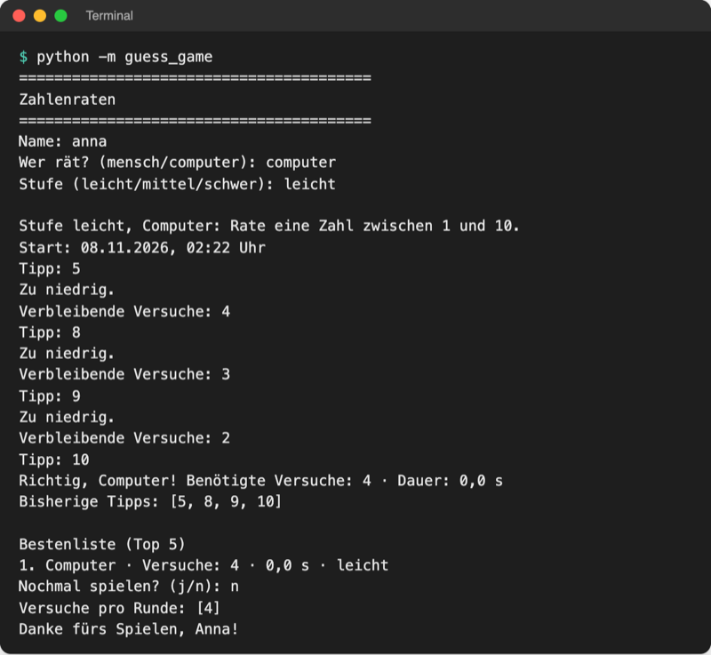
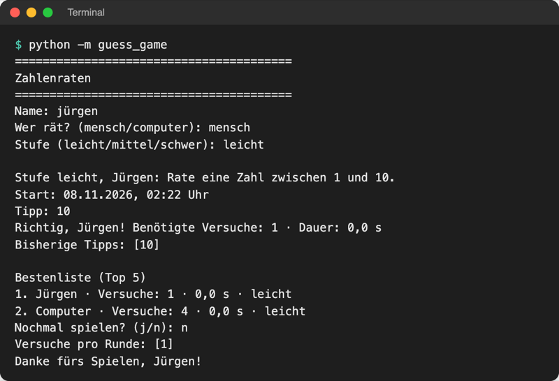

# Lab 10.3 – Lösung: Komposition

Fertiger Stand: [project/examples/m10-class-relations/l03-composition/guess_game/](../../project/examples/m10-class-relations/l03-composition/guess_game/). Test im Ordner `project/`: `cd examples/m10-class-relations/l03-composition`, dann `python -m guess_game`.

## Aufgabe 1: Scoreboard in storage.py

```python
def get_tries(score):
    """Sortierschlüssel: die Anzahl der Versuche eines Ergebnisses."""
    return score["tries"]


class Scoreboard:
    """Bestenliste: hält alle Ergebnisse und speichert sie in einer JSON-Datei."""

    def __init__(self, path=HIGHSCORES_FILE):
        self.path = path
        self.scores = self.load()  # beim Erzeugen einmal aus der Datei laden

    def load(self):
        """Gibt alle gespeicherten Ergebnisse als Liste von Dictionaries zurück."""
        if not self.path.exists():  # erster Start: noch keine Datei
            return []
        with open(self.path, encoding="utf-8") as file:
            return json.load(file)

    def save(self):
        """Schreibt alle Ergebnisse als JSON in die Datei."""
        with open(self.path, "w", encoding="utf-8") as file:
            json.dump(self.scores, file, indent=2, ensure_ascii=False)

    def add(self, result):
        """Fügt ein Ergebnis hinzu und speichert sofort."""
        self.scores.append(result)
        self.save()

    def top_five(self):
        """Gibt die fünf Ergebnisse mit den wenigsten Versuchen zurück."""
        return sorted(self.scores, key=get_tries)[:5]
```

Unterschied zu Lab 8.2: Die Liste liegt jetzt im Objekt (`self.scores`). `top_five()` muss die Datei nicht mehr jedes Mal neu lesen; `add` hält Liste und Datei gleich.

## Aufgabe 2: Game bekommt Player und Scoreboard

```python
class Game:
    """Ein Spiel: hat einen Spieler, eine Bestenliste, Geheimzahl und Tipps."""

    def __init__(self, player, scoreboard, level="leicht"):
        self.player = player  # Komposition: Game hat einen Player ...
        self.scoreboard = scoreboard  # ... und ein Scoreboard
        self.level = level
        # ... Rest von __init__ unverändert
```

In `result()`:

```python
            "name": self.player.name,
```

## Aufgabe 3: save_score()

```python
    def save_score(self):
        """Trägt das Ergebnis in die Bestenliste ein, aber nur bei einem Gewinn."""
        if self.is_won:
            self.scoreboard.add(self.result())  # Dateizugriff erledigt Scoreboard
```

`Game` entscheidet, **ob** gespeichert wird (Spielregel), `Scoreboard` entscheidet, **wie** (Datei). So bleibt `logic.py` frei von Dateizugriffen.

## Aufgabe 4: play_round(game)

```python
def play_round(game):
    """Spielt eine Runde: Spieler tippt, Spiel wertet aus; gibt das Ergebnis zurück."""
    player = game.player
    print(
        f"\nStufe {game.level}, {player.name}: "
        f"Rate eine Zahl zwischen {game.low} und {game.high}."
    )
```

Ebenso in der Gewinnzeile: `f"Richtig, {player.name}! …"`. Der Rest der Funktion bleibt.

## Aufgabe 5: __main__.py und Test

```python
    scoreboard = storage.Scoreboard()  # lädt highscores.json einmal
    all_tries = []
    play_again = "j"
    while play_again == "j":
        level = ui.ask_level()
        game = logic.Game(player, scoreboard, level)  # neues Spiel pro Runde
        result = ui.play_round(game)
        all_tries.append(result["tries"])
        storage.append_history(result)  # jede Runde, auch verlorene
        game.save_score()  # Game entscheidet, ob das Ergebnis in die Liste kommt
        if result["won"]:
            ui.show_highscores(scoreboard.top_five())
        play_again = ui.ask_play_again()
```

Erster Start (`computer`, leicht), zweiter Start (`mensch`, leicht, Tipp 10):





_Quelle: eigene Screenshots, Kurs-Repo, 08.11.2026 (Testlauf mit festem Zufallswert, daher Dauer 0,0 s)._

`playground/history.csv` danach:

```text
Datum;Name;Stufe;Versuche;Dauer;gewonnen
2026-11-08;Computer;leicht;4;0,0;ja
2026-11-08;Jürgen;leicht;1;0,0;ja
```

Das Format von `highscores.json` ist unverändert; eine Datei aus Lab 8.2 lädt ohne Anpassung.

## Erweiterung

`playground/ebike.py`:

```python
# E-Bike hat einen Akku: Komposition


class Battery:
    """Akku mit Ladestand in Prozent."""

    def __init__(self, percent=100):
        self.percent = percent

    def use(self, amount):
        """Verbraucht amount Prozent, aber nie unter 0."""
        self.percent = max(0, self.percent - amount)


class EBike:
    """Ein E-Bike hat einen Akku (von außen, tauschbar)."""

    def __init__(self, name, battery):
        self.name = name
        self.battery = battery

    def ride(self, km):
        """Fährt km Kilometer, 2 % Akku pro Kilometer."""
        self.battery.use(km * 2)  # Aufgabe an den Akku delegieren
        print(f"{self.name}: {km} km gefahren, Akku {self.battery.percent} %")


bike = EBike("Stadtrad", Battery())
bike.ride(20)
bike.ride(40)
bike.battery = Battery(80)  # Akku tauschen
bike.ride(10)
```

```text
$ python ebike.py
Stadtrad: 20 km gefahren, Akku 60 %
Stadtrad: 40 km gefahren, Akku 0 %
Stadtrad: 10 km gefahren, Akku 60 %
```

Der Akku kommt von außen (Aggregation) und lässt sich tauschen, ohne `EBike` zu ändern. `max(0, …)` verhindert einen negativen Ladestand.
