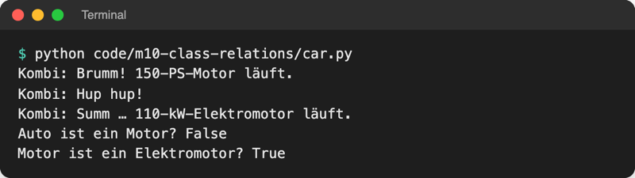
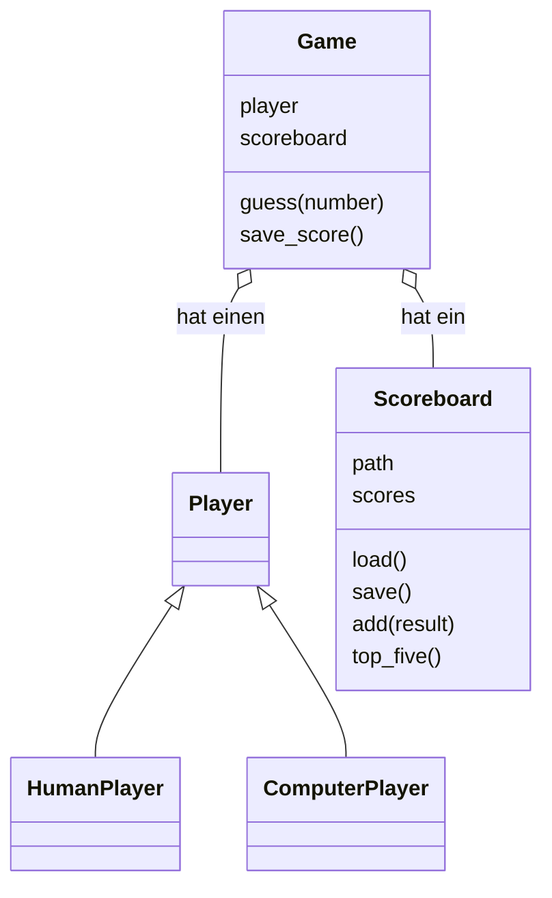

# Lab 10.3: Komposition

**Leitfragen:**

<details>
<summary>Ist ein Spiel eine Bestenliste – oder hat es eine?</summary>

Es hat eine. Ein Spiel ist keine Liste von Ergebnissen, es trägt sein Ergebnis nur dort ein. Deshalb erbt `Game` nicht von `Scoreboard`, sondern bekommt ein `Scoreboard`-Objekt als Attribut.

</details>

<details>
<summary>Was müsste sich ändern, wenn die Bestenliste später in einer Datenbank liegt?</summary>

Nur die Klasse `Scoreboard` (Laden und Speichern). `Game` ruft weiter `scoreboard.add(...)` auf und merkt vom Wechsel nichts, solange die neue Klasse dieselben Methoden anbietet.

</details>

- Komposition: Ein Objekt besteht aus anderen Objekten und gibt Aufgaben an sie weiter. Ein Auto **hat einen** Motor und lässt ihn starten.
- Vererbung („ist ein“) und Komposition („hat ein“) sind die zwei Arten, Klassen zu verbinden. Die Prüffrage entscheidet, welche passt.

## Begriffe

| Begriff | Bedeutung |
| --- | --- |
| Komposition | Ein Objekt hält andere Objekte als Attribute und nutzt sie; wie ein Auto aus Motor, Hupe und Rädern |
| „hat ein“-Beziehung | Prüffrage für Komposition: „Hat ein Auto einen Motor?“ Ja → Attribut `self.engine` |
| Aggregation | lockere Form: Das Teil kommt von außen, lebt auch allein weiter und lässt sich tauschen (Motor, Bestenliste) |
| Komposition im engen Sinn | feste Form: Das Teil entsteht im `__init__` des Ganzen und gehört nur ihm (Hupe) |
| delegieren | eine Aufgabe an ein enthaltenes Objekt weitergeben: `car.start()` ruft `self.engine.start()` |
| „Komposition vor Vererbung“ | Faustregel: im Zweifel „hat ein“ wählen, weil Teile tauschbar bleiben und Klassen klein |

## „Ist ein“ oder „hat ein“?

| | Vererbung | Komposition |
| --- | --- | --- |
| Beziehung | „ist ein“ | „hat ein“ |
| Prüfsatz | „Ein Kreis ist eine Form.“ | „Ein Auto hat einen Motor.“ |
| Schreibweise | `class Circle(Shape):` | `self.engine = engine` im `__init__` |
| Was übernommen wird | alle Attribute und Methoden der Basisklasse | nichts; das Objekt ruft Methoden des Teils auf |
| Tauschen zur Laufzeit | nein, die Basisklasse steht fest | ja, z. B. `car.engine = ElectricEngine(110)` |
| Falscher Einsatz erkennbar an | Sätzen wie „Ein Auto ist ein Motor“ | – |
| Im Spiel | `HumanPlayer(Player)`, `InvalidGuessError(ValueError)` | `Game` hat einen `Player` und ein `Scoreboard` |


_Quelle: Wikimedia Commons, „AggregationAndComposition.svg“ von ACiD2 und Mikm (https://commons.wikimedia.org/wiki/File:AggregationAndComposition.svg), gemeinfrei, abgerufen am 08.11.2026._

Im Klassendiagramm steht die Raute beim Ganzen: ausgefüllt = Komposition (der Vergaser gehört fest zum Auto), hohl = Aggregation (die Enten leben auch ohne den Teich). Für den Code macht der Unterschied wenig aus: In beiden Fällen ist das Teil ein Attribut.

## Beispiel: Car hat einen Engine

Datei: [code/m10-class-relations/car.py](../../project/code/m10-class-relations/car.py)

```python
class Engine:
    def __init__(self, horsepower):
        self.horsepower = horsepower

    def start(self):
        return f"Brumm! {self.horsepower}-PS-Motor läuft."


class Horn:
    def honk(self):
        return "Hup hup!"


class Car:
    def __init__(self, brand, engine):
        self.brand = brand
        self.engine = engine  # Aggregation: Motor kommt von außen, ist tauschbar
        self.horn = Horn()  # Komposition: Hupe entsteht mit dem Auto

    def start(self):
        """Delegiert: das Auto bittet seinen Motor, zu starten."""
        print(f"{self.brand}: {self.engine.start()}")


car = Car("Kombi", Engine(150))
car.start()
car.engine = ElectricEngine(110)  # Motor tauschen, Car bleibt unverändert
car.start()
```



_Quelle: eigener Screenshot, Kurs-Repo, 08.11.2026._

- `Car` weiß nicht, wie ein Motor funktioniert; es ruft nur `start()` auf. `ElectricEngine` (in der Datei) hat dieselbe Methode, also passt sie ohne Änderung an `Car`: Komposition und Polymorphie (Lab 10.2) arbeiten zusammen.
- Wäre `Car` von `Engine` abgeleitet, hätte jedes Auto genau einen festen Motortyp, und ein Auto „wäre“ ein Motor. Der Satz klingt falsch, also passt Vererbung nicht.

## Wann Vererbung, wann Komposition?

- **Vererbung**, wenn der „ist ein“-Satz stimmt und die Unterklasse überall dort einsetzbar ist, wo die Basisklasse erwartet wird (`HumanPlayer` überall, wo ein `Player` gebraucht wird).
- **Komposition**, wenn ein Objekt eine Fähigkeit nur benutzt (Speichern, Motor, Hupe) oder das Teil austauschbar sein soll.
- **Faustregel „Komposition vor Vererbung“:** Tiefe Vererbungsketten koppeln Klassen fest aneinander; eine Änderung oben wirkt auf alle darunter. Mit Komposition bleibt jede Klasse klein und für eine Aufgabe zuständig.

## Im Spiel: Scoreboard, Game hat Player und Scoreboard

Die Funktionen `load_highscores`, `save_highscore` und `top_five` aus `storage.py` werden Methoden der neuen Klasse `Scoreboard`. `Game` bekommt Spieler und Bestenliste beim Erzeugen übergeben:



```python
class Game:
    def __init__(self, player, scoreboard, level="leicht"):
        self.player = player  # Komposition: Game hat einen Player ...
        self.scoreboard = scoreboard  # ... und ein Scoreboard
        ...

    def save_score(self):
        """Trägt das Ergebnis in die Bestenliste ein, aber nur bei einem Gewinn."""
        if self.is_won:
            self.scoreboard.add(self.result())  # Dateizugriff erledigt Scoreboard
```

- `logic.py` enthält danach kein `open`, `json` oder `Path`: Wo und wie gespeichert wird, weiß nur `Scoreboard`.
- `__main__.py` erzeugt einen `Player` und ein `Scoreboard` pro Programmstart und pro Runde ein neues `Game(player, scoreboard, level)`. Das `Scoreboard` lädt `highscores.json` dabei nur einmal.
- `Scoreboard(path=HIGHSCORES_FILE)` hat einen Standardwert (Lab 5.2): `Scoreboard()` nutzt `highscores.json`, `Scoreboard(Path("test.json"))` eine andere Datei.

## Typische Fehler

| Symptom | Ursache | Lösung |
| --- | --- | --- |
| `TypeError: Game.__init__() missing 1 required positional argument: 'scoreboard'` | Aufruf mit zu wenigen Argumenten, z. B. `logic.Game(player)` | `logic.Game(player, scoreboard, level)` |
| `AttributeError: 'Game' object has no attribute 'name'` | `game.name` in `ui.py`, der Name steckt jetzt im Spieler | `game.player.name` bzw. `player = game.player` |
| `AttributeError: 'str' object has no attribute 'name'` | alter Aufruf `logic.Game(player.name, level)`: der Name (ein String) landet in `player` | ganzes Objekt übergeben: `Game(player, …)` |
| `AttributeError: 'Scoreboard' object has no attribute 'scores'` | `self.scores = self.load()` fehlt im `__init__` | im `__init__` einmal laden |
| Bestenliste vergisst Ergebnisse der laufenden Sitzung | pro Runde ein neues `Scoreboard()` statt einmal vor der Schleife | `scoreboard = storage.Scoreboard()` vor der `while`-Schleife |

## Fazit

- „Ist ein“ → Vererbung, „hat ein“ → Komposition; im Zweifel Komposition.
- Komposition heißt: Objekt als Attribut speichern und Aufgaben an es delegieren; das Teil bleibt tauschbar.
- `Game` hat einen `Player` und ein `Scoreboard`; Dateizugriffe stecken nur noch in `Scoreboard`.

In der Übung baut das eigene Spiel die Klasse `Scoreboard` und übergibt Spieler und Bestenliste an `Game`.
