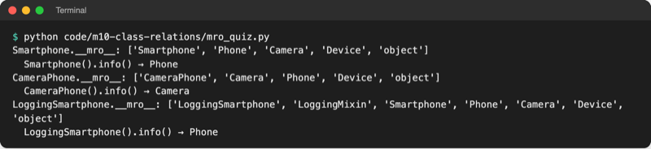

# Lab 10.4 – Lösung: Mehrfachvererbung und Mixins

Kein Spielstand: Das Spiel bleibt auf dem Stand von Lab 10.3. Quelldatei: [project/code/m10-class-relations/mro_quiz.py](../../project/code/m10-class-relations/mro_quiz.py).

## Aufgabe 1: Vererbungsdiagramm

```text
            Device
           /      \
        Phone    Camera
           \      /
          Smartphone          (Phone links, Camera rechts)
```

Ein Diamant wie `Person` → `Employee`/`Customer` → `EmployeeCustomer` in der Theorie. `CameraPhone` hat dieselbe Form, nur mit `Camera` links. `LoggingSmartphone` hängt unter `Smartphone` und bekommt zusätzlich `LoggingMixin`.

## Aufgabe 2: Vorhersage

| Klasse | MRO | `info()` | Regel |
| --- | --- | --- | --- |
| `Smartphone` | Smartphone, Phone, Camera, Device, object | `Phone` | links vor rechts: `Phone` steht zuerst in der Klammer |
| `CameraPhone` | CameraPhone, Camera, Phone, Device, object | `Camera` | gleiche Klassen, andere Reihenfolge in der Klammer |
| `LoggingSmartphone` | LoggingSmartphone, LoggingMixin, Smartphone, Phone, Camera, Device, object | `Phone` | `LoggingMixin` hat kein `info()`, die Suche geht weiter bis `Phone` |

`Device` steht jeweils erst nach `Phone` **und** `Camera` (Kinder vor Eltern), obwohl sie auf dem Weg über `Phone` schon früher erreichbar wäre.

## Aufgabe 3: Prüfen



_Quelle: eigener Screenshot, Kurs-Repo, 08.11.2026._

Häufigste Fehlvorhersage: `Device` direkt nach `Phone` („erst den linken Ast ganz nach oben“). Die Regel „jede Klasse einmal, Kinder vor Eltern“ schiebt `Device` hinter `Camera`.

## Aufgabe 4: Broken

```python
class Broken(Device, Phone):
    pass
```

```text
$ python mro_quiz.py
Traceback (most recent call last):
  File ".../playground/mro_quiz.py", line 38, in <module>
    class Broken(Device, Phone):
        pass
TypeError: Cannot create a consistent method resolution order (MRO) for bases Device, Phone
```

Die Klammer verlangt `Device` vor `Phone` (links vor rechts), die Vererbung verlangt `Phone` vor `Device` (Kind vor Eltern). Beides geht nicht; Python bricht schon beim Anlegen der Klasse ab, noch bevor Teil 2 etwas ausgibt.

## Aufgabe 5: Smartphone(Camera, Phone)

```text
Smartphone.__mro__: ['Smartphone', 'Camera', 'Phone', 'Device', 'object']
  Smartphone().info() → Camera
CameraPhone.__mro__: ['CameraPhone', 'Camera', 'Phone', 'Device', 'object']
  CameraPhone().info() → Camera
LoggingSmartphone.__mro__: ['LoggingSmartphone', 'LoggingMixin', 'Smartphone', 'Camera', 'Phone', 'Device', 'object']
  LoggingSmartphone().info() → Camera
```

Auch `LoggingSmartphone` liefert jetzt „Camera“: Es erbt die Reihenfolge von `Smartphone`. Eine kleine Änderung in einer Basisklasse wirkt auf alle Klassen darunter; genau deshalb gilt Mehrfachvererbung als schwer zu überblicken.

## Erweiterung

`playground/notify.py`:

```python
# Benachrichtigen über zwei Kanäle: zwei Mixins


class EmailMixin:
    def send_email(self, text):
        print(f"E-Mail an {self.email}: {text}")


class SmsMixin:
    def send_sms(self, text):
        print(f"SMS an {self.phone}: {text}")


class Customer(EmailMixin, SmsMixin):
    def __init__(self, name, email, phone):
        self.name = name
        self.email = email
        self.phone = phone

    def remind(self):
        """Erinnert über beide Kanäle."""
        text = f"Hallo {self.name}, das Buch ist morgen fällig."
        self.send_email(text)
        self.send_sms(text)


lena = Customer("Lena", "lena@example.org", "0151 2345678")
lena.remind()
print(Customer.mro())
```

```text
$ python notify.py
E-Mail an lena@example.org: Hallo Lena, das Buch ist morgen fällig.
SMS an 0151 2345678: Hallo Lena, das Buch ist morgen fällig.
[<class '__main__.Customer'>, <class '__main__.EmailMixin'>, <class '__main__.SmsMixin'>, <class 'object'>]
```

Die beiden Mixins haben keine gleichnamigen Methoden; die Reihenfolge in der Klammer spielt hier deshalb keine Rolle. Die Mixins brauchen die Attribute `email` und `phone`, die erst `Customer` setzt.
