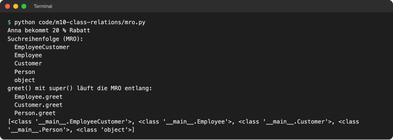

# Lab 10.4: Mehrfachvererbung und Mixins

**Leitfragen:**

<details>
<summary>Eine Person ist Mitarbeiterin und Kundin zugleich – welche Regeln gelten?</summary>

Beide: Sie hat alles, was Mitarbeitende haben, und alles, was Kundschaft hat. Widersprechen sich zwei Regeln (20 % Mitarbeiterrabatt oder 5 % Kundenkarte?), braucht es eine feste Reihenfolge, wer gewinnt.

</details>

<details>
<summary>Was passiert, wenn beide „Eltern“ eine Methode gleichen Namens haben?</summary>

Python nimmt die Methode der Klasse, die in der Klammer weiter links steht. Die vollständige Suchreihenfolge heißt MRO und lässt sich mit `Klasse.__mro__` anzeigen.

</details>

- Eine Klasse darf mehrere Basisklassen haben: `class EmployeeCustomer(Employee, Customer):`. Sie erbt dann von allen.
- Python sucht Methoden in einer festen Reihenfolge (MRO). Wer sie kennt, kann vorhersagen, welche Methode läuft.

## Begriffe

| Begriff | Bedeutung |
| --- | --- |
| Mehrfachvererbung | Klasse mit mehr als einer Basisklasse, z. B. `class C(A, B):` |
| MRO (Method Resolution Order) | „Reihenfolge der Methodensuche“: Liste aller Klassen, die Python beim Suchen einer Methode durchgeht |
| `Klasse.__mro__` / `Klasse.mro()` | zeigt die MRO als Tupel bzw. als Liste |
| `object` | Urklasse aller Klassen; jede Klasse erbt automatisch von ihr, deshalb steht sie immer am Ende der MRO |
| Diamant-Problem | zwei Basisklassen haben dieselbe gemeinsame Basisklasse; im Diagramm entsteht eine Raute |
| Mixin | kleine Klasse mit **einer** Fähigkeit (z. B. Protokollieren), die andere Klassen zusätzlich erben; allein nicht sinnvoll |
| `__name__` einer Klasse | Name der Klasse als Text, z. B. `"Employee"` |

## Zwei Basisklassen und die MRO

Datei: [code/m10-class-relations/mro.py](../../project/code/m10-class-relations/mro.py)

```python
class Person:
    def __init__(self, name):
        self.name = name

    def discount(self):
        return 0


class Employee(Person):
    def discount(self):
        return 20  # Mitarbeiterrabatt


class Customer(Person):
    def discount(self):
        return 5  # Kundenkarte


class EmployeeCustomer(Employee, Customer):
    """Zwei Basisklassen: erst Employee, dann Customer."""


anna = EmployeeCustomer("Anna")      # __init__ erbt sie von Person
print(anna.discount())               # 20: Employee steht links
for cls in EmployeeCustomer.__mro__:
    print(cls.__name__)
```

`EmployeeCustomer` hat keinen eigenen Code außer dem Docstring. Die Klassen bilden einen Diamanten:


_Quelle: Wikimedia Commons, „Diamond inheritance.svg“ von RokerHRO (https://commons.wikimedia.org/wiki/File:Diamond_inheritance.svg), gemeinfrei, abgerufen am 08.11.2026. Im Beispiel: A = `Person`, B = `Employee`, C = `Customer`, D = `EmployeeCustomer`._



_Quelle: eigener Screenshot, Kurs-Repo, 08.11.2026._

Regeln, nach denen Python die MRO bildet:

| Regel | Im Beispiel |
| --- | --- |
| die Klasse selbst zuerst | `EmployeeCustomer` |
| Kinder vor ihren Eltern | `Employee` und `Customer` vor `Person` |
| Basisklassen in der Reihenfolge der Klammer, links zuerst | `Employee` vor `Customer` |
| jede Klasse nur einmal, auch wenn sie über zwei Wege erreichbar ist | `Person` einmal, erst nach beiden Kindern |
| `object` ganz am Ende | `object` |

**`super()` folgt der MRO, nicht dem Diagramm:** In `mro.py` ruft `Employee.greet()` `super().greet()` auf. Bei Anna landet das in `Customer.greet`, nicht in `Person.greet`, weil `Customer` in Annas MRO als Nächstes kommt. So läuft jede `greet`-Methode genau einmal.

## Mixins: Fähigkeiten zum Ausleihen

Ein Mixin ist eine kleine Klasse ohne eigene Daten, die nur eine Methode beisteuert. Sie steht in der Klammer **links** von der eigentlichen Basisklasse.

Datei: [code/m10-class-relations/logging_mixin.py](../../project/code/m10-class-relations/logging_mixin.py)

```python
class LoggingMixin:
    """Fähigkeit „protokollieren“: braucht nur ein Attribut name."""

    def log(self, text):
        print(f"[{self.name}] {text}")


class LoggingBankAccount(LoggingMixin, BankAccount):
    def deposit(self, amount):
        super().deposit(amount)  # das normale Einzahlen aus BankAccount
        self.log(f"{amount} Euro eingezahlt, Stand {self.balance} Euro")


class Thermostat(LoggingMixin):   # ganz andere Klasse, gleiche Fähigkeit
    ...
```

![Terminal: [Konto Anna] 50 Euro eingezahlt, Stand 150 Euro; [Heizung Bad] Temperatur auf 22 °C gestellt; MRO LoggingBankAccount, LoggingMixin, BankAccount, object](https://raw.githubusercontent.com/kodschul/kodschul-python-5-open/assets/m10/logging-mixin-run.png)

_Quelle: eigener Screenshot, Kurs-Repo, 08.11.2026._

- Ein Mixin ergibt allein keinen Sinn (`LoggingMixin().log("x")` scheitert, weil `name` fehlt); es ergänzt andere Klassen.
- Typische Mixins in fremdem Code: Protokollieren, Umwandeln in JSON, Vergleichen. Der Name endet meist auf `Mixin`.

## Im Spiel: protokollierender Computer (nur Demo)

Das Spiel bekommt in diesem Lab keinen neuen Stand. Der Mixin lässt sich aber im REPL an den `ComputerPlayer` aus Lab 10.2 hängen (im Ordner `playground/`, Spiel ab Stand 10.2):

![Terminal: REPL definiert LoggingMixin und LoggingComputerPlayer(LoggingMixin, players.ComputerPlayer); on_hint gibt [Computer] 50 war zu niedrig aus, low/high danach 51 und 100; MRO LoggingComputerPlayer, LoggingMixin, ComputerPlayer, Player, object](https://raw.githubusercontent.com/kodschul/kodschul-python-5-open/assets/m10/mixin-player-repl.png)

_Quelle: eigener Screenshot, Kurs-Repo, 08.11.2026._

`super().on_hint(...)` sucht ab `LoggingMixin` weiter; dort gibt es kein `on_hint`, also landet der Aufruf bei `ComputerPlayer.on_hint`, das den Bereich halbiert.

## Grenzen: wann besser nicht

| Problem | Beispiel | Besser |
| --- | --- | --- |
| Namenskonflikte | beide Eltern haben `discount()`, nur eine gewinnt still | Methode in der Kindklasse selbst schreiben und entscheiden |
| schwer zu lesen | um eine Methode zu finden, muss man die MRO kennen | Komposition (Lab 10.3): Fähigkeit als Attribut |
| Reihenfolge unmöglich | `class Broken(Device, Phone)`, obwohl `Phone` von `Device` erbt | `TypeError: Cannot create a consistent method resolution order (MRO)`; Kind (`Phone`) zuerst nennen |
| verschiedene `__init__`-Parameter | beide Eltern brauchen andere Argumente | Mixins ohne eigenes `__init__` schreiben |

Faustregel: Mehrfachvererbung nur für kleine Mixins ohne eigene Daten. Für „Person ist Mitarbeiterin und Kundin“ ist oft eine Person mit einer Liste von Rollen (Komposition) übersichtlicher.

## Typische Fehler

| Symptom | Ursache | Lösung |
| --- | --- | --- |
| falsche Methode läuft | Reihenfolge in der Klammer vertauscht | MRO mit `Klasse.mro()` prüfen, Mixin links |
| `TypeError: Cannot create a consistent method resolution order (MRO) for bases …` | Basisklasse vor ihrer eigenen Unterklasse genannt | Unterklasse zuerst oder Basisklasse weglassen |
| `AttributeError: 'LoggingMixin' object has no attribute 'name'` | Mixin allein benutzt | Mixin nur zusammen mit einer Klasse, die `name` hat |
| Ausgabe `<class '__main__.Employee'>` statt `Employee` | ganze Klasse gedruckt | `cls.__name__` drucken |

## Vertiefung

Original: [Python-Tutorial, Abschnitt 9.5.1 Multiple Inheritance: Syntax class DerivedClassName(Base1, Base2, Base3) und Erklärung der Suchreihenfolge tiefen-zuerst, links-nach-rechts](https://docs.python.org/3.14/tutorial/classes.html#multiple-inheritance), Stand 08.11.2026.

Das Verfahren heißt C3-Linearisierung und ist seit Python 2.3 im Einsatz; Details: „The Python 2.3 Method Resolution Order“ (https://docs.python.org/3.14/howto/mro.html, abgerufen am 08.11.2026).

## Fazit

- Mehrere Basisklassen sind erlaubt; die MRO legt fest, wer bei gleichen Methodennamen gewinnt: Kind vor Eltern, links vor rechts, jede Klasse einmal.
- `Klasse.__mro__` bzw. `Klasse.mro()` zeigt die Reihenfolge; `super()` folgt ihr.
- Mixins sind kleine, kombinierbare Fähigkeiten; für alles Größere ist Komposition meist klarer.

In der Übung wird die MRO von drei Klassen erst vorhergesagt, dann geprüft.
