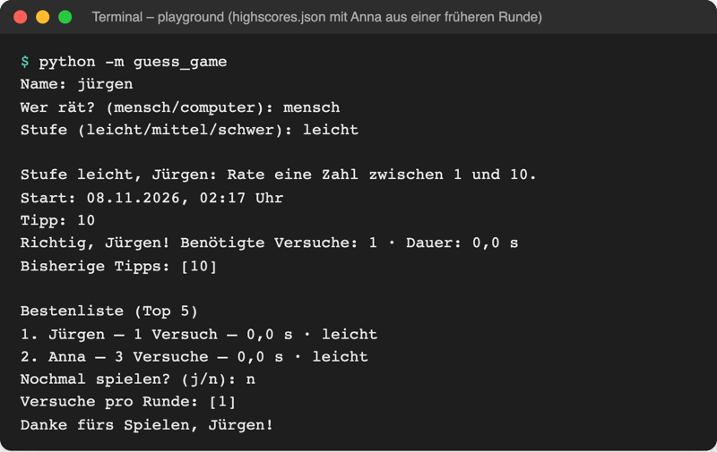

# Lab 11.1 – Lösung: Score mit __str__ und __lt__

Fertiger Stand: [project/examples/m11-advanced-oop/l01-magic-methods/guess_game/](../../project/examples/m11-advanced-oop/l01-magic-methods/guess_game/)

## Aufgabe 1: Klasse Score und Game.score()

```python
class Score:
    """Ergebnis eines Spiels, das sich lesbar ausgeben und sortieren lässt."""

    def __init__(self, name, level, tries, seconds, won, date):
        self.name = name
        self.level = level
        self.tries = tries
        self.seconds = seconds
        self.won = won
        self.date = date

    def to_dict(self):
        """Gibt das Ergebnis als Dictionary zurück (für JSON)."""
        return {
            "name": self.name,
            "level": self.level,
            "tries": self.tries,
            "seconds": self.seconds,
            "won": self.won,
            "date": self.date,
        }
```

In `Game`:

```python
    def save_score(self):
        """Trägt das Ergebnis in die Bestenliste ein, aber nur bei einem Gewinn."""
        if self.is_won:
            self.scoreboard.add(self.score())  # Dateizugriff erledigt Scoreboard

    def score(self):
        """Gibt das Ergebnis des Spiels als Score-Objekt zurück."""
        return Score(
            self.player.name,
            self.level,
            len(self.guesses),
            self.seconds,
            self.is_won,
            self.started.strftime("%Y-%m-%d"),
        )
```

`Score` steht in `logic.py`, weil es Spieldaten sind, keine Ein- oder Ausgabe. Die Reihenfolge der sechs Parameter muss überall gleich sein, sonst landet z. B. die Stufe im Namen.

## Aufgabe 2: __str__

```python
    def __str__(self):
        """Text für print() und f-Strings: Anna – 3 Versuche – 12,4 s."""
        word = "Versuch" if self.tries == 1 else "Versuche"
        seconds = f"{self.seconds:.1f}".replace(".", ",")
        return f"{self.name} – {self.tries} {word} – {seconds} s"
```

## Aufgabe 3: __lt__ und Prüfung im REPL

```python
    def __lt__(self, other):
        """Kleiner = besser: weniger Versuche, bei Gleichstand weniger Zeit."""
        if self.tries != other.tries:
            return self.tries < other.tries
        return self.seconds < other.seconds
```

```text
>>> from guess_game import logic
>>> anna = logic.Score("Anna", "leicht", 3, 20.0, True, "2026-11-08")
>>> ben = logic.Score("Ben", "leicht", 4, 5.0, True, "2026-11-08")
>>> cem = logic.Score("Cem", "leicht", 3, 12.4, True, "2026-11-08")
>>> print(anna)
Anna – 3 Versuche – 20,0 s
>>> anna < ben
True
>>> for score in sorted([anna, ben, cem]):
...     print(score)
...
Cem – 3 Versuche – 12,4 s
Anna – 3 Versuche – 20,0 s
Ben – 4 Versuche – 5,0 s
```

Drei Versuche in 20 s schlagen vier Versuche in 5 s, weil zuerst die Versuche zählen. `print(sorted([...]))` zeigt dagegen `[<guess_game.logic.Score object at 0x…>, …]`: Eine Liste nutzt `__repr__`, das `Score` noch nicht hat (Lab 11.2).

## Aufgabe 4: storage.py mit Score-Objekten

```python
from guess_game import logic
```

```python
    def load(self):
        """Liest die JSON-Datei und gibt eine Liste von Score-Objekten zurück."""
        if not self.path.exists():  # erster Start: noch keine Datei
            return []
        with open(self.path, encoding="utf-8") as file:
            data = json.load(file)  # Liste von Dictionaries
        scores = []
        for item in data:
            score = logic.Score(
                item["name"],
                item["level"],
                item["tries"],
                item["seconds"],
                item["won"],
                item["date"],
            )
            scores.append(score)
        return scores

    def save(self):
        """Schreibt alle Ergebnisse als JSON in die Datei."""
        data = []
        for score in self.scores:
            data.append(score.to_dict())  # JSON kennt keine Score-Objekte
        with open(self.path, "w", encoding="utf-8") as file:
            json.dump(data, file, indent=2, ensure_ascii=False)

    def add(self, score):
        """Fügt ein Score-Objekt hinzu und speichert sofort."""
        self.scores.append(score)
        self.save()

    def top_five(self):
        """Gibt die fünf besten Ergebnisse zurück."""
        return sorted(self.scores)[:5]  # sorted vergleicht mit Score.__lt__
```

In `append_history(score)` werden die Zugriffe zu Attributen: `"Datum": score.date`, `"Name": score.name`, `"Stufe": score.level`, `"Versuche": score.tries`, `"Dauer": str(score.seconds).replace(".", ",")`, `"gewonnen": "ja" if score.won else "nein"`.

## Aufgabe 5: ui.py, __main__.py und Testlauf

`ui.py`:

```python
def show_highscores(scores):
    """Zeigt die Bestenliste mit Platz, Score und Stufe."""
    print("\nBestenliste (Top 5)")
    place = 1
    for score in scores:
        print(f"{place}. {score} · {score.level}")  # f-String nutzt Score.__str__
        place += 1
```

Am Ende von `play_round`: `return game.score()`.

`__main__.py`, Rundenkörper:

```python
        score = ui.play_round(game)
        all_tries.append(score.tries)
        storage.append_history(score)  # jede Runde, auch verlorene
        game.save_score()  # Game entscheidet, ob das Ergebnis in die Liste kommt
        if score.won:
            ui.show_highscores(scoreboard.top_five())
```

Einzahl im REPL:

```text
>>> print(logic.Score("Jürgen", "leicht", 1, 0.0, True, "2026-11-08"))
Jürgen – 1 Versuch – 0,0 s
```

Lauf mit einer `highscores.json`, in der schon Anna mit 3 Versuchen steht:



_Quelle: eigener Screenshot, Kurs-Repo, 08.11.2026 (Ausgabe mit festem Zufallswert erzeugt, daher 0,0 s)._

`highscores.json` hat danach zwei Einträge mit den Feldern `name`, `level`, `tries`, `seconds`, `won`, `date`, genau wie vor dem Umbau.

## Erweiterung

```python
class Price:
    """Preis in Cent, damit keine Rundungsfehler entstehen."""

    def __init__(self, cents):
        self.cents = cents

    def __str__(self):
        return f"{self.cents / 100:.2f}".replace(".", ",") + " €"

    def __add__(self, other):
        return Price(self.cents + other.cents)

    def __lt__(self, other):
        return self.cents < other.cents


prices = [Price(1250), Price(399), Price(2000)]
for price in sorted(prices):
    print(price)

total = prices[0] + prices[1] + prices[2]
print("Summe:", total)
```

```text
3,99 €
12,50 €
20,00 €
Summe: 36,49 €
```

`prices[0] + prices[1] + prices[2]` rechnet von links: Das erste `+` liefert einen neuen `Price`, das zweite addiert den dritten dazu.
