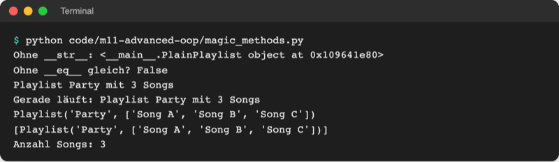

# Lab 11.1: Magic Methods

**Leitfragen:**

<details>
<summary>Woher weiß <code>print</code>, wie ein Objekt aussehen soll?</summary>

Von sich aus gar nicht: Ohne Hilfe zeigt `print` nur Klasse und Speicheradresse. `print` ruft die Methode `__str__` des Objekts auf; wer sie schreibt, legt den Text fest.

</details>

<details>
<summary>Wer ist „besser“: drei Versuche in 20 s oder vier Versuche in 5 s?</summary>

Das entscheidet eine Regel, nicht Python. Im Spiel gilt: weniger Versuche zuerst, nur bei Gleichstand die kürzere Zeit. Also gewinnen drei Versuche in 20 s. Diese Regel steht in der Methode `__lt__`.

</details>

<details>
<summary>Warum funktioniert <code>+</code> bei Zahlen und Strings unterschiedlich?</summary>

`+` ruft die Methode `__add__` des linken Werts auf. `int` rechnet darin, `str` hängt Texte aneinander. Jede Klasse bestimmt selbst, was `+` bedeutet.

</details>

- Python übersetzt Schreibweisen wie `print(obj)`, `a + b`, `a < b` oder `len(obj)` in Aufrufe von Methoden mit doppelten Unterstrichen.
- Eine eigene Klasse, die diese Methoden schreibt, funktioniert mit `print`, `+`, `<` und `sorted` wie eine eingebaute.

## Begriffe

| Begriff | Bedeutung |
| --- | --- |
| Magic Method (Dunder-Methode) | Methode mit doppeltem Unterstrich vorn und hinten („double underscore“), z. B. `__str__`; Python ruft sie selbst auf, wie eine Steckdose, in die `print` oder `+` einstecken |
| `__init__` | schon bekannt aus Lab 9.2: die erste Magic Method, Python ruft sie beim Erzeugen auf |
| `__str__` | liefert den lesbaren Text für Menschen (`print`, `str()`, f-String) |
| `__repr__` | liefert den eindeutigen Text für Entwickler (REPL, Listen, `repr()`) |
| `__eq__` | legt fest, wann `a == b` wahr ist |
| `__lt__` | legt fest, wann `a < b` wahr ist („less than“); `sorted` nutzt genau diesen Vergleich |
| `__add__` | legt fest, was `a + b` ergibt |
| `__len__` | Antwort auf `len(obj)` |
| Operatorüberladung | einem Operator wie `+` oder `<` für die eigene Klasse eine Bedeutung geben |

## Das Problem: print kennt die eigene Klasse nicht

Datei: [code/m11-advanced-oop/magic_methods.py](../../project/code/m11-advanced-oop/magic_methods.py)

```python
class PlainPlaylist:
    def __init__(self, name, songs):
        self.name = name
        self.songs = songs

plain = PlainPlaylist("Lernen", ["Lofi 1", "Lofi 2"])
print(plain)       # <__main__.PlainPlaylist object at 0x105b4e120>
```

Python kennt `Playlist` nicht und zeigt deshalb nur Klassenname und Speicheradresse. Auch `==` vergleicht ohne Hilfe nur, ob es **dasselbe** Objekt ist, nicht ob der Inhalt gleich ist.

## Python ruft die Methode auf

| Schreibweise | Python ruft auf | Ohne eigene Methode |
| --- | --- | --- |
| `print(obj)`, `str(obj)`, `f"{obj}"` | `obj.__str__()` | `__repr__`, sonst `<… object at 0x…>` |
| `repr(obj)`, `obj` im REPL, `print([obj])` | `obj.__repr__()` | `<… object at 0x…>` |
| `a == b` | `a.__eq__(b)` | nur wahr, wenn dasselbe Objekt |
| `a < b`, `sorted(liste)` | `a.__lt__(b)` | `TypeError: '<' not supported …` |
| `a + b` | `a.__add__(b)` | `TypeError: unsupported operand …` |
| `len(obj)` | `obj.__len__()` | `TypeError: object of type … has no len()` |

Dieselbe Schreibweise wirkt je nach Klasse anders: `3 + 4` ruft `int.__add__` (rechnet, ergibt `7`), `"3" + "4"` ruft `str.__add__` (hängt an, ergibt `"34"`). Datei mit diesen Beispielen: [code/m11-advanced-oop/overloading.py](../../project/code/m11-advanced-oop/overloading.py).

```python
class Playlist:
    def __init__(self, name, songs):
        self.name = name
        self.songs = songs

    def __str__(self):                  # für Menschen
        return f"Playlist {self.name} mit {len(self.songs)} Songs"

    def __repr__(self):                 # für Entwickler
        return f"Playlist('{self.name}', {self.songs})"

    def __len__(self):                  # len(playlist)
        return len(self.songs)
```



_Quelle: eigener Screenshot, Kurs-Repo, 08.11.2026._

## `__str__` oder `__repr__`?

| | `__str__` | `__repr__` |
| --- | --- | --- |
| Für wen | Menschen, Ausgabe im Programm | Entwickler beim Fehlersuchen |
| Aufgerufen von | `print`, `str()`, f-String | REPL, `repr()`, Elemente in Listen |
| Beispiel | `Playlist Party mit 3 Songs` | `Playlist('Party', ['Song A', …])` |
| Fehlt sie | Python nimmt `__repr__` | `<__main__.Playlist object at 0x…>` |

Die Python-Dokumentation beschreibt alle Magic Methods im Kapitel „Data model“:

Original: [Python-Dokumentation, Kapitel 3.3.1: object.__repr__ und object.__str__ mit Beschreibung, wann Python sie aufruft](https://docs.python.org/3.14/reference/datamodel.html#object.__repr__), Stand 08.11.2026.

## Rechnen und Vergleichen: Point

Datei: [code/m11-advanced-oop/magic_points.py](../../project/code/m11-advanced-oop/magic_points.py)

```python
class Point:
    def __init__(self, x, y):
        self.x = x
        self.y = y

    def __add__(self, other):           # a + b
        return Point(self.x + other.x, self.y + other.y)

    def __eq__(self, other):            # a == b
        return self.x == other.x and self.y == other.y

    def __lt__(self, other):            # a < b: näher am Nullpunkt ist kleiner
        return self.x**2 + self.y**2 < other.x**2 + other.y**2
```

- `other` ist das zweite Objekt: Bei `a + b` ist `self` der Punkt `a`, `other` der Punkt `b`.
- `__add__` ändert keinen der beiden Punkte, sondern gibt einen **neuen** zurück, so wie `3 + 4` die 3 nicht verändert.
- `__lt__` gibt `True` oder `False` zurück. Mehr braucht `sorted`: Es vergleicht immer zwei Elemente mit `<`.
- `b > a` funktioniert ohne eigenes `__gt__`: Python dreht den Vergleich um und prüft `a < b`. Für `<=` braucht es dagegen ein eigenes `__le__`.

![Terminal: magic_points.py zeigt a = (1, 2), a + b = (4, 6), Vergleiche mit True und die sortierte Liste [Point(0, 1), Point(2, 2), Point(5, 5)]](https://raw.githubusercontent.com/kodschul/kodschul-python-5-open/assets/m11/magic-points-run.png)

_Quelle: eigener Screenshot, Kurs-Repo, 08.11.2026._

**„Überladen“ in Python:** Zwei Methoden gleichen Namens mit verschiedenen Parametern gibt es in Python nicht; die zweite ersetzt die erste (Lab 9.3). Stattdessen helfen Standardwerte (`name="Gast"`) und `*args` (Lab 5.2). Das Überladen von **Operatoren** über Magic Methods gibt es dagegen, und genau das zeigt dieses Lab.

## Im Spiel: Score

Bisher war ein Ergebnis ein Dictionary, und die Bestenliste brauchte `key=get_tries` und eine lange f-String-Zeile. Neu ist die Klasse `Score` in `logic.py` (Auszug):

```python
class Score:
    """Ergebnis eines Spiels, das sich lesbar ausgeben und sortieren lässt."""

    def __str__(self):
        """Text für print() und f-Strings: Anna – 3 Versuche – 12,4 s."""
        word = "Versuch" if self.tries == 1 else "Versuche"
        seconds = f"{self.seconds:.1f}".replace(".", ",")
        return f"{self.name} – {self.tries} {word} – {seconds} s"

    def __lt__(self, other):
        """Kleiner = besser: weniger Versuche, bei Gleichstand weniger Zeit."""
        if self.tries != other.tries:
            return self.tries < other.tries
        return self.seconds < other.seconds
```

- Der Bedingungsausdruck aus Lab 3.1 sorgt für „1 Versuch“ statt „1 Versuche“.
- „Kleiner“ heißt hier „besser“: `sorted` stellt kleine Werte nach vorn, also stehen die besten Ergebnisse oben.
- `Scoreboard.top_five()` wird zu `sorted(self.scores)[:5]`, die Bestenliste zu `print(f"{place}. {score} · {score.level}")`.
- JSON kennt keine eigenen Objekte. `Score` bekommt deshalb eine Methode `to_dict()` fürs Speichern, und `load()` baut aus jedem Dictionary wieder ein `Score`. Die Datei `highscores.json` behält ihr Format.

## Typische Fehler

| Symptom | Ursache | Lösung |
| --- | --- | --- |
| `<guess_game.logic.Score object at 0x…>` | `__str__` fehlt oder ist falsch geschrieben (`__str_`, `_str_`) | genau zwei Unterstriche vorn und hinten |
| `TypeError: __str__ returned non-string (type NoneType)` | `__str__` benutzt `print` statt `return` | Text mit `return` zurückgeben |
| `TypeError: '<' not supported between instances of 'Score' and 'Score'` | `sorted` ohne `__lt__` in der Klasse | `__lt__` schreiben |
| `AttributeError: 'dict' object has no attribute 'tries'` | `load()` gibt noch Dictionaries zurück | in `load()` aus jedem Dictionary ein `Score` bauen |
| `TypeError: Object of type Score is not JSON serializable` | `save()` übergibt `Score`-Objekte an `json.dump` | vorher `score.to_dict()` |
| Liste zeigt `[<… object at 0x…>]` | Listen nutzen `__repr__`, nicht `__str__` | `__repr__` ergänzen (Lab 11.2 erledigt das automatisch) |

## Fazit

- Magic Methods verbinden eigene Klassen mit Python-Schreibweisen: `print` → `__str__`, `+` → `__add__`, `<` und `sorted` → `__lt__`, `len` → `__len__`.
- `__str__` ist für Menschen, `__repr__` für Entwickler.
- Ein `Score` mit `__lt__` sortiert die Bestenliste ohne Schlüsselfunktion.

In der Übung bekommt das eigene Spiel die Klasse `Score` mit `__str__` und `__lt__`.
