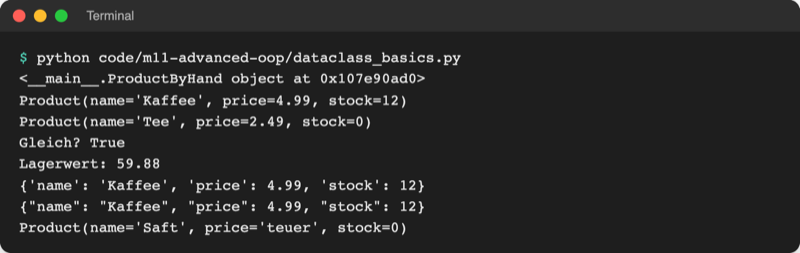
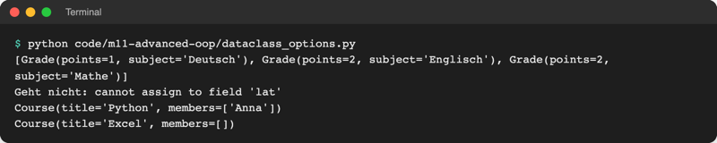

# Lab 11.2: Dataclasses

**Leitfragen:**

<details>
<summary>Welche Zeilen von <code>Score</code> aus Lab 11.1 sind reine Schreibarbeit?</summary>

`__init__` schreibt jeden Namen dreimal (`self.name = name`), `to_dict` noch zweimal. Nur `__str__` und `__lt__` enthalten eigene Regeln. Die Schreibarbeit kann Python aus einer Liste der Felder selbst erzeugen.

</details>

<details>
<summary>Wann reicht ein Dictionary, wann lohnt eine Klasse?</summary>

Ein Dictionary reicht für kurzlebige Daten ohne Verhalten (eine JSON-Zeile). Eine Klasse lohnt, sobald die Daten Regeln mitbringen (Ausgabe, Vergleich) oder Tippfehler bei Schlüsseln auffallen sollen: `score.trys` meldet sofort einen Fehler.

</details>

- Viele Klassen tragen vor allem Daten: ein Ergebnis, ein Produkt, eine Adresse. Für sie erzeugt `@dataclass` die Standardmethoden automatisch.
- Die Klasse nennt nur noch ihre Felder mit Typ; eigene Methoden wie `__str__` und `__lt__` bleiben möglich.

## Begriffe

| Begriff | Bedeutung |
| --- | --- |
| Dataclass | Klasse, deren `__init__`, `__repr__` und `__eq__` Python aus einer Liste von Feldern erzeugt; wie ein Formular, aus dem der Drucker die Durchschläge selbst macht |
| `@dataclass` | Markierung über der Klasse, die das Erzeugen auslöst; Schreibweise mit `@` wie `@property` (Lab 9.3), Details in Lab 13.1 |
| Feld | ein Datenwert der Dataclass, z. B. `tries: int` |
| Type Hint (Annotation) | Angabe hinter dem Doppelpunkt, welche Art Wert erwartet wird: `name: str` heißt „hier gehört ein Text hin“; ein Etikett, keine Kontrolle |
| Standardwert | Wert hinter `=`, den ein Feld bekommt, wenn er beim Erzeugen fehlt |
| `asdict` | Funktion, die eine Dataclass in ein Dictionary umwandelt (z. B. für JSON) |
| `order=True` | Option: erzeugt `<`, `<=`, `>`, `>=`, die Feld für Feld vergleichen |
| `frozen=True` | Option: Felder lassen sich nach dem Erzeugen nicht mehr ändern |
| `field(default_factory=list)` | gibt jedem Objekt eine eigene neue Liste als Standardwert |

## Type Hints: ein Etikett für den Wert

Ein Type Hint steht nach dem Namen, getrennt durch einen Doppelpunkt. Er sagt Menschen und Werkzeugen, welche Art Wert gemeint ist.

| Type Hint | Bedeutung | Beispielwert |
| --- | --- | --- |
| `name: str` | Text | `"Anna"` |
| `tries: int` | ganze Zahl | `3` |
| `seconds: float` | Kommazahl | `12.4` |
| `won: bool` | wahr oder falsch | `True` |
| `members: list` | Liste | `["Anna", "Ben"]` |

- Python **prüft den Typ nicht**: `Product("Saft", "teuer")` läuft ohne Fehler. VS Code kann solche Stellen aber markieren.
- In einer Dataclass ist der Type Hint Pflicht: Nur Namen **mit** Type Hint werden zu Feldern.
- Außerhalb von Dataclasses sind Type Hints freiwillig; dieser Kurs nutzt sie nur hier.

## Von Hand oder mit @dataclass

Datei: [code/m11-advanced-oop/dataclass_basics.py](../../project/code/m11-advanced-oop/dataclass_basics.py)

```python
class ProductByHand:                 # von Hand: jedes Attribut einzeln
    def __init__(self, name, price, stock=0):
        self.name = name
        self.price = price
        self.stock = stock
```

```python
from dataclasses import asdict, dataclass


@dataclass  # erzeugt __init__, __repr__ und __eq__ aus den Feldern
class Product:
    name: str          # Feld: Typ (Python prüft den Typ nicht)
    price: float
    stock: int = 0     # Standardwert: darf beim Erzeugen fehlen

    def total_value(self):
        return self.price * self.stock


coffee = Product("Kaffee", 4.99, 12)
print(coffee)                                   # Product(name='Kaffee', ...)
print(coffee == Product("Kaffee", 4.99, 12))   # True
print(asdict(coffee))                           # {'name': 'Kaffee', ...}
```



_Quelle: eigener Screenshot, Kurs-Repo, 08.11.2026._

Was `@dataclass` erzeugt:

| Methode | Wirkung | Von Hand nötig? |
| --- | --- | --- |
| `__init__` | Parameter in Feld-Reihenfolge, Standardwerte inklusive | nein |
| `__repr__` | `Product(name='Kaffee', price=4.99, stock=12)` | nein |
| `__eq__` | gleich, wenn alle Felder gleich sind | nein |
| `__lt__` usw. | nur mit `order=True` | eigene Regel: selbst schreiben |
| `__str__` | wird nicht erzeugt; `print` nutzt dann `__repr__` | für lesbaren Text selbst schreiben |

Die Python-Dokumentation zeigt dasselbe Muster: aus drei Feldern entsteht ein vollständiges `__init__`.

Original: [Python-Dokumentation dataclasses: Beispiel InventoryItem mit drei Feldern und das daraus erzeugte __init__](https://docs.python.org/3.14/library/dataclasses.html), Stand 08.11.2026.

## Optionen: order, frozen, default_factory

Datei: [code/m11-advanced-oop/dataclass_options.py](../../project/code/m11-advanced-oop/dataclass_options.py)

```python
@dataclass(order=True)       # vergleicht zuerst points, dann subject
class Grade:
    points: int
    subject: str


@dataclass(frozen=True)      # eingefroren: Felder nicht änderbar
class Coordinate:
    lat: float
    lon: float


@dataclass
class Course:
    title: str
    members: list = field(default_factory=list)   # jede Instanz: eigene Liste
```



_Quelle: eigener Screenshot, Kurs-Repo, 08.11.2026._

- **`order=True`** vergleicht Feld für Feld in der Reihenfolge der Klasse. Bei `Score` stünde `name` vorn: Die Bestenliste wäre alphabetisch. Deshalb behält `Score` sein eigenes `__lt__` und nutzt `order=True` nicht; beides zusammen bricht mit `TypeError: Cannot overwrite attribute __lt__ in class Score …` ab.
- **`frozen=True`** passt zu Werten, die sich nie ändern sollen (Koordinaten, Einstellungen).
- **`field(default_factory=list)`** verhindert die Falle aus Lab 5.3: `members: list = []` würde eine einzige Liste für alle Objekte bedeuten. Python lehnt das ab: `ValueError: mutable default <class 'list'> for field members is not allowed: use default_factory`.

## Dataclass, Dictionary, namedtuple, Klasse

| | Dictionary | `namedtuple` | Dataclass | Klasse von Hand |
| --- | --- | --- | --- | --- |
| Zugriff | `score["tries"]` | `score.tries` | `score.tries` | `score.tries` |
| Tippfehler im Namen | neuer Schlüssel oder `KeyError` | `AttributeError` | `AttributeError` | `AttributeError` |
| Lesbare Ausgabe | ja | ja | ja (`__repr__`) | selbst schreiben |
| Änderbar | ja | nein | ja (`frozen=True`: nein) | ja |
| Eigene Methoden | nein | kaum | ja | ja |
| Passt für | JSON, kurzlebige Daten | kleine feste Gruppen | Datensätze mit etwas Verhalten | viel Verhalten, eigener `__init__` |

`namedtuple` ist ein Tupel mit Namen je Platz: `Point = namedtuple("Point", ["x", "y"])` aus dem Modul `collections` (mehr dazu in Lab 14.1).

## Im Spiel: Score als Dataclass

Vorher (Lab 11.1, Auszug):

```python
class Score:
    def __init__(self, name, level, tries, seconds, won, date):
        self.name = name
        self.level = level
        self.tries = tries
        self.seconds = seconds
        self.won = won
        self.date = date
```

Nachher:

```python
@dataclass  # erzeugt __init__, __repr__ und __eq__ aus den Feldern
class Score:
    """Ergebnis eines Spiels, das sich lesbar ausgeben und sortieren lässt."""

    # Feld: Typ (bei Dataclasses Pflicht, Python prüft ihn nicht)
    name: str
    level: str
    tries: int
    seconds: float
    won: bool
    date: str
```

- `__str__` und `__lt__` bleiben unverändert stehen, `to_dict()` entfällt: `storage.save()` nutzt `asdict(score)`.
- Die Feld-Reihenfolge entspricht den alten Parametern. Deshalb funktionieren `Game.score()` und `Scoreboard.load()` ohne Änderung.

## Typische Fehler

| Symptom | Ursache | Lösung |
| --- | --- | --- |
| `TypeError: Score() takes no arguments` | `@dataclass` über der Klasse fehlt | `@dataclass` direkt über `class` |
| Feld fehlt in `repr` und `__init__` | Feld ohne Type Hint, z. B. `level = "leicht"` | `level: str` |
| `TypeError: non-default argument 'stock' follows default argument 'price'` | Feld ohne Standardwert nach einem mit Standardwert | Felder mit Standardwert ans Ende |
| `ValueError: mutable default <class 'list'> …` | Liste als Standardwert | `field(default_factory=list)` |
| `NameError: name 'asdict' is not defined` | Import fehlt in `storage.py` | `from dataclasses import asdict` |
| Bestenliste alphabetisch sortiert | `order=True` statt eigenem `__lt__` | `order=True` entfernen |

## Fazit

- `@dataclass` erzeugt `__init__`, `__repr__` und `__eq__` aus Feldern mit Type Hint.
- Type Hints sind Etiketten; Python prüft sie nicht.
- Eigene Regeln (`__str__`, `__lt__`) bleiben; `asdict` ersetzt das handgeschriebene `to_dict`.

In der Übung wird `Score` im eigenen Spiel zur Dataclass.
