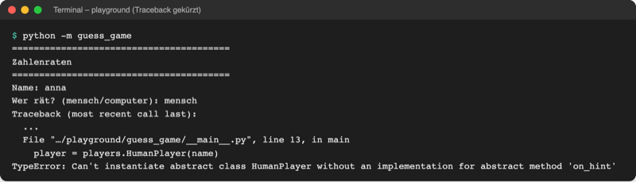

# Lab 11.3 – Lösung: Player als abstrakter Vertrag

Fertiger Stand: [project/examples/m11-advanced-oop/l03-abstraction/guess_game/players.py](../../project/examples/m11-advanced-oop/l03-abstraction/guess_game/players.py)

## Aufgabe 1: Von ABC erben

```python
# Spieler: wer den nächsten Tipp liefert

from abc import ABC, abstractmethod

from guess_game import ui


class Player(ABC):
    """Abstrakte Basisklasse: Vertrag, den jeder Spielertyp erfüllen muss."""
```

## Aufgabe 2: Pflichtmethoden markieren

```python
    @abstractmethod
    def next_guess(self):
        """Gibt den nächsten Tipp zurück; jede Unterklasse muss das festlegen."""

    @abstractmethod
    def on_hint(self, guess, hint):
        """Reagiert auf den Hinweis zum letzten Tipp; Pflicht für jede Unterklasse."""
```

Der Docstring ist der ganze Körper; mehr braucht eine abstrakte Methode nicht.

## Aufgabe 3: Der Vertrag greift



_Quelle: eigener Screenshot, Kurs-Repo, 08.11.2026 (Traceback gekürzt)._

`HumanPlayer` hatte `on_hint` bisher von `Player` geerbt. Jetzt ist es Pflicht und fehlt. Der Fehler erscheint beim Erzeugen in `__main__.py`, nicht erst beim ersten Tipp. Mit `computer` startet das Spiel noch, weil `ComputerPlayer` beide Methoden hat.

## Aufgabe 4: HumanPlayer erfüllt den Vertrag

```python
class HumanPlayer(Player):
    """Ein Mensch, der seine Tipps im Terminal eingibt."""

    def next_guess(self):
        """Fragt den Tipp per input ab (überschreibt Player.next_guess)."""
        return ui.ask_number("Tipp: ")

    def on_hint(self, guess, hint):
        """Ein Mensch liest den Hinweis selbst im Terminal: nichts zu tun."""
        pass
```

Ausgabe von Mensch- und Computer-Runde wie in Lab 11.2, z. B. für den Computer auf Stufe leicht:

```text
Wer rät? (mensch/computer): computer
Stufe (leicht/mittel/schwer): leicht

Stufe leicht, Computer: Rate eine Zahl zwischen 1 und 10.
Start: 08.11.2026, 02:17 Uhr
Tipp: 5
Zu niedrig.
Verbleibende Versuche: 4
Tipp: 8
Zu niedrig.
Verbleibende Versuche: 3
Tipp: 9
Zu niedrig.
Verbleibende Versuche: 2
Tipp: 10
Richtig, Computer! Benötigte Versuche: 4 · Dauer: 0,0 s
```

## Aufgabe 5: Vertrag im REPL prüfen

```text
>>> from guess_game import players
>>> players.Player("Test")
TypeError: Can't instantiate abstract class Player without an implementation for abstract methods 'next_guess', 'on_hint'
>>> class LazyPlayer(players.Player):
...     def next_guess(self):
...         return 5
...
>>> LazyPlayer("Test")
TypeError: Can't instantiate abstract class LazyPlayer without an implementation for abstract method 'on_hint'
```

(Die REPL zeigt vor der letzten Zeile noch `Traceback (most recent call last): …`.) Jeder künftige Spielertyp, etwa ein `RandomPlayer`, muss beide Methoden mitbringen, sonst lässt er sich nicht erzeugen.

## Erweiterung

```python
from abc import ABC, abstractmethod


class Animal(ABC):
    """Vertrag: jedes Tier hat einen Namen und macht ein Geräusch."""

    def __init__(self, name):
        self.name = name

    @abstractmethod
    def sound(self):
        """Gibt das Geräusch des Tiers zurück."""

    def speak(self):
        return f"{self.name} sagt {self.sound()}"


class Dog(Animal):
    def sound(self):
        return "Wuff"


class Cat(Animal):
    def sound(self):
        return "Miau"


class Fish(Animal):
    """Fische machen kein Geräusch: sound() fehlt absichtlich."""


for animal in [Dog("Bello"), Cat("Mimi")]:
    print(animal.speak())

try:
    Fish("Nemo")
except TypeError as error:
    print("TypeError:", error)
```

```text
Bello sagt Wuff
Mimi sagt Miau
TypeError: Can't instantiate abstract class Fish without an implementation for abstract method 'sound'
```
