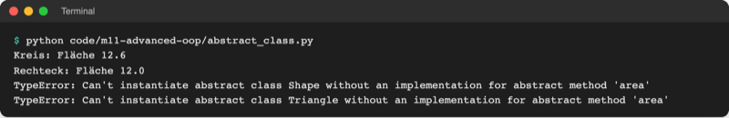
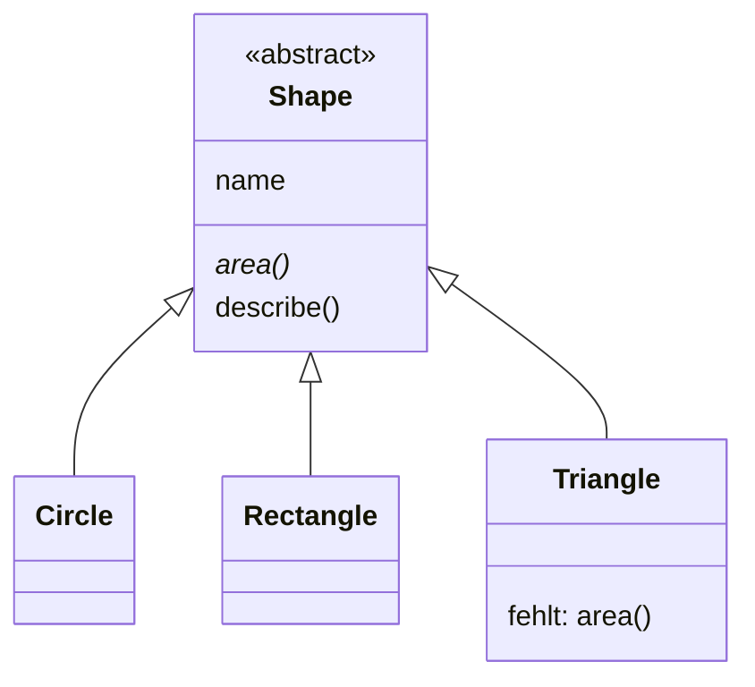
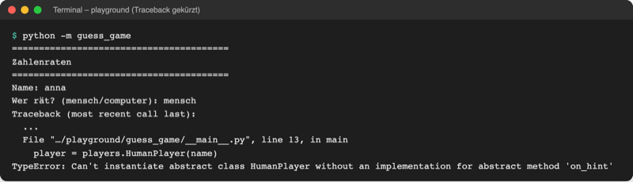

# Lab 11.3: Abstrakte Klassen

**Leitfragen:**

<details>
<summary>Gibt es „einen Spieler“, der weder Mensch noch Computer ist?</summary>

Nein. „Spieler“ beschreibt nur, was alle gemeinsam haben (Name, Tipps liefern). Ein Objekt der Basisklasse allein kann nicht raten. Eine solche Klasse heißt abstrakt: Sie dient als Vorlage, nicht als Exemplar.

</details>

<details>
<summary>Wie erzwingt man, dass jeder neue Spielertyp raten kann?</summary>

Bisher (Lab 10.1) meldet `NotImplementedError` den Fehler erst, wenn `next_guess()` aufgerufen wird. Mit `@abstractmethod` verweigert Python schon das Erzeugen eines Objekts, solange eine Pflichtmethode fehlt.

</details>

- Manche Basisklassen beschreiben nur einen Vertrag: „Wer hier erbt, muss diese Methoden haben.“ Objekte von ihnen allein ergeben keinen Sinn.
- Python setzt diesen Vertrag mit dem Modul `abc` (Abstract Base Classes) durch.

## Begriffe

| Begriff | Bedeutung |
| --- | --- |
| abstrakte Klasse | Basisklasse, von der sich kein Objekt erzeugen lässt; wie ein Formular-Vordruck, den erst das Ausfüllen nutzbar macht |
| konkrete Klasse | Unterklasse, die alle Pflichtmethoden hat; von ihr lassen sich Objekte erzeugen |
| Vertrag (Schnittstelle) | Liste von Methoden, die jede Unterklasse anbieten muss, wie eine Steckdosennorm: jeder Stecker, der passt, funktioniert |
| `ABC` | Basisklasse aus dem Modul `abc`; wer von ihr erbt, kann abstrakte Methoden haben |
| `@abstractmethod` | Markierung einer Pflichtmethode; Schreibweise wie `@property` und `@dataclass`, Details in Lab 13.1 |
| Instanziieren | ein Objekt einer Klasse erzeugen, z. B. `Circle(2)` |

## Shape als Vertrag

Datei: [code/m11-advanced-oop/abstract_class.py](../../project/code/m11-advanced-oop/abstract_class.py)

```python
import math
from abc import ABC, abstractmethod


class Shape(ABC):                         # erbt von ABC
    def __init__(self, name):
        self.name = name

    @abstractmethod
    def area(self):                       # Pflicht: nur Docstring, kein Code
        """Fläche berechnen: jede Unterklasse muss das festlegen."""

    def describe(self):                   # fertige Methode für alle
        return f"{self.name}: Fläche {self.area():.1f}"


class Circle(Shape):
    def __init__(self, radius):
        super().__init__("Kreis")
        self.radius = radius

    def area(self):                       # Vertrag erfüllt
        return math.pi * self.radius**2


class Triangle(Shape):
    """Unvollständig: area() fehlt."""
```

- Eine abstrakte Methode hat keinen eigenen Code; ein Docstring genügt als Körper.
- Eine abstrakte Klasse darf fertige Methoden enthalten (`describe`). Sie ruft `self.area()` auf, und jede Unterklasse liefert ihre eigene Fläche (Polymorphie aus Lab 10.2).
- `Shape("Form")` und `Triangle("Dreieck")` scheitern beim Erzeugen, `Circle(2)` und `Rectangle(3, 4)` funktionieren:



_Quelle: eigener Screenshot, Kurs-Repo, 08.11.2026._

Die Meldung lautet in Python 3.14 (Stand: 08.11.2026):

```text
TypeError: Can't instantiate abstract class Triangle without an implementation for abstract method 'area'
```

Fehlen mehrere Methoden, nennt Python alle: `… without an implementation for abstract methods 'next_guess', 'on_hint'`.



## Wann meldet Python den Fehler?

| | `NotImplementedError` (Lab 10.1) | `ABC` + `@abstractmethod` |
| --- | --- | --- |
| Basisklasse erzeugen | geht | `TypeError` |
| Unterklasse ohne Methode erzeugen | geht | `TypeError` beim Erzeugen |
| Fehler sichtbar | erst beim Aufruf der Methode, evtl. mitten im Spiel | sofort, bevor etwas passiert |
| Fertige Methoden in der Basisklasse | ja | ja |

Die Python-Dokumentation beschreibt das Modul `abc` und die Klasse `ABC`:

Original: [Python-Dokumentation abc — Abstract Base Classes mit der Beschreibung von class abc.ABC und einem Beispiel class MyABC(ABC)](https://docs.python.org/3.14/library/abc.html#module-abc), Stand 08.11.2026.

**Randnotiz andere Sprachen:** Java und C# kennen dafür `interface`: eine Liste von Methoden ganz ohne Code, die eine Klasse „implementiert“. Pythons abstrakte Klasse kann beides: Pflichtmethoden und fertige Methoden.

## Im Spiel: Player als Vertrag

In `players.py` wird `Player` abstrakt (Auszug):

```python
from abc import ABC, abstractmethod


class Player(ABC):
    """Abstrakte Basisklasse: Vertrag, den jeder Spielertyp erfüllen muss."""

    def start_round(self, low, high):
        """Merkt sich zu Beginn jeder Runde den Zahlenbereich."""
        self.low = low
        self.high = high

    @abstractmethod
    def next_guess(self):
        """Gibt den nächsten Tipp zurück; jede Unterklasse muss das festlegen."""

    @abstractmethod
    def on_hint(self, guess, hint):
        """Reagiert auf den Hinweis zum letzten Tipp; Pflicht für jede Unterklasse."""
```

- `start_round` bleibt eine normale Methode: Sie ist für alle Spieler gleich.
- `on_hint` hatte bisher den Standard „nichts tun“ (`pass`). Als Pflichtmethode muss jetzt auch `HumanPlayer` sie selbst haben, mit dem Körper `pass`. Ohne sie bricht das Spiel beim Erzeugen des Spielers ab:



_Quelle: eigener Screenshot, Kurs-Repo, 08.11.2026 (Traceback gekürzt)._

## Typische Fehler

| Symptom | Ursache | Lösung |
| --- | --- | --- |
| `TypeError: Can't instantiate abstract class HumanPlayer …` | Unterklasse hat eine Pflichtmethode nicht | Methode in der Unterklasse ergänzen |
| Kein Fehler, obwohl eine Methode fehlt | Basisklasse erbt nicht von `ABC` | `class Player(ABC):` |
| Fehler bleibt trotz neuer Methode | Name falsch geschrieben (`next_Guess`, `onhint`) | Namen exakt wie in der Basisklasse |
| `NameError: name 'abstractmethod' is not defined` | Import fehlt | `from abc import ABC, abstractmethod` |
| `TypeError: Can't instantiate abstract class Player …` | Basisklasse direkt erzeugt | eine konkrete Unterklasse erzeugen |

## Vertiefung

`typing.Protocol` beschreibt einen Vertrag ohne Vererbung: Jede Klasse mit passenden Methoden gilt als passend (Duck Typing aus Lab 10.2), geprüft von Werkzeugen wie VS Code, nicht beim Programmlauf.

## Fazit

- Eine abstrakte Klasse (`ABC`) ist ein Vertrag; `@abstractmethod` markiert Pflichtmethoden.
- Python verweigert das Erzeugen, solange eine Pflichtmethode fehlt; der Fehler kommt früher als mit `NotImplementedError`.
- Fertige Methoden wie `start_round` dürfen in der abstrakten Klasse stehen.

In der Übung wird `Player` im eigenen Spiel zum abstrakten Vertrag.
