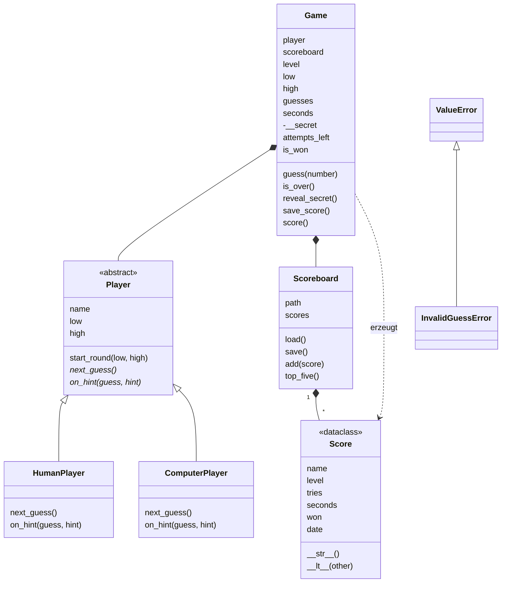
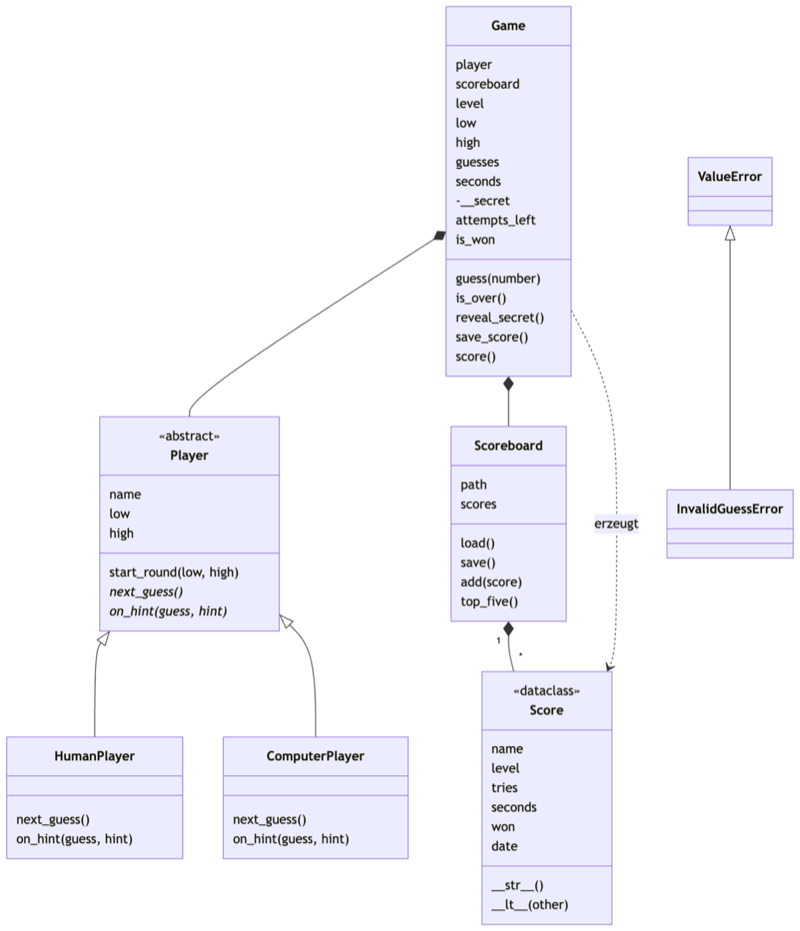

# Lab 11.4 – Lösung: Review des Spiels

Review-Objekt: [project/examples/m11-advanced-oop/l03-abstraction/guess_game/](../../project/examples/m11-advanced-oop/l03-abstraction/guess_game/). Ein eigener Stand kann abweichen; die Befunde unten gelten für das Beispiel.

## Aufgabe 1: Aufgabe je Datei

| Datei | Aufgabe |
| --- | --- |
| `logic.py` | Regeln und Spieldaten: `LEVELS`, `InvalidGuessError`, `Score`, `Game`; kein `input`, kein Dateizugriff |
| `players.py` | wer den nächsten Tipp liefert: `Player` (abstrakt), `HumanPlayer`, `ComputerPlayer` |
| `ui.py` | alle Ein- und Ausgaben, Spielschleife `play_round` |
| `storage.py` | Dateien: `Scoreboard` (JSON), `append_history` (CSV) |
| `__main__.py` | Ablauf: Objekte erzeugen, Runden starten, Strg+C abfangen |

## Aufgabe 2: Klassendiagramm

Gerendert:

_Quelle: eigene Darstellung (Mermaid), Kurs-Repo, 08.11.2026._

- `#95;` steht im Mermaid-Text für einen Unterstrich; ohne diese Schreibweise macht Mermaid aus `__str__` fett gedrucktes „str“.
- `attempts_left` und `is_won` sind Properties: Sie stehen bei den Attributen, weil sie sich ohne `()` lesen.
- Genau genommen leben `Player` und `Scoreboard` länger als ein `Game` (je eins pro Programmstart). Wer das zeigen will, zeichnet eine leere Raute (Aggregation).

## Aufgabe 3: Suchergebnisse

| Suche | Treffer | Bewertung |
| --- | --- | --- |
| `input(` | nur `ui.py` | ok |
| `print(` | `ui.py` (viele), `__main__.py` Zeile 34, `logic.py` Zeile 44 | `logic.py`: nur Text im Docstring von `__str__`, ok; `__main__.py`: Abbruchmeldung bei Strg+C, siehe Vorschlag 2 |
| `open(` | nur `storage.py` | ok |
| `import` | `players → ui → logic`, `storage → logic`, `__main__ → alle`; `logic` importiert kein Paketmodul | ok, kein Kreis |

## Aufgabe 4: Checkliste 8–14

| # | Befund |
| --- | --- |
| 8 | `__secret` und `_max_tries` geschützt, `attempts_left` nur lesbar. Aber `guesses` ist eine offene Liste: `game.guesses.append(...)` von außen würde Versuche verbrauchen oder einen Gewinn vortäuschen. |
| 9 | ok: `HumanPlayer` ist ein `Player`, `Game` hat einen `Player` |
| 10 | ok: `next_guess` und `on_hint` sind abstrakt |
| 11 | ok: `Score` ist Dataclass mit `__str__` und `__lt__` |
| 12 | Komma-Formatierung dreimal: `logic.py` Zeile 46 (`Score.__str__`), `ui.py` Zeile 85 (`format_seconds`), `storage.py` Zeile 68 (`append_history`) |
| 13 | ok |
| 14 | ok |

## Aufgabe 5: Vorschläge und Datenbank-Frage

| Datei | Stelle | Beobachtung | Vorschlag |
| --- | --- | --- | --- |
| `logic.py`, `ui.py`, `storage.py` | `Score.__str__`, `format_seconds`, `append_history` | Sekunden mit Komma an drei Stellen formatiert | eine Funktion `format_seconds` in `logic.py`, die alle drei nutzen |
| `__main__.py` | `except KeyboardInterrupt` | einziges `print` außerhalb von `ui.py` | Funktion `ui.show_abort()` aufrufen |

Weitere mögliche Befunde:

- `players.py` ruft `ui.ask_number` und `ui.show_guess` auf: Spieler und Bildschirm hängen zusammen. Ein Computer-Spieler ohne Terminal (z. B. für einen Test mit 1.000 Runden) bräuchte eine Änderung.
- `Game.guesses` ist von außen änderbar (Befund 8); eine nur lesbare Property über einer privaten Liste würde das verhindern.
- `ui.ask_level` enthält den Prompt-Text zweimal.

**Datenbank statt JSON:** nur die Klasse `Scoreboard` in `storage.py`. `Game` ruft lediglich `scoreboard.add(...)` auf, `__main__.py` nutzt `scoreboard.top_five()` und `scoreboard.scores`; beide Aufrufe bleiben gleich. Soll auch der Spielverlauf in die Datenbank, kommt `append_history` in `storage.py` dazu.

## Erweiterung

| Linie | Belegende Code-Zeile |
| --- | --- |
| `Player <\|-- HumanPlayer` | `players.py`: `class HumanPlayer(Player):` |
| `Player <\|-- ComputerPlayer` | `players.py`: `class ComputerPlayer(Player):` |
| `Game *-- Player` | `logic.py`: `self.player = player` |
| `Game *-- Scoreboard` | `logic.py`: `self.scoreboard = scoreboard` |
| `Scoreboard *-- Score` | `storage.py`: `scores.append(score)` in `load()`, `self.scores.append(score)` in `add()` |
| `Game ..> Score` | `logic.py`: `return Score(...)` in `score()` |
| `ValueError <\|-- InvalidGuessError` | `logic.py`: `class InvalidGuessError(ValueError):` |

Im ersten Entwurf fehlen meist „`Game` erzeugt `Score`“ und „`InvalidGuessError` erbt von `ValueError`“.
