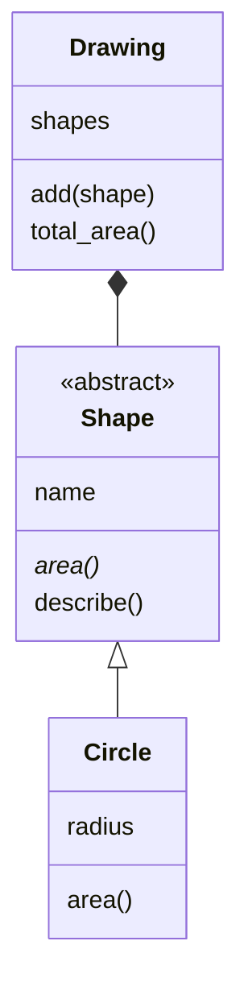

# Lab 11.4: Code-Review

**Leitfragen:**

Welche Klasse würde beim Wechsel von JSON zu einer Datenbank geändert?

Nur `Scoreboard` in `storage.py`: Sie allein liest und schreibt `highscores.json` (Lab 10.3). `Game` ruft nur `scoreboard.add(...)` auf und merkt vom Wechsel nichts.

Wo steckt im Code noch <code>input</code> oder <code>print</code> in der Logik?

Eine Suche über alle Dateien zeigt es: Aufrufe stehen in `ui.py`, dazu ein `print` für den Abbruch in `__main__.py`. In `logic.py` taucht `print(` nur im Text eines Docstrings auf. `players.py` ruft Funktionen aus `ui` auf, enthält aber selbst kein `input`.

- Ein Code-Review ist das Lesen von Code mit einer Frageliste, bevor er weiterwächst: Was macht jede Klasse, wer kennt wen, wo stecken Dateien und Ein-/Ausgabe?
- Ein Klassendiagramm zeigt die Antworten auf einen Blick, ohne jede Zeile zu lesen.

## Begriffe

| Begriff | Bedeutung |
| --- | --- |
| Code-Review | Code mit einer Checkliste durchsehen und Verbesserungen notieren; wie Korrekturlesen eines Textes |
| Klassendiagramm | Bild aller Klassen mit Attributen, Methoden und Beziehungen |
| UML | Unified Modeling Language: genormte Zeichen für solche Diagramme; „UML light“ nutzt nur Kästen und vier Pfeile |
| Befund | eine Beobachtung im Review: was auffällt, wo, und warum es stört |
| eine Aufgabe pro Klasse | jede Klasse hat einen Grund, sich zu ändern (Fachbegriff: Single Responsibility) |

## Klassendiagramm (UML light)

Eine Klasse ist ein Kasten mit drei Fächern: Name, Attribute, Methoden. Abstrakte Klassen tragen `<<abstract>>`, abstrakte Methoden sind kursiv.

Die Linien zwischen den Kästen:

| Zeichen | Beziehung | Lesart | Im Kurs |
| --- | --- | --- | --- |
| Pfeil mit leerem Dreieck `<\|--` | Vererbung | „ist ein“ | Lab 10.1 |
| Linie mit gefüllter Raute `*--` | Komposition | „hat ein“, Teil gehört zum Ganzen | Lab 10.3 |
| Linie mit leerer Raute `o--` | Aggregation | „hat ein“, Teil lebt auch allein | Lab 10.3 |
| gestrichelter Pfeil `..>` | Abhängigkeit | „benutzt“ oder „erzeugt“ | – |

_Quelle: Wikimedia Commons, „UMLRelationships.svg“ (https://commons.wikimedia.org/wiki/File:UMLRelationships.svg), Kappamille, CC BY-SA 4.0, abgerufen am 08.11.2026._

Das Diagramm entsteht auf Papier oder als Mermaid-Text in einer `.md`-Datei; GitHub zeigt solchen Text als Bild an. Eine Zahl an der Linie (`"1" *-- "*"`) heißt „eins hat viele“.

## Kriterien

Die vollständige Liste zum Abhaken steht in der [Review-Checkliste](l04-review-checklist.md). Die wichtigsten:

| Kriterium | Warum |
| --- | --- |
| Eine Aufgabe pro Klasse und Datei | Eine Änderung (z. B. Datenbank statt JSON) trifft nur eine Stelle |
| Keine Dateizugriffe in der Spiellogik (`logic.py`) | Regeln lassen sich ohne Dateien testen und wiederverwenden |
| `input` und `print` nur in `ui.py` | Eine andere Oberfläche (Web, App) ersetzt nur `ui.py` |
| Kein Import im Kreis | `logic` kennt niemanden, sonst blockieren sich die Module beim Laden |
| Interne Daten geschützt | Von außen soll niemand die Geheimzahl ändern (Lab 9.3) |
| Gleiche Regel nur einmal im Code | Bei einer Änderung bleibt keine Kopie veraltet zurück |

## Suchen statt Lesen

Viele Kriterien prüft eine Suche über alle Dateien: **Edit → Find in Files** (`Strg+Shift+F`, macOS `Cmd+Shift+F`). Das Feld **files to include** (über die drei Punkte `…` aufklappen) begrenzt die Suche auf einen Ordner, z. B. `playground/guess_game`.

_Quelle: Visual Studio Code Docs, „Basic editing – Search across files“ (https://code.visualstudio.com/docs/editing/codebasics#_search-across-files), CC BY 4.0, abgerufen am 08.11.2026._

_Quelle: Visual Studio Code Docs, „Advanced search options“ (https://code.visualstudio.com/docs/editing/codebasics#_advanced-search-options), CC BY 4.0, abgerufen am 08.11.2026._

| Suchbegriff | Prüft |
| --- | --- |
| `input(` und `print(` | Ein-/Ausgabe außerhalb von `ui.py` |
| `open(`, `json`, `Path` | Dateizugriffe außerhalb von `storage.py` |
| `import` | wer welches Modul kennt (Importgraph) |
| `replace(".", ",")` | dieselbe Formatierung an mehreren Stellen |

Ein Treffer ist noch kein Fehler: `print(` in einem Docstring oder Kommentar ist nur Text. Jeder Treffer wird angesehen und bewertet.

## Befunde aufschreiben

Ein guter Befund nennt Datei, Stelle, Beobachtung und Vorschlag, in einer Zeile:

| Datei | Stelle | Beobachtung | Vorschlag |
| --- | --- | --- | --- |
| `ui.py` | `ask_level` | Prompt-Text steht zweimal in der Funktion | Text in eine Konstante |

Vorschläge sind Anregungen, keine Pflicht. Das Review ändert den Code nicht; Änderungen folgen danach in Ruhe.

## Fazit

- Ein Review prüft den Code gegen feste Kriterien: eine Aufgabe pro Klasse, keine Dateien und kein `print` in der Logik.
- Ein Klassendiagramm (UML light) zeigt Klassen und ihre Beziehungen mit vier Linienarten.
- **Find in Files** findet Verstöße schneller als Lesen; jeder Treffer wird bewertet.

In der Übung entsteht das Klassendiagramm des Spiels mit zwei Verbesserungsvorschlägen.
