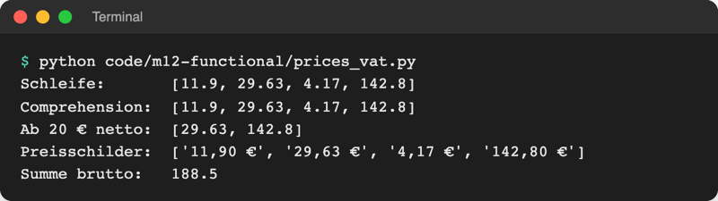
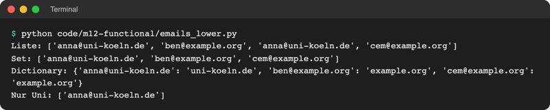
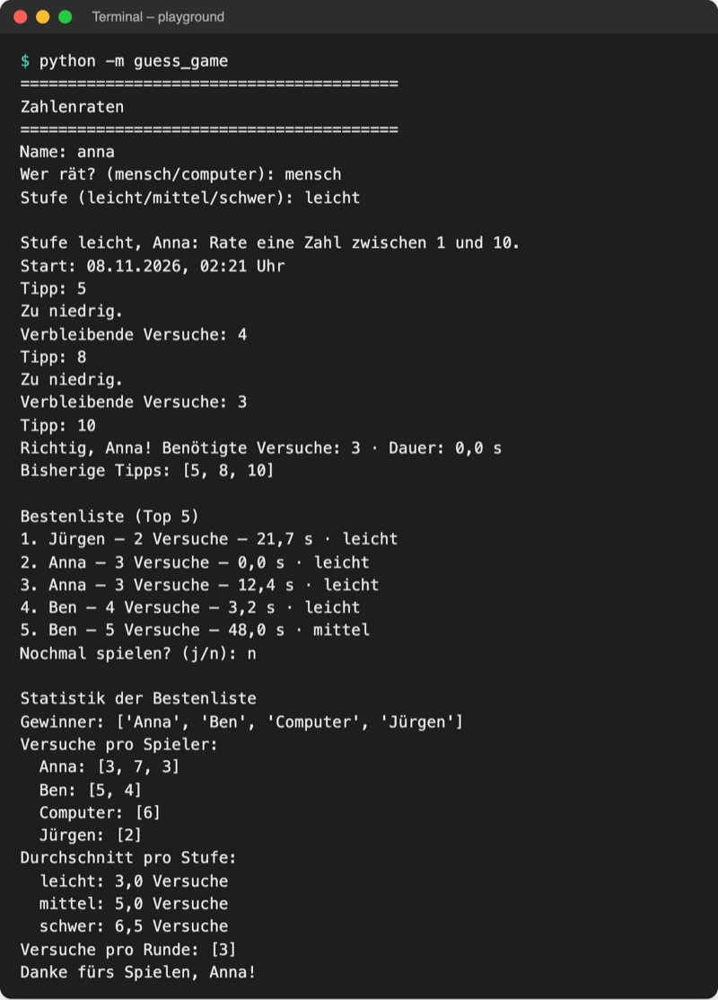

# Lab 12.1: Comprehensions

**Leitfragen:**

<details>
<summary>Wie entsteht aus einer Preisliste eine Liste mit Bruttopreisen?</summary>

Jeden Nettopreis einzeln mit 1,19 malnehmen und das Ergebnis in eine neue Liste legen. Eine Comprehension schreibt genau das in eine Zeile: `[price * 1.19 for price in net_prices]`.

</details>

<details>
<summary>Wie viele Zeilen braucht das mit einer normalen Schleife?</summary>

Drei: leere Liste anlegen, `for`-Zeile, `append` im Block. Die Comprehension braucht eine Zeile und keinen leeren Startwert.

</details>

<details>
<summary>Wann wird eine „Einzeiler“-Lösung unleserlich?</summary>

Sobald mehrere `for`, mehrere Bedingungen und Rechnungen in einer Zeile stehen. Dann ist eine normale Schleife mit sprechenden Namen besser lesbar.

</details>

- Eine Comprehension baut eine neue Liste, ein neues Set oder ein neues Dictionary aus einer vorhandenen Folge, in einem einzigen Ausdruck.
- Sie ersetzt das Muster „leere Liste anlegen, Schleife, `append`“ aus Lab 4.1 und kann dabei filtern.

## Begriffe

| Begriff | Bedeutung |
| --- | --- |
| Comprehension | Schreibweise in Klammern, die aus einer Folge eine neue Sammlung baut; wie ein Satz „alle Preise mal 1,19“ |
| Listen-Comprehension | Comprehension in `[ ]`, Ergebnis ist eine Liste |
| Set-Comprehension | Comprehension in `{ }` mit einem Wert vorne, Ergebnis ist ein Set (doppelte Werte fallen weg) |
| Dict-Comprehension | Comprehension in `{ }` mit `schlüssel: wert` vorne, Ergebnis ist ein Dictionary |
| Ausdruck vorne | der Teil vor `for`; bestimmt, was in die neue Sammlung kommt |
| Filter (`if` hinten) | Bedingung am Ende; nur Elemente, für die sie wahr ist, kommen hinein |
| verschachtelte Comprehension | Comprehension mit zwei `for` oder mit einer Comprehension im Wert |

## Comprehensions auf einen Blick

Die Schreibweise stammt aus der Mathematik. Dort beschreibt die Mengenschreibweise eine Menge über eine Variable, ihre Herkunft und eine Bedingung: „alle x aus den natürlichen Zahlen, für die gilt …“.


_Quelle: Wikimedia Commons, „Diagram of Set Builder Notation“, Addemf, CC0 (https://commons.wikimedia.org/wiki/File:Diagram_of_Set_Builder_Notation.png), abgerufen am 08.11.2026._

Python übernimmt die drei Teile fast wörtlich: `[x for x in numbers if x % 3 == 0]` = Variable, Herkunft, Bedingung.

| Jahr | Python-Version | Neu | Quelle |
| --- | --- | --- | --- |
| 2000 | 2.0 | Listen-Comprehension | [PEP 202](https://peps.python.org/pep-0202/) |
| 2004 | 2.4 | Generator-Ausdruck (Lab 12.3) | [PEP 289](https://peps.python.org/pep-0289/) |
| 2008/2010 | 3.0 / 2.7 | Dict- und Set-Comprehension | [PEP 274](https://peps.python.org/pep-0274/) |

## Vorher: Schleife mit append

Datei: [code/m12-functional/prices_vat.py](../../project/code/m12-functional/prices_vat.py)

```python
net_prices = [10.0, 24.9, 3.5, 120.0]
VAT = 1.19  # 19 % Mehrwertsteuer

gross_prices = []
for price in net_prices:
    gross_prices.append(round(price * VAT, 2))
```

## Nachher: Listen-Comprehension

```python
gross_prices = [round(price * VAT, 2) for price in net_prices]
```

Gelesen von innen nach außen: „für jeden `price` in `net_prices`: berechne `round(price * VAT, 2)` und sammle das Ergebnis in einer Liste“.

```text
[ round(price * VAT, 2)   for price in net_prices   if price >= 20 ]
  └ Ausdruck: was hinein   └ Herkunft: woher        └ Filter: optional
```

| Teil | Schleife | Comprehension |
| --- | --- | --- |
| leere Liste | `gross_prices = []` | entfällt, die Klammern `[ ]` erzeugen sie |
| Durchlauf | `for price in net_prices:` | `for price in net_prices` (ohne Doppelpunkt) |
| Wert ablegen | `gross_prices.append(...)` | der Ausdruck vorne |
| Bedingung | `if price >= 20:` im Block | `if price >= 20` am Ende |

Original: [Python-Dokumentation, Abschnitt 5.1.3 List Comprehensions: Quadratzahlen erst mit Schleife und append, dann als map mit lambda und als Comprehension](https://docs.python.org/3.14/tutorial/datastructures.html#list-comprehensions), Stand 08.11.2026.

## Mit Bedingung filtern

```python
expensive = [round(price * VAT, 2) for price in net_prices if price >= 20]
labels = [f"{price:.2f} €".replace(".", ",") for price in gross_prices]
```

Vorne darf jeder Ausdruck stehen, der einen Wert liefert: Rechnung, Methodenaufruf, f-String. `:.2f` gibt zwei Nachkommastellen aus (wie `:.1f` aus Lab 6.3).



_Quelle: eigener Screenshot, Kurs-Repo, 08.11.2026._

## Set- und Dict-Comprehension

Datei: [code/m12-functional/emails_lower.py](../../project/code/m12-functional/emails_lower.py)

```python
cleaned = [email.strip().lower() for email in emails]          # Liste
unique = {email.strip().lower() for email in emails}           # Set: ohne Doppelte
domains = {email: email.split("@")[1] for email in sorted(unique)}  # Dictionary
```

| Klammern | vorne | Ergebnis |
| --- | --- | --- |
| `[ ... ]` | ein Wert | Liste, Reihenfolge wie die Quelle, Doppelte bleiben |
| `{ ... }` | ein Wert | Set, Doppelte fallen weg, keine feste Reihenfolge |
| `{ ... }` | `schlüssel: wert` | Dictionary („Mapping“: Schlüssel → Wert) |



_Quelle: eigener Screenshot, Kurs-Repo, 08.11.2026._

## Verschachtelt – und wann eine Schleife lesbarer ist

Datei: [code/m12-functional/nested_comprehension.py](../../project/code/m12-functional/nested_comprehension.py). Zwei `for` lesen sich wie zwei verschachtelte Schleifen (Lab 3.4), von links nach rechts:

```python
all_grades = [grade for grades in courses.values() for grade in grades]
good = {course: [g for g in grades if g < 2.5] for course, grades in courses.items()}
```

Die zweite Zeile ist eine **Comprehension im Wert**: Für jeden Kurs entsteht als Wert eine eigene kleine Liste.

| Comprehension passt | Schleife ist besser |
| --- | --- |
| ein `for`, höchstens ein `if` | zwei `for` und dazu Bedingungen |
| ein kurzer Ausdruck vorne | Zwischenergebnisse, die einen Namen verdienen |
| Ergebnis ist eine neue Sammlung | etwas soll passieren (`print`, Datei schreiben) |
| passt in eine Zeile (≤ 88 Zeichen) | Zeile müsste umbrochen werden, um lesbar zu sein |

Eine Comprehension nur für `print` (`[print(x) for x in names]`) baut eine sinnlose Liste aus `None`. Für Ausgaben bleibt die `for`-Schleife.

**Ausblick:** Mit runden Klammern direkt in einer Funktion entsteht keine Liste, sondern ein Generator-Ausdruck: `sum(price * VAT for price in net_prices)`. Was das spart, zeigt Lab 12.3.

## Im Spiel: Statistik der Bestenliste

`logic.statistics(scores)` wertet die Score-Objekte der Bestenliste aus. Drei Comprehensions liefern drei Ergebnisse (`average` rundet den Mittelwert auf eine Stelle):

```python
winners = {score.name for score in scores}                       # Set
tries_per_player = {
    name: [score.tries for score in scores if score.name == name]  # Dict mit Liste
    for name in winners
}
levels = {score.level for score in scores}  # gespielte Stufen
average_per_level = {
    level: average([score.tries for score in scores if score.level == level])
    for level in levels
}
```

`ui.show_statistics` druckt das Ergebnis vor dem Abschied, sortiert mit `sorted`, weil Sets keine feste Reihenfolge haben.



_Quelle: eigener Screenshot, Kurs-Repo, 08.11.2026 (Bestenliste aus `data/highscores_sample.json`)._

## Typische Fehler

| Symptom | Ursache | Lösung |
| --- | --- | --- |
| `SyntaxError: invalid syntax` bei `[x for x in numbers:]` | Doppelpunkt aus der Schleife mitkopiert | Doppelpunkt in der Comprehension weglassen |
| `SyntaxError` bei `[x if x > 0 for x in numbers]` | `if` ohne `else` steht vorne | Filter ans Ende: `[x for x in numbers if x > 0]` |
| Ergebnis ist ein Set statt Dictionary | `{name for ...}` ohne `schlüssel: wert` | Doppelpunkt vorne: `{name: len(name) for ...}` |
| Reihenfolge der Gewinner wechselt | Sets haben keine feste Reihenfolge | zum Anzeigen `sorted(...)` verwenden |
| `ZeroDivisionError` in `average` | leere Liste, z. B. leere Bestenliste | vorher prüfen; das Spiel zeigt dann „Noch keine Einträge.“ |
| Zeile kaum lesbar | zu viel in einer Comprehension | in eine Schleife mit Zwischennamen umbauen |

## Fazit

- `[ausdruck for element in folge if bedingung]` ersetzt leere Liste + Schleife + `append`.
- `{wert for ...}` baut ein Set, `{schlüssel: wert for ...}` ein Dictionary.
- Lesbarkeit entscheidet: ein `for`, ein `if`, eine Zeile; sonst die normale Schleife.

In der Übung bekommt das eigene Spiel eine Statistikfunktion mit drei Comprehensions.
