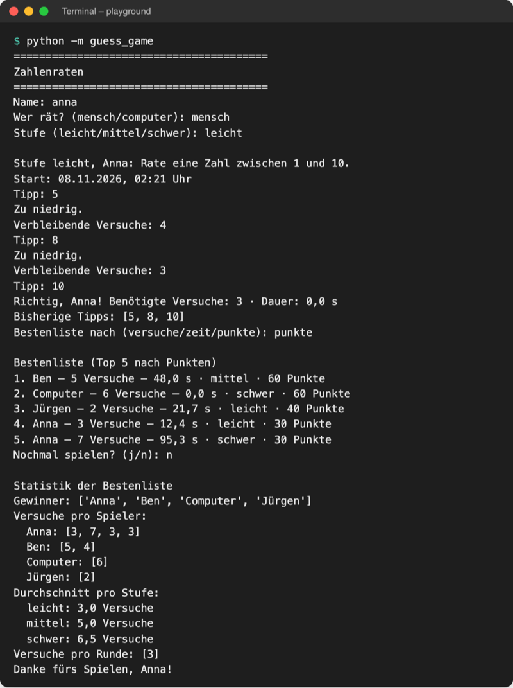

# Lab 12.2 – Lösung: Umschaltbare Bestenliste

Fertiger Stand: [project/examples/m12-functional/l02-lambda/guess_game/](../../project/examples/m12-functional/l02-lambda/guess_game/). Test im Ordner `project/`: `cd examples/m12-functional/l02-lambda`, dann `python -m guess_game`.

## Aufgabe 1: LEVEL_POINTS

```python
# Stufe -> Funktion, die aus den Versuchen Punkte macht (Funktionen als Werte)
# weniger Versuche und schwerere Stufe = mehr Punkte
LEVEL_POINTS = {
    "leicht": lambda tries: (6 - tries) * 10,
    "mittel": lambda tries: (8 - tries) * 20,
    "schwer": lambda tries: (8 - tries) * 30,
}
```

`logic.LEVEL_POINTS['leicht'](1)` gibt `50` aus: `['leicht']` holt die Funktion, `(1)` ruft sie auf. Die Zahlen 6 und 8 liegen je eins über den erlaubten Versuchen der Stufe, so gibt auch der letzte Versuch noch Punkte (leicht 5 Versuche = 10, schwer 7 Versuche = 30). Jede Stufe könnte eine ganz andere Regel haben, etwa einen Bonus für einen Treffer im ersten Versuch; deshalb Funktionen statt nur eines Faktors.

## Aufgabe 2: Score.points()

```python
    def points(self):
        """Berechnet die Punkte mit der Funktion, die zur Stufe gehört."""
        calculate = LEVEL_POINTS[self.level]  # eine Funktion aus dem Dictionary
        return calculate(self.tries)
```

`points` ist eine Methode und kein Dataclass-Feld: Die Punkte werden immer aus `level` und `tries` berechnet und landen deshalb nicht in `highscores.json`.

## Aufgabe 3: Scoreboard.top()

```python
    def top(self, by="versuche", count=5):
        """Gibt die besten Ergebnisse zurück: nach Versuchen, Zeit oder Punkten."""
        if by == "zeit":
            ranked = sorted(self.scores, key=lambda score: score.seconds)
        elif by == "punkte":
            ranked = sorted(self.scores, key=lambda score: score.points(), reverse=True)
        else:  # "versuche": sorted vergleicht mit Score.__lt__
            ranked = sorted(self.scores)
        return ranked[:count]
```

In der Lambda für Punkte stehen Klammern (`score.points()`): Der Schlüssel ist das Ergebnis der Methode. Bei gleichen Punkten bleibt die Reihenfolge der Datei.

## Aufgabe 4: RANKINGS, ask_ranking() und show_highscores()

```python
# Sortierung -> Überschrift der Bestenliste
RANKINGS = {"versuche": "Versuchen", "zeit": "Zeit", "punkte": "Punkten"}


def ask_ranking():
    """Fragt, wonach die Bestenliste sortiert wird; Enter = nach Versuchen."""
    by = input("Bestenliste nach (versuche/zeit/punkte): ").strip().lower()
    if by not in RANKINGS:  # leer oder unbekannt
        by = "versuche"
    return by


def show_highscores(scores, by="versuche"):
    """Zeigt die Bestenliste mit Platz, Score, Stufe und Punkten."""
    print(f"\nBestenliste (Top 5 nach {RANKINGS[by]})")
    place = 1
    for score in scores:
        # f-String nutzt Score.__str__
        print(f"{place}. {score} · {score.level} · {score.points()} Punkte")
        place += 1
```

`RANKINGS` erfüllt zwei Aufgaben: Es prüft die Eingabe (`in`) und liefert das Wort für die Überschrift.

## Aufgabe 5: __main__.py und Test

```python
        if score.won:
            by = ui.ask_ranking()
            ui.show_highscores(scoreboard.top(by), by)
```

Lauf mit `data/highscores_sample.json` als `highscores.json` (Eingaben `anna`, `mensch`, `leicht`, `5`, `8`, `10`, dann `zeit` bzw. `punkte`), Auszug:

```text
Bestenliste nach (versuche/zeit/punkte): zeit

Bestenliste (Top 5 nach Zeit)
1. Computer – 6 Versuche – 0,0 s · schwer · 60 Punkte
2. Anna – 3 Versuche – 0,0 s · leicht · 30 Punkte
3. Ben – 4 Versuche – 3,2 s · leicht · 20 Punkte
4. Anna – 3 Versuche – 12,4 s · leicht · 30 Punkte
5. Jürgen – 2 Versuche – 21,7 s · leicht · 40 Punkte
```



_Quelle: eigener Screenshot, Kurs-Repo, 08.11.2026 (Bestenliste aus `data/highscores_sample.json`, Eingaben per Skript, daher 0,0 s)._

Nur Enter ergibt `Bestenliste (Top 5 nach Versuchen)` mit Jürgen (2 Versuche) oben. Bei echt gespielten Runden zeigt die Sortierung nach Zeit auch ohne vorbereitete Datei Unterschiede.

## Erweiterung

```python
import json
from pathlib import Path

with open(Path("../data/persons.json"), encoding="utf-8") as file:
    persons = json.load(file)

adults = filter(lambda person: person["age"] >= 18, persons)
names = list(map(lambda person: person["name"], adults))
print("Ab 18:", names)

tallest = max(persons, key=lambda person: person["height"])
print("Am größten:", tallest["name"], tallest["height"], "cm")
```

```text
Ab 18: ['Petra', 'Jülide']
Am größten: Petra 178 cm
```

`map` arbeitet hier direkt auf dem Ergebnis von `filter`; erst `list(...)` holt die Werte. Als Comprehension: `[p["name"] for p in persons if p["age"] >= 18]`.
