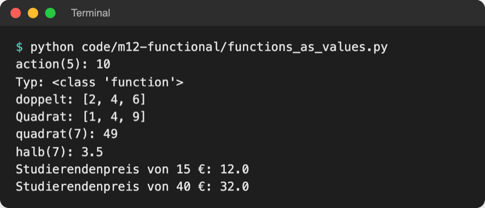
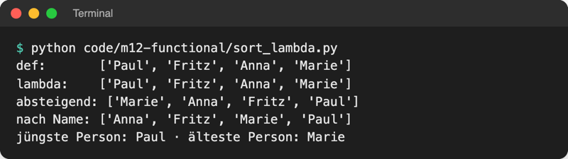
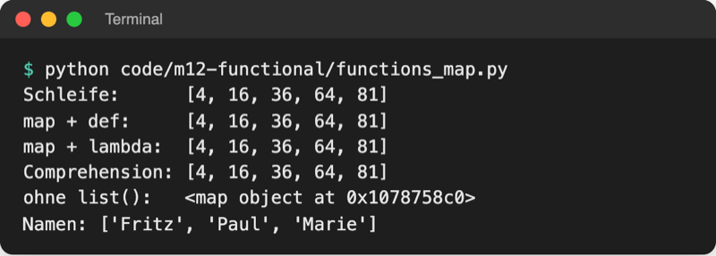
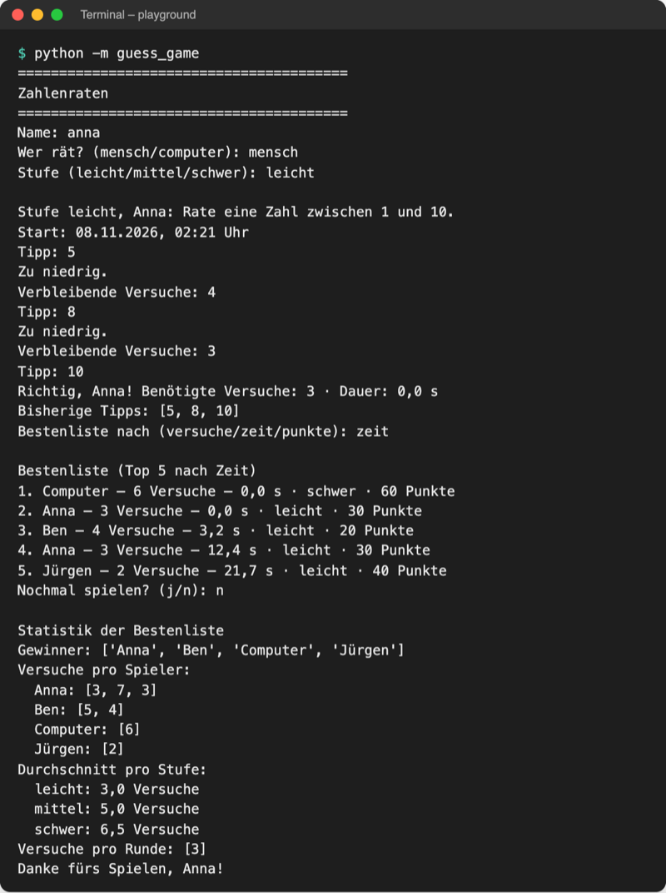

# Lab 12.2: lambda, map, filter

**Leitfragen:**

<details>
<summary>Wie sortiert man Personen nach Alter statt nach Name?</summary>

Mit `sorted(persons, key=...)` (Lab 8.2): Die Schlüsselfunktion liefert für jede Person das Alter. Statt einer eigenen `def`-Funktion reicht ein `lambda person: person["age"]` direkt an der Stelle.

</details>

<details>
<summary>Kann man ein Rezept in ein Rezept geben?</summary>

Ja: „Bereite die Soße nach Rezept B zu“ steht mitten in Rezept A. In Python ist eine Funktion ein Wert wie eine Zahl und lässt sich an eine andere Funktion übergeben, in einem Dictionary ablegen oder zurückgeben.

</details>

<details>
<summary>Was ist der Vorteil einer Funktion ohne Nebenwirkungen?</summary>

Sie liefert bei gleicher Eingabe immer dasselbe Ergebnis und verändert nichts außerhalb. Sie lässt sich daher einzeln testen, beliebig oft aufrufen und gefahrlos weitergeben.

</details>

- Funktionen sind in Python Objekte: Sie haben einen Namen, lassen sich aber wie jeder andere Wert speichern und übergeben.
- `lambda` schreibt eine kleine Funktion in einer Zeile; `sorted`, `min`, `max`, `map` und `filter` nehmen solche Funktionen entgegen.

## Begriffe

| Begriff | Bedeutung |
| --- | --- |
| Funktion als Wert | Funktionsname ohne `()` meint die Funktion selbst, nicht ihr Ergebnis; wie ein Rezeptzettel statt des fertigen Kuchens |
| Funktion höherer Ordnung | Funktion, die eine Funktion als Argument bekommt oder zurückgibt, z. B. `sorted` mit `key=` |
| `lambda` | kleine Funktion ohne Namen aus genau einem Ausdruck: `lambda tries: tries * 10` |
| `map(funktion, folge)` | wendet die Funktion auf jedes Element an |
| `filter(funktion, folge)` | behält nur die Elemente, für die die Funktion `True` liefert |
| Schlüsselfunktion (`key=`) | Funktion, nach deren Ergebnis `sorted`, `min`, `max` vergleichen |
| Closure | innere Funktion, die sich Werte der äußeren Funktion merkt, auch nachdem diese fertig ist |
| Nebenwirkung (Seiteneffekt) | alles, was eine Funktion außer ihrem Rückgabewert verändert: Ausgabe, Datei, Liste von außen |
| reine Funktion | Funktion ohne Nebenwirkungen: gleiche Eingabe, gleiches Ergebnis |

## Funktionen sind Werte

Datei: [code/m12-functional/functions_as_values.py](../../project/code/m12-functional/functions_as_values.py). `key=get_tries` aus Lab 8.2 hat das schon genutzt: ohne Klammern übergeben, `sorted` ruft selbst auf.

```python
def double(number):
    return number * 2


def square(number):
    return number * number


action = double                     # 1. in einer Variablen: kein Aufruf, nur der Name
print(action(5))                    # 10


def apply_to_all(function, numbers):  # 2. als Argument
    return [function(number) for number in numbers]


operations = {"doppelt": double, "quadrat": square}  # 3. im Dictionary
print(operations["quadrat"](7))     # Funktion holen, dann mit (7) aufrufen
```



_Quelle: eigener Screenshot, Kurs-Repo, 08.11.2026._

**Funktion zurückgeben (Closure):** `make_discount(20)` liefert eine neue Funktion, die sich die 20 merkt:

```python
def make_discount(percent):
    def discount(price):
        return round(price * (100 - percent) / 100, 2)
    return discount                   # Funktion zurückgeben, nicht aufrufen


student_price = make_discount(20)
print(student_price(15))              # 12.0
```

## lambda: Funktion in einer Zeile

```text
lambda person: person["age"]
       └ Parameter └ Ausdruck = Rückgabewert (ohne return)
```

| | `def` | `lambda` |
| --- | --- | --- |
| Name | ja, z. B. `get_age` | keiner (anonym) |
| Inhalt | beliebig viele Anweisungen | genau ein Ausdruck |
| `return`, Docstring | ja | nein, der Ausdruck ist das Ergebnis |
| Einsatz | wiederverwendete Logik | kurzer Einmal-Schlüssel, z. B. für `sorted` |

`lambda`, `map` und `filter` kamen im Januar 1994 in Python, nach dem Vorbild funktionaler Sprachen wie Lisp und Scheme ([Guido van Rossum, The History of Python](https://python-history.blogspot.com/2009/04/origins-of-pythons-functional-features.html), abgerufen am 08.11.2026). Eine Lambda in einer Variablen (`f = lambda x: x * 2`) ist erlaubt, aber unüblich: Dafür ist `def` lesbarer (PEP 8).

## sorted, min und max mit key=lambda

Datei: [code/m12-functional/sort_lambda.py](../../project/code/m12-functional/sort_lambda.py)

```python
by_age = sorted(persons, key=lambda person: person["age"])
oldest_first = sorted(persons, key=lambda person: person["age"], reverse=True)
youngest = min(persons, key=lambda person: person["age"])
```

- `reverse=True` (Lab 8.2) dreht die Reihenfolge um: größter Schlüssel zuerst.
- Bei gleichem Schlüssel bleibt die ursprüngliche Reihenfolge erhalten (`sorted` ist stabil).
- `min`/`max` liefern das ganze Element, nicht nur den Schlüssel.

Original: [Python-Dokumentation, Sorting Techniques, Abschnitt Key Functions mit sorted und key=lambda](https://docs.python.org/3.14/howto/sorting.html#key-functions), Stand 08.11.2026.



_Quelle: eigener Screenshot, Kurs-Repo, 08.11.2026._

## map und filter oder Comprehension?

Dateien: [code/m12-functional/functions_map.py](../../project/code/m12-functional/functions_map.py), [code/m12-functional/functions_filter.py](../../project/code/m12-functional/functions_filter.py)

```python
squares = list(map(lambda num: num**2, nums))        # jedes Element umwandeln
evens = list(filter(lambda num: num % 2 == 0, nums))  # Elemente auswählen
```

`map` und `filter` liefern kein fertiges Ergebnis, sondern ein Objekt, das erst auf Anfrage rechnet (Prinzip in Lab 12.3). `list(...)` sammelt die Werte ein.

| Aufgabe | `map` / `filter` | Comprehension (Lab 12.1) |
| --- | --- | --- |
| jedes Element umwandeln | `list(map(square_num, nums))` | `[num**2 for num in nums]` |
| Elemente auswählen | `list(filter(is_even, nums))` | `[num for num in nums if num % 2 == 0]` |
| beides zusammen | `list(map(f, filter(g, nums)))` | `[f(n) for n in nums if g(n)]` |
| passt gut, wenn | es die Funktion schon mit Namen gibt | ein kurzer Ausdruck reicht |
| Ergebnis | map-/filter-Objekt, `list()` nötig | sofort eine Liste |

In Python gilt meist die Comprehension als lesbarer; `map` und `filter` lohnen sich vor allem, wenn es die Funktion schon mit Namen gibt.



_Quelle: eigener Screenshot, Kurs-Repo, 08.11.2026._

## Grundideen funktionaler Programmierung

```python
def add_bonus(points, bonus):          # rein: rechnet nur, gibt zurück
    return points + bonus


log = []


def add_bonus_logged(points, bonus):   # Nebenwirkung: ändert die Liste log außerhalb
    log.append(bonus)
    return points + bonus
```

Beide liefern `13` für `(10, 3)`. Nach drei Aufrufen von `add_bonus_logged` ist `log` aber drei Einträge lang: Das Ergebnis hängt nicht mehr nur von den Argumenten ab.

| Idee | Bedeutung | Im Spiel |
| --- | --- | --- |
| keine Nebenwirkungen | Funktion rechnet nur und gibt zurück | `logic.statistics`, `Score.points` |
| unveränderliche Daten | neue Werte erzeugen statt alte ändern | `sorted` liefert eine neue Liste, `scores` bleibt |
| Funktionen als Bausteine | Verhalten als Wert übergeben | `key=lambda ...`, `LEVEL_POINTS` |

Ein- und Ausgabe sind immer Nebenwirkungen; deshalb liegen sie im Spiel gebündelt in `ui.py` und `storage.py`.

## Im Spiel: Punkte pro Stufe und umschaltbare Bestenliste

`logic.py` speichert pro Stufe eine Regel als Funktion; `Score.points()` holt die passende und ruft sie auf:

```python
LEVEL_POINTS = {
    "leicht": lambda tries: (6 - tries) * 10,
    "mittel": lambda tries: (8 - tries) * 20,
    "schwer": lambda tries: (8 - tries) * 30,
}

    def points(self):
        """Berechnet die Punkte mit der Funktion, die zur Stufe gehört."""
        calculate = LEVEL_POINTS[self.level]  # eine Funktion aus dem Dictionary
        return calculate(self.tries)
```

`Scoreboard.top(by)` in `storage.py` wählt die Sortierung; nach jedem Gewinn fragt das Spiel `Bestenliste nach (versuche/zeit/punkte):` (Enter = nach Versuchen):

```python
        if by == "zeit":
            ranked = sorted(self.scores, key=lambda score: score.seconds)
        elif by == "punkte":
            ranked = sorted(self.scores, key=lambda score: score.points(), reverse=True)
```



_Quelle: eigener Screenshot, Kurs-Repo, 08.11.2026. Bestenliste aus `data/highscores_sample.json`; die neue Runde zeigt 0,0 s, weil die Eingaben per Skript kommen._

## Typische Fehler

| Symptom | Ursache | Lösung |
| --- | --- | --- |
| `TypeError: 'int' object is not callable` | Funktion mit `()` übergeben: `key=get_age()` | ohne Klammern: `key=get_age` |
| Ausgabe `<map object at 0x…>` | `map`/`filter` noch nicht eingesammelt | `list(map(...))` |
| zweites `list(evens)` ist leer | map-/filter-Objekt ist nach einem Durchlauf verbraucht | Ergebnis einmal in einer Liste speichern |
| `SyntaxError` bei `lambda x: return x * 2` | `return` in einer Lambda | nur den Ausdruck schreiben: `lambda x: x * 2` |
| Bestenliste nach Punkten zeigt die schlechtesten zuerst | `reverse=True` fehlt | bei „mehr ist besser“ absteigend sortieren |
| `KeyError: 'Leicht'` in `points()` | Stufenname in `highscores.json` anders geschrieben | Stufen klein schreiben wie in `LEVELS` |

## Vertiefung

`functools` aus der Standardbibliothek bringt weitere Werkzeuge für Funktionen:

```python
from functools import partial, reduce

reduce(lambda total, n: total + n, [3, 5, 2], 0)  # 10: Liste zu einem Wert falten


def power(base, exponent):
    return base**exponent


square = partial(power, exponent=2)  # neue Funktion: power mit festem exponent
print(square(7))                     # 49
```

Für Summen ist `sum` lesbarer als `reduce`; seit Python 3 liegt `reduce` deshalb nicht mehr bei den eingebauten Funktionen.

## Fazit

- Eine Funktion ohne `()` ist ein Wert: speichern, übergeben, zurückgeben.
- `lambda parameter: ausdruck` ist die Kurzform für kleine Schlüsselfunktionen.
- `sorted`/`min`/`max` mit `key=`, `reverse=True` für absteigend; `map`/`filter` oder Comprehension für Umwandeln und Auswählen.

In der Übung bekommt das eigene Spiel Punkte pro Stufe und eine Bestenliste nach Versuchen, Zeit oder Punkten.
