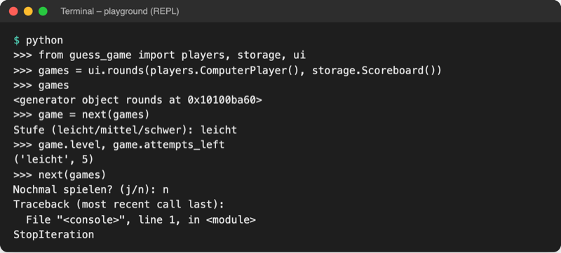

# Lab 12.3 – Lösung: Runden aus einem Generator

Fertiger Stand (Spiel v3): [project/examples/m12-functional/l03-generators/guess_game/](../../project/examples/m12-functional/l03-generators/guess_game/). Test im Ordner `project/`: `cd examples/m12-functional/l03-generators`, dann `python -m guess_game`.

## Aufgabe 1: Generatorfunktion rounds()

```python
def rounds(player, scoreboard):
    """Generator: liefert Runde für Runde ein neues Spiel, bis niemand mehr will."""
    while True:
        level = ask_level()
        yield logic.Game(player, scoreboard, level)  # pausiert, bis for weitermacht
```

`while True` ist hier keine Gefahr: Der Generator rechnet nur, wenn jemand die nächste Runde abruft.

## Aufgabe 2: Ende mit return

```python
        if ask_play_again() != "j":
            return  # Generator endet, die for-Schleife hört auf
```

Die Frage steht **hinter** dem `yield`: Der Generator wacht erst auf, wenn die `for`-Schleife die nächste Runde will, also nach dem Ende der gespielten Runde. `return` ohne Wert beendet den Generator; Python löst dafür `StopIteration` aus.

## Aufgabe 3: Prüfung im interaktiven Modus



_Quelle: eigener Screenshot, Kurs-Repo, 08.11.2026 (Transkript einer echten Sitzung im Ordner `examples/m12-functional/l03-generators`)._

- `ui.rounds(...)` allein fragt noch nichts: Es entsteht nur das Generator-Objekt.
- `next(games)` läuft bis zum ersten `yield`: Stufenfrage, dann ein `Game` mit 5 Versuchen.
- Das zweite `next(games)` setzt hinter dem `yield` fort, fragt `Nochmal spielen?` und endet nach `n` mit `StopIteration`. In der `for`-Schleife fängt Python dieses Signal ab.

## Aufgabe 4: for statt while in __main__.py

```python
def main():
    """Hauptablauf: Name fragen, Runden spielen, bis niemand mehr will."""
    ui.show_banner()
    name = ui.ask_name()
    if ui.ask_player_type() == "computer":
        player = players.ComputerPlayer()
    else:
        player = players.HumanPlayer(name)
    scoreboard = storage.Scoreboard()  # lädt highscores.json einmal
    all_tries = []
    for game in ui.rounds(player, scoreboard):  # eine Runde pro Durchlauf
        score = ui.play_round(game)
        all_tries.append(score.tries)
        storage.append_history(score)  # jede Runde, auch verlorene
        game.save_score()  # Game entscheidet, ob das Ergebnis in die Liste kommt
        if score.won:
            by = ui.ask_ranking()
            ui.show_highscores(scoreboard.top(by), by)
    ui.show_statistics(logic.statistics(scoreboard.scores))
    ui.show_goodbye(name, all_tries)
```

Fünf Zeilen entfallen (`play_again = "j"`, `while`, `ask_level`, `logic.Game(...)`, `play_again = ui.ask_play_again()`), eine `for`-Zeile kommt dazu. `logic` wird in `__main__.py` weiter für `logic.statistics` gebraucht.

## Aufgabe 5: Test

Eingaben `anna`, `mensch`, `leicht`, `5`, `8`, `10`, Enter, `j`, `leicht`, `9`, `punkte`, `n` (leere Bestenliste zu Beginn), Auszug ab dem ersten Gewinn:

```text
Bisherige Tipps: [5, 8, 10]
Bestenliste nach (versuche/zeit/punkte): 

Bestenliste (Top 5 nach Versuchen)
1. Anna – 3 Versuche – 0,0 s · leicht · 30 Punkte
Nochmal spielen? (j/n): j
Stufe (leicht/mittel/schwer): leicht

Stufe leicht, Anna: Rate eine Zahl zwischen 1 und 10.
Start: 08.11.2026, 02:26 Uhr
Tipp: 9
Richtig, Anna! Benötigte Versuche: 1 · Dauer: 0,0 s
Bisherige Tipps: [9]
Bestenliste nach (versuche/zeit/punkte): punkte

Bestenliste (Top 5 nach Punkten)
1. Anna – 1 Versuch – 0,0 s · leicht · 50 Punkte
2. Anna – 3 Versuche – 0,0 s · leicht · 30 Punkte
Nochmal spielen? (j/n): n

Statistik der Bestenliste
Gewinner: ['Anna']
Versuche pro Spieler:
  Anna: [3, 1]
Durchschnitt pro Stufe:
  leicht: 2,0 Versuche
Versuche pro Runde: [3, 1]
Danke fürs Spielen, Anna!
```

Die Ausgabe gleicht Lab 12.2 Zeile für Zeile. `Strg+C` bei `Tipp:` ergibt eine Leerzeile und `Spiel abgebrochen. Bis zum nächsten Mal!`: Das `try`/`except KeyboardInterrupt` um `main()` greift auch innerhalb des Generators.

## Erweiterung

```python
from pathlib import Path

LOG_FILE = Path("../data/sample.log")


def warn_times(path):
    """Generator: liefert die Uhrzeit jeder WARN-Zeile."""
    with open(path, encoding="utf-8") as file:
        for line in file:
            parts = line.split(" ")  # Datum, Uhrzeit, Stufe, Text ...
            if parts[2] == "WARN":
                yield parts[1]


for clock in warn_times(LOG_FILE):
    print("Warnung um", clock)
```

```text
Warnung um 08:03:51
Warnung um 08:07:38
Warnung um 08:07:58
Warnung um 08:18:30
Warnung um 08:19:01
Warnung um 08:39:40
Warnung um 08:43:15
Warnung um 08:44:06
```

Der Dateiname `warnings.py` wäre ungünstig: Python hat ein eingebautes Modul `warnings`, und eine gleichnamige eigene Datei überdeckt es (Lab 6.1).
