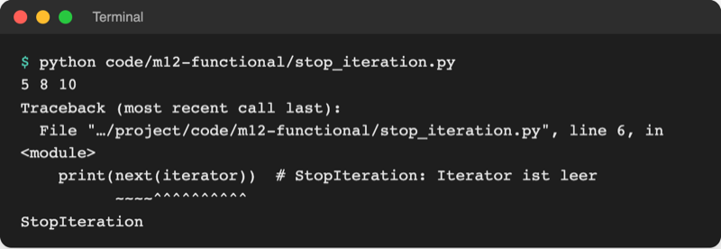
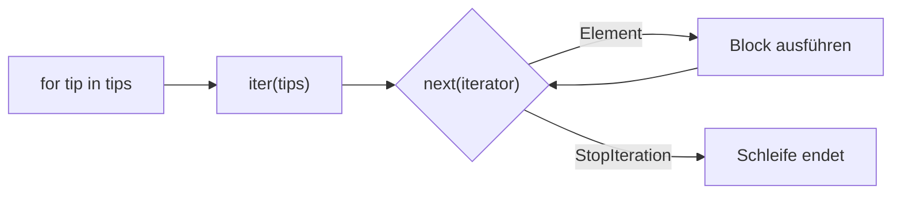
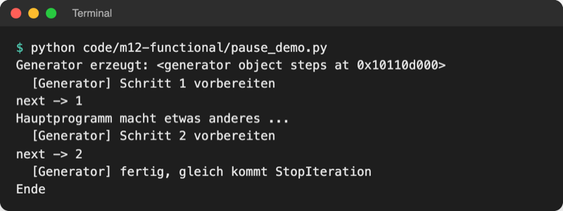
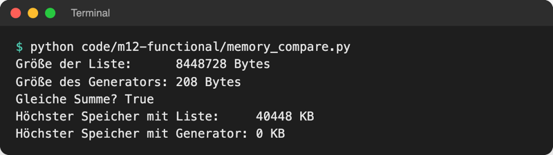
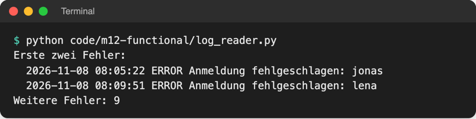

# Lab 12.3: Iteratoren und Generatoren

**Leitfragen:**

<details>
<summary>Wie liest man eine Datei mit 10 Millionen Zeilen, ohne den Speicher zu füllen?</summary>

Zeile für Zeile: lesen, verarbeiten, vergessen, nächste Zeile. `for line in file:` (Lab 8.1) arbeitet so; ein Generator verpackt dieses Vorgehen in eine eigene Funktion.

</details>

<details>
<summary>Woher weiß `for`, wann eine Liste zu Ende ist?</summary>

`for` fragt die Liste immer wieder nach dem nächsten Element. Gibt es keines mehr, meldet die Liste das mit einem Signal (`StopIteration`), und die Schleife endet still.

</details>

<details>
<summary>Wie kann eine Funktion „mittendrin pausieren“?</summary>

Mit `yield` statt `return`: Die Funktion gibt einen Wert ab, merkt sich Stelle und Variablen und macht beim nächsten Abruf genau dort weiter.

</details>

- Hinter jeder `for`-Schleife steht ein Iterator: ein Objekt, das auf Anfrage das nächste Element liefert.
- Ein Generator ist der einfachste Weg zu einem eigenen Iterator: eine Funktion mit `yield`, die Werte erst dann berechnet, wenn sie gebraucht werden.

## Begriffe

| Begriff | Bedeutung |
| --- | --- |
| iterierbar (Iterable) | alles, was `for` durchlaufen kann: Liste, String, Dictionary, Datei, `range` |
| Iterator | Objekt, das sich die aktuelle Position merkt und auf Anfrage das nächste Element liefert; wie ein Lesezeichen im Buch |
| `iter(folge)` | holt einen Iterator für eine iterierbare Folge |
| `next(iterator)` | liefert das nächste Element |
| `StopIteration` | Ausnahme, mit der ein Iterator „keine Elemente mehr“ meldet |
| Generatorfunktion | Funktion mit `yield`; ihr Aufruf liefert einen Generator, startet aber noch keine Zeile |
| `yield` | gibt einen Wert ab und pausiert die Funktion an dieser Stelle |
| Generator-Ausdruck | Comprehension in runden Klammern: `(n * n for n in numbers)` |
| bedarfsgesteuert (lazy) | Werte entstehen erst, wenn jemand nach ihnen fragt, nicht alle vorab |

## Was for intern macht

Datei: [code/m12-functional/iter_next.py](../../project/code/m12-functional/iter_next.py)

```python
tips = [5, 8, 10]
iterator = iter(tips)  # Lesezeichen an den Anfang
print(next(iterator))  # 5
print(next(iterator))  # 8
print(next(iterator))  # 10
```

Ein vierter `next(iterator)` löst `StopIteration` aus. Datei: [code/m12-functional/stop_iteration.py](../../project/code/m12-functional/stop_iteration.py) (absichtlich fehlerhaft)



_Quelle: eigener Screenshot, Kurs-Repo, 08.11.2026 (Pfad gekürzt)._

`for tip in tips:` macht dasselbe und fängt das Ende selbst ab, ausgeschrieben mit `try`/`except` aus Lab 7.2:

```python
iterator = iter(tips)
while True:
    try:
        tip = next(iterator)
    except StopIteration:  # keine Elemente mehr: Schleife beenden
        break
    print("Tipp:", tip)
```



Original: [Python-Dokumentation, Abschnitt 9.8 Iterators: for ruft iter() auf, next() liefert a, b, c und dann StopIteration](https://docs.python.org/3.14/tutorial/classes.html#iterators), Stand 08.11.2026.

## Eigener Iterator: Klasse oder Generator

Datei: [code/m12-functional/countdown.py](../../project/code/m12-functional/countdown.py). Dieselbe Aufgabe zweimal: von `start` bis 1 herunterzählen.

```python
class Countdown:
    def __init__(self, start):
        self.current = start

    def __iter__(self):
        return self              # das Objekt ist selbst sein Iterator

    def __next__(self):          # Magic Method für next() (Lab 11.1)
        if self.current < 1:
            raise StopIteration  # Ende melden
        value = self.current
        self.current -= 1
        return value
```

```python
def countdown(start):
    while start >= 1:
        yield start              # Wert abgeben und hier pausieren
        start -= 1
```

| | Klasse mit `__iter__`/`__next__` | Generatorfunktion |
| --- | --- | --- |
| Code | Klasse, zwei Methoden, Zustand in `self` | eine Funktion mit `yield` |
| Position merken | selbst in Attributen | Python merkt sich lokale Variablen |
| Ende melden | `raise StopIteration` | Funktion endet oder `return` |
| Einsatz | Iterator braucht weitere Methoden | fast immer |

`list(Countdown(3))` und `list(countdown(3))` ergeben beide `[3, 2, 1]`.

## yield: die pausierbare Funktion

Datei: [code/m12-functional/pause_demo.py](../../project/code/m12-functional/pause_demo.py)

```python
def steps():
    print("  [Generator] Schritt 1 vorbereiten")
    yield 1
    print("  [Generator] Schritt 2 vorbereiten")
    yield 2
    print("  [Generator] fertig, gleich kommt StopIteration")


gen = steps()            # noch läuft keine Zeile der Funktion
print("next ->", next(gen))
```



_Quelle: eigener Screenshot, Kurs-Repo, 08.11.2026._

Ablauf: Aufruf erzeugt nur das Generator-Objekt → `next` läuft bis zum ersten `yield` → Funktion schläft, Hauptprogramm arbeitet → nächstes `next` setzt hinter dem `yield` fort → Funktionsende löst `StopIteration` aus.

**Unendlicher Generator:** `while True:` mit `yield` ist erlaubt, weil der Generator nur auf Anfrage rechnet. `ticket_numbers()` in `countdown.py` liefert Wartenummern `A-1`, `A-2`, … so viele, wie `next` abruft. `list(...)` auf einen unendlichen Generator hört dagegen nie auf.

## Generator-Ausdruck und Speicher

Runde statt eckige Klammern machen aus einer Listen-Comprehension (Lab 12.1) einen Generator-Ausdruck. Direkt in einer Funktion reichen die Klammern der Funktion: `sum(n * n for n in numbers)`.

Datei: [code/m12-functional/memory_compare.py](../../project/code/m12-functional/memory_compare.py). Gemessen mit `tracemalloc` (Standardbibliothek, misst den Speicher, den Python belegt):

```python
total_list = sum([n * n for n in range(COUNT)])  # eckige Klammern: erst Liste
total_gen = sum(n * n for n in range(COUNT))     # runde Klammern: Wert für Wert
```



_Quelle: eigener Screenshot, Kurs-Repo, Python 3.14.2 auf macOS, 08.11.2026. Die Zahlen schwanken je nach System leicht._

| | Liste `[ ... ]` (Lagerhalle) | Generator `( ... )` (Förderband) |
| --- | --- | --- |
| Werte berechnet | alle sofort | einer pro Abruf |
| Speicher | wächst mit der Anzahl | bleibt klein |
| mehrfach durchlaufen | ja | nein, nach einem Durchlauf leer |
| Index `[2]`, `len()` | ja | nein |
| gut für | Ergebnisse, die bleiben und mehrfach gebraucht werden | große Dateien, lange Folgen, einmalige Summen |

## Beispiel: Generator für eine große Log-Datei

Datei: [code/m12-functional/log_reader.py](../../project/code/m12-functional/log_reader.py), liest [data/sample.log](../../project/data/sample.log) (40 erfundene Zeilen wie `2026-11-08 08:05:22 ERROR Anmeldung fehlgeschlagen: jonas`). Zwei Generatoren arbeiten hintereinander wie Stationen an einem Förderband:

```python
def read_lines(path):
    with open(path, encoding="utf-8") as file:
        for line in file:            # die Datei liest auch nur Zeile für Zeile
            yield line.rstrip("\n")  # rstrip: Zeilenumbruch rechts entfernen


def only_level(lines, level):
    for line in lines:
        if line.split(" ")[2] == level:  # Datum, Uhrzeit, Stufe, Text
            yield line


errors = only_level(read_lines(LOG_FILE), "ERROR")  # noch nichts gelesen
print(next(errors))
rest = sum(1 for line in errors)                    # zählt den Rest
```



_Quelle: eigener Screenshot, Kurs-Repo, 08.11.2026._

Bei 10 Millionen Zeilen ändert sich am Code nichts; im Speicher liegt trotzdem nur die aktuelle Zeile. `with` schließt die Datei, sobald der Generator fertig ist.

## Im Spiel: Runden aus einem Generator

Bisher steuert `__main__.py` die Runden mit einer `while`-Schleife und der Variable `play_again`:

```python
    play_again = "j"
    while play_again == "j":
        level = ui.ask_level()
        game = logic.Game(player, scoreboard, level)  # neues Spiel pro Runde
        score = ui.play_round(game)
        # ... Bestenliste ...
        play_again = ui.ask_play_again()
```

Neu liefert der Generator `ui.rounds` Runde für Runde ein `Game`; `__main__.py` braucht nur noch `for`:

```python
def rounds(player, scoreboard):
    """Generator: liefert Runde für Runde ein neues Spiel, bis niemand mehr will."""
    while True:
        level = ask_level()
        yield logic.Game(player, scoreboard, level)  # pausiert, bis for weitermacht
        if ask_play_again() != "j":
            return  # Generator endet, die for-Schleife hört auf
```

```python
    for game in ui.rounds(player, scoreboard):  # eine Runde pro Durchlauf
        score = ui.play_round(game)
        # ... Bestenliste ...
```

`return` in einem Generator beendet ihn; die `for`-Schleife erhält `StopIteration` und endet. Die Ausgabe des Spiels bleibt gleich, nur die Verantwortung wandert: `rounds` entscheidet, ob es weitergeht, die Schleife spielt nur.

## Typische Fehler

| Symptom | Ursache | Lösung |
| --- | --- | --- |
| `StopIteration` als Traceback | `next()` auf einen leeren Iterator | `for` nutzen oder `except StopIteration` |
| zweite Schleife über denselben Generator macht nichts | Generator ist nach einem Durchlauf verbraucht | Generatorfunktion neu aufrufen |
| Ausgabe `<generator object rounds at 0x…>` | Generator nur erzeugt, nie durchlaufen | `for`, `next()` oder `list()` |
| Funktion mit `yield` gibt nichts aus, obwohl `print` darin steht | Aufruf startet keine Zeile | mit `next()` oder `for` abrufen |
| `TypeError: 'generator' object is not subscriptable` | Index `[0]` auf einen Generator | `next(gen)` oder vorher `list(gen)` |
| Programm hängt, Speicher wächst | `list()` auf einen unendlichen Generator | nur so viele Werte mit `next` holen wie nötig |
| `TypeError: rounds() missing 2 required positional arguments` | `ui.rounds()` ohne Spieler und Bestenliste | `ui.rounds(player, scoreboard)` |

## Fazit

- `for` ruft `iter()` und dann `next()` auf, bis `StopIteration` kommt.
- `yield` macht eine Funktion zum Generator: Sie liefert Werte einzeln und pausiert dazwischen.
- Generatoren und Generator-Ausdrücke sparen Speicher, lassen sich aber nur einmal durchlaufen.

In der Übung liefert der Generator `rounds()` dem eigenen Spiel Runde für Runde.
