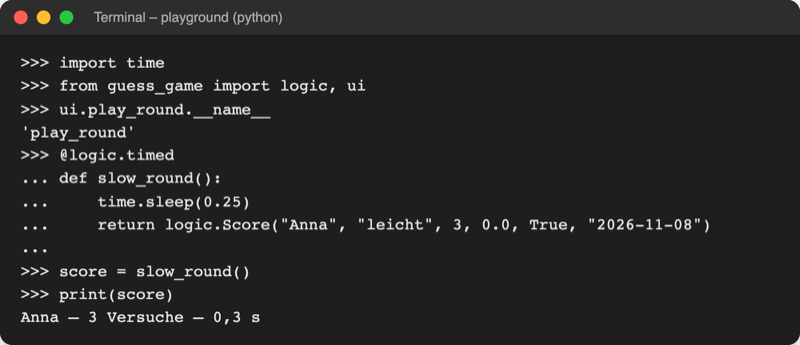

# Lab 13.1 – Lösung: Zeitmessung per @timed

Fertiger Stand: [project/examples/m13-pythonic/l01-decorators/guess_game/](../../project/examples/m13-pythonic/l01-decorators/guess_game/). Test im Ordner `project/`: `cd examples/m13-pythonic/l01-decorators`, dann `python -m guess_game`.

## Aufgabe 1: Decorator timed in logic.py

```python
import functools
import random
import time
```

```python
def timed(func):
    """Decorator: misst die Laufzeit von func und trägt sie ins Ergebnis ein."""

    @functools.wraps(func)  # Name und Docstring von func bleiben erhalten
    def wrapper(*args, **kwargs):
        start = time.perf_counter()  # Stoppuhr starten
        result = func(*args, **kwargs)  # die eigentliche Funktion aufrufen
        result.seconds = round(time.perf_counter() - start, 1)
        return result

    return wrapper
```

`timed` steht in `logic.py`, weil es weder `input` noch `print` braucht. `import time` war schon da.

## Aufgabe 2: Game ohne Stoppuhr

In `__init__` entfallen die zwei Zeilen `self.start_time = …` und `self.seconds = 0.0`, in `guess()` der Block `if self.is_over(): # Stoppuhr anhalten …`. Neu:

```python
    def save_score(self, score):
        """Trägt score in die Bestenliste ein, aber nur bei einem Gewinn."""
        if self.is_won:
            self.scoreboard.add(score)  # Dateizugriff erledigt Scoreboard

    def score(self):
        """Gibt das Ergebnis als Score zurück; die Dauer trägt @timed ein."""
        return Score(
            self.player.name,
            self.level,
            len(self.guesses),
            0.0,  # Dauer: misst der Decorator @timed um play_round
            self.is_won,
            self.started.strftime("%Y-%m-%d"),
        )
```

`save_score` bekommt den Score von außen: Nur der Score aus `play_round` trägt die gemessene Dauer. Ein neuer Aufruf von `self.score()` hätte wieder `0.0`.

## Aufgabe 3: play_round und show_result in ui.py

```python
@logic.timed  # misst die Dauer der Runde, ohne Messcode in der Funktion
def play_round(game):
    """Spielt eine Runde: Spieler tippt, Spiel wertet aus; gibt den Score zurück."""
    player = game.player
    # ... Kopfzeilen und while-Schleife unverändert ...
    return game.score()


def show_result(game, score):
    """Zeigt nach der Runde Gewinn oder Geheimzahl und die bisherigen Tipps."""
    player = game.player
    if score.won:
        duration = format_seconds(score.seconds)  # gemessen von @timed
        console.print(
            f"Richtig, {player.name}! Benötigte Versuche: {len(game.guesses)}"
            f" · Dauer: {duration} s",
            style="green",
        )
    else:
        print(f"Keine Versuche mehr. Die Zahl war {game.reveal_secret()}.")
    print("Bisherige Tipps:", game.guesses)
```

`ui.py` importiert `logic` schon, deshalb reicht `@logic.timed`. Die Ausgabe darf nicht in `play_round` bleiben: Während `play_round` läuft, misst der Wrapper noch, `score.seconds` ist dort `0.0`.

## Aufgabe 4: __main__.py

```python
    for game in ui.rounds(player, scoreboard):  # eine Runde pro Durchlauf
        score = ui.play_round(game)  # @timed hat score.seconds eingetragen
        ui.show_result(game, score)
        all_tries.append(score.tries)
        storage.append_history(score)  # jede Runde, auch verlorene
        game.save_score(score)  # Game entscheidet, ob das Ergebnis in die Liste kommt
```

## Aufgabe 5: Test

Eingaben `anna`, `mensch`, `leicht`, `5`, `8`, `10`, Enter, `n` (Seed 3, Auszug):

```text
Tipp: 10
Richtig, Anna! Benötigte Versuche: 3 · Dauer: 0,0 s
Bisherige Tipps: [5, 8, 10]
Bestenliste nach (versuche/zeit/punkte): 
```

Die Ausgabe gleicht Lab 12.3 Zeile für Zeile. `0,0 s` stammt aus einem Skriptlauf mit sofortigen Eingaben; beim Tippen von Hand erscheinen echte Sekunden. Der Check im interaktiven Modus, ergänzt um eine dekorierte Testfunktion (`time.sleep(0.25)` wartet eine Viertelsekunde):



_Quelle: eigener Screenshot, Kurs-Repo, 08.11.2026 (Transkript einer echten Sitzung im Ordner `examples/m13-pythonic/l01-decorators`)._

Ohne `@functools.wraps` ergäbe `ui.play_round.__name__` den Text `'wrapper'`.

## Erweiterung

```python
import functools
import random


def retry(times):
    """Gibt einen Decorator zurück, der func bei ValueError bis zu times-mal startet."""

    def decorator(func):
        @functools.wraps(func)
        def wrapper(*args, **kwargs):
            for attempt in range(1, times + 1):
                try:
                    return func(*args, **kwargs)  # Erfolg: sofort zurückgeben
                except ValueError as error:
                    print(f"Fehlversuch {attempt} von {times}: {error}")
                    if attempt == times:
                        raise  # letzter Versuch: Fehler weiterreichen

        return wrapper

    return decorator


@retry(times=3)
def roll_six():
    """Würfelt; alles außer 6 gilt als Fehler."""
    number = random.randint(1, 6)
    print("Gewürfelt:", number)
    if number != 6:
        raise ValueError("keine 6")
    return number


print("Ergebnis:", roll_six())
```

Zwei echte Läufe:

```text
Gewürfelt: 5
Fehlversuch 1 von 3: keine 6
Gewürfelt: 3
Fehlversuch 2 von 3: keine 6
Gewürfelt: 6
Ergebnis: 6
```

```text
Gewürfelt: 2
Fehlversuch 1 von 3: keine 6
Gewürfelt: 5
Fehlversuch 2 von 3: keine 6
Gewürfelt: 1
Fehlversuch 3 von 3: keine 6
Traceback (most recent call last):
  ...
ValueError: keine 6
```

`return` in der Schleife beendet den Wrapper beim ersten Erfolg. Solche Decorators nutzen Programme, die Server im Netz abfragen: Eine Verbindung scheitert manchmal nur kurz.
