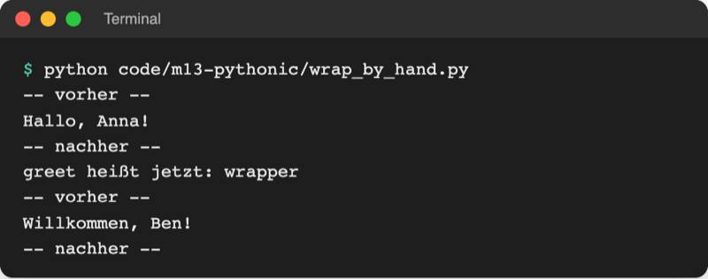
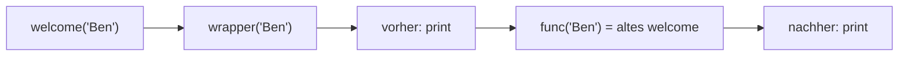
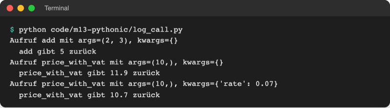
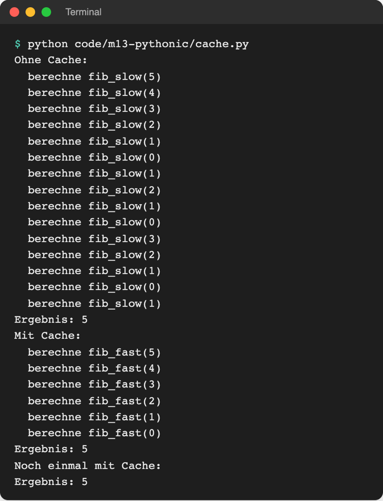

# Lab 13.1: Decorators

**Leitfragen:**

<details>
<summary>Zehn Funktionen sollen ihre Laufzeit messen – wie viele Zeilen sind das per Hand?</summary>

Pro Funktion mindestens drei: Stoppuhr starten, anhalten, Dauer ausgeben (Lab 6.3). Bei zehn Funktionen also rund 30 fast gleiche Zeilen, die bei jeder Änderung zehnmal angepasst werden. Ein Decorator schreibt sie einmal und legt sie um jede Funktion.

</details>

<details>
<summary>Was bedeutete das <code>@</code> vor <code>property</code> an Tag 3?</summary>

`@property` (Lab 9.3) stand über einer Methode und machte sie lesbar wie ein Attribut. Das `@` ist eine Abkürzung: `@property` über `def balance` bedeutet `balance = property(balance)`, also „gib die Methode an `property` und nimm das, was zurückkommt“.

</details>

<details>
<summary>Wie verändert man das Verhalten einer Funktion, ohne ihren Code anzufassen?</summary>

Man packt sie ein: Eine neue Funktion ruft die alte auf und erledigt davor und danach zusätzliche Arbeit, etwa messen, protokollieren oder prüfen. Die alte Funktion bleibt unverändert.

</details>

- Ein Decorator ist eine Funktion, die eine Funktion bekommt und eine eingepackte Version zurückgibt, wie ein Geschenkpapier um ein Geschenk: Der Inhalt bleibt, außen kommt etwas dazu.
- `@name` über `def` ist die Kurzschreibweise dafür. `@property`, `@dataclass` und `@abstractmethod` aus Tag 3 sind solche Decorators.

## Begriffe

| Begriff | Bedeutung |
| --- | --- |
| Decorator | Funktion, die eine Funktion entgegennimmt und eine erweiterte Funktion zurückgibt; wie eine Verpackung um ein Geschenk |
| Wrapper (Hülle) | die innere Funktion des Decorators, die statt der Originalfunktion aufgerufen wird und diese selbst aufruft |
| `@decorator` | Kurzschreibweise über `def`: `@log_call` über `def add` heißt `add = log_call(add)` |
| `func(*args, **kwargs)` | Aufruf, der ein Tupel und ein Dictionary wieder in einzelne Argumente auspackt; Gegenstück zu `*args`/`**kwargs` beim Definieren (Lab 5.2) |
| `__name__` einer Funktion | ihr Name als Text, z. B. `"add"` |
| `__doc__` einer Funktion | ihr Docstring als Text |
| `functools.wraps` | Decorator für den Wrapper: überträgt Name und Docstring der Originalfunktion |
| Decorator mit Parameter | Funktion, die erst einen Decorator baut: `@repeat(times=3)` |
| Cache | Zwischenspeicher: einmal berechnete Ergebnisse werden gemerkt statt neu berechnet |

## Erst ohne: dieselbe Prüfung in jeder Funktion

Datei: [code/m13-pythonic/validation_without.py](../../project/code/m13-pythonic/validation_without.py). Drei Flächenfunktionen, jede prüft ihre Längen selbst:

```python
def rectangle_area(width, height):
    """Fläche eines Rechtecks."""
    if width <= 0:  # Prüfung 2: dieselbe Zeile noch einmal
        raise ValueError(f"{width} ist keine positive Länge.")
    if height <= 0:  # Prüfung 3
        raise ValueError(f"{height} ist keine positive Länge.")
    return width * height
```

Fünf fast gleiche Prüfungen in drei Funktionen. Soll die Meldung anders lauten, ändert sich jede Stelle. Im Spiel ist es dasselbe Muster: Seit Lab 6.3 startet und stoppt `Game` die Stoppuhr selbst, mitten in der Spiellogik.

## Vom Funktionswert zum Decorator

Funktionen sind Werte (Lab 12.2): Sie lassen sich übergeben und zurückgeben. Ein Decorator nutzt beides. Datei: [code/m13-pythonic/wrap_by_hand.py](../../project/code/m13-pythonic/wrap_by_hand.py)

```python
def announce(func):
    """Packt func ein: vorher und nachher eine Zeile ausgeben."""

    def wrapper(name):
        print("-- vorher --")
        func(name)  # die eingepackte Funktion aufrufen
        print("-- nachher --")

    return wrapper  # zurückgeben, nicht aufrufen


greet = announce(greet)  # von Hand einpacken: greet zeigt jetzt auf wrapper
```

```python
@announce  # dasselbe in kurz: welcome = announce(welcome)
def welcome(name):
    """Heißt eine Person willkommen."""
    print(f"Willkommen, {name}!")
```



_Quelle: eigener Screenshot, Kurs-Repo, 08.11.2026._

`wrapper` ist eine Closure (Lab 12.2): Sie merkt sich `func`, auch nachdem `announce` fertig ist.



## Die @-Schreibweise und bekannte Decorators

`@` gibt es seit Python 2.4 (2004), festgelegt in PEP 318. Ein PEP (Python Enhancement Proposal) ist ein öffentliches Dokument, mit dem eine Änderung an Python beschrieben und beschlossen wird.

Original: [PEP 318 Decorators for Functions and Methods: Status Final, erstellt am 05.06.2003, Python-Version 2.4](https://peps.python.org/pep-0318/), Stand 08.11.2026.

| Decorator | aus Lab | packt ein … und macht daraus |
| --- | --- | --- |
| `@property` | 9.3 | Methode → lesbares Attribut |
| `@dataclass` | 11.2 | Klasse → Klasse mit `__init__`, `__repr__`, `__eq__` (Decorators gehen auch über Klassen) |
| `@abstractmethod` | 11.3 | Methode → Pflichtmethode für Unterklassen |
| `@functools.cache` | 13.1 | Funktion → Funktion mit Gedächtnis |
| `@functools.wraps(func)` | 13.1 | Wrapper → Wrapper mit Name und Docstring von `func` |

## Ein Wrapper für jede Funktion: *args und **kwargs

`announce` passt nur auf Funktionen mit genau einem Argument. Mit `*args` und `**kwargs` (Lab 5.2) nimmt der Wrapper alles an und reicht es unverändert weiter. Datei: [code/m13-pythonic/log_call.py](../../project/code/m13-pythonic/log_call.py)

```python
import functools


def log_call(func):
    """Decorator: gibt Name, Argumente und Ergebnis jedes Aufrufs aus."""

    @functools.wraps(func)
    def wrapper(*args, **kwargs):  # nimmt jede Art von Argumenten an
        print(f"Aufruf {func.__name__} mit args={args}, kwargs={kwargs}")
        result = func(*args, **kwargs)  # alles unverändert weiterreichen
        print(f"  {func.__name__} gibt {result} zurück")
        return result

    return wrapper


@log_call
def price_with_vat(net, rate=0.19):
    """Bruttopreis aus Nettopreis und Steuersatz."""
    return round(net * (1 + rate), 2)
```



_Quelle: eigener Screenshot, Kurs-Repo, 08.11.2026._

| Stelle | Schreibweise | Wirkung |
| --- | --- | --- |
| `def wrapper(*args, **kwargs):` | einpacken | `price_with_vat(10, rate=0.07)` → `args = (10,)`, `kwargs = {"rate": 0.07}` |
| `func(*args, **kwargs)` | auspacken | wird wieder zu `func(10, rate=0.07)` |
| `return result` | weitergeben | ohne diese Zeile liefert jede dekorierte Funktion `None` |

Dann mit: Dasselbe Prinzip räumt die Flächenfunktionen vom Anfang auf. Datei: [code/m13-pythonic/validation.py](../../project/code/m13-pythonic/validation.py)

```python
def positive_lengths(func):
    """Decorator: prüft vor dem Aufruf, dass alle Argumente positiv sind."""

    @functools.wraps(func)  # Name und Docstring von func bleiben erhalten
    def wrapper(*args):
        for value in args:  # args: Tupel mit allen Argumenten des Aufrufs
            if value <= 0:
                raise ValueError(f"{value} ist keine positive Länge.")
        return func(*args)  # Tupel wieder auspacken: func(3, 5)

    return wrapper


@positive_lengths
def rectangle_area(width, height):
    """Fläche eines Rechtecks."""
    return width * height
```

Fünf Prüfungen werden zu einer; die Ausgabe beider Dateien ist gleich, inklusive `Fehler: -5 ist keine positive Länge.`

Der Dateiname ist `log_call.py`, nicht `logging.py`: Eine eigene Datei mit dem Namen eines eingebauten Moduls überdeckt es (Lab 6.1).

## functools.wraps: Name und Docstring behalten

Ohne `wraps` heißt jede eingepackte Funktion `wrapper` (siehe `greet.__name__` oben), und ihr Docstring ist weg. Fehlermeldungen, `help()` und später Log-Dateien zeigen dann den falschen Namen. `@functools.wraps(func)` über `def wrapper` kopiert `__name__` und `__doc__` von `func`.

Original: [Python-Dokumentation zu functools.wraps: Beispiel mit my_decorator, example.__name__ ergibt example, ohne wraps wäre es wrapper](https://docs.python.org/3.14/library/functools.html#functools.wraps), Stand 08.11.2026.

## Decorator mit Parameter

Soll der Decorator selbst einen Wert bekommen, braucht es eine Ebene mehr: eine Funktion, die den Decorator baut. Datei: [code/m13-pythonic/repeat.py](../../project/code/m13-pythonic/repeat.py)

```python
def repeat(times):  # Ebene 1: nimmt den Parameter
    def decorator(func):  # Ebene 2: der eigentliche Decorator
        @functools.wraps(func)
        def wrapper(*args, **kwargs):  # Ebene 3: läuft bei jedem Aufruf
            for _ in range(times):  # _: Zählvariable wird nicht gebraucht
                func(*args, **kwargs)

        return wrapper

    return decorator


@repeat(times=3)  # erst repeat(times=3) aufrufen, das Ergebnis ist der Decorator
def cheer(name):
    print(f"Los, {name}!")
```

`cheer("Anna")` gibt dreimal `Los, Anna!` aus. `@dataclass(order=True)` aus Lab 11.2 funktioniert genauso.

## functools.cache: Ergebnisse merken

`@functools.cache` (seit Python 3.9) speichert zu jedem Argument das Ergebnis. Ein zweiter Aufruf mit demselben Argument rechnet nicht noch einmal. Datei: [code/m13-pythonic/cache.py](../../project/code/m13-pythonic/cache.py); die Fibonacci-Zahl ist die Summe der beiden vorherigen, die Funktion ruft sich dafür selbst auf (Rekursion, Lab 5.3).

```python
@functools.cache  # Ergebnis je Argument merken
def fib_fast(n):
    """Fibonacci-Zahl n, mit Gedächtnis."""
    print(f"  berechne fib_fast({n})")
    if n < 2:
        return n
    return fib_fast(n - 1) + fib_fast(n - 2)
```



_Quelle: eigener Screenshot, Kurs-Repo, 08.11.2026._

Geeignet nur für reine Funktionen (Lab 12.2): gleiche Eingabe, gleiches Ergebnis. Für `input()`, Zufall oder die Uhrzeit wäre das gemerkte Ergebnis falsch.

## Im Spiel: @timed misst die Runde

Bisher misst `Game` die Dauer selbst (Lab 6.3), verteilt auf `__init__` und `guess`:

```python
        self.start_time = time.perf_counter()  # Stoppuhr starten
        self.seconds = 0.0
```

```python
        if self.is_over():  # Stoppuhr anhalten
            self.seconds = round(time.perf_counter() - self.start_time, 1)
```

Neu steht die Messung einmal in `logic.py`, und `ui.play_round` bekommt nur noch eine Zeile `@logic.timed`:

```python
def timed(func):
    """Decorator: misst die Laufzeit von func und trägt sie ins Ergebnis ein."""

    @functools.wraps(func)  # Name und Docstring von func bleiben erhalten
    def wrapper(*args, **kwargs):
        start = time.perf_counter()  # Stoppuhr starten
        result = func(*args, **kwargs)  # die eigentliche Funktion aufrufen
        result.seconds = round(time.perf_counter() - start, 1)
        return result

    return wrapper
```

```python
@logic.timed  # misst die Dauer der Runde, ohne Messcode in der Funktion
def play_round(game):
    ...
    return game.score()
```

- `play_round` gibt den `Score` zurück; `timed` trägt die gemessene Dauer in `result.seconds` ein. Das funktioniert nur, weil `Score` (Lab 11.2) ein Attribut `seconds` hat: `@timed` passt auf Funktionen, deren Ergebnis ein solches Attribut besitzt.
- Die Gewinnzeile braucht die Dauer, die erst nach `play_round` feststeht. Deshalb wandert die Ergebnisausgabe in eine neue Funktion `ui.show_result(game, score)`, und `game.save_score(score)` speichert den gemessenen Score.
- Die Ausgabe des Spiels bleibt gleich. Die Dauer umfasst jetzt die ganze Runde ab der Kopfzeile, nicht erst ab dem ersten Tipp.

## Typische Fehler

| Symptom | Ursache | Lösung |
| --- | --- | --- |
| dekorierte Funktion gibt `None` zurück | `return result` im Wrapper fehlt | Ergebnis von `func(...)` zurückgeben |
| `TypeError: 'NoneType' object is not callable` | Decorator gibt nichts zurück (`return wrapper` fehlt) | `return wrapper` ohne `()` am Ende des Decorators |
| Funktion läuft schon beim Start ohne Aufruf | `return wrapper()` statt `return wrapper` | Wrapper zurückgeben, nicht aufrufen |
| `TypeError: announce.<locals>.wrapper() takes 1 positional argument but 2 were given` | Wrapper mit festen Parametern | `def wrapper(*args, **kwargs)` und `func(*args, **kwargs)` |
| `__name__` zeigt `wrapper` | `@functools.wraps(func)` fehlt | über `def wrapper` ergänzen, `import functools` |
| `AttributeError: 'NoneType' object has no attribute 'seconds' …` | `play_round` gibt keinen `Score` mehr zurück | `return game.score()` am Ende von `play_round` |
| `TypeError: Game.save_score() takes 1 positional argument but 2 were given` | Aufruf `save_score(score)`, Methode noch ohne Parameter | `def save_score(self, score):` |

## Fazit

- Ein Decorator nimmt eine Funktion, packt sie in einen Wrapper und gibt den Wrapper zurück; `@name` ist die Kurzschreibweise.
- `*args, **kwargs` im Wrapper plus `func(*args, **kwargs)` passen auf jede Funktion; `functools.wraps` behält Name und Docstring.
- Wiederkehrende Arbeit wie Messen, Protokollieren oder Prüfen steht so einmal im Code statt in jeder Funktion.

In der Übung ersetzt `@timed` die Stoppuhr im eigenen Spiel.
