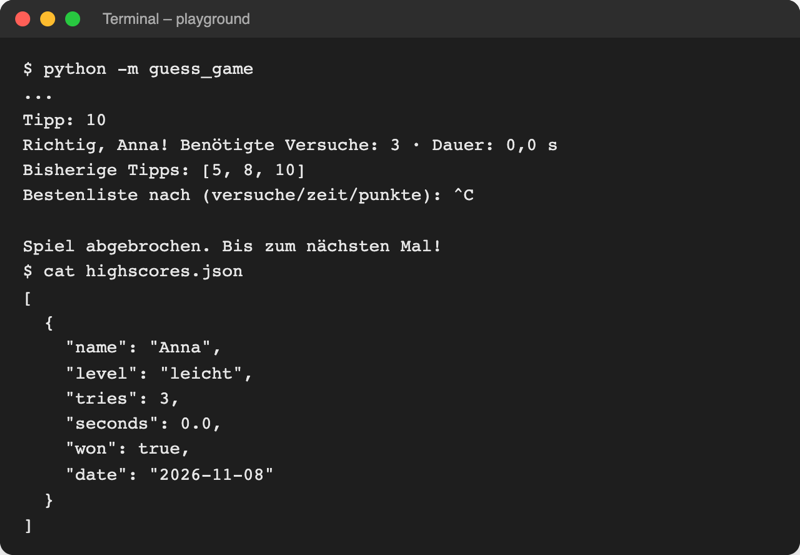

# Lab 13.2 – Lösung: Bestenliste als Context Manager

Fertiger Stand: [project/examples/m13-pythonic/l02-context-managers/guess_game/](../../project/examples/m13-pythonic/l02-context-managers/guess_game/). Test im Ordner `project/`: `cd examples/m13-pythonic/l02-context-managers`, dann `python -m guess_game`.

## Aufgabe 1: Konstruktor ohne Laden

```python
class Scoreboard:
    """Bestenliste als Context Manager: with lädt die Datei und speichert sie."""

    def __init__(self, path=HIGHSCORES_FILE):
        self.path = Path(path)  # erlaubt "highscores.json" und Path(...)
        self.scores = []
```

`Path(path)` macht aus dem Text `"highscores.json"` ein `Path`-Objekt (Lab 8.1); `load()` braucht `self.path.exists()`.

## Aufgabe 2: __enter__

```python
    def __enter__(self):
        """Beginn des with-Blocks: Datei laden; das Objekt wird zu "as board"."""
        self.scores = self.load()
        return self
```

Ohne `return self` wäre `board` im `with`-Block `None`.

## Aufgabe 3: __exit__ und add()

```python
    def __exit__(self, exc_type, exc_value, traceback):
        """Ende des with-Blocks: immer speichern, auch nach Fehler oder Strg+C."""
        self.save()
        return False  # Fehler nicht verschlucken, sondern weiterreichen
```

```python
    def add(self, score):
        """Fügt ein Score-Objekt hinzu; gespeichert wird am Ende des with-Blocks."""
        self.scores.append(score)
```

Die drei Parameter von `__exit__` bleiben ungenutzt, sind aber Pflicht: Python übergibt sie immer. `return False` reicht `KeyboardInterrupt` an `__main__.py` weiter. Mit `return True` wäre Strg+C verschluckt: Das Programm liefe hinter dem `with`-Block weiter und zeigte den Abschied von `show_goodbye`.

## Aufgabe 4: with in __main__.py

```python
    all_tries = []
    # with: lädt highscores.json beim Betreten, speichert beim Verlassen
    with storage.Scoreboard("highscores.json") as board:
        for game in ui.rounds(player, board):  # eine Runde pro Durchlauf
            score = ui.play_round(game)  # @timed hat score.seconds eingetragen
            ui.show_result(game, score)
            all_tries.append(score.tries)
            storage.append_history(score)  # jede Runde, auch verlorene
            game.save_score(score)  # nur ein Gewinn kommt in die Bestenliste
            if score.won:
                by = ui.ask_ranking()
                ui.show_highscores(board.top(by), by)
        ui.show_statistics(logic.statistics(board.scores))
    ui.show_goodbye(name, all_tries)
```

`show_goodbye` braucht die Bestenliste nicht und darf außerhalb stehen. Kommentar am `except KeyboardInterrupt:` unten in der Datei: `# Strg+C; die Bestenliste hat __exit__ schon gesichert`.

## Aufgabe 5: Test mit Strg+C

Eingaben `anna`, `mensch`, `leicht`, `5`, `8`, `10`, dann Strg+C bei der Ranglistenfrage (Seed 3, Auszug), danach der Inhalt von `highscores.json`:



_Quelle: eigener Screenshot, Kurs-Repo, 08.11.2026 (echte Ausgabe im Ordner `examples/m13-pythonic/l02-context-managers`, Strg+C per Skript ausgelöst)._

Der Ablauf: `game.save_score(score)` hängt den Gewinn an `board.scores` an, Strg+C löst `KeyboardInterrupt` aus, Python verlässt den `with`-Block und ruft `__exit__` auf, das speichert. Erst danach greift `except KeyboardInterrupt`.

## Erweiterung

```python
from contextlib import contextmanager


@contextmanager
def section(title):
    """Rahmt die Ausgabe des with-Blocks mit Kopf- und Fußzeile ein."""
    print(f"=== {title} ===")
    try:
        yield
    finally:  # Fußzeile auch nach einem Fehler
        print(f"--- Ende {title} ---")


with section("Einkauf"):
    print("Milch")
    print("Brot")

try:
    with section("Rechnung"):
        print("Summe:", 10 / 0)
except ZeroDivisionError as error:
    print("Fehler:", error)
```

```text
=== Einkauf ===
Milch
Brot
--- Ende Einkauf ---
=== Rechnung ===
--- Ende Rechnung ---
Fehler: division by zero
```

`Summe:` erscheint nicht: Python rechnet `10 / 0` aus, bevor `print` startet. Ohne `try`/`finally` fehlt nach dem Fehler die Zeile `--- Ende Rechnung ---`.
