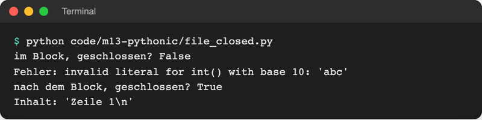
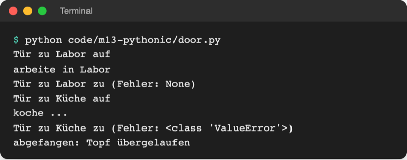
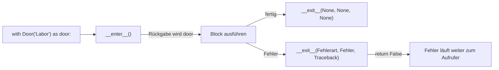
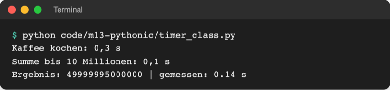

# Lab 13.2: Context Manager

**Leitfragen:**

<details>
<summary>Wer schließt eine Datei, wenn mitten im Schreiben ein Fehler passiert?</summary>

Mit `with open(...)` (Lab 8.1) schließt Python sie selbst, auch nach dem Fehler. Ohne `with` bleibt sie offen, bis das Programm endet; bereits geschriebener Text kann verloren gehen.

</details>

<details>
<summary>Was haben „Tür auf – arbeiten – Tür zu“ und <code>with</code> gemeinsam?</summary>

Beide folgen demselben Ablauf: vorbereiten, arbeiten, aufräumen. `with` garantiert den letzten Schritt: Die Tür geht auch dann zu, wenn beim Arbeiten etwas schiefgeht.

</details>

- Ein Context Manager ist ein Objekt, das für einen `with`-Block Vorbereitung und Aufräumen übernimmt: Datei öffnen und schließen, Verbindung aufbauen und trennen, Stoppuhr starten und anhalten.
- Eigene Context Manager entstehen als Klasse mit `__enter__` und `__exit__` oder kürzer als Generatorfunktion mit `@contextmanager`.

## Begriffe

| Begriff | Bedeutung |
| --- | --- |
| Context Manager | Objekt, das beim Betreten eines `with`-Blocks etwas vorbereitet und beim Verlassen aufräumt; wie eine Hotelzimmerkarte, die beim Auschecken immer zurückgegeben wird |
| `with ... as name:` | führt den eingerückten Block im Context Manager aus; `name` ist das, was `__enter__` zurückgibt |
| `__enter__(self)` | Magic Method (Lab 11.1), läuft beim Betreten des Blocks |
| `__exit__(self, exc_type, exc_value, traceback)` | Magic Method, läuft beim Verlassen, immer: nach dem letzten Befehl, nach einem Fehler, nach `return` oder Strg+C |
| Ressource | etwas, das nach Gebrauch zurückgegeben werden muss: offene Datei, Datenbankverbindung, temporärer Ordner |
| `contextlib.contextmanager` | Decorator (Lab 13.1), der aus einer Generatorfunktion mit genau einem `yield` (Lab 12.3) einen Context Manager macht |

## Was with open seit Lab 8.1 tut

Datei: [code/m13-pythonic/file_closed.py](../../project/code/m13-pythonic/file_closed.py). Mitten im Schreiben passiert ein `ValueError`:

```python
try:
    with open(note_file, "w", encoding="utf-8") as file:
        file.write("Zeile 1\n")
        print("im Block, geschlossen?", file.closed)
        number = int("abc")  # ValueError mitten im Schreiben
        file.write("Zeile 2\n")  # wird nie erreicht
except ValueError as error:
    print("Fehler:", error)

print("nach dem Block, geschlossen?", file.closed)
```



_Quelle: eigener Screenshot, Kurs-Repo, 08.11.2026._

`file.closed` ist ein Attribut jeder geöffneten Datei. Trotz Fehler ist die Datei danach geschlossen, und „Zeile 1“ steht sicher darin. Ohne `with` bräuchte es dafür `try`/`finally` aus Lab 7.2:

```python
file = open(note_file, "w", encoding="utf-8")
try:
    file.write("Zeile 1\n")
finally:
    file.close()  # läuft immer, mit und ohne Fehler
```

`with` ist dieselbe Garantie in einer Zeile. Python ruft dafür zwei Methoden des Datei-Objekts auf: `__enter__` am Anfang, `__exit__` am Ende.

## Eigener Context Manager als Klasse

Datei: [code/m13-pythonic/door.py](../../project/code/m13-pythonic/door.py)

```python
class Door:
    """Context Manager: öffnet beim Betreten, schließt beim Verlassen."""

    def __init__(self, room):
        self.room = room

    def __enter__(self):
        print(f"Tür zu {self.room} auf")
        return self  # wird zur Variablen hinter "as"

    def __exit__(self, exc_type, exc_value, traceback):
        # exc_type: Art des Fehlers im Block, None ohne Fehler
        print(f"Tür zu {self.room} zu (Fehler: {exc_type})")
        return False  # Fehler nicht verschlucken


with Door("Labor") as door:
    print("arbeite in", door.room)
```



_Quelle: eigener Screenshot, Kurs-Repo, 08.11.2026._



| Parameter von `__exit__` | ohne Fehler | mit Fehler im Block |
| --- | --- | --- |
| `exc_type` | `None` | Fehlerklasse, z. B. `ValueError` |
| `exc_value` | `None` | das Fehler-Objekt mit der Meldung |
| `traceback` | `None` | Ort des Fehlers (wie im Traceback, Lab 7.1) |
| Rückgabe `False` | – | Fehler läuft weiter, `except` außen fängt ihn |
| Rückgabe `True` | – | Fehler wird verschluckt; selten sinnvoll, versteckt Probleme |

## Timer: Zeitmessung als Context Manager

Datei: [code/m13-pythonic/timer_class.py](../../project/code/m13-pythonic/timer_class.py). `time.sleep(0.3)` wartet 0,3 Sekunden und steht hier für echte Arbeit.

```python
class Timer:
    """Context Manager: Stoppuhr für den Inhalt des with-Blocks."""

    def __init__(self, label):
        self.label = label
        self.seconds = 0.0

    def __enter__(self):
        self.start = time.perf_counter()  # Stoppuhr starten
        return self

    def __exit__(self, exc_type, exc_value, traceback):
        self.seconds = time.perf_counter() - self.start  # Stoppuhr anhalten
        print(f"{self.label}: {self.seconds:.1f} s".replace(".", ","))
        return False


with Timer("Kaffee kochen"):
    time.sleep(0.3)
```



_Quelle: eigener Screenshot, Kurs-Repo, 08.11.2026. Die zweite Messung schwankt je nach Rechner._

`@timed` (Lab 13.1) misst eine ganze Funktion, `Timer` einen beliebigen Codeabschnitt.

## Kürzer: contextlib.contextmanager mit yield

Datei: [code/m13-pythonic/timer_contextlib.py](../../project/code/m13-pythonic/timer_contextlib.py). Derselbe Timer als Generatorfunktion (Lab 12.3):

```python
from contextlib import contextmanager


@contextmanager  # macht aus der Generatorfunktion einen Context Manager
def timer(label):
    """Stoppuhr: alles vor yield ist __enter__, alles danach __exit__."""
    start = time.perf_counter()
    try:
        yield  # hier läuft der with-Block
    finally:  # auch nach einem Fehler im Block
        seconds = time.perf_counter() - start
        print(f"{label}: {seconds:.1f} s".replace(".", ","))


with timer("Kaffee kochen"):
    time.sleep(0.3)
```

- Code vor `yield` = Vorbereitung, `yield` = Pause, solange der Block läuft, Code danach = Aufräumen.
- `yield wert` liefert `wert` an `as`; ein `yield` ohne Wert reicht, wenn niemand `as` braucht.
- Ohne `try`/`finally` fällt das Aufräumen bei einem Fehler im Block aus.

Original: [Python-Dokumentation zu contextlib.contextmanager: Beispiel managed_resource mit try, yield und finally](https://docs.python.org/3.14/library/contextlib.html#contextlib.contextmanager), Stand 08.11.2026.

| | Klasse mit `__enter__`/`__exit__` | `@contextmanager` |
| --- | --- | --- |
| Code | Klasse, zwei Methoden | eine Funktion mit `yield` |
| Zustand merken | in `self` | lokale Variablen |
| gut für | Objekte, die auch außerhalb von `with` Methoden brauchen (z. B. `Scoreboard.top()`) | kurze Vorher-nachher-Abläufe |

## Typische Einsätze

| Einsatz | Beispiel | Aufräumen |
| --- | --- | --- |
| Datei | `with open(path, encoding="utf-8") as file:` (Lab 8.1) | Datei schließen |
| Datenbankverbindung | `with sqlite3.connect("game.db") as connection:` (Modul 18) | Änderungen übernehmen oder zurückrollen |
| Zeitmessung | `with Timer("Import"):` | Dauer ausgeben |
| temporärer Ordner | `with tempfile.TemporaryDirectory() as folder:` | Ordner samt Inhalt löschen |
| Bestenliste | `with storage.Scoreboard("highscores.json") as board:` | Datei speichern |

`with` gibt es seit Python 2.5 (2006), beschrieben in PEP 343 von Guido van Rossum und Alyssa Coghlan.

Original: [PEP 343 The with Statement: Autoren Guido van Rossum und Alyssa Coghlan, erstellt am 13.05.2005, Python-Version 2.5](https://peps.python.org/pep-0343/), Stand 08.11.2026.

## Im Spiel: die Bestenliste speichert beim Verlassen

Bisher lädt `Scoreboard` die Datei beim Erzeugen, und `add()` speichert nach jedem Gewinn sofort. Neu übernimmt `with` beides:

```python
    def __init__(self, path=HIGHSCORES_FILE):
        self.path = Path(path)  # erlaubt "highscores.json" und Path(...)
        self.scores = []

    def __enter__(self):
        """Beginn des with-Blocks: Datei laden; das Objekt wird zu "as board"."""
        self.scores = self.load()
        return self

    def __exit__(self, exc_type, exc_value, traceback):
        """Ende des with-Blocks: immer speichern, auch nach Fehler oder Strg+C."""
        self.save()
        return False  # Fehler nicht verschlucken, sondern weiterreichen
```

```python
    # with: lädt highscores.json beim Betreten, speichert beim Verlassen
    with storage.Scoreboard("highscores.json") as board:
        for game in ui.rounds(player, board):  # eine Runde pro Durchlauf
            ...
        ui.show_statistics(logic.statistics(board.scores))
```

- `add()` hängt nur noch an die Liste an. Gespeichert wird einmal, beim Verlassen des Blocks.
- Strg+C löst `KeyboardInterrupt` aus, eine Ausnahme wie jede andere: `__exit__` speichert, `return False` reicht sie weiter, und das `except KeyboardInterrupt` in `__main__.py` verabschiedet sich wie bisher.
- `__exit__` speichert immer, auch ohne Gewinn: Nach dem ersten Start liegt eine `highscores.json` mit `[]` im Ordner.

## Typische Fehler

| Symptom | Ursache | Lösung |
| --- | --- | --- |
| `TypeError: 'Scoreboard' object does not support the context manager protocol (missed __exit__ method)` | `__enter__` oder `__exit__` fehlt oder ist falsch geschrieben | beide Methoden mit je zwei Unterstrichen davor und danach |
| `AttributeError: 'NoneType' object has no attribute 'top'` | `__enter__` ohne `return self`; `board` ist `None` | `return self` am Ende von `__enter__` |
| `TypeError: Scoreboard.__exit__() takes 1 positional argument but 4 were given` | `__exit__(self)` ohne die drei Fehlerparameter | `def __exit__(self, exc_type, exc_value, traceback):` |
| Fehler im Block verschwindet spurlos | `__exit__` gibt `True` zurück | `return False` |
| Gewinn fehlt nach dem Neustart in der Bestenliste | `add()` speichert nicht mehr, `__exit__` ruft `self.save()` nicht auf | `self.save()` in `__exit__` |
| `NameError: name 'scoreboard' is not defined` | Variable heißt jetzt `board`, eine Stelle nutzt noch den alten Namen | alle Stellen im Block auf `board` umstellen |
| `RuntimeError: generator didn't yield` | `@contextmanager`-Funktion erreicht ihr `yield` nicht (z. B. in einem `if`) | genau ein `yield`, das immer erreicht wird |

## Fazit

- `with` ruft `__enter__` beim Betreten und `__exit__` beim Verlassen auf, auch nach Fehlern und Strg+C.
- Eigene Context Manager entstehen als Klasse oder mit `@contextmanager` und `yield` zwischen Vorbereitung und Aufräumen.
- Aufräumen gehört in den Context Manager, nicht in jede Stelle, die das Objekt benutzt.

In der Übung wird die Bestenliste des eigenen Spiels zum Context Manager und überlebt Strg+C.
