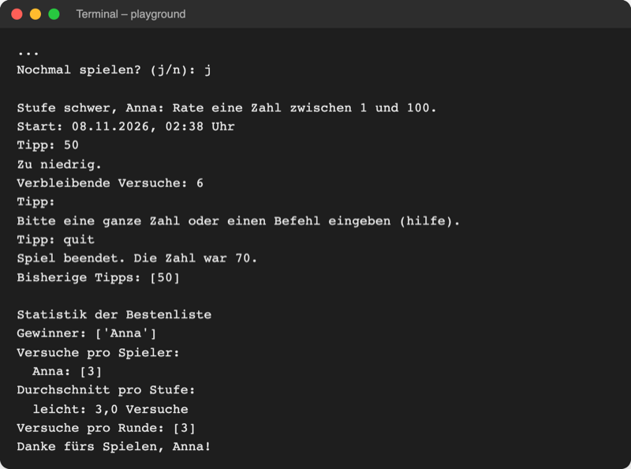

# Lab 13.3 – Lösung: Befehlsmenü per match

Fertiger Stand: [project/examples/m13-pythonic/l03-pattern-matching/guess_game/](../../project/examples/m13-pythonic/l03-pattern-matching/guess_game/). Test im Ordner `project/`: `cd examples/m13-pythonic/l03-pattern-matching`, dann `python -m guess_game`.

## Aufgabe 1: Game kennt next_level und stopped

```python
        self.level = level
        self.next_level = level  # Stufe der nächsten Runde, Befehl "stufe ..."
        self.stopped = False  # True nach dem Befehl "quit"
```

```python
    def is_over(self):
        """True, wenn gewonnen, alle Versuche verbraucht oder abgebrochen."""
        return self.stopped or self.is_won or self.attempts_left == 0

    def stop(self):
        """Beendet das Spiel vorzeitig (Befehl quit)."""
        self.stopped = True
```

Weil `is_over()` nach `quit` wahr ist, endet die `while`-Schleife in `play_round`, und `reveal_secret()` gibt die Geheimzahl frei.

## Aufgabe 2: Text statt Zahl

```python
def ask_command(prompt):
    """Fragt nach einem Tipp oder Befehl und gibt den Text aufgeräumt zurück."""
    return input(prompt).strip().lower()
```

```python
class HumanPlayer(Player):
    def next_guess(self):
        """Fragt Tipp oder Befehl per input ab (überschreibt Player.next_guess)."""
        return ui.ask_command("Tipp: ")
```

```python
class ComputerPlayer(Player):
    def next_guess(self):
        """Tippt die Mitte des Bereichs, zeigt den Tipp und gibt ihn als Text zurück."""
        guess = (self.low + self.high) // 2
        ui.show_guess(guess)
        return str(guess)  # Text wie eine Eingabe über die Tastatur
```

Beide Spielertypen liefern Text, damit `play_round` sie gleich behandeln kann (Polymorphie, Lab 10.2). `on_hint(guess, hint)` bekommt weiter die Zahl.

## Aufgabe 3: make_guess, show_help und match

```python
def show_help():
    """Zeigt alle Befehle, die beim Tipp funktionieren."""
    print("Befehle:")
    print("  7             Zahl tippen")
    print("  hilfe         diese Übersicht")
    print("  stufe schwer  Stufe der nächsten Runde (leicht/mittel/schwer)")
    print("  bestenliste   Bestenliste zeigen")
    print("  quit          Spiel beenden")
```

```python
def make_guess(game, number):
    """Gibt einen Tipp an das Spiel weiter und zeigt den Hinweis an."""
    try:
        hint = game.guess(number)  # das Spiel wertet aus
    except logic.InvalidGuessError as error:  # kein Versuch verbraucht
        print(error)
        return
    game.player.on_hint(number, hint)  # Computer lernt daraus, Mensch liest es

    if hint == "schon getippt":
        print("Diese Zahl wurde schon getippt.")
    elif hint != "richtig":
        show_hint(hint)
        if not game.is_over():
            print(f"Verbleibende Versuche: {game.attempts_left}")
```

`continue` aus der alten Schleife wird hier zu `return`: Die Funktion endet, die Schleife in `play_round` fragt erneut. Die Schleife selbst:

```python
    while not game.is_over():
        text = player.next_guess()  # Zahl oder Befehl, als Text
        match text.split():  # "stufe schwer" -> ["stufe", "schwer"]
            case [number] if number.isdigit():  # genau ein Wort aus Ziffern
                make_guess(game, int(number))
            case ["hilfe"]:
                show_help()
            case ["stufe", level] if level in logic.LEVELS:
                game.next_level = level
                print(f"Die nächste Runde läuft auf Stufe {level}.")
            case ["stufe", _]:
                print("Diese Stufe gibt es nicht.")
            case ["bestenliste"]:
                show_highscores(game.scoreboard.top())
            case ["quit"]:
                game.stop()
            case _:  # alles andere, auch leere Eingabe
                print("Bitte eine ganze Zahl oder einen Befehl eingeben (hilfe).")
    return game.score()
```

```python
def show_highscores(scores, by="versuche"):
    """Zeigt die Bestenliste mit Platz, Score, Stufe und Punkten."""
    print(f"\nBestenliste (Top 5 nach {RANKINGS[by]})")
    if not scores:  # Befehl bestenliste vor dem ersten Gewinn
        print("Noch keine Einträge.")
    # ... Schleife über scores unverändert ...
```

- `"".split()` ergibt `[]`; das passt auf kein Muster außer `case _`. So meldet auch die leere Eingabe den Hinweis.
- `-5` ist für `isdigit()` keine Zahl (das Minus ist keine Ziffer) und landet ebenfalls bei `case _`.
- `case ["stufe", _]` steht hinter dem Muster mit Guard: Erst wenn die Stufe unbekannt ist, greift es.

## Aufgabe 4: :=, rounds, show_result, Banner

```python
def ask_level():
    """Fragt so lange nach der Stufe, bis es sie gibt, und gibt sie zurück."""
    prompt = "Stufe (leicht/mittel/schwer): "
    # := speichert die Eingabe und prüft sie in derselben Zeile
    while (level := input(prompt).strip().lower()) not in logic.LEVELS:
        print("Diese Stufe gibt es nicht.")
    return level


def ask_player_type():
    """Fragt, ob ein Mensch oder der Computer rät, und gibt die Antwort zurück."""
    prompt = "Wer rät? (mensch/computer): "
    while (player_type := input(prompt).strip().lower()) not in ["mensch", "computer"]:
        print("Bitte mensch oder computer eingeben.")
    return player_type
```

```python
def rounds(player, scoreboard):
    """Generator: liefert Runde für Runde ein neues Spiel, bis niemand mehr will."""
    level = ask_level()  # nur einmal; wechseln mit dem Befehl "stufe schwer"
    while True:
        game = logic.Game(player, scoreboard, level)
        yield game  # pausiert, bis die for-Schleife weitermacht
        level = game.next_level
        if ask_play_again() != "j":
            return  # Generator endet, die for-Schleife hört auf
```

```python
    elif game.stopped:
        print(f"Spiel beendet. Die Zahl war {game.reveal_secret()}.")
```

Der Zweig steht in `show_result` zwischen `if score.won:` und `else:`. In `show_banner` kommt nach der zweiten `=`-Linie `print("Beim Tipp versteht das Spiel auch Befehle, z. B. hilfe.")` dazu.

## Aufgabe 5: break nach quit und Test

```python
            score = ui.play_round(game)  # @timed hat score.seconds eingetragen
            ui.show_result(game, score)
            if game.stopped:  # Befehl quit: Runde zählt nicht
                break
```

`break` steht vor `append_history` und `save_score`: Eine abgebrochene Runde landet weder in `history.csv` noch in der Bestenliste. `__exit__` aus Lab 13.2 speichert trotzdem beim Verlassen des `with`-Blocks.

Lauf mit Seed 3 und den Eingaben aus der Aufgabe (`8`, `10` bis zum Gewinn, Enter, `j`, `50`, Enter, `quit`); der erste Teil steht als Screenshot in der Theorie, hier der Schluss:



_Quelle: eigener Screenshot, Kurs-Repo, 08.11.2026 (Auszug, Ordner `examples/m13-pythonic/l03-pattern-matching`)._

Mit `computer` und `schwer` rät der Computer wie bisher `50, 75, 88, 81, 78, 76` und gewinnt nach 6 Versuchen: `str(guess)` läuft durch `case [number] if number.isdigit()`.

## Erweiterung

```python
from guess_game.logic import Score


def badge(score):
    """Vergibt ein Abzeichen je nach Ergebnis."""
    match score:
        case Score(won=True, tries=1):
            return "Volltreffer"
        case Score(won=True, level="schwer"):
            return "Profi"
        case Score(won=True):
            return "Geschafft"
        case _:
            return "Nächstes Mal"


scores = [
    Score("Anna", "leicht", 1, 2.5, True, "2026-11-08"),
    Score("Ben", "schwer", 6, 31.0, True, "2026-11-08"),
    Score("Cem", "mittel", 4, 12.4, True, "2026-11-08"),
    Score("Dana", "leicht", 5, 20.1, False, "2026-11-08"),
]
for score in scores:
    print(f"{score}: {badge(score)}")
```

```text
Anna – 1 Versuch – 2,5 s: Volltreffer
Ben – 6 Versuche – 31,0 s: Profi
Cem – 4 Versuche – 12,4 s: Geschafft
Dana – 5 Versuche – 20,1 s: Nächstes Mal
```

Die Reihenfolge zählt: Stünde `Score(won=True)` oben, bekäme jeder Gewinn „Geschafft“. `f"{score}"` nutzt `Score.__str__` aus Lab 11.1.
