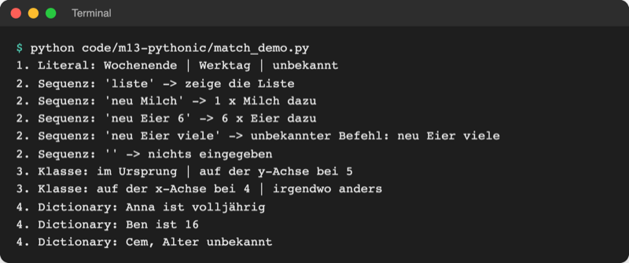
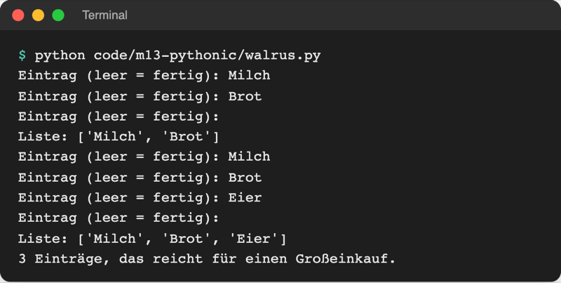
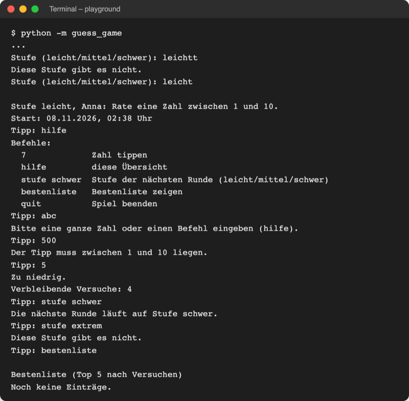
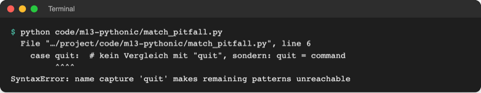

# Lab 13.3: Pattern Matching und Walrus

**Leitfragen:**

<details>
<summary>Wie viele <code>elif</code> braucht ein Menü mit sechs Befehlen, von denen einer ein Argument hat?</summary>

Ein `if`, fünf `elif` und ein `else` für Unbekanntes. Der Befehl mit Argument („stufe schwer“) braucht zusätzlich Zerlegen, Längenprüfung und Index: `len(parts) == 2 and parts[0] == "stufe"`. `match` beschreibt stattdessen die Form der Eingabe direkt.

</details>

<details>
<summary>Wie unterscheidet ein Programm „7“ von „stufe schwer“?</summary>

Es zerlegt den Text mit `split()` (Lab 2.4) in Wörter: `["7"]` ist ein Wort aus Ziffern, `["stufe", "schwer"]` sind zwei Wörter, das erste ist „stufe“. Form und Inhalt der Liste entscheiden.

</details>

<details>
<summary>Warum fragt die Schleife bisher zweimal nach Eingabe?</summary>

`while level not in LEVELS:` braucht schon vor der ersten Prüfung einen Wert. Deshalb steht `input` einmal vor der Schleife und noch einmal am Ende des Blocks. Der Zuweisungsausdruck `:=` holt die Eingabe direkt in der Bedingung.

</details>

- `match`/`case` vergleicht einen Wert der Reihe nach mit Mustern: Werten, Listenformen, Objekten oder Dictionaries. Der erste passende `case` gewinnt und kann Teile des Werts gleich in Variablen ablegen.
- `:=` speichert ein Ergebnis und nutzt es im selben Ausdruck, etwa in der Bedingung einer `while`-Schleife.

## Begriffe

| Begriff | Bedeutung |
| --- | --- |
| Pattern Matching | Fallunterscheidung nach der Form eines Werts, wie ein Sortierautomat für Pakete: Größe und Aufschrift bestimmen das Fach |
| `match wert:` | Beginn der Fallunterscheidung; `wert` heißt Subjekt |
| `case muster:` | ein Fall; der Block läuft, wenn das Muster passt, danach endet `match` |
| Literalmuster | fester Wert: `case "hilfe":`, `case 404:`; `|` heißt „oder“ |
| Sequenzmuster | Liste mit fester Länge: `case ["stufe", level]:` passt auf genau zwei Elemente, das erste `"stufe"` |
| Name im Muster (Capture) | ein Name wie `level` passt auf jeden Wert und speichert ihn |
| `_` (Platzhalter) | passt auf jeden Wert und speichert nichts |
| Guard | Bedingung hinter dem Muster: `case [number] if number.isdigit():` |
| Klassenmuster | `case Point(x=0, y=y):` prüft Klasse und Attribute |
| Dictionary-Muster | `case {"name": name}:` prüft, ob der Schlüssel da ist |
| Zuweisungsausdruck `:=` | speichert einen Wert und gibt ihn gleichzeitig zurück; wegen der Form „Walross-Operator“ genannt |

## Erst ohne: Menü mit if und elif

Ein Menü für eine Einkaufsliste mit `if`/`elif` (Lab 3.1):

```python
parts = command.split()
if parts == ["liste"]:
    result = "zeige die Liste"
elif len(parts) == 2 and parts[0] == "neu":
    result = f"1 x {parts[1]} dazu"
elif len(parts) == 3 and parts[0] == "neu" and parts[2].isdigit():
    result = f"{parts[2]} x {parts[1]} dazu"
elif parts == []:
    result = "nichts eingegeben"
else:
    result = f"unbekannter Befehl: {command}"
```

Jede Zeile prüft Länge und Inhalt einzeln, und `parts[1]` sagt nichts über seine Bedeutung.

## match und case

Datei: [code/m13-pythonic/match_demo.py](../../project/code/m13-pythonic/match_demo.py). Dasselbe Menü mit Sequenzmustern:

```python
def shopping(command):
    """Wertet einen Befehl für eine Einkaufsliste aus."""
    match command.split():  # "neu Milch 2" -> ["neu", "Milch", "2"]
        case ["liste"]:
            return "zeige die Liste"
        case ["neu", item]:  # genau zwei Wörter, das zweite heißt jetzt item
            return f"1 x {item} dazu"
        case ["neu", item, amount] if amount.isdigit():
            return f"{amount} x {item} dazu"
        case []:  # leere Eingabe
            return "nichts eingegeben"
        case _:
            return f"unbekannter Befehl: {command}"
```

- Python prüft die `case`-Zeilen von oben nach unten; nur der erste passende Block läuft.
- `["neu", item]` passt auf eine Liste mit genau zwei Elementen, deren erstes `"neu"` ist; das zweite landet in `item`.
- Der Guard `if amount.isdigit()` (Lab 7.2) wird erst geprüft, wenn die Form passt. Ist er falsch, geht es mit dem nächsten `case` weiter.
- `case _:` fängt alles Übrige. Fehlt er und passt nichts, passiert nichts.

| Muster | Beispiel | passt auf |
| --- | --- | --- |
| Literal | `case "sa" \| "so":` | genau diesen Wert, `\|` = oder |
| Sequenz | `case ["neu", item]:` | Liste mit zwei Elementen, erstes `"neu"` |
| Sequenz mit Guard | `case [number] if number.isdigit():` | ein Element aus Ziffern |
| Klasse | `case Point(x=0, y=y):` | `Point`-Objekt mit `x == 0`, `y` wird gespeichert |
| Dictionary | `case {"name": name, "age": age}:` | Dictionary mit beiden Schlüsseln, weitere egal |
| Platzhalter | `case _:` | alles |

Klassen- und Dictionary-Muster aus derselben Datei:

```python
@dataclass
class Point:
    x: int
    y: int


def where(point):
    """Beschreibt die Lage eines Punkts."""
    match point:
        case Point(x=0, y=0):
            return "im Ursprung"
        case Point(x=0, y=y):  # y wird mit dem Attribut belegt
            return f"auf der y-Achse bei {y}"
        case Point(x=x, y=0):
            return f"auf der x-Achse bei {x}"
        case Point():
            return "irgendwo anders"
```

```python
    match person:
        case {"name": name, "age": age} if age >= 18:
            return f"{name} ist volljährig"
        case {"name": name, "age": age}:
            return f"{name} ist {age}"
        case {"name": name}:
            return f"{name}, Alter unbekannt"
```



_Quelle: eigener Screenshot, Kurs-Repo, 08.11.2026._

## match, if/elif und switch

| | `if`/`elif` | `match`/`case` | `switch` (C, Java, JavaScript) |
| --- | --- | --- | --- |
| prüft | beliebige Bedingungen | Form und Werte eines Subjekts | einen Wert auf Gleichheit |
| Teile herausholen | von Hand per Index | im Muster, z. B. `item` | nein |
| Durchfallen in den nächsten Fall | nein | nein | ja, ohne `break` |
| gut für | Zahlenbereiche, Vergleiche wie `tries < 3` | Befehle, Listen, Objekte mit fester Form | – |

Original: [Python-Tutorial, Abschnitt 4.7 match Statements: Beispiel http_error mit case 400, 404, 418 und case _ als Wildcard](https://docs.python.org/3.14/tutorial/controlflow.html#match-statements), Stand 08.11.2026.

`match` gibt es seit Python 3.10 (veröffentlicht am 04.10.2021, PEP 619), beschrieben in PEP 634 (Spezifikation) und PEP 636 (Tutorial). Ältere Python-Versionen melden `SyntaxError`.

Original: [PEP 634 Structural Pattern Matching: Specification, Autoren Brandt Bucher und Guido van Rossum, Python-Version 3.10](https://peps.python.org/pep-0634/), Stand 08.11.2026.

## Der Zuweisungsausdruck :=

Datei: [code/m13-pythonic/walrus.py](../../project/code/m13-pythonic/walrus.py). Vorher steht `input` zweimal:

```python
items = []
text = input("Eintrag (leer = fertig): ").strip()
while text != "":
    items.append(text)
    text = input("Eintrag (leer = fertig): ").strip()
```

Mit `:=` steht es einmal, direkt in der Bedingung:

```python
items = []
while (text := input("Eintrag (leer = fertig): ").strip()) != "":
    items.append(text)
```

- Lesen von innen nach außen: Eingabe holen, in `text` speichern, dann mit `""` vergleichen.
- Die Klammern sind nötig: Ohne sie würde `text` das Ergebnis des Vergleichs speichern, also `True` oder `False`.
- `=` ist eine Anweisung und steht allein in einer Zeile; `:=` ist ein Ausdruck und darf in `while`, `if` und Comprehensions stehen. In `if (count := len(items)) > 2:` steht `count` danach weiter zur Verfügung.



_Quelle: eigener Screenshot, Kurs-Repo, 08.11.2026._

`:=` kam mit Python 3.8 (veröffentlicht am 14.10.2019, PEP 569) über PEP 572. Die Debatte darüber war so hart, dass Guido van Rossum danach am 12.07.2018 sein Amt als „Benevolent Dictator for Life“ abgab ([Mail „Transfer of power“](https://mail.python.org/pipermail/python-committers/2018-July/005664.html), abgerufen am 08.11.2026).

Original: [PEP 572 Assignment Expressions: Autoren Chris Angelico, Tim Peters, Guido van Rossum, Python-Version 3.8](https://peps.python.org/pep-0572/), Stand 08.11.2026.

## Im Spiel: ein Befehlsmenü beim Tipp

Beim `Tipp:` versteht das Spiel jetzt Befehle. Dafür liefert `player.next_guess()` Text statt Zahl (`HumanPlayer` über `ui.ask_command("Tipp: ")`, `ComputerPlayer` mit `str(guess)`), und `play_round` zerlegt ihn:

```python
    while not game.is_over():
        text = player.next_guess()  # Zahl oder Befehl, als Text
        match text.split():  # "stufe schwer" -> ["stufe", "schwer"]
            case [number] if number.isdigit():  # genau ein Wort aus Ziffern
                make_guess(game, int(number))
            case ["hilfe"]:
                show_help()
            case ["stufe", level] if level in logic.LEVELS:
                game.next_level = level
                print(f"Die nächste Runde läuft auf Stufe {level}.")
            case ["stufe", _]:
                print("Diese Stufe gibt es nicht.")
            case ["bestenliste"]:
                show_highscores(game.scoreboard.top())
            case ["quit"]:
                game.stop()
            case _:  # alles andere, auch leere Eingabe
                print("Bitte eine ganze Zahl oder einen Befehl eingeben (hilfe).")
    return game.score()
```

- Die alte Auswertung eines Tipps (`game.guess`, `InvalidGuessError`, Hinweise) steht unverändert in der neuen Funktion `make_guess(game, number)`. `ask_number` entfällt: Das `try`/`except ValueError` ersetzt der Guard `isdigit()`.
- `stufe schwer` gilt für die nächste Runde. Die Stufe wird deshalb nur noch einmal am Anfang gefragt; `rounds` übernimmt danach `game.next_level`.
- `quit` setzt `game.stopped`; `is_over()` wird wahr, `show_result` meldet „Spiel beendet. Die Zahl war …“, und `__main__.py` verlässt die Schleife mit `break`. Diese Runde zählt nicht.

`ask_level` und `ask_player_type` fragen mit `:=` nur noch an einer Stelle:

```python
    prompt = "Stufe (leicht/mittel/schwer): "
    # := speichert die Eingabe und prüft sie in derselben Zeile
    while (level := input(prompt).strip().lower()) not in logic.LEVELS:
        print("Diese Stufe gibt es nicht.")
    return level
```



_Quelle: eigener Screenshot, Kurs-Repo, 08.11.2026 (Auszug)._

## Typische Fehler

| Symptom | Ursache | Lösung |
| --- | --- | --- |
| `SyntaxError: name capture 'quit' makes remaining patterns unreachable` | bloßer Name hinter `case` ist ein Fang-alles, kein Vergleich | Text in Anführungszeichen: `case "quit":` bzw. `case ["quit"]:` |
| `stufe schwer` landet bei „Bitte eine ganze Zahl …“ | `match text:` statt `match text.split():`; der ganze Text ist keine Liste | Subjekt `text.split()` |
| `case ["stufe", _]` greift auch bei `stufe schwer` | allgemeineres Muster steht vor dem genaueren | genaue Muster zuerst, `_` und `case _` zuletzt |
| `TypeError: '<' not supported between instances of 'str' and 'int'` | Text aus `next_guess()` ohne `int()` an `game.guess` | `make_guess(game, int(number))` |
| Liste enthält `True` statt der Eingaben | Klammern um `(text := input(...))` fehlen; `text` speichert das Ergebnis des Vergleichs | Zuweisungsausdruck immer einklammern |
| Stufe wird nach „Nochmal spielen?“ wieder gefragt | `ask_level()` steht noch in der `while`-Schleife von `rounds` | einmal davor, danach `level = game.next_level` |



_Quelle: eigener Screenshot, Kurs-Repo, 08.11.2026 (Pfad gekürzt)._

## Fazit

- `match`/`case` wählt nach der Form eines Werts; Sequenzmuster holen Teile wie `level` gleich heraus, Guards ergänzen Bedingungen, `case _` fängt den Rest.
- Feste Werte stehen in Anführungszeichen; ein bloßer Name fängt alles.
- `:=` speichert und prüft in einem Schritt; Eingabeschleifen brauchen `input` nur noch einmal.

In der Übung bekommt das eigene Spiel sein Befehlsmenü.
