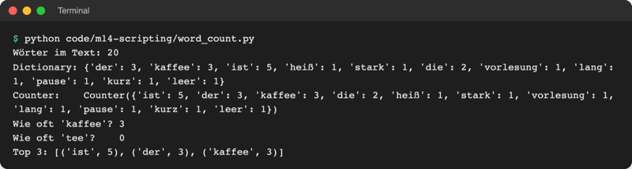
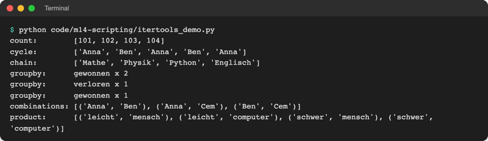

# Lab 14.1: collections und itertools

**Leitfragen:**

<details>
<summary>Wie zählt man, wie oft jedes Wort in einem Text vorkommt?</summary>

Jedes Wort bekommt einen Zähler: Ist das Wort neu, startet der Zähler bei 1, sonst steigt er um 1. Mit einem Dictionary (Lab 4.3) geht das von Hand; `Counter` aus dem Modul `collections` erledigt es in einer Zeile.

</details>

<details>
<summary>Wie viele Zeilen braucht das mit einem normalen Dictionary?</summary>

Etwa sechs: Schleife, `if word in counts`, Zähler erhöhen, `else`, Zähler anlegen. Dazu kommt das Sortieren nach Häufigkeit. `Counter(words).most_common(3)` ersetzt alles zusammen.

</details>

- Viele Aufgaben in Skripten wiederholen sich: zählen, gruppieren, die letzten N Werte merken, Listen kombinieren.
- Die Standardbibliothek hat dafür fertige Werkzeuge: Sammlungen in `collections`, Schleifen-Bausteine in `itertools`. Beide sind ohne Installation dabei (Lab 6.2).

## Begriffe

| Begriff | Bedeutung |
| --- | --- |
| `collections` | Modul der Standardbibliothek mit spezialisierten Sammlungen, die Dictionary, Liste und Tupel ergänzen |
| `Counter` | Dictionary, das zählt: Schlüssel = Ding, Wert = Anzahl; wie eine Strichliste |
| `most_common(n)` | die `n` häufigsten Einträge als Liste von Tupeln `(Ding, Anzahl)` |
| `defaultdict` | Dictionary, das für einen fehlenden Schlüssel automatisch einen Startwert anlegt, z. B. eine leere Liste |
| `deque` | Warteschlange; mit `maxlen` fällt beim Anhängen das älteste Element hinaus, wie bei einem Verlauf der letzten drei Anrufe |
| `namedtuple` | Tupel, dessen Felder Namen haben: `start.x` statt `start[0]` |
| `itertools` | Modul mit fertigen Bausteinen für Schleifen über Folgen |
| `list.extend(andere)` | hängt alle Elemente einer anderen Liste an; `append` hängt die Liste als ein Element an |

Original: [Python-Dokumentation: Übersichtstabelle des Moduls collections mit namedtuple, deque, ChainMap, Counter, OrderedDict, defaultdict und UserDict, UserList, UserString](https://docs.python.org/3.14/library/collections.html), Stand 08.11.2026.

Die Tabelle zeigt alle Sammlungen des Moduls. Im Kurs zählen vier: `Counter`, `defaultdict`, `deque`, `namedtuple`.

## Counter: zählen ohne if

Datei: [code/m14-scripting/word_count.py](../../project/code/m14-scripting/word_count.py). Erst von Hand mit einem Dictionary, dann mit `Counter`:

```python
counts = {}
for word in words:
    if word in counts:
        counts[word] += 1
    else:
        counts[word] = 1
```

```python
from collections import Counter

counter = Counter(words)          # zählt jedes Wort der Liste
print(counter["kaffee"])          # 3
print(counter["tee"])             # 0, kein KeyError
print(counter.most_common(3))     # [('ist', 5), ('der', 3), ('kaffee', 3)]
```



_Quelle: eigener Screenshot, Kurs-Repo, 08.11.2026._

- `Counter` nimmt jede Folge: Liste, String (zählt Buchstaben), Generator.
- Ein fehlender Schlüssel liefert `0` statt `KeyError` (Lab 7.1). Deshalb lässt sich ein leerer `Counter()` auch Zeile für Zeile füllen: `counter[word] += 1`.
- `most_common()` sortiert absteigend nach Anzahl; bei gleicher Anzahl bleibt die Reihenfolge des ersten Auftretens.

## defaultdict: gruppieren ohne „Gibt es den Schlüssel schon?“

Datei: [code/m14-scripting/group_by_letter.py](../../project/code/m14-scripting/group_by_letter.py). Wörter nach Anfangsbuchstaben in Listen sammeln:

```python
groups = {}
for word in WORDS:
    letter = word[0]
    if letter not in groups:      # fehlende Liste erst anlegen
        groups[letter] = []
    groups[letter].append(word)
```

```python
from collections import defaultdict

groups = defaultdict(list)        # fehlender Schlüssel -> neue leere Liste
for word in WORDS:
    groups[word[0]].append(word)
# {'k': ['kaffee', 'kurz'], 'p': ['pause', 'pizza'], 'v': [...], 's': [...]}
```

`defaultdict(list)` bekommt den Namen `list` ohne Klammern: Bei jedem fehlenden Schlüssel ruft es `list()` auf und erhält `[]`. Mit `defaultdict(int)` startet jeder Zähler bei `0`.

## deque und namedtuple

Datei: [code/m14-scripting/deque_namedtuple.py](../../project/code/m14-scripting/deque_namedtuple.py)

```python
from collections import deque, namedtuple

last_tips = deque(maxlen=3)        # höchstens drei Elemente
for tip in [50, 25, 37, 31, 34]:
    last_tips.append(tip)          # das älteste fällt vorne heraus
print(list(last_tips))             # [37, 31, 34]

Point = namedtuple("Point", ["x", "y"])
start = Point(3, 4)
print(start.x, start[1])           # 3 4: per Name oder Index
```

`namedtuple` ist die leichte Variante der Dataclass aus Lab 11.2: unveränderlich wie ein Tupel, aber mit lesbaren Feldnamen.

## itertools: Bausteine für Schleifen

Datei: [code/m14-scripting/itertools_demo.py](../../project/code/m14-scripting/itertools_demo.py). Alle Funktionen liefern Iteratoren (Lab 12.3): Werte entstehen erst beim Abruf, `list(...)` macht sie sichtbar.

| Funktion | Wirkung | Beispiel aus der Demo |
| --- | --- | --- |
| `count(101)` | zählt ohne Ende hoch | Wartenummern 101, 102, … |
| `cycle(folge)` | wiederholt eine Folge ohne Ende | Anna, Ben, Anna, Ben, … |
| `islice(it, n)` | nimmt nur die ersten `n` Werte | bremst `count` und `cycle` |
| `chain(a, b)` | mehrere Folgen hintereinander | Vormittags- und Nachmittagsfächer |
| `groupby(folge)` | fasst **direkt aufeinanderfolgende** gleiche Werte zusammen | gewonnen ×2, verloren ×1, gewonnen ×1 |
| `combinations(folge, 2)` | alle Paare ohne Wiederholung | Spielpaarungen Anna–Ben, Anna–Cem, Ben–Cem |
| `product(a, b)` | jede Kombination aus zwei Folgen | Stufe × Spielertyp |



_Quelle: eigener Screenshot, Kurs-Repo, 08.11.2026._

`groupby` arbeitet nur auf Nachbarn: Für Gruppen über die ganze Liste erst sortieren oder gleich `defaultdict` nehmen. `count` und `cycle` enden nie; ohne `islice` oder `break` läuft die Schleife endlos.

## Im Spiel: Lieblingszahl und Versuche pro Stufe

Am Ende einer Sitzung (ein Programmstart, mehrere Runden) zeigt das Spiel neu den Block „Diese Sitzung“. Zwei kleine Funktionen in `logic.py` liefern die Daten, ohne `print`:

```python
from collections import Counter, defaultdict


def favourite_numbers(guesses, count=3):
    """Gibt die meistgetippten Zahlen als (Zahl, Anzahl) zurück: [(7, 4), ...]."""
    return Counter(guesses).most_common(count)  # Counter zählt jede Zahl


def tries_per_level(scores):
    """Gruppiert die Versuche nach Stufe: {"leicht": [3, 5], "schwer": [6]}."""
    groups = defaultdict(list)  # fehlender Schlüssel -> automatisch leere Liste
    for score in scores:
        groups[score.level].append(score.tries)
    return groups
```

`__main__.py` sammelt dafür pro Runde den `Score` in `played` und alle Tipps in `all_guesses`; `all_guesses.extend(game.guesses)` hängt die Tipps der Runde einzeln an. Die Ausgabe übernimmt `ui.show_session`:

![Terminal: Ende einer Sitzung mit zwei Runden auf leicht, Block Diese Sitzung mit Lieblingszahl 5 (2-mal getippt), Meistgetippt [(5, 2), (8, 2), (10, 2)] und Versuche pro Stufe leicht [3, 5]](https://raw.githubusercontent.com/kodschul/kodschul-python-5-open/assets/m14/game-l01-session.png)

_Quelle: eigener Screenshot, Kurs-Repo, 08.11.2026 (Ende eines echten Laufs, mit Seed 3)._

Die Tipps stehen in keiner Datei: Nach dem nächsten Programmstart zählt die Lieblingszahl wieder von vorn. Runden, die mit `quit` enden, zählen nicht mit.

## Typische Fehler

| Symptom | Ursache | Lösung |
| --- | --- | --- |
| `NameError: name 'Counter' is not defined` | Import fehlt | `from collections import Counter` |
| `TypeError: first argument must be callable or None` | `defaultdict([])` statt `defaultdict(list)` | den Namen `list` ohne Klammern übergeben |
| `groupby` liefert dieselbe Gruppe mehrfach | gleiche Werte stehen nicht direkt nebeneinander | vorher `sorted(...)` oder `defaultdict` |
| Programm hängt bei `list(count())` | `count` und `cycle` enden nie | `islice(..., n)` oder `break` |
| Liste in der Liste: `[[5, 8], [10]]` | `append(game.guesses)` statt `extend` | `extend` hängt die Elemente einzeln an |
| `most_common()[0]` wirft `IndexError` | leere Liste, z. B. nur `quit` gespielt | vorher `if favourites:` prüfen |

## Fazit

- `Counter` zählt, `most_common(n)` liefert die Rangliste.
- `defaultdict(list)` gruppiert ohne Prüfung auf fehlende Schlüssel.
- `deque(maxlen=n)` merkt sich die letzten n Werte, `namedtuple` gibt Tupel-Feldern Namen.
- `itertools` liefert fertige Iteratoren für Zählen, Wiederholen, Verketten, Gruppieren und Kombinieren.

In der Übung zählt das eigene Spiel die meistgetippten Zahlen und gruppiert die Versuche nach Stufe.
