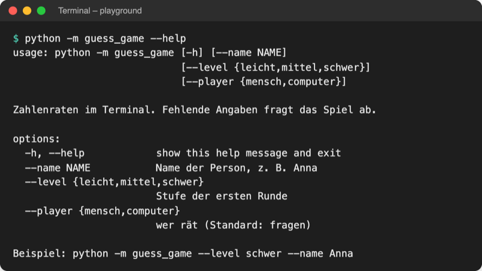
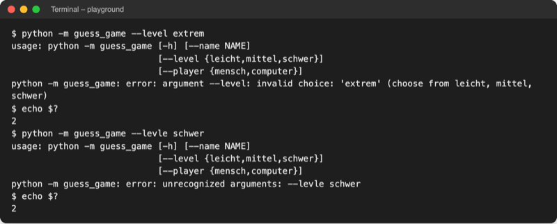

# Lab 14.2 – Lösung: Das Spiel mit Optionen starten

Fertiger Stand: [project/examples/m14-scripting/l02-argparse/guess_game/](../../project/examples/m14-scripting/l02-argparse/guess_game/). Test im Ordner `project/`: `cd examples/m14-scripting/l02-argparse`, dann `python -m guess_game --help`.

## Aufgabe 1: parse_args() mit --name

```python
# Startpunkt: python -m guess_game führt diese Datei aus
# Beispiel: python -m guess_game --level schwer --name Anna

import argparse

from guess_game import logic, players, storage, ui


def parse_args():
    """Liest die Optionen aus der Kommandozeile; --help erzeugt argparse selbst."""
    parser = argparse.ArgumentParser(
        prog="python -m guess_game",
        description="Zahlenraten im Terminal. Fehlende Angaben fragt das Spiel ab.",
        epilog="Beispiel: python -m guess_game --level schwer --name Anna",
    )
    parser.add_argument("--name", help="Name der Person, z. B. Anna")
```

`argparse` gehört zur Standardbibliothek und steht deshalb in der ersten Importgruppe.

## Aufgabe 2: --level und --player mit choices

```python
    parser.add_argument(
        "--level", choices=list(logic.LEVELS), help="Stufe der ersten Runde"
    )
    parser.add_argument(
        "--player", choices=["mensch", "computer"], help="wer rät (Standard: fragen)"
    )
    return parser.parse_args()  # liest sys.argv
```

`list(logic.LEVELS)` liefert die Schlüssel des Stufen-Dictionarys: `["leicht", "mittel", "schwer"]`. Eine neue Stufe in `logic.py` erscheint so automatisch in Hilfe und Prüfung.

## Aufgabe 3: Nur fragen, was fehlt

```python
def main():
    """Hauptablauf: Optionen lesen, fehlende Angaben fragen, Runden spielen."""
    args = parse_args()
    ui.show_banner()
    if args.name is None:  # nur fragen, was nicht beim Start angegeben wurde
        name = ui.ask_name()
    else:
        name = args.name.strip().title()
    player_type = args.player
    if player_type is None:
        player_type = ui.ask_player_type()
    if player_type == "computer":
        player = players.ComputerPlayer()
    else:
        player = players.HumanPlayer(name)
```

`parse_args()` steht vor dem Banner: Bei `--help` oder einer falschen Option beendet `argparse` das Programm, bevor etwas gedruckt wird. `is None` statt `== ""`: Eine fehlende Option hat den Wert `None` (Lab 5.2).

## Aufgabe 4: Stufe an rounds() weitergeben

```python
def rounds(player, scoreboard, level=None):
    """Generator: liefert Runde für Runde ein neues Spiel, bis niemand mehr will."""
    if level is None:  # keine Stufe beim Start angegeben (--level)
        level = ask_level()  # nur einmal; wechseln mit dem Befehl "stufe schwer"
    while True:
        game = logic.Game(player, scoreboard, level)
        yield game  # pausiert, bis die for-Schleife weitermacht
        level = game.next_level
        if ask_play_again() != "j":
            return  # Generator endet, die for-Schleife hört auf
```

```python
        for game in ui.rounds(player, board, args.level):  # eine Runde pro Durchlauf
```

`--level` gilt nur für die erste Runde; danach wechselt der Befehl `stufe …` aus Lab 13.3 wie bisher.

## Aufgabe 5: Tests

`--help`:



_Quelle: eigener Screenshot, Kurs-Repo, 08.11.2026._

Start mit allen drei Optionen (Seed 3, echte Ausgabe, gekürzt):

```text
$ python -m guess_game --name Anna --level schwer --player mensch
========================================
Zahlenraten
========================================
Beim Tipp versteht das Spiel auch Befehle, z. B. hilfe.

Stufe schwer, Anna: Rate eine Zahl zwischen 1 und 100.
Start: 08.11.2026, 02:39 Uhr
Tipp: 50
Zu niedrig.
Verbleibende Versuche: 6
...
Tipp: 76
Richtig, Anna! Benötigte Versuche: 5 · Dauer: 0,0 s
Bisherige Tipps: [50, 75, 80, 77, 76]
Bestenliste nach (versuche/zeit/punkte):

Bestenliste (Top 5 nach Versuchen)
1. Anna – 5 Versuche – 0,0 s · schwer · 90 Punkte
Nochmal spielen? (j/n): n
...
Danke fürs Spielen, Anna!
```

Falsche Werte:



_Quelle: eigener Screenshot, Kurs-Repo, 08.11.2026._

Ohne Optionen fragt das Spiel `Name:`, `Wer rät? (mensch/computer):` und `Stufe (leicht/mittel/schwer):` wie in Lab 14.1. Mit `--name Anna --level schwer` ohne `--player` fragt es nur `Wer rät?`.

## Erweiterung: count_files.py

```python
# Dateien mit einer Endung in einem Ordner zählen

import argparse
import sys
from pathlib import Path


def parse_args():
    """Liest Ordner und Endung aus der Kommandozeile."""
    parser = argparse.ArgumentParser(
        description="Zählt die Dateien eines Ordners mit einer Endung."
    )
    parser.add_argument("folder", help="Ordner, der durchsucht wird")
    parser.add_argument(
        "--ext", default="txt", help="Endung ohne Punkt (Standard: txt)"
    )
    return parser.parse_args()


def main():
    args = parse_args()
    folder = Path(args.folder)
    if not folder.is_dir():
        print(f"Ordner nicht gefunden: {folder}")
        sys.exit(1)
    count = 0
    for path in folder.iterdir():
        if path.is_file() and path.suffix.lower() == "." + args.ext:
            count += 1
    print(f"Dateien mit .{args.ext}: {count}")


if __name__ == "__main__":
    main()
```

```text
$ python count_files.py ../data/messy_downloads --ext csv
Dateien mit .csv: 2
$ python count_files.py ../data/nichtda
Ordner nicht gefunden: ../data/nichtda
$ echo $?
1
$ python count_files.py --help
usage: count_files.py [-h] [--ext EXT] folder

Zählt die Dateien eines Ordners mit einer Endung.

positional arguments:
  folder      Ordner, der durchsucht wird

options:
  -h, --help  show this help message and exit
  --ext EXT   Endung ohne Punkt (Standard: txt)
```

`.lower()` zählt auch `.CSV` mit. `umfrage_2025.csv` im Unterordner `alte_downloads/` zählt nicht, weil `iterdir` nur eine Ebene liest; Lab 14.3 zeigt `rglob` für alle Ebenen.
