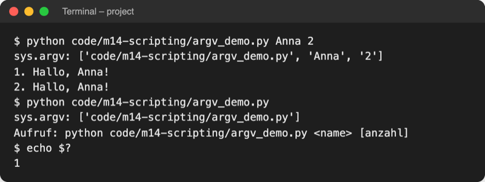
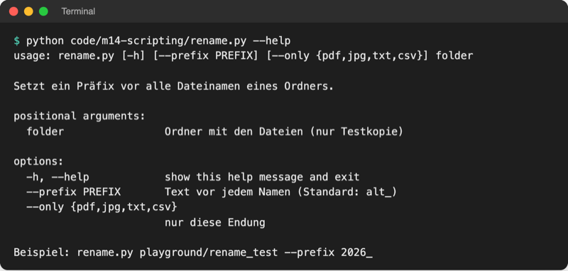
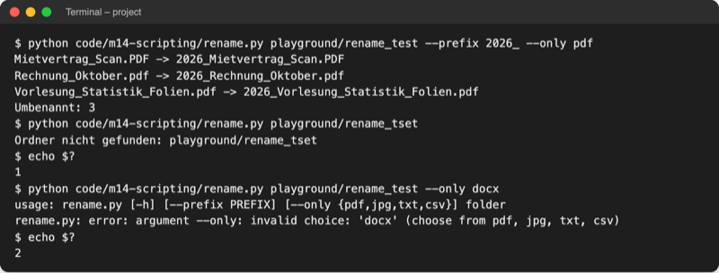
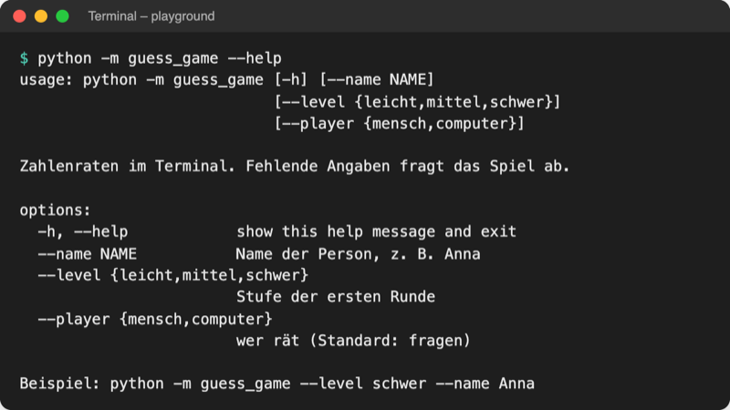
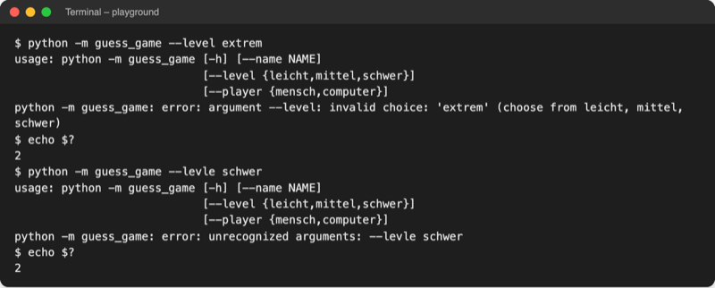

# Lab 14.2: Kommandozeilen-Programme

**Leitfragen:**

<details>
<summary>Wie startet ein Server nachts ein Programm, wenn niemand Fragen beantwortet?</summary>

Ein Zeitplaner startet es zur festgelegten Uhrzeit: `cron` unter Linux und macOS, die Aufgabenplanung unter Windows. Alles, was das Programm wissen muss, steht deshalb schon im Startbefehl, zum Beispiel `--level schwer`.

</details>

<details>
<summary>Welche Fragen des Spiels könnten schon beim Start beantwortet sein?</summary>

Name, Spielertyp (mensch/computer) und Stufe der ersten Runde. Tipps und „Nochmal spielen?“ entstehen erst während des Spiels und bleiben Fragen.

</details>

<details>
<summary>Woran erkennt ein anderes Programm, ob ein Skript erfolgreich war?</summary>

Am Exit-Code: Jedes Programm gibt beim Beenden eine Zahl an das Betriebssystem zurück. `0` heißt Erfolg, jede andere Zahl Fehler. Der Zeitplaner oder ein anderes Skript wertet diese Zahl aus.

</details>

- Ein Kommandozeilen-Programm bekommt seine Angaben beim Start: `python -m guess_game --name Anna --level schwer --player mensch`.
- `argparse` aus der Standardbibliothek liest diese Angaben, prüft sie und erzeugt die Hilfe `--help` automatisch.

## Begriffe

| Begriff | Bedeutung |
| --- | --- |
| Kommandozeile | die Zeile im Terminal, in der ein Befehl mit allen Angaben steht |
| Argument | ein Wort hinter dem Programmnamen, z. B. `Anna` oder `--level` |
| `sys.argv` | Liste aller Wörter der Kommandozeile als Strings; `sys` ist das Modul für Angaben über das laufende Python |
| `argparse` | Modul der Standardbibliothek, das Argumente beschreibt, prüft und in Variablen umwandelt |
| Positionsargument | Pflichtangabe, erkannt an ihrer Position: in `rename.py playground/test` ist `playground/test` der Ordner |
| Option (optionales Argument) | Angabe mit Namen und `--`, Reihenfolge egal, darf fehlen: `--prefix 2026_` |
| Standardwert (`default`) | Wert, den eine Option hat, wenn sie fehlt; ohne Angabe `None` |
| `choices` | Liste erlaubter Werte; alles andere lehnt `argparse` mit Fehlermeldung ab |
| Exit-Code | Zahl, die ein Programm beim Beenden zurückgibt: `0` Erfolg, sonst Fehler |
| `cron` / Aufgabenplanung | Zeitplaner, der Programme zu festen Zeiten startet (Linux/macOS bzw. Windows) |
| Shebang | erste Zeile `#!/usr/bin/env python3`: sagt dem System, mit welchem Programm eine Skriptdatei läuft |

## Automatisierung auf einen Blick

Automatisierungs-Skripte erledigen wiederkehrende Arbeit am Rechner, ohne dass jemand danebensitzt. In der Systemadministration ist das Alltag: Server sichern, Platten aufräumen, Berichte bauen.

| Aufgabe | Beispiel | Im Kurs |
| --- | --- | --- |
| Dateien sichern | jede Nacht Spielstände in einen Backup-Ordner kopieren | Lab 14.3 |
| Aufräumen | Downloads nach Dateityp sortieren | Lab 14.3 |
| Umbenennen | Präfix vor viele Dateinamen setzen | dieses Lab |
| System prüfen | Python-Version, freier Speicher, Befehle starten | Lab 15.1 |
| Protokollieren | festhalten, was nachts passiert ist | Lab 15.3 |
| Bericht | Log-Dateien auswerten, Zusammenfassung schreiben | Lab 16.3 |

**Wer startet das Skript?** Ein Mensch im Terminal, oder ein Zeitplaner: Unter Linux und macOS ist das `cron` (seit Version 7 Unix, 1979); eine Zeile wie `30 7 * * * python backup.py` startet ein Programm täglich um 7:30 Uhr. Unter Windows übernimmt das die Aufgabenplanung (Task Scheduler), die Programme zu Zeitpunkten oder bei Ereignissen startet.

_Quellen: Wikipedia „cron“ (https://en.wikipedia.org/wiki/Cron), Microsoft Learn „Task Scheduler“ (https://learn.microsoft.com/en-us/windows/win32/taskschd/task-scheduler-start-page), abgerufen am 08.11.2026._

Daraus folgen drei Regeln für jedes Automatisierungs-Skript:

1. Keine Rückfragen: alle Angaben kommen aus der Kommandozeile.
2. Erfolg oder Fehler über den Exit-Code melden.
3. Selbsterklärend sein: `--help` zeigt, was das Skript kann.

Bekannte Kommandozeilen-Programme arbeiten genauso. Die Python-Dokumentation erklärt `argparse` am Befehl `ls` (Ordnerinhalt anzeigen): ohne Argument, mit Positionsargument `pypy`, mit Option `-l` und mit `--help`.

Original: [Python-Dokumentation, argparse-Tutorial: der Befehl ls ohne Argument, mit Positionsargument pypy, mit Option -l und mit --help](https://docs.python.org/3.14/howto/argparse.html#concepts), Stand 08.11.2026.

## Die Grundidee: sys.argv

Datei: [code/m14-scripting/argv_demo.py](../../project/code/m14-scripting/argv_demo.py)

```python
import sys

print("sys.argv:", sys.argv)  # [0] ist immer der Skriptname

if len(sys.argv) < 2:  # kein Name angegeben
    print("Aufruf: python code/m14-scripting/argv_demo.py <name> [anzahl]")
    sys.exit(1)  # Exit-Code 1 = Fehler

name = sys.argv[1]
```



_Quelle: eigener Screenshot, Kurs-Repo, 08.11.2026._

`sys.exit(1)` beendet das Programm sofort mit Exit-Code 1. Von Hand wird es schnell mühsam: Jede Angabe kommt als Text an, `argv_demo.py Anna drei` endet mit `ValueError`, eine Hilfe gibt es nicht. Genau das übernimmt `argparse`.

## argparse: Argumente beschreiben statt zerlegen

Datei: [code/m14-scripting/rename.py](../../project/code/m14-scripting/rename.py) setzt ein Präfix vor alle Dateinamen eines Ordners. Nur an einer Testkopie ausprobieren: im Explorer `data/messy_downloads` kopieren, in `playground/` einfügen und in `rename_test` umbenennen. Das Original der Kursdaten lehnt das Skript ab.

```python
import argparse


def parse_args():
    """Liest Ordner und Optionen aus der Kommandozeile."""
    parser = argparse.ArgumentParser(
        description="Setzt ein Präfix vor alle Dateinamen eines Ordners.",
        epilog="Beispiel: rename.py playground/rename_test --prefix 2026_",
    )
    parser.add_argument("folder", help="Ordner mit den Dateien (nur Testkopie)")
    parser.add_argument(
        "--prefix", default="alt_", help="Text vor jedem Namen (Standard: alt_)"
    )
    parser.add_argument(
        "--only", choices=["pdf", "jpg", "txt", "csv"], help="nur diese Endung"
    )
    return parser.parse_args()
```

| Baustein | Wirkung |
| --- | --- |
| `ArgumentParser(description=..., epilog=...)` | Text über und unter der Hilfe |
| `add_argument("folder")` | Name ohne `--` = Positionsargument, Pflicht |
| `add_argument("--prefix", default="alt_")` | Option; fehlt sie, gilt der Standardwert |
| `choices=[...]` | nur diese Werte erlaubt |
| `help="..."` | Zeile in der Hilfe |
| `args = parser.parse_args()` | liest `sys.argv`; danach `args.folder`, `args.prefix`, `args.only` |

Im restlichen Skript arbeitet `folder.iterdir()` alle Einträge des Ordners ab, `path.suffix` liefert die Endung (`".pdf"`), `path.rename(neu)` benennt um; Lab 14.3 vertieft diese Befehle.



_Quelle: eigener Screenshot, Kurs-Repo, 08.11.2026._

`-h, --help` erzeugt `argparse` selbst. Die festen Texte (`usage`, `options`, `error`) bleiben englisch; seit Python 3.14 erscheint die Hilfe im Terminal farbig.



_Quelle: eigener Screenshot, Kurs-Repo, 08.11.2026 (Testkopie `playground/rename_test`)._

## Exit-Codes

| Code | Bedeutung | Wer setzt ihn? |
| --- | --- | --- |
| `0` | Erfolg | Python, wenn das Programm normal endet |
| `1` | Fehler, den das Skript selbst erkennt (Ordner fehlt, nichts zu tun) | eigener Code mit `sys.exit(1)` |
| `2` | falsche Kommandozeile (unbekannte Option, ungültiger Wert) | `argparse` |

Den letzten Exit-Code zeigt im Terminal macOS/Linux `echo $?`, PowerShell `$LASTEXITCODE`. Ein unbehandelter Traceback endet ebenfalls mit `1`.

## Skripte direkt starten

- **Linux/macOS:** Erste Zeile `#!/usr/bin/env python3` (Shebang), einmal `chmod +x rename.py` (macht die Datei ausführbar), dann `./rename.py playground/rename_test`.
- **Windows:** `py rename.py playground/rename_test`; der Befehl `py` liest ebenfalls die Shebang-Zeile.

Im Kurs bleibt der Start mit `python …` bei aktivem `.venv`; so laufen alle Skripte mit den installierten Paketen.

_Quelle: Python-Dokumentation „Using Python on Windows – Shebang lines“ (https://docs.python.org/3.14/using/windows.html), abgerufen am 08.11.2026._

## Im Spiel: Start mit Optionen

Ab jetzt beantwortet die Kommandozeile die Fragen nach Name, Spielertyp und Stufe:

```python
def parse_args():
    """Liest die Optionen aus der Kommandozeile; --help erzeugt argparse selbst."""
    parser = argparse.ArgumentParser(
        prog="python -m guess_game",
        description="Zahlenraten im Terminal. Fehlende Angaben fragt das Spiel ab.",
        epilog="Beispiel: python -m guess_game --level schwer --name Anna",
    )
    parser.add_argument("--name", help="Name der Person, z. B. Anna")
    parser.add_argument(
        "--level", choices=list(logic.LEVELS), help="Stufe der ersten Runde"
    )
    parser.add_argument(
        "--player", choices=["mensch", "computer"], help="wer rät (Standard: fragen)"
    )
    return parser.parse_args()  # liest sys.argv
```

`prog=` legt den Programmnamen in Hilfe und Fehlermeldungen fest; ohne ihn hängt er vom Startbefehl ab (seit Python 3.14 z. B. `python3.14 -m guess_game`, davor `__main__.py`). Alle drei Optionen haben den Standard `None` = „fehlt, also fragen“:

```python
    if args.name is None:  # nur fragen, was nicht beim Start angegeben wurde
        name = ui.ask_name()
    else:
        name = args.name.strip().title()
```

`python -m guess_game --name Anna --level schwer --player mensch` startet ohne Rückfrage direkt in die erste Runde. Fehlt `--player`, fragt das Spiel weiter „Wer rät?“.



_Quelle: eigener Screenshot, Kurs-Repo, 08.11.2026._

Am Ende einer Sitzung zeigt das Spiel den Block „Diese Sitzung“ mit Lieblingszahl und Versuchen pro Stufe; er stammt aus [Lab 14.1](../l01-collections-itertools/l01-collections-itertools-thx.md) und steckt im Starter, auch wenn Lab 14.1 übersprungen wurde.

## Typische Fehler

| Symptom | Ursache | Lösung |
| --- | --- | --- |
| `error: argument --level: invalid choice: 'extrem'`, Exit-Code 2 | Wert nicht in `choices` | einen erlaubten Wert nehmen, `--help` zeigt sie |
| `error: unrecognized arguments: --levle schwer` | Tippfehler im Optionsnamen | Schreibweise mit `--help` vergleichen |
| `error: the following arguments are required: folder` | Positionsargument fehlt | Ordner angeben |
| `AttributeError: 'Namespace' object has no attribute 'dry_run'` | Option nie mit `add_argument` angelegt | Option ergänzen; Bindestrich wird zu `_` |
| Spiel fragt trotz Option nach dem Namen | `if args.name == ""` statt `is None` | fehlende Option ist `None` |



_Quelle: eigener Screenshot, Kurs-Repo, 08.11.2026._

## Fazit

- Automatisierte Skripte stellen keine Fragen: alle Angaben kommen aus der Kommandozeile.
- `sys.argv` ist die rohe Liste, `argparse` beschreibt Positionsargumente und Optionen mit `default`, `choices` und `help` und erzeugt `--help`.
- Exit-Codes melden das Ergebnis: `0` Erfolg, `1` eigener Fehler (`sys.exit(1)`), `2` falsche Kommandozeile.

In der Übung bekommt das eigene Spiel die Optionen `--name`, `--level` und `--player`.
