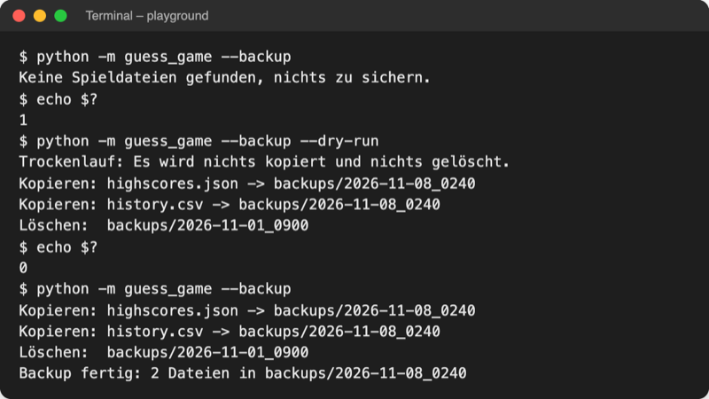

# Lab 14.3 – Lösung: Backup der Spieldateien mit Trockenlauf

Fertiger Stand: [project/examples/m14-scripting/l03-filesystem/guess_game/](../../project/examples/m14-scripting/l03-filesystem/guess_game/). Test im Ordner `project/`: `cd examples/m14-scripting/l03-filesystem`, dann `python -m guess_game --help`.

## Aufgabe 1: backup() kopiert die Spieldateien

```python
import csv
import json
import shutil
from dataclasses import asdict
from datetime import datetime
from pathlib import Path
```

```python
BACKUP_DIR = Path("backups")  # ein Unterordner pro Backup, z. B. 2026-11-08_1530
```

Zwischenstand nach Aufgabe 1 (ohne Rotation und Trockenlauf):

```python
def backup(keep=5, dry_run=False):
    files = [path for path in [HIGHSCORES_FILE, HISTORY_FILE] if path.exists()]
    target = BACKUP_DIR / datetime.now().strftime("%Y-%m-%d_%H%M")
    old_folders = []
    target.mkdir(parents=True, exist_ok=True)  # legt auch backups/ an
    for path in files:
        path.copy_into(target)  # seit Python 3.14; früher shutil.copy
    return target, files, old_folders
```

`parents=True` legt `backups/` beim ersten Mal gleich mit an. Der Ordnername `2026-11-08_1530` nutzt die Formatcodes aus Lab 6.3; zwei Backups in derselben Minute landen im selben Ordner, `copy_into` überschreibt dann die Dateien.

## Aufgabe 2: show_backup() in ui.py

```python
def show_backup(target, files, old_folders, dry_run):
    """Zeigt, was das Backup kopiert und löscht (oder im Trockenlauf täte)."""
    if dry_run:
        print("Trockenlauf: Es wird nichts kopiert und nichts gelöscht.")
    for path in files:
        print(f"Kopieren: {path} -> {target}")
    for folder in old_folders:
        print(f"Löschen:  {folder}")
    if not dry_run:
        print(f"Backup fertig: {len(files)} Dateien in {target}")
```

Trockenlauf und echter Lauf drucken dieselben Zeilen; so lässt sich beides direkt vergleichen.

## Aufgabe 3: Optionen und run_backup() in __main__.py

```python
import argparse
import sys
```

```python
    parser.add_argument(
        "--backup", action="store_true", help="Spieldateien sichern, nicht spielen"
    )
    parser.add_argument(
        "--keep", type=int, default=5, help="so viele Backups behalten (Standard: 5)"
    )
    parser.add_argument(
        "--dry-run", action="store_true", help="mit --backup: nur anzeigen"
    )
    args = parser.parse_args()  # liest sys.argv
    if args.keep < 1:
        parser.error("--keep muss mindestens 1 sein.")  # beendet mit Exit-Code 2
    return args


def run_backup(args):
    """Sichert die Spieldateien; Exit-Code 1, wenn es nichts zu sichern gibt."""
    target, files, old_folders = storage.backup(args.keep, args.dry_run)
    if not files:
        print("Keine Spieldateien gefunden, nichts zu sichern.")
        sys.exit(1)  # 1 = Fehler, z. B. für Aufgabenplanung oder cron
    ui.show_backup(target, files, old_folders, args.dry_run)


def main():
    """Hauptablauf: Optionen lesen, fehlende Angaben fragen, Runden spielen."""
    args = parse_args()
    if args.backup:  # Werkzeug-Modus: sichern und fertig, ohne Spiel
        run_backup(args)
        return
    ui.show_banner()
```

- `--dry-run` heißt im Code `args.dry_run`: `argparse` macht aus dem Bindestrich einen Unterstrich.
- `type=int` wandelt `--keep 2` in die Zahl `2`; `--keep zwei` lehnt `argparse` mit Exit-Code 2 ab.
- `parser.error(...)` ist optional, schützt aber vor `--keep 0`: `[:-0]` wäre `[:0]`, also eine leere Liste, und es würde nie etwas gelöscht.

## Aufgabe 4: Rotation und Trockenlauf

Fertige Funktion:

```python
def backup(keep=5, dry_run=False):
    """Kopiert die Spieldateien in backups/<Datum_Uhrzeit>/, behält nur keep Backups.

    Gibt Zielordner, kopierte Dateien und zu löschende Ordner zurück.
    Mit dry_run=True (Trockenlauf) wird nichts kopiert und nichts gelöscht.
    """
    files = [path for path in [HIGHSCORES_FILE, HISTORY_FILE] if path.exists()]
    target = BACKUP_DIR / datetime.now().strftime("%Y-%m-%d_%H%M")
    folders = []  # vorhandene Backup-Ordner
    if BACKUP_DIR.exists():
        folders = [path for path in BACKUP_DIR.iterdir() if path.is_dir()]
    if target not in folders:
        folders.append(target)
    # Namen wie 2026-11-08_1530 sortieren alphabetisch = zeitlich
    old_folders = sorted(folders)[:-keep]  # alle außer den neuesten keep
    if dry_run or not files:
        return target, files, old_folders
    target.mkdir(parents=True, exist_ok=True)  # legt auch backups/ an
    for path in files:
        path.copy_into(target)  # seit Python 3.14; früher shutil.copy
    for folder in old_folders:
        shutil.rmtree(folder)  # löscht den Ordner samt Inhalt
    return target, files, old_folders
```

- Der neue Ordner zählt bei der Rotation mit, auch wenn er noch nicht existiert; sonst blieben nach dem Lauf `keep + 1` Backups.
- Die Datumsform `JJJJ-MM-TT_HHMM` sortiert alphabetisch genau wie zeitlich; mit `08.11.2026` ginge das nicht.
- Das `return` vor `mkdir` ist der ganze Trockenlauf: Bis dahin wird nur gelesen und gerechnet.

## Aufgabe 5: Testlauf

Mit `backups/2026-11-01_0900` und `backups/2026-11-02_0900` (echte Ausgabe):

```text
$ python -m guess_game --backup --keep 2 --dry-run
Trockenlauf: Es wird nichts kopiert und nichts gelöscht.
Kopieren: highscores.json -> backups/2026-11-08_0247
Kopieren: history.csv -> backups/2026-11-08_0247
Löschen:  backups/2026-11-01_0900
$ python -m guess_game --backup --keep 2
Kopieren: highscores.json -> backups/2026-11-08_0247
Kopieren: history.csv -> backups/2026-11-08_0247
Löschen:  backups/2026-11-01_0900
Backup fertig: 2 Dateien in backups/2026-11-08_0247
```

Danach enthält `backups/` nur `2026-11-02_0900` und `2026-11-08_0247` (mit beiden Dateien). Unter Windows erscheinen die Pfade mit `\`.

Weitere Fälle, ohne Spieldateien und mit fünf alten Ordnern bei Standard `--keep 5`:



_Quelle: eigener Screenshot, Kurs-Repo, 08.11.2026._

Was wäre ohne Trockenlauf passiert? Ein Fehler wie `[:keep]` statt `[:-keep]` hätte sofort die neuesten Backups gelöscht und die ältesten behalten. Der Trockenlauf zeigt die Zeile `Löschen:` vorher.

## Erweiterung: sort_by_letter.py

```python
# Dateien nach Anfangsbuchstaben in Unterordner sortieren, mit Trockenlauf

import argparse
import sys
from pathlib import Path


def parse_args():
    """Liest Ordner und --dry-run aus der Kommandozeile."""
    parser = argparse.ArgumentParser(
        description="Sortiert Dateien nach Anfangsbuchstaben in Unterordner."
    )
    parser.add_argument("folder", help="Ordner, der sortiert wird (Testkopie)")
    parser.add_argument(
        "--dry-run", action="store_true", help="nur anzeigen, nichts verschieben"
    )
    return parser.parse_args()


def main():
    args = parse_args()
    folder = Path(args.folder)
    if not folder.is_dir():
        print(f"Ordner nicht gefunden: {folder}")
        sys.exit(1)
    if args.dry_run:
        print("Trockenlauf: Es wird nichts verschoben.")
    for path in sorted(folder.iterdir(), key=lambda p: p.name.lower()):
        if not path.is_file() or path.name.startswith("."):
            continue  # Unterordner und versteckte Dateien bleiben
        target_dir = folder / path.name[0].upper()
        print(f"{path.name} -> {target_dir.name}/")
        if not args.dry_run:
            target_dir.mkdir(exist_ok=True)
            path.move_into(target_dir)  # seit Python 3.14


if __name__ == "__main__":
    main()
```

```text
$ python sort_by_letter.py messy_downloads --dry-run
Trockenlauf: Es wird nichts verschoben.
einkaufsliste.txt -> E/
kontakte_export.csv -> K/
LIESMICH -> L/
Mietvertrag_Scan.PDF -> M/
noten_semester1.csv -> N/
notizen.txt -> N/
...
Vorlesung_Statistik_Folien.pdf -> V/
```

Ohne `--dry-run` entstehen die Ordner `E/`, `K/`, `L/`, `M/`, `N/`, `P/`, `R/`, `S/`, `U/`, `V/`; `alte_downloads/` bleibt unberührt. `move_into` hält den Dateinamen bei; gleichwertig ist `path.move(target_dir / path.name)`. Eine neue Testkopie legt `make_sandbox.py` jederzeit wieder an.
