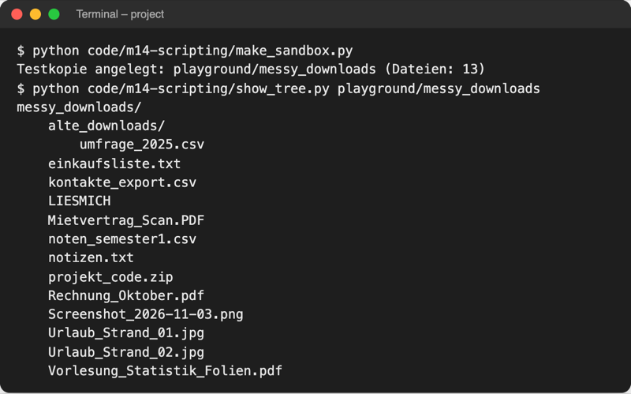
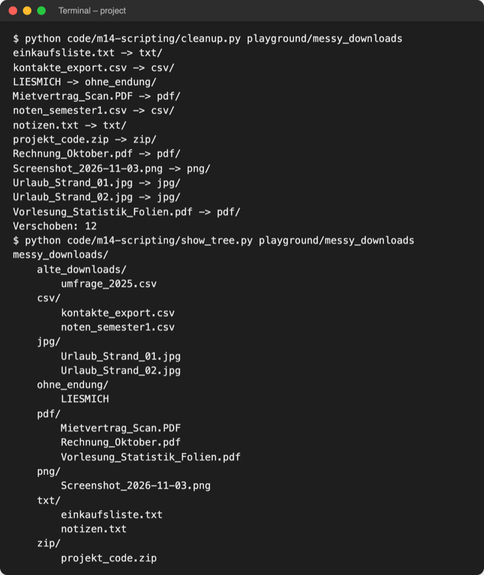
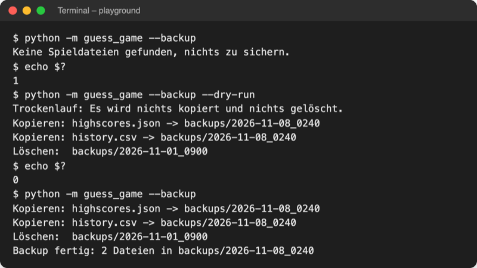

# Lab 14.3: Dateisystem automatisieren

**Leitfragen:**

<details>
<summary>Welche Ordner auf dem eigenen Rechner bräuchten regelmäßig Ordnung?</summary>

Typisch sind Downloads, Desktop, Screenshots und Fotos vom Handy: Dateien aller Art landen an einem Ort. Ein Skript kann sie nach Endung, Datum oder Namen in Unterordner sortieren.

</details>

<details>
<summary>Was ist das Risiko eines Skripts, das Dateien verschiebt?</summary>

Ein Fehler trifft sofort Hunderte Dateien: falscher Ordner, überschriebene Dateien, gelöschte Backups. Deshalb zeigt ein gutes Skript erst im Trockenlauf, was es tun würde, und arbeitet beim Ausprobieren auf einer Kopie.

</details>

<details>
<summary>Wie findet man alle `.csv`-Dateien in allen Unterordnern?</summary>

Von Hand: jeden Ordner öffnen und nachsehen. In Python mit einem Suchmuster: `Path("data").rglob("*.csv")` durchsucht den Ordner und alle Ebenen darunter.

</details>

- `pathlib` aus Lab 8.1 kann mehr als Pfade bauen: Ordner auflisten, Dateien suchen, anlegen, kopieren, verschieben.
- Seit Python 3.14 kopiert und verschiebt `Path` ganze Ordner selbst; ältere Skripte nutzen dafür `shutil` und `os.path`.

## Begriffe

| Begriff | Bedeutung |
| --- | --- |
| `path.iterdir()` | liefert alle Einträge direkt in einem Ordner, eine Ebene tief |
| `path.glob("*.csv")` | sucht per Muster im Ordner; `*` steht für beliebige Zeichen |
| `path.rglob("*.csv")` | sucht wie `glob`, aber auch in allen Unterordnern (r = rekursiv, Ebene für Ebene nach unten) |
| `path.suffix` / `path.stem` | Endung mit Punkt (`".pdf"`) / Name ohne Endung |
| `path.stat()` | Angaben des Betriebssystems zur Datei: `st_size` (Bytes), `st_mtime` (Änderungszeit in Sekunden) |
| `mkdir(parents=True, exist_ok=True)` | Ordner anlegen, auch fehlende Elternordner; kein Fehler, wenn er schon existiert |
| `copy`, `copy_into`, `move` | kopieren bzw. verschieben, Dateien und ganze Ordner (seit Python 3.14) |
| `shutil` | Modul für Datei-Operationen, älterer Weg zum Kopieren und Verschieben, dazu ZIP und Ordner löschen |
| `shutil.rmtree(ordner)` | löscht einen Ordner samt Inhalt, ohne Papierkorb |
| Trockenlauf (dry run) | Probelauf: das Skript zeigt, was es tun würde, ändert aber nichts |

## Ordner lesen: iterdir, suffix, stat

Datei: [code/m14-scripting/list_folder.py](../../project/code/m14-scripting/list_folder.py) liest den Testordner [data/messy_downloads/](../../project/data/messy_downloads/) (13 erfundene Dateien, ein Unterordner) und ändert nichts.

```python
for path in sorted(folder.iterdir(), key=lambda p: p.name.lower()):
    if path.is_dir():
        print(f"[Ordner] {path.name}/")
        continue
    info = path.stat()  # Angaben des Betriebssystems zur Datei
    changed = datetime.fromtimestamp(info.st_mtime)  # Sekunden -> Datum
    print(f"{path.name} | Endung: {path.suffix} | {info.st_size} Bytes ...")
```

```text
[Ordner] alte_downloads/
einkaufsliste.txt | Endung: .txt | 27 Bytes | geändert 06.11.2026
kontakte_export.csv | Endung: .csv | 72 Bytes | geändert 01.10.2026
LIESMICH | Endung:  | 27 Bytes | geändert 01.09.2026
Mietvertrag_Scan.PDF | Endung: .PDF | 602 Bytes | geändert 12.09.2026
...
```

`datetime.fromtimestamp` wandelt die Sekundenzahl in ein `datetime` (Lab 6.3). Nach dem Entpacken des Kurs-ZIPs zeigt das Datum meist den Zeitpunkt des Entpackens. `LIESMICH` hat keine Endung: `suffix` ist dann `""`.

## Dateien finden: glob und rglob

Datei: [code/m14-scripting/find_csv.py](../../project/code/m14-scripting/find_csv.py)

```python
folder.glob("*.csv")    # kontakte_export.csv, noten_semester1.csv
folder.rglob("*.csv")   # dieselben plus alte_downloads/umfrage_2025.csv
```

| Muster | findet |
| --- | --- |
| `*.csv` | alle Namen, die auf `.csv` enden |
| `Urlaub_*` | alle Namen, die mit `Urlaub_` beginnen |
| `*` | alles; mit `rglob("*")` jede Datei und jeden Ordner auf allen Ebenen |

Die Summe aller Dateigrößen ist ein Generator-Ausdruck (Lab 12.3): `sum(p.stat().st_size for p in folder.rglob("*") if p.is_file())`.

## Anlegen, kopieren, verschieben

| Methode | Wirkung | seit |
| --- | --- | --- |
| `ziel.mkdir(parents=True, exist_ok=True)` | Ordner anlegen | älter |
| `quelle.copy(ziel)` | Datei oder ganzen Ordner nach `ziel` kopieren | **3.14** |
| `quelle.copy_into(ordner)` | in einen vorhandenen Ordner hineinkopieren, Name bleibt | **3.14** |
| `quelle.move(ziel)` | Datei oder Ordner verschieben | **3.14** |
| `quelle.move_into(ordner)` | in einen vorhandenen Ordner hineinverschieben | **3.14** |
| `quelle.rename(ziel)` | umbenennen (Lab 14.2) | älter |
| `datei.unlink()` | eine Datei löschen | älter |

Original: [Python-Dokumentation, What's New in Python 3.14, Abschnitt pathlib: neue Methoden copy, copy_into, move und move_into](https://docs.python.org/3.14/whatsnew/3.14.html#pathlib), Stand 08.11.2026.

`copy` und `move` überschreiben eine vorhandene Zieldatei ohne Rückfrage. Datei: [code/m14-scripting/make_sandbox.py](../../project/code/m14-scripting/make_sandbox.py) legt mit `copy` eine Testkopie an, auf der das Aufräumen gefahrlos läuft:

```python
SOURCE = Path("data/messy_downloads")  # Original der Kursdaten: nur lesen
TARGET = Path("playground/messy_downloads")  # hier darf aufgeräumt werden

if TARGET.exists():
    shutil.rmtree(TARGET)  # alte Kopie samt Inhalt löschen
SOURCE.copy(TARGET)  # seit Python 3.14: kopiert den ganzen Ordner
```

## Ältere Wege: shutil und os.path

Diese Schreibweisen stehen in vielen Skripten und Anleitungen. Datei: [code/m14-scripting/old_ways.py](../../project/code/m14-scripting/old_ways.py) zeigt beide Wege nebeneinander.

| Aufgabe | `pathlib` (Kurs) | älter |
| --- | --- | --- |
| Pfad bauen | `Path(ordner) / "a.txt"` | `os.path.join(ordner, "a.txt")` |
| existiert? | `pfad.exists()` | `os.path.exists(pfad)` |
| Größe | `pfad.stat().st_size` | `os.path.getsize(pfad)` |
| Ordnerinhalt | `pfad.iterdir()` | `os.listdir(pfad)` |
| Datei kopieren | `pfad.copy(ziel)` | `shutil.copy(pfad, ziel)` |
| Ordner kopieren | `pfad.copy(ziel)` | `shutil.copytree(pfad, ziel)` |
| verschieben | `pfad.move(ziel)` | `shutil.move(pfad, ziel)` |
| Ordner samt Inhalt löschen | – | `shutil.rmtree(pfad)` |
| ZIP-Archiv | – | `shutil.make_archive("name", "zip", ordner)` |

`shutil.rmtree` und `make_archive` haben kein `Path`-Gegenstück und bleiben auch in neuem Code.

## Sicher arbeiten: erst Trockenlauf, dann ausführen

Datei: [code/m14-scripting/cleanup.py](../../project/code/m14-scripting/cleanup.py) sortiert Dateien nach Endung in Unterordner (`pdf/`, `jpg/`, …; ohne Endung nach `ohne_endung/`). Ablauf: Testkopie anlegen, Trockenlauf, prüfen, ausführen.

```python
    for path in sorted(folder.iterdir(), key=lambda p: p.name.lower()):
        if not path.is_file() or path.name.startswith("."):
            continue  # Unterordner und versteckte Dateien bleiben, wo sie sind
        target_dir = folder / folder_name_for(path)
        target = target_dir / path.name
        if target.exists():
            print(f"Übersprungen, existiert schon: {target}")
            continue  # nie eine vorhandene Datei überschreiben
        print(f"{path.name} -> {target_dir.name}/")
        if not args.dry_run:
            target_dir.mkdir(exist_ok=True)  # Unterordner anlegen, falls nötig
            path.move(target)  # seit Python 3.14; früher shutil.move
        count += 1
```

`--dry-run` ist eine Option ohne Wert: `action="store_true"` macht `args.dry_run` zu `True`, wenn sie dasteht, sonst `False`. Ein Skript mit Trockenlauf druckt in beiden Fällen dieselben Zeilen und überspringt nur im Trockenlauf die ändernden Befehle.



_Quelle: eigener Screenshot, Kurs-Repo, 08.11.2026._

```text
$ python code/m14-scripting/cleanup.py playground/messy_downloads --dry-run
Trockenlauf: Es wird nichts verschoben.
einkaufsliste.txt -> txt/
kontakte_export.csv -> csv/
LIESMICH -> ohne_endung/
...
Würde verschieben: 12
```



_Quelle: eigener Screenshot, Kurs-Repo, 08.11.2026._

`show_tree.py` ([code](../../project/code/m14-scripting/show_tree.py)) zeigt den Baum mit `rglob("*")`; `path.relative_to(folder).parts` liefert die Pfadteile unterhalb des Startordners, ihre Anzahl ist die Einrücktiefe. Auf `data/messy_downloads` direkt angewendet, lehnt `cleanup.py` ab und endet mit Exit-Code 1.

> **Merksatz:** Ein Skript, das Dateien verschiebt oder löscht, bekommt einen Trockenlauf und wird zuerst an einer Kopie getestet.

## Im Spiel: Backup mit Rotation

`python -m guess_game --backup` spielt nicht, sondern sichert `highscores.json` und `history.csv` in `backups/<Datum_Uhrzeit>/` und behält nur die neuesten fünf Backups (Rotation). So lässt es sich per cron oder Aufgabenplanung jede Nacht starten. Kern in `storage.py`:

```python
    files = [path for path in [HIGHSCORES_FILE, HISTORY_FILE] if path.exists()]
    target = BACKUP_DIR / datetime.now().strftime("%Y-%m-%d_%H%M")
    folders = []  # vorhandene Backup-Ordner
    if BACKUP_DIR.exists():
        folders = [path for path in BACKUP_DIR.iterdir() if path.is_dir()]
    if target not in folders:
        folders.append(target)
    # Namen wie 2026-11-08_1530 sortieren alphabetisch = zeitlich
    old_folders = sorted(folders)[:-keep]  # alle außer den neuesten keep
    if dry_run or not files:
        return target, files, old_folders
```

- `[:-keep]` schneidet die letzten `keep` Elemente ab (negativer Index, Lab 2.4): übrig bleiben die älteren Ordner, die weg dürfen.
- Erst danach kommen `mkdir`, `copy_into` und `shutil.rmtree`; im Trockenlauf kehrt die Funktion vorher zurück.
- Neue Optionen in `__main__.py`: `--backup` und `--dry-run` mit `action="store_true"`, `--keep` mit `type=int` (wandelt den Text in eine Zahl) und `default=5`. Ohne Spieldateien endet `--backup` mit `sys.exit(1)`.



_Quelle: eigener Screenshot, Kurs-Repo, 08.11.2026 (fünf alte Backup-Ordner vorbereitet)._

## Typische Fehler

| Symptom | Ursache | Lösung |
| --- | --- | --- |
| `AttributeError: 'PosixPath' object has no attribute 'copy'` (Windows: `'WindowsPath'`) | Python älter als 3.14 | Python 3.14 nutzen oder `shutil.copy` / `shutil.copytree` |
| `FileNotFoundError` bei `copy_into` oder `mkdir` | Zielordner fehlt bzw. Elternordner fehlt | `mkdir(parents=True, exist_ok=True)` vorher |
| `FileExistsError` bei `mkdir` | Ordner gibt es schon | `exist_ok=True` |
| `glob("*.csv")` findet Dateien in Unterordnern nicht | `glob` sucht nur eine Ebene | `rglob("*.csv")` |
| `.PDF` landet nicht bei `.pdf` | Endungen unterscheiden Groß/klein | `path.suffix.lower()` |
| `FileNotFoundError` für `data/...` | Terminal steht im falschen Ordner | `Path.cwd()` prüfen; Demos laufen im Ordner `project/` |
| Kursdaten verschwunden | Skript lief auf dem Original | ZIP neu entpacken oder Ordner aus dem Kurs-Repo holen; künftig erst `make_sandbox.py` |
| die neuesten Backups verschwinden, die ältesten bleiben | `[:keep]` statt `[:-keep]` | Minuszeichen setzen; erst mit `--dry-run` prüfen |

## Fazit

- `iterdir`, `glob`/`rglob` und `stat` lesen das Dateisystem; `mkdir`, `copy`, `copy_into` und `move` (seit 3.14) ändern es.
- `shutil` und `os.path` sind die älteren Wege; `shutil.rmtree` und `make_archive` bleiben aktuell.
- Ändernde Skripte bekommen `--dry-run` und laufen zuerst auf einer Kopie.

In der Übung bekommt das eigene Spiel die Optionen `--backup`, `--keep` und `--dry-run`.
