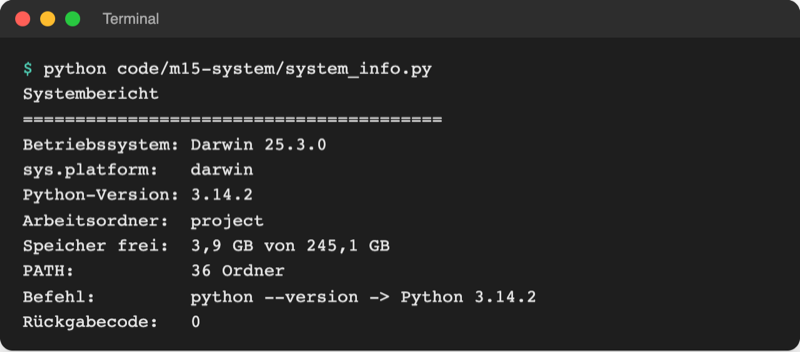

# Lab 15.1 – Lösung: Systembericht

Fertige Datei: [project/code/m15-system/system_info.py](../../project/code/m15-system/system_info.py). Start im Ordner `project/`: `python code/m15-system/system_info.py`.

## Aufgaben 1 bis 4: das ganze Skript

```python
# Lab 15.1: Systembericht – Angaben über den eigenen Rechner für eine Support-Anfrage
import os
import platform
import shutil
import subprocess
import sys
from pathlib import Path

print("Systembericht")
print("=" * 40)

# 1. Betriebssystem und Python
print(f"Betriebssystem: {platform.system()} {platform.release()}")  # z. B. Windows 11
print(f"sys.platform:   {sys.platform}")  # win32, darwin (macOS) oder linux
print(f"Python-Version: {platform.python_version()}")
print(f"Arbeitsordner:  {Path(os.getcwd()).name}")  # nur der letzte Ordnername

# 2. Freier Speicherplatz auf dem Laufwerk des Arbeitsordners
usage = shutil.disk_usage(".")  # Werte in Byte
free_gb = f"{usage.free / 10**9:.1f}".replace(".", ",")  # 1 GB = 10**9 Byte
total_gb = f"{usage.total / 10**9:.1f}".replace(".", ",")
print(f"Speicher frei:  {free_gb} GB von {total_gb} GB")

# 3. Umgebungsvariable lesen: PATH gibt es auf jedem System
folders = os.environ["PATH"].split(os.pathsep)  # Trenner: ; unter Windows, sonst :
print(f"PATH:           {len(folders)} Ordner")

# 4. Ein anderes Programm starten: Python selbst, das gibt es überall
result = subprocess.run(
    [sys.executable, "--version"],  # Liste: Programm, dann jedes Argument einzeln
    capture_output=True,  # Ausgabe auffangen statt direkt anzeigen
    text=True,  # Ausgabe als Text (str) statt als Bytes
    check=True,  # Rückgabecode ungleich 0 -> CalledProcessError
)
print(f"Befehl:         python --version -> {result.stdout.strip()}")
print(f"Rückgabecode:   {result.returncode}")  # 0 = erfolgreich
```

- Aufgabe 1: `platform` liefert lesbare Namen, `sys.platform` den Kurznamen für Prüfungen.
- Aufgabe 2: `f"{wert:.1f}"` rundet auf eine Stelle (Lab 6.3), `.replace(".", ",")` setzt das deutsche Komma.
- Aufgabe 3: `os.pathsep` ist `;` unter Windows und `:` unter macOS/Linux; so zählt das Skript überall richtig.
- Aufgabe 4: `result.stdout` endet mit einem Zeilenumbruch, `.strip()` entfernt ihn. `Path(os.getcwd()).name` zeigt nur den letzten Ordnernamen statt des ganzen Pfads mit dem Benutzernamen.

## Aufgabe 5: Test



_Quelle: eigener Screenshot, Kurs-Repo, 08.11.2026 (macOS). Unter Windows steht z. B. `Windows 11` und `win32`._

Umgebungsvariable, macOS/Linux:

```text
$ python code/m15-system/env_vars.py
Anzahl Umgebungsvariablen: 69
APP_MODE: normal
DEMO_TOKEN ist nicht gesetzt.
$ export DEMO_TOKEN=abc12345
$ python code/m15-system/env_vars.py
Anzahl Umgebungsvariablen: 70
APP_MODE: normal
DEMO_TOKEN ist gesetzt (8 Zeichen).
```

Unter Windows lautet die zweite Zeile `$env:DEMO_TOKEN = "abc12345"`. Die Anzahl der Variablen hängt vom Rechner ab; sie steigt nach dem Setzen um eins.

## Erweiterung

Unter Aufgabe 4 im selben Skript (die Imports stehen schon oben):

```python
count_option = "-n" if sys.platform == "win32" else "-c"  # Windows: -n, sonst -c
try:
    result = subprocess.run(
        ["ping", count_option, "1", "127.0.0.1"], capture_output=True, timeout=10
    )
    if result.returncode == 0:
        print("ping:           erreichbar")
    else:
        print("ping:           nicht erreichbar")
except FileNotFoundError:  # ping ist nicht installiert
    print("ping:           nicht installiert")
```

```text
ping:           erreichbar
```

Ohne `text=True` bleibt die Ausgabe hier Bytes; das stört nicht, weil nur der Rückgabecode zählt. `127.0.0.1` ist immer der eigene Rechner, deshalb klappt der Test auch ohne Internet.
