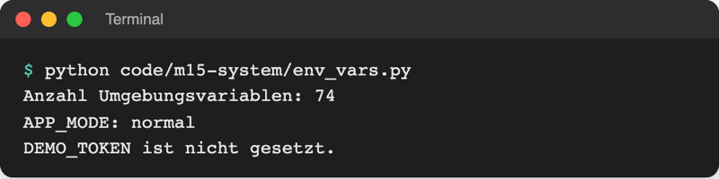
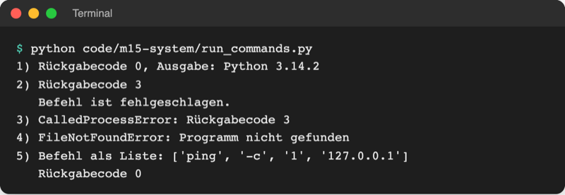

# Lab 15.1: Mit dem Betriebssystem arbeiten

**Leitfragen:**

<details>
<summary>Welche Angaben über den eigenen Rechner (System, Python-Version, freier Speicher) muss man bei einem Support-Problem nennen?</summary>

Mindestens Betriebssystem mit Version, Python-Version und freien Speicherplatz; oft auch, welche Programme installiert sind. Ein Skript kann all das selbst abfragen und als Bericht ausgeben.

</details>

<details>
<summary>Woran erkennt ein Skript, ob ein gestarteter Befehl geklappt hat?</summary>

Am Rückgabecode (Exit-Code aus Lab 14.2): `0` heißt Erfolg, jede andere Zahl Fehler. Dazu kommt die Ausgabe des Befehls, die das Skript auffangen und auswerten kann.

</details>

<details>
<summary>Was kann passieren, wenn eine Nutzereingabe direkt in einen Befehl eingefügt wird?</summary>

Wer die Eingabe schreibt, kann einen zweiten Befehl anhängen, etwa `; rm -rf ~` (alles im eigenen Ordner löschen). Diese „Shell-Injection“ verhindert die Listenform von `subprocess.run` ohne `shell=True`.

</details>

- Python-Programme laufen nicht allein: Das Betriebssystem (Windows, macOS, Linux) stellt Dateien, Einstellungen und andere Programme bereit.
- Die Module `os`, `sys`, `platform`, `shutil` und `subprocess` fragen das System ab und starten andere Programme, auf allen drei Systemen mit demselben Code.

## Begriffe

| Begriff | Bedeutung |
| --- | --- |
| Betriebssystem | Grundprogramm des Rechners (Windows, macOS, Linux); verwaltet Dateien, Speicher und laufende Programme |
| Umgebungsvariable | Einstellung mit Name und Text, die das Betriebssystem jedem gestarteten Programm mitgibt; wie ein Zettel, den jedes Programm beim Start in die Hand bekommt |
| `PATH` | Umgebungsvariable mit der Liste der Ordner, in denen das System nach Programmen sucht |
| Prozess | ein laufendes Programm; ein Skript kann weitere Prozesse starten |
| Rückgabecode | Zahl, mit der ein Programm endet; `0` = Erfolg (aus Lab 14.2 als Exit-Code bekannt) |
| Shell | Programm, das Befehlszeilen liest und ausführt (PowerShell, bash, zsh); das Terminal zeigt sie an |
| Shell-Injection | Angriff, bei dem eine Eingabe einen zusätzlichen Befehl in eine Befehlszeile schmuggelt |

## Das System abfragen: os, sys, platform

| Aufruf | Liefert | Beispiel (macOS, 08.11.2026) |
| --- | --- | --- |
| `platform.system()` | Name des Betriebssystems | `'Darwin'` (macOS), `'Windows'`, `'Linux'` |
| `platform.release()` | Version des Systems | `'25.3.0'`, unter Windows z. B. `'11'` |
| `platform.python_version()` | Python-Version als Text | `'3.14.2'` |
| `sys.platform` | Kurzname für Prüfungen im Code | `'darwin'`, `'win32'`, `'linux'` |
| `sys.executable` | Pfad des gerade laufenden Python (in `.venv`) | `.../project/.venv/bin/python` |
| `os.getcwd()` | aktueller Arbeitsordner als Text | `.../project` |

`sys` kennt das Kurs-Projekt schon (`sys.argv` und `sys.exit` aus Lab 14.2). `platform` beschreibt das System für Menschen, `sys.platform` ist für `if`-Prüfungen gedacht. `Path(os.getcwd())` und `Path.cwd()` liefern denselben Ordner als `Path`.

Freier Speicherplatz kommt aus `shutil` (bekannt aus Lab 14.3): `shutil.disk_usage(".")` liefert für das Laufwerk des Arbeitsordners drei Zahlen in Byte, `total`, `used` und `free`. `usage.free / 10**9` rechnet in Gigabyte um.

## Umgebungsvariablen: Einstellungen außerhalb des Codes

Jedes Programm erbt beim Start die Umgebungsvariablen des Terminals. Sie eignen sich für Einstellungen, die nicht im Code stehen sollen, vor allem Geheimnisse wie Passwörter und API-Schlüssel: Der Code wird geteilt, die Variable bleibt auf dem eigenen Rechner. Datei: [code/m15-system/env_vars.py](../../project/code/m15-system/env_vars.py)

```python
import os

# os.environ verhält sich wie ein Dictionary: Name -> Text
print(f"Anzahl Umgebungsvariablen: {len(os.environ)}")

# os.getenv(name, standard): fehlt die Variable, kommt der Standardwert zurück
mode = os.getenv("APP_MODE", "normal")
print(f"APP_MODE: {mode}")

# Geheimnisse (Passwörter, API-Schlüssel) nie ausgeben, nur prüfen, ob sie da sind
token = os.getenv("DEMO_TOKEN")  # None, wenn nicht gesetzt
if token is None:
    print("DEMO_TOKEN ist nicht gesetzt.")
else:
    print(f"DEMO_TOKEN ist gesetzt ({len(token)} Zeichen).")
```



_Quelle: eigener Screenshot, Kurs-Repo, 08.11.2026._

| Zugriff | Fehlt die Variable … |
| --- | --- |
| `os.environ["PATH"]` | `KeyError` (wie bei einem Dictionary) |
| `os.getenv("APP_MODE")` | `None` |
| `os.getenv("APP_MODE", "normal")` | der Standardwert `"normal"` |

Eine Variable setzen gilt nur für das aktuelle Terminal, bis es geschlossen wird:

| System | Setzen | Entfernen |
| --- | --- | --- |
| Windows (PowerShell) | `$env:DEMO_TOKEN = "abc12345"` | `Remove-Item Env:DEMO_TOKEN` |
| macOS/Linux (bash, zsh) | `export DEMO_TOKEN=abc12345` | `unset DEMO_TOKEN` |

Danach zeigt `python code/m15-system/env_vars.py` „DEMO_TOKEN ist gesetzt (8 Zeichen).“ Werte sind immer Text: `os.getenv("PORT", "8000")` liefert `"8000"`, eine Zahl daraus macht `int(...)`.

## Andere Programme starten: subprocess.run

`subprocess.run` startet ein Programm als eigenen Prozess, wartet, bis es fertig ist, und gibt ein Ergebnis-Objekt zurück. Der Befehl steht als **Liste**: zuerst das Programm, dann jedes Argument als eigenes Element.

```python
import subprocess
import sys

result = subprocess.run(
    [sys.executable, "--version"],  # Liste: Programm, dann jedes Argument einzeln
    capture_output=True,  # Ausgabe auffangen statt direkt anzeigen
    text=True,  # Ausgabe als Text (str) statt als Bytes
    check=True,  # Rückgabecode ungleich 0 -> CalledProcessError
)
print(result.stdout.strip())  # Python 3.14.2
print(result.returncode)  # 0
```

`sys.executable` statt `"python"`: Je nach System heißt der Befehl `python`, `python3` oder `py`; `sys.executable` ist immer genau das Python, das gerade läuft, auch innerhalb von `.venv`.

| Parameter / Attribut | Bedeutung |
| --- | --- |
| `capture_output=True` | Ausgabe landet in `result.stdout` (normale Ausgabe) und `result.stderr` (Fehlerausgabe) |
| `text=True` | Ausgabe als `str`; ohne das kommen Bytes wie `b'Python 3.14.2\n'` |
| `check=True` | Rückgabecode ungleich 0 löst `subprocess.CalledProcessError` aus |
| `timeout=10` | nach 10 Sekunden abbrechen (`subprocess.TimeoutExpired`) |
| `result.returncode` | Rückgabecode des Programms |

Was bei Erfolg, Fehler und fehlendem Programm passiert, zeigt [code/m15-system/run_commands.py](../../project/code/m15-system/run_commands.py):



_Quelle: eigener Screenshot, Kurs-Repo, 08.11.2026 (macOS; unter Windows steht in Zeile 5 `-n` statt `-c`)._

- Ohne `check=True` entscheidet das Skript selbst: `if result.returncode != 0:`.
- Gibt es das Programm nicht, löst Python `FileNotFoundError` aus (Lab 7.2: mit `try`/`except` abfangen).

## Sicher bleiben: keine Eingaben in Befehlszeilen

Mit `shell=True` und einem zusammengesetzten Text liest eine Shell die Zeile und führt alles aus, was darin steht, auch angehängte Befehle:

```python
host = input("Rechner: ")  # jemand tippt: 127.0.0.1; rm -rf ~
# GEFÄHRLICH, nicht übernehmen: Die Shell führt nach ping auch rm -rf ~ aus
# subprocess.run(f"ping -c 1 {host}", shell=True)

# Sicher: Liste ohne Shell, die Eingabe bleibt EIN Argument für ping
subprocess.run(["ping", "-c", "1", host])
```

In der Listenform kommt die ganze Eingabe als ein einziges Argument bei `ping` an; `ping` meldet dann nur „unbekannter Rechner“. Die Python-Dokumentation beschreibt das im Abschnitt „Security Considerations“:

Original: [Python-Dokumentation subprocess, Abschnitt Security Considerations: ohne shell=True ruft die Bibliothek keine Shell auf, mit shell=True muss die Anwendung Sonderzeichen selbst maskieren](https://docs.python.org/3.14/library/subprocess.html#security-considerations), Stand 08.11.2026.

> **Merksatz:** Befehle immer als Liste, nie `shell=True` mit Text, der von außen kommt.

## Plattformunabhängig schreiben

| Statt … | besser … | Warum |
| --- | --- | --- |
| `"C:\\Users\\anna\\data"` | `Path("data")` (Lab 8.1) | Pfadtrenner `\` und `/` setzt `pathlib` selbst |
| `["python", ...]` | `[sys.executable, ...]` | Programmname unterscheidet sich je System |
| feste Option `"-c"` | `"-n" if sys.platform == "win32" else "-c"` | manche Befehle haben je System andere Optionen |
| `PATH.split(":")` | `PATH.split(os.pathsep)` | Trenner `;` unter Windows, sonst `:` |
| Befehle, die nur ein System kennt (`ls`, `dir`) | Python selbst: `Path.iterdir()` (Lab 14.3) | läuft überall ohne `subprocess` |

## Typische Fehler

| Symptom | Ursache | Lösung |
| --- | --- | --- |
| `FileNotFoundError` bei `subprocess.run("python --version")` (macOS/Linux) | Befehl als ein Text: Python sucht ein Programm namens `python --version` | Liste: `[sys.executable, "--version"]` |
| `result.stdout` ist `None` | `capture_output=True` fehlt | Parameter ergänzen |
| Ausgabe beginnt mit `b'...'` | `text=True` fehlt | Parameter ergänzen |
| `KeyError: 'DEMO_TOKEN'` | Variable nicht gesetzt, Zugriff mit `os.environ[...]` | `os.getenv(...)` mit Standardwert |
| Variable gesetzt, Skript sieht sie nicht | in einem anderen Terminal gesetzt | im selben Terminal setzen und starten |
| `ping` hängt unter macOS/Linux | ohne `-c 1` pingt es endlos | Option `-c 1` (Windows `-n 1`), `timeout=10` |

## Vertiefung

- `os.system("...")` steht in älterem Code: startet immer über die Shell und liefert nur den Rückgabecode. Für neuen Code `subprocess.run`.
- Dauerhafte Umgebungsvariablen: Windows „Systemeigenschaften → Umgebungsvariablen“, macOS/Linux eine Zeile `export ...` in `~/.zshrc` bzw. `~/.bashrc`. Projekte nutzen oft eine Datei `.env` (steht in `project/.gitignore`).

## Fazit

- `platform`, `sys` und `shutil.disk_usage` liefern Systemangaben; `os.getenv` liest Umgebungsvariablen mit Standardwert.
- `subprocess.run([...], capture_output=True, text=True, check=True)` startet Programme; der Rückgabecode zeigt den Erfolg.
- Befehle immer als Liste übergeben, nie `shell=True` mit fremden Eingaben.

In der Übung entsteht ein Systembericht, der alle Angaben für eine Support-Anfrage sammelt.
