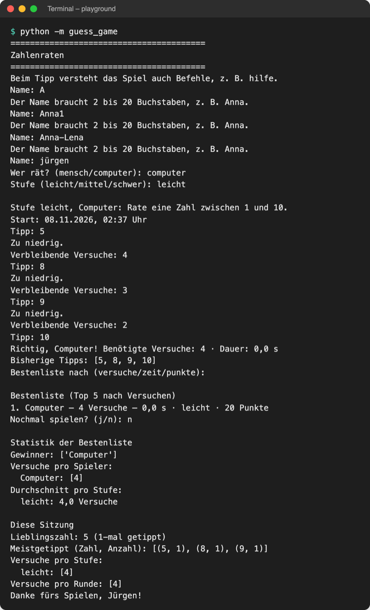
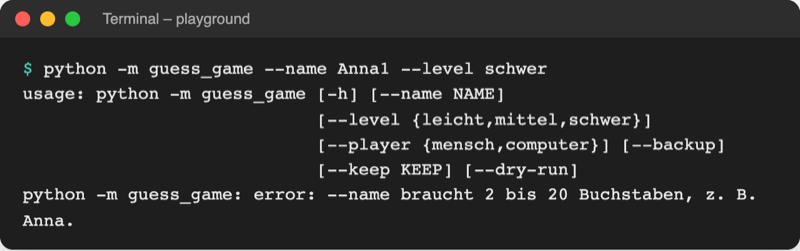
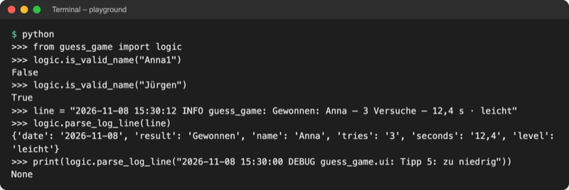

# Lab 15.2 – Lösung: Namensprüfung und Log-Zeilen per Regex

Fertiger Stand: [project/examples/m15-system/l02-regex/guess_game/](../../project/examples/m15-system/l02-regex/guess_game/). Test im Ordner `project/`: `cd examples/m15-system/l02-regex`, dann `python -m guess_game`.

## Aufgabe 1: NAME_PATTERN und is_valid_name

`logic.py`, oben bei den Imports `import re`, dann vor `draw_secret`:

```python
# Name: 2 bis 20 Buchstaben, auch Umlaute und ß; ^ und $ = ganzer Text
NAME_PATTERN = re.compile(r"^[A-Za-zÄÖÜäöüß]{2,20}$")


def is_valid_name(name):
    """True, wenn der Name nur aus 2 bis 20 Buchstaben besteht."""
    return NAME_PATTERN.fullmatch(name) is not None
```

`fullmatch` prüft den ganzen Text; `^` und `$` sagen dasselbe noch einmal und machen das Muster auch mit `search` sicher. `{2,20}` gilt für die ganze Zeichenklasse davor: 2 bis 20 Zeichen, jedes ein Buchstabe.

## Aufgabe 2: ask_name mit Prüfung

```python
def ask_name():
    """Fragt so lange nach dem Namen, bis er gültig ist, und gibt ihn zurück."""
    while not logic.is_valid_name(name := input("Name: ").strip()):
        print("Der Name braucht 2 bis 20 Buchstaben, z. B. Anna.")
    return name.title()
```

`:=` speichert die Eingabe in `name` und prüft sie in derselben Zeile (Muster aus `ask_level`, Lab 13.3).

## Aufgabe 3: --name prüfen

```python
    args = parser.parse_args()  # liest sys.argv
    if args.name is not None and not logic.is_valid_name(args.name):
        parser.error("--name braucht 2 bis 20 Buchstaben, z. B. Anna.")
```

In `main()` genügt danach `name = args.name.title()`: Ein gültiger Name hat keine Leerzeichen mehr, `.strip()` entfällt.

## Aufgabe 4: LOG_PATTERN und parse_log_line

```python
# Ergebniszeile im Log, z. B.
# 2026-11-08 15:30:12 INFO guess_game: Gewonnen: Anna – 3 Versuche – 12,4 s · leicht
LOG_PATTERN = re.compile(
    r"^(?P<date>\d{4}-\d{2}-\d{2}) [\d:]+ INFO \S+ "
    r"(?P<result>Gewonnen|Verloren): (?P<name>\w+) – (?P<tries>\d+) Versuche? – "
    r"(?P<seconds>[\d,]+) s · (?P<level>\w+)$"
)


def parse_log_line(line):
    """Zerlegt eine Ergebniszeile in ein Dictionary; andere Zeilen -> None."""
    match = LOG_PATTERN.search(line.strip())
    if match is None:
        return None
    return match.groupdict()  # {"date": "2026-11-08", "result": "Gewonnen", ...}
```

`line.strip()` entfernt den Zeilenumbruch, den jede aus einer Datei gelesene Zeile am Ende hat; sonst passt `$` nicht. `\w+` beim Namen erfasst auch `Jürgen`, weil `\w` Umlaute einschließt.

## Aufgabe 5: Test



_Quelle: eigener Screenshot, Kurs-Repo, 08.11.2026 (Eingaben `A`, `Anna1`, `Anna-Lena`, `jürgen`, `computer`, `leicht`, Enter, `n`)._



_Quelle: eigener Screenshot, Kurs-Repo, 08.11.2026 (Exit-Code 2)._



_Quelle: eigener Screenshot, Kurs-Repo, 08.11.2026 (Transkript einer echten Sitzung im Ordner `examples/m15-system/l02-regex`)._

- Alle Werte im Dictionary sind Text (`'3'`, `'12,4'`); wer damit rechnet, wandelt sie um (Lab 16.3).
- Die DEBUG-Zeile scheitert schon am Wort `INFO`; der interaktive Modus zeigt `None` nur mit `print(...)` an.

## Erweiterung

`logic.py`:

```python
import regex  # Drittmodul, steht in requirements.txt

# \p{L} = ein Buchstabe aus jeder Sprache
UNICODE_NAME_PATTERN = regex.compile(r"\p{L}{2,20}")


def is_valid_name(name):
    """True, wenn der Name nur aus 2 bis 20 Buchstaben besteht."""
    return UNICODE_NAME_PATTERN.fullmatch(name) is not None
```

```text
Zoë True
José True
Jürgen True
R2D2 False
A False
```

`import regex` ist ein Drittpaket und steht deshalb (Ruff-Regel) in einem eigenen Block nach den Imports der Standardbibliothek. `Anna-Lena` bleibt abgelehnt: Der Bindestrich ist kein Buchstabe. Wer ihn erlauben will, braucht ein Muster wie `\p{L}+(-\p{L}+)?`.
