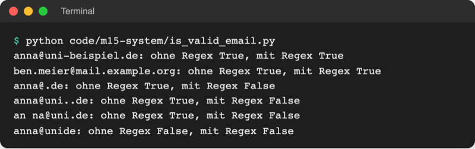
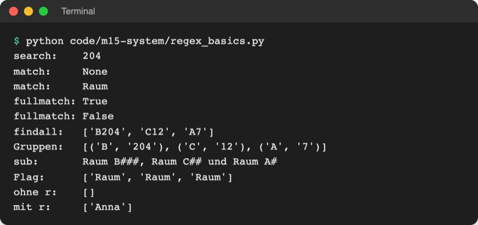
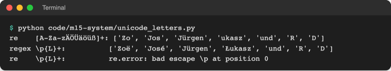

# Lab 15.2: Reguläre Ausdrücke

**Leitfragen:**

<details>
<summary>Wie findet man alle Telefonnummern in einem langen Dokument, die alle unterschiedlich geschrieben sind?</summary>

Nicht über den genauen Text, sondern über die Form: „Ziffern, dazwischen Leerzeichen, Schrägstrich oder Bindestrich, vorne vielleicht `+` oder `(`“. Genau so eine Formbeschreibung ist ein regulärer Ausdruck.

</details>

<details>
<summary>Welche Regeln hat eine gültige E-Mail-Adresse?</summary>

Genau ein `@`, davor mindestens ein Zeichen, dahinter eine Domain mit Punkt, keine Leerzeichen, keine zwei Punkte hintereinander. Mit `in` und `split` lassen sich nur einige dieser Regeln prüfen; ein Muster prüft alle auf einmal.

</details>

<details>
<summary>Wann ist <code>in</code> einfacher als ein Muster?</summary>

Wenn ein fester Text gesucht wird: `"Fehler" in line` ist kürzer, schneller und lesbarer. Ein Muster lohnt sich erst, wenn der gesuchte Text nur seiner Form nach bekannt ist.

</details>

- Ein regulärer Ausdruck (englisch „regular expression“, kurz Regex) beschreibt die **Form** eines Textes: „vier Ziffern, Bindestrich, zwei Ziffern“ statt „2026-11“.
- Python bringt dafür das Modul `re` mit: suchen, prüfen, herauslösen und ersetzen.

## Reguläre Ausdrücke auf einen Blick

- **Problem:** Texte sind voller Angaben, die gleich gebaut, aber verschieden geschrieben sind: Telefonnummern, Datumsangaben, E-Mail-Adressen, Log-Zeilen.
- **Bild:** eine Suche mit Platzhaltern. Aus `*.csv` (Lab 14.3, „alles, was auf .csv endet“) wird eine ganze Sprache aus Platzhaltern: `\d` = eine Ziffer, `+` = einmal oder öfter.
- **Definition:** ein Suchmuster aus normalen Zeichen und Sonderzeichen, das ein Programm über einen Text legt; jede Stelle, auf die das Muster passt, ist ein Treffer.

![Text aus der Bibel, in dem das Muster h[aeiou]+ alle Stellen markiert: the, heaven, there, that, without](https://upload.wikimedia.org/wikipedia/commons/c/c6/Regular_expression_example.png)

_Das Muster `h[aeiou]+` („ein h, dann ein oder mehr Vokale“) über einen Text gelegt. Quelle: Belbury, „Regular expression example.png“, Wikimedia Commons (https://commons.wikimedia.org/wiki/File:Regular_expression_example.png), CC0, abgerufen am 08.11.2026._


_Stephen Cole Kleene, 1978. Quelle: Konrad Jacobs, Wikimedia Commons (https://commons.wikimedia.org/wiki/File:Stephen_Cole_Kleene.jpg), CC BY-SA 2.0 de, abgerufen am 08.11.2026._

| Jahr | Ereignis |
| --- | --- |
| 1951 | Der Mathematiker Stephen Cole Kleene beschreibt „reguläre Mengen“; der Stern `*` heißt bis heute „Kleene-Stern“. |
| 1968 | Ken Thompson baut reguläre Ausdrücke in den Texteditor QED ein, danach in die Unix-Werkzeuge `ed` und `grep`. |
| heute | Jede verbreitete Programmiersprache hat Regex; VS Code durchsucht Dateien damit (Suchfeld, Schalter `.*`). |

Einsatz: Eingaben prüfen (Formulare), Angaben aus Text herauslösen (Rechnungen, Logs), Text umbauen (Datumsformat ändern, Daten anonymisieren).

Quellen: Kleene, „Representation of Events in Nerve Nets and Finite Automata“, RAND RM-704, 1951; Thompson, „Regular Expression Search Algorithm“, Communications of the ACM 11(6), 1968. Stand: 08.11.2026.

## Begriffe

| Begriff | Bedeutung |
| --- | --- |
| Regulärer Ausdruck (Regex) | Suchmuster, das die Form eines Textes beschreibt |
| Treffer (Match) | Textstelle, auf die das Muster passt; in Python ein Match-Objekt |
| Zeichenklasse | eckige Klammern: genau ein Zeichen aus einer Auswahl, z. B. `[aeiou]` |
| Quantor | gibt an, wie oft das Zeichen davor vorkommt: `+`, `*`, `?`, `{2,20}` |
| Anker | steht für eine Position statt für ein Zeichen: `^` Anfang, `$` Ende |
| Gruppe | Teil des Musters in runden Klammern, dessen Treffer einzeln abrufbar ist |
| Raw-String | String mit `r` davor; der Backslash `\` bleibt ein normales Zeichen |

## Erst ohne: E-Mail-Prüfung mit split

Mit den Werkzeugen aus Lab 2.4 sieht eine Prüfung so aus. Datei: [code/m15-system/is_valid_email.py](../../project/code/m15-system/is_valid_email.py)

```python
def is_valid_email_simple(email):
    """Prüfung nur mit count, split und in (Werkzeuge aus Lab 2.4)."""
    if email.count("@") != 1:  # genau ein @
        return False
    user, domain = email.split("@")
    return user != "" and "." in domain  # etwas vor dem @, ein Punkt dahinter
```

Jede weitere Regel (keine Leerzeichen, kein Punkt direkt nach dem `@`, keine zwei Punkte) bräuchte eine weitere Zeile. Mit Muster ist es eine Zeile:

```python
EMAIL_PATTERN = re.compile(r"[\w.+-]+@[\w-]+(\.[\w-]+)+")
```

Gelesen: „ein oder mehr Zeichen aus Buchstabe, Ziffer, `_ . + -`; ein `@`; ein Domain-Teil; danach mindestens einmal Punkt plus Domain-Teil“.



_Quelle: eigener Screenshot, Kurs-Repo, 08.11.2026._

Auch das Muster ist nicht vollständig (`anna..b@uni.de` käme durch). Eine Adresse sicher prüfen kann nur eine Bestätigungsmail; das Muster fängt Tippfehler ab.

## Die wichtigsten Zeichen

| Muster | passt auf | Beispiel |
| --- | --- | --- |
| `abc` | genau diesen Text | `Raum` |
| `.` | ein beliebiges Zeichen (außer Zeilenumbruch) | `B.04` → `B204`, `B-04` |
| `\d` / `\D` | eine Ziffer / alles außer Ziffern | `\d\d` → `42` |
| `\w` | Buchstabe (auch `ä`, `é`), Ziffer oder `_` | `\w+` → `Jürgen` |
| `\s` / `\S` | Leerraum (Leerzeichen, Tab) / alles außer Leerraum | `\S+` → `guess_game:` |
| `[aeiou]` | ein Zeichen aus der Liste | `h[aeiou]` → `ha`, `he` |
| `[A-Z]`, `[0-9]` | ein Zeichen aus einem Bereich | `[A-Z]\d` → `B2` |
| `[^0-9]` | ein Zeichen, das **nicht** in der Liste steht | |
| `+` | das Zeichen davor 1-mal oder öfter | `\d+` → `7`, `2026` |
| `*` | 0-mal oder öfter | `ab*` → `a`, `abbb` |
| `?` | 0- oder 1-mal (optional) | `Versuche?` → `Versuch`, `Versuche` |
| `{4}` / `{2,20}` | genau 4-mal / 2- bis 20-mal | `\d{4}` → `2026` |
| `^` / `$` | Anfang / Ende des Textes | `^Raum` |
| `\b` | Wortgrenze | `\bAnna` → nicht in `Hanna` |
| `a\|b` | `a` oder `b` | `Gewonnen\|Verloren` |
| `( )` | Gruppe | `(\d+) Versuche` |
| `(?P<name> )` | Gruppe mit Namen | `(?P<year>\d{4})` |
| `\.` `\+` `\(` | das Sonderzeichen selbst | `\.` = ein echter Punkt |

## Raw-Strings: r"..."

Ein Backslash in einem normalen String leitet ein Steuerzeichen ein (`"\n"` = Zeilenumbruch, Lab 2.4). Im Muster soll `\b` aber „Wortgrenze“ heißen. Das `r` vor dem String lässt jeden Backslash stehen:

```python
normal = "\bAnna"  # ohne r: \b wird zum Steuerzeichen "Rückschritt"
raw = r"\bAnna"  # mit r: Backslash + b = Wortgrenze im Muster
print("ohne r:   ", re.findall(normal, "Anna und Hanna"))  # []
print("mit r:    ", re.findall(raw, "Anna und Hanna"))  # ['Anna']
```

Regel: Muster immer als Raw-String schreiben.

## Die Funktionen aus re

Datei: [code/m15-system/regex_basics.py](../../project/code/m15-system/regex_basics.py)

| Funktion | Wirkung | Ergebnis |
| --- | --- | --- |
| `re.search(muster, text)` | erste Stelle irgendwo im Text | Match-Objekt oder `None` |
| `re.match(muster, text)` | nur ganz am Anfang | Match-Objekt oder `None` |
| `re.fullmatch(muster, text)` | der **ganze** Text muss passen (prüfen) | Match-Objekt oder `None` |
| `re.findall(muster, text)` | alle Treffer | Liste von Strings (bei Gruppen: Liste von Tupeln) |
| `re.finditer(muster, text)` | alle Treffer nacheinander | Match-Objekte für eine `for`-Schleife |
| `re.sub(muster, ersatz, text)` | Treffer ersetzen | neuer String |
| `re.compile(muster)` | Muster einmal vorbereiten | Muster-Objekt mit denselben Methoden |

```python
text = "Raum B204, Raum C12 und Raum A7"

match = re.search(r"\d+", text)  # \d+ = eine oder mehr Ziffern
print("search:   ", match.group())  # der gefundene Text: 204
print("match:    ", re.match(r"\d+", text))  # None: der Text beginnt mit "R"
print("fullmatch:", re.fullmatch(r"[A-Z]\d+", "B204") is not None)  # True
print("findall:  ", re.findall(r"[A-Z]\d+", text))  # ['B204', 'C12', 'A7']
print("Gruppen:  ", re.findall(r"([A-Z])(\d+)", text))  # [('B', '204'), ...]
print("sub:      ", re.sub(r"\d", "#", text))  # Raum B###, ...
print("Flag:     ", re.findall(r"raum", text, re.IGNORECASE))  # ['Raum', ...]
```



_Quelle: eigener Screenshot, Kurs-Repo, 08.11.2026._

- `match.group()` gibt den gefundenen Text zurück. Ist das Ergebnis `None`, gibt es kein `.group()`: erst mit `is None` prüfen (Lab 14.2).
- **Flags** ändern die Regeln für das ganze Muster: `re.IGNORECASE` (Groß/klein egal), `re.MULTILINE` (`^`/`$` gelten pro Zeile).
- `re.compile` lohnt sich für Muster, die oft gebraucht werden; der Name in GROSSBUCHSTABEN zeigt eine Konstante (Lab 3.4).

## Gruppen: Teile herauslösen

Runde Klammern merken sich ihren Teil des Treffers; `(?P<name>...)` gibt ihm einen Namen. Datei: [code/m15-system/extract_contacts.py](../../project/code/m15-system/extract_contacts.py) (alle Namen und Nummern erfunden)

```python
# Telefonnummer: optional + oder (, dann eine Ziffer, dann mindestens fünf
# Zeichen aus Ziffern, Leerzeichen, / ( ) -, am Ende wieder eine Ziffer
PHONE_PATTERN = re.compile(r"[+(]?\d[\d /()-]{5,}\d")

# Datum T.M.JJJJ mit benannten Gruppen: (?P<name>...)
DATE_PATTERN = re.compile(r"(?P<day>\d{1,2})\.(?P<month>\d{1,2})\.(?P<year>\d{4})")

for number in PHONE_PATTERN.findall(TEXT):
    digits = re.sub(r"\D", "", number)  # \D = alles außer Ziffern -> weg
    print(f"  {number}  ->  {digits}")

for match in DATE_PATTERN.finditer(TEXT):  # finditer: ein Match-Objekt je Treffer
    day = match.group("day").zfill(2)  # "3" -> "03"
    month = match.group("month").zfill(2)
    print(f"  {match.group()}  ->  {match.group('year')}-{month}-{day}")

print(PHONE_PATTERN.sub("[Nummer]", TEXT))  # anonymisieren
```

![Terminal: extract_contacts.py findet vier Telefonnummern und drei Datumsangaben, wandelt sie in Ziffern bzw. JJJJ-MM-TT um und gibt den Text mit [Nummer] statt der Nummern aus](https://raw.githubusercontent.com/kodschul/kodschul-python-5-open/assets/m15/extract-contacts-run.png)

_Quelle: eigener Screenshot, Kurs-Repo, 08.11.2026._

- `match.group("day")` holt eine Gruppe, `match.groupdict()` alle benannten Gruppen als Dictionary: `{'day': '3', 'month': '12', 'year': '2026'}`.
- `"3".zfill(2)` füllt links mit Nullen auf zwei Stellen auf.
- Gruppen liefern immer **Text**; Zahlen daraus macht `int(...)`.

## Wann Regex, wann nicht?

| Aufgabe | Besser | Warum |
| --- | --- | --- |
| fester Text enthalten? | `"Fehler" in line` | kürzer und lesbarer |
| beginnt/endet mit festem Text? | `startswith`, `endswith` | sagt genau, was gemeint ist |
| Felder mit festem Trenner | `split(";")`, `csv` (Lab 8.3) | Regex wäre unnötig schwer |
| JSON, HTML, XML | `json` (Lab 8.2), eigene Parser | verschachtelte Formate überfordern Regex |
| Form prüfen (Name, PLZ, Datum) | `fullmatch` | eine Zeile statt vieler `if` |
| Angaben aus Fließtext herauslösen | `findall`, `finditer`, Gruppen | Form bekannt, Position nicht |

## Im Spiel: Namensprüfung und Log-Zeilen

Bisher nimmt das Spiel jeden Namen, auch `A` oder `Anna1`. Neu in `logic.py`:

```python
# Name: 2 bis 20 Buchstaben, auch Umlaute und ß; ^ und $ = ganzer Text
NAME_PATTERN = re.compile(r"^[A-Za-zÄÖÜäöüß]{2,20}$")
```

`ui.ask_name()` fragt mit `:=` (Lab 13.3) so lange, bis `NAME_PATTERN.fullmatch(name)` einen Treffer liefert, und `--name` wird beim Start genauso geprüft.

Das zweite Muster löst aus einer Log-Zeile Datum, Ergebnis, Name, Versuche, Dauer und Stufe heraus. So sehen die Zeilen aus, die das Spiel in Lab 15.3 protokolliert:

```text
2026-11-08 15:30:12 INFO guess_game: Gewonnen: Anna – 3 Versuche – 12,4 s · leicht
```

```python
# Ergebniszeile im Log, z. B.
# 2026-11-08 15:30:12 INFO guess_game: Gewonnen: Anna – 3 Versuche – 12,4 s · leicht
LOG_PATTERN = re.compile(
    r"^(?P<date>\d{4}-\d{2}-\d{2}) [\d:]+ INFO \S+ "
    r"(?P<result>Gewonnen|Verloren): (?P<name>\w+) – (?P<tries>\d+) Versuche? – "
    r"(?P<seconds>[\d,]+) s · (?P<level>\w+)$"
)
```

Drei Raw-Strings direkt hintereinander in Klammern fügt Python zu einem String zusammen; so bleibt jede Zeile kurz.

| Teil des Musters | passt auf |
| --- | --- |
| `^(?P<date>\d{4}-\d{2}-\d{2})` | am Zeilenanfang `2026-11-08` → Gruppe `date` |
| ` [\d:]+ INFO \S+ ` | Uhrzeit, `INFO`, Logger-Name `guess_game:` (nicht gespeichert) |
| `(?P<result>Gewonnen\|Verloren): ` | `Gewonnen` → Gruppe `result` |
| `(?P<name>\w+) – ` | `Anna`, danach Gedankenstrich `–` |
| `(?P<tries>\d+) Versuche? – ` | `3`; `?` erlaubt auch „1 Versuch“ |
| `(?P<seconds>[\d,]+) s · (?P<level>\w+)$` | `12,4`, Mittelpunkt `·`, `leicht` bis Zeilenende |

`parse_log_line(line)` gibt `match.groupdict()` zurück oder `None`, wenn die Zeile nicht passt. Gedankenstrich `–` und Mittelpunkt `·` sind keine Tastaturzeichen: das Muster aus dem Handout kopieren, nicht abtippen.

## Drittmodul regex: alle Buchstaben aller Sprachen

`[A-Za-zÄÖÜäöüß]` kennt nur die aufgezählten Buchstaben; `Zoë` oder `José` fallen durch. Das Paket `regex` von PyPI (steht in `requirements.txt`, Lab 6.2) arbeitet wie `re`, kennt aber Unicode-Kategorien: `\p{L}` = „ein Buchstabe, egal aus welcher Sprache“. Datei: [code/m15-system/unicode_letters.py](../../project/code/m15-system/unicode_letters.py)

```python
import regex  # pip install regex (steht in requirements.txt)

text = "Zoë, José, Jürgen, Łukasz und R2D2"
print(regex.findall(r"\p{L}+", text))  # ['Zoë', 'José', 'Jürgen', 'Łukasz', 'und', 'R', 'D']
```



_Quelle: eigener Screenshot, Kurs-Repo, 08.11.2026 (`regex` 2026.11.7)._

`regex` lohnt sich, wenn Unicode-Kategorien (`\p{L}`, `\p{Lu}` für Großbuchstaben) oder besondere Funktionen wie unscharfe Suche gebraucht werden; sonst reicht `re`.

## Typische Fehler

| Symptom | Ursache | Lösung |
| --- | --- | --- |
| `AttributeError: 'NoneType' object has no attribute 'group'` | kein Treffer, Ergebnis ist `None` | erst `if match is None:` prüfen |
| `findall` liefert Tupel statt ganzer Treffer | Muster enthält Gruppen `( )` | Gruppen weglassen oder `finditer` + `group()` |
| `Anna1` wird als gültig erkannt | `search` statt `fullmatch` | zum Prüfen `fullmatch` oder `^...$` |
| `.` passt auf jedes Zeichen statt auf einen Punkt | Punkt nicht maskiert | `\.` |
| Muster findet nichts, obwohl es passen müsste | `r` vergessen, `\b` wurde zum Steuerzeichen | Raw-String `r"..."` |
| `re.error: bad escape \p` | `re` kennt `\p{L}` nicht | Paket `regex` nutzen |
| `parse_log_line` liefert immer `None` | `–` oder `·` abgetippt (`-`, `.`) | Muster kopieren |

## Vertiefung

- Muster ausprobieren: Online-Tester wie regex101.com (Einstellung „Python“) zeigen jeden Teil des Musters farbig und erklären ihn. Stand: 08.11.2026.
- Referenz: [Python-Dokumentation `re`](https://docs.python.org/3.14/library/re.html) und [Regular Expression HOWTO](https://docs.python.org/3.14/howto/regex.html).
- `*` und `+` sind „gierig“: `<.+>` nimmt in `<a><b>` alles bis zum letzten `>`; `<.+?>` nimmt so wenig wie möglich.

## Fazit

- Ein regulärer Ausdruck beschreibt die Form eines Textes; Muster immer als Raw-String `r"..."`.
- `fullmatch` prüft, `search` findet, `findall`/`finditer` sammeln, `sub` ersetzt; benannte Gruppen lösen Teile heraus.
- Für feste Texte reichen `in`, `startswith` und `split`; `regex` mit `\p{L}` erst, wenn alle Sprachen zählen.

In der Übung prüft das eigene Spiel den Namen per Muster und bekommt die Funktion `parse_log_line`.
