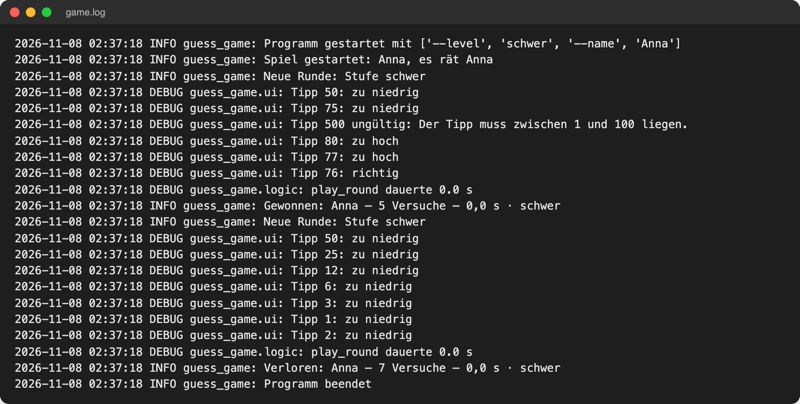
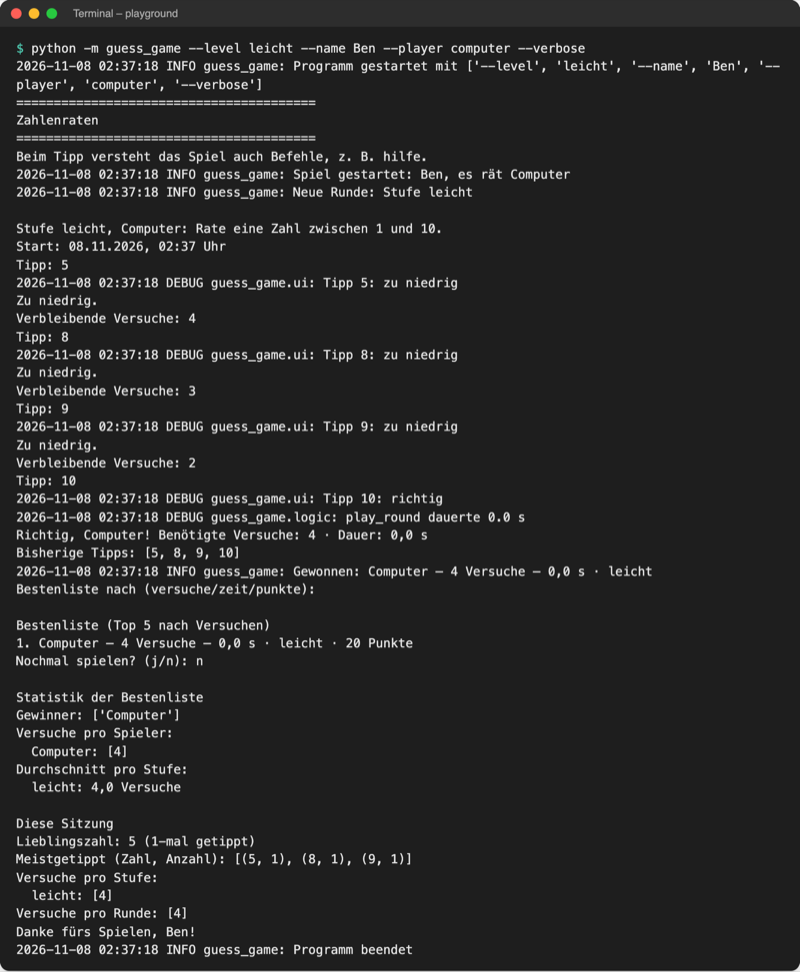
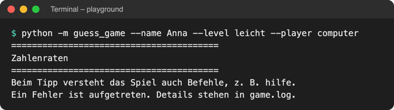

# Lab 15.3 – Lösung: game.log und --verbose

Fertiger Stand: [project/examples/m15-system/l03-logging/guess_game/](../../project/examples/m15-system/l03-logging/guess_game/). Test im Ordner `project/`: `cd examples/m15-system/l03-logging`, dann `python -m guess_game --verbose`.

## Aufgabe 1: setup_logging und --verbose

`__main__.py`, oben:

```python
import argparse
import logging
import sys

from guess_game import logic, players, storage, ui

LOG_FILE = "game.log"
# __name__ wäre hier "__main__"; deshalb der Paketname als fester Logger-Name
logger = logging.getLogger("guess_game")
```

In `parse_args()` vor `parser.parse_args()`:

```python
    parser.add_argument(
        "--verbose", action="store_true", help="Protokoll auch im Terminal zeigen"
    )
```

`setup_logging(verbose)` steht unverändert wie in der Theorie unter `parse_args()`. Der feste Name `"guess_game"` ist wichtig: Die Logger `guess_game.ui` und `guess_game.logic` aus Aufgabe 3 hängen darunter, und `LOG_PATTERN` erwartet den Namen in der Ergebniszeile.

## Aufgabe 2: INFO-Zeilen in main()

```python
def main():
    """Hauptablauf: Optionen lesen, fehlende Angaben fragen, Runden spielen."""
    args = parse_args()
    setup_logging(args.verbose)
    logger.info(f"Programm gestartet mit {sys.argv[1:]}")
    if args.backup:  # Werkzeug-Modus: sichern und fertig, ohne Spiel
        run_backup(args)
        return
    ui.show_banner()
    if args.name is None:  # nur fragen, was nicht beim Start angegeben wurde
        name = ui.ask_name()
    else:
        name = args.name.title()
    player_type = args.player
    if player_type is None:
        player_type = ui.ask_player_type()
    if player_type == "computer":
        player = players.ComputerPlayer()
    else:
        player = players.HumanPlayer(name)
    logger.info(f"Spiel gestartet: {name}, es rät {player.name}")
    played = []  # Scores aller Runden dieser Sitzung
    all_guesses = []  # alle Tipps dieser Sitzung
    # with: lädt highscores.json beim Betreten, speichert beim Verlassen
    with storage.Scoreboard("highscores.json") as board:
        for game in ui.rounds(player, board, args.level):  # eine Runde pro Durchlauf
            logger.info(f"Neue Runde: Stufe {game.level}")
            score = ui.play_round(game)  # @timed hat score.seconds eingetragen
            ui.show_result(game, score)
            if game.stopped:  # Befehl quit: Runde zählt nicht
                logger.info("Spiel mit quit beendet")
                break
            if score.won:  # Format passt zu logic.LOG_PATTERN (Lab 15.2)
                logger.info(f"Gewonnen: {score} · {score.level}")
            else:
                logger.info(f"Verloren: {score} · {score.level}")
            played.append(score)
            all_guesses.extend(game.guesses)  # hängt alle Tipps der Runde an
            storage.append_history(score)  # jede Runde, auch verlorene
            game.save_score(score)  # nur ein Gewinn kommt in die Bestenliste
            if score.won:
                by = ui.ask_ranking()
                ui.show_highscores(board.top(by), by)
        ui.show_statistics(logic.statistics(board.scores))
    favourites = logic.favourite_numbers(all_guesses)
    ui.show_session(favourites, logic.tries_per_level(played))
    ui.show_goodbye(name, [score.tries for score in played])
    logger.info("Programm beendet")
```

`setup_logging` steht vor dem Backup-Zweig, damit auch `--backup` protokolliert wird (`run_backup` schreibt dafür eigene INFO- und WARNING-Zeilen, siehe Example). Die Ergebniszeile nutzt `Score.__str__` (Lab 11.1); dadurch passt sie zu `logic.LOG_PATTERN` aus Lab 15.2.

## Aufgabe 3: Logger in ui.py und logic.py

`ui.py` und `logic.py` bekommen `import logging` und oben:

```python
logger = logging.getLogger(__name__)  # Name "guess_game.ui" bzw. "guess_game.logic"
```

`ui.make_guess`:

```python
def make_guess(game, number):
    """Gibt einen Tipp an das Spiel weiter und zeigt den Hinweis an."""
    try:
        hint = game.guess(number)  # das Spiel wertet aus
    except logic.InvalidGuessError as error:  # kein Versuch verbraucht
        logger.debug(f"Tipp {number} ungültig: {error}")
        print(error)
        return
    logger.debug(f"Tipp {number}: {hint}")
    # ... Rest unverändert
```

`logic.timed`, im `wrapper` vor `return result`:

```python
        logger.debug(f"{func.__name__} dauerte {result.seconds} s")
```

Decorator und Logging arbeiten zusammen: Jede mit `@timed` markierte Funktion meldet ihre Dauer, ohne dass ihr eigener Code davon weiß. `logic.py` bleibt ohne `print` und ohne Dateizugriff; wohin die Meldung geht, entscheidet allein `setup_logging`.

## Aufgabe 4: Fehler-Handler

```python
if __name__ == "__main__":  # nur beim Start, nicht beim Import
    try:
        main()
    except KeyboardInterrupt:  # Strg+C; die Bestenliste hat __exit__ schon gesichert
        logger.info("Mit Strg+C abgebrochen")
        print("\nSpiel abgebrochen. Bis zum nächsten Mal!")
    except Exception:  # alles Unerwartete: Traceback ins Log, kurze Meldung
        logger.exception("Unerwarteter Fehler")
        print(f"Ein Fehler ist aufgetreten. Details stehen in {LOG_FILE}.")
        sys.exit(1)
```

`except Exception` steht **nach** `except KeyboardInterrupt`: Python prüft die Zweige von oben nach unten, und Strg+C soll weiter die freundliche Abschiedszeile bekommen.

## Aufgabe 5: Test

`game.log` nach zwei Runden (Eingaben `mensch`, `50`, `75`, `500`, `80`, `77`, `76`, Enter, `j`, `50`, `25`, `12`, `6`, `3`, `1`, `2`, `n`; Seed 3):



_Quelle: eigener Screenshot, Kurs-Repo, 08.11.2026._

Mit `--verbose` (Eingaben Enter, `n`):



_Quelle: eigener Screenshot, Kurs-Repo, 08.11.2026 (Seed 3)._

Kaputte `highscores.json`:



_Quelle: eigener Screenshot, Kurs-Repo, 08.11.2026 (Exit-Code 1)._

```text
2026-11-08 02:37:18 INFO guess_game: Programm gestartet mit ['--name', 'Anna', '--level', 'leicht', '--player', 'computer']
2026-11-08 02:37:18 INFO guess_game: Spiel gestartet: Anna, es rät Computer
2026-11-08 02:37:18 ERROR guess_game: Unerwarteter Fehler
Traceback (most recent call last):
  File "guess_game/__main__.py", line 129, in <module>
    main()
    ~~~~^^
  File "guess_game/__main__.py", line 101, in main
    with storage.Scoreboard("highscores.json") as board:
  ...
json.decoder.JSONDecodeError: Expecting ',' delimiter: line 2 column 1 (char 17)
```

Die Fehlerzeile steht direkt nach „Spiel gestartet“: `with storage.Scoreboard(...)` scheitert schon beim Laden in `__enter__`. Die kaputte Datei bleibt unverändert, weil `__exit__` nur nach einem erfolgreichen `__enter__` läuft (Lab 13.2). Pfade im Traceback sind hier gekürzt.

## Abschlusskriterien

```text
{'date': '2026-11-08', 'result': 'Gewonnen', 'name': 'Computer', 'tries': '4', 'seconds': '0,0', 'level': 'leicht'}
```

Ausgabe nach `python -m guess_game --level leicht --name Anna --player computer`, Enter, `n`: Die vorletzte Zeile von `game.log` ist die Ergebniszeile, die letzte `Programm beendet`.

## Erweiterung

```python
import logging

logging.basicConfig(
    filename="grades.log",
    encoding="utf-8",
    level=logging.INFO,
    format="%(asctime)s %(levelname)s %(name)s: %(message)s",
    datefmt="%Y-%m-%d %H:%M:%S",
)
logger = logging.getLogger("grades")

for grade in [1.7, 2.3, 6.0, 1.0]:
    if 1.0 <= grade <= 5.0:
        logger.info(f"Note {grade} ok")
    else:
        logger.warning(f"Note {grade} ungültig")

print("Fertig, Details in grades.log.")
```

```text
2026-11-08 02:44:17 INFO grades: Note 1.7 ok
2026-11-08 02:44:17 INFO grades: Note 2.3 ok
2026-11-08 02:44:17 WARNING grades: Note 6.0 ungültig
2026-11-08 02:44:17 INFO grades: Note 1.0 ok
```

Im Terminal erscheint nur `Fertig, Details in grades.log.`: Mit `filename=` schreibt `basicConfig` ausschließlich in die Datei.
