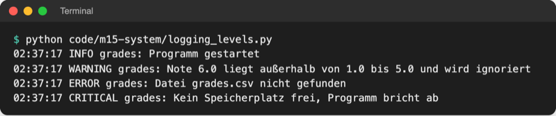
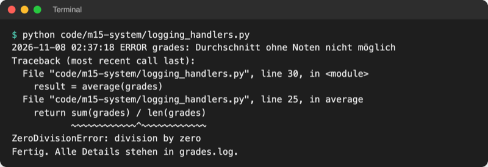
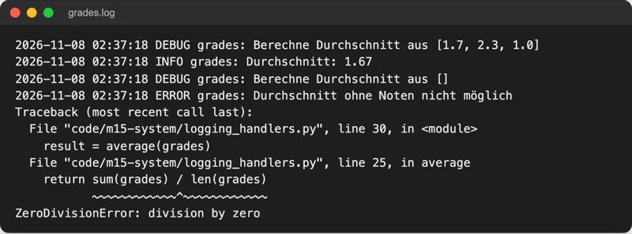
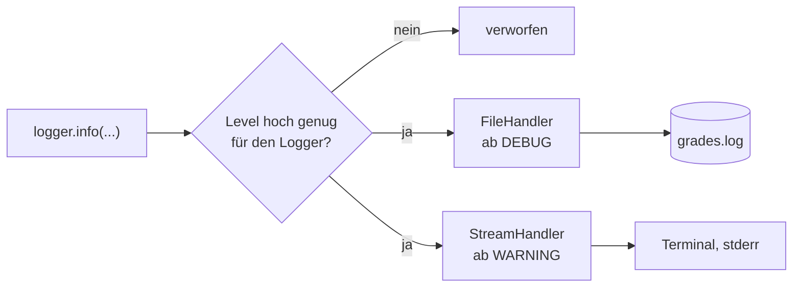
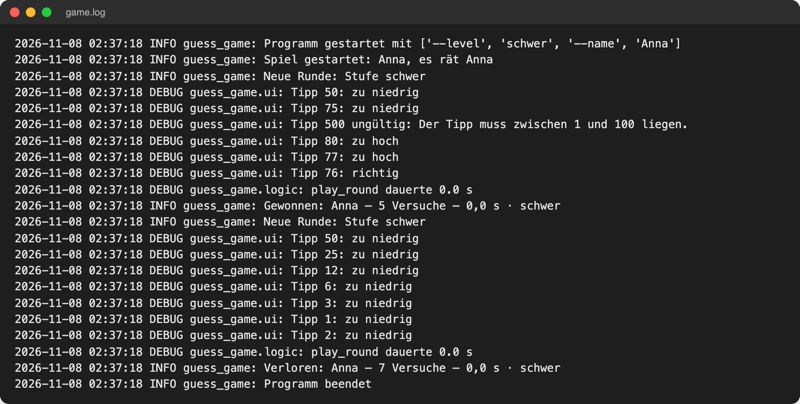
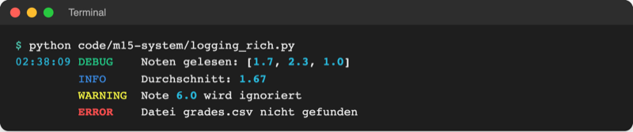

# Lab 15.3: Logging

**Leitfragen:**

<details>
<summary>Ein Skript lief heute Nacht allein und ist abgebrochen – woher weiß man, warum?</summary>

Nur, wenn es unterwegs mitgeschrieben hat: in eine Datei, mit Uhrzeit, und beim Absturz mit der Fehlermeldung samt Traceback. Dieses Protokoll heißt Log.

</details>

<details>
<summary>Welche Meldungen braucht ein Entwickler, welche ein Betreiber?</summary>

Entwickler brauchen Details (jeder Tipp, jede Berechnung), Betreiber nur Start, Ergebnis, Warnungen und Fehler. Log-Level trennen beides: DEBUG für Details, INFO und höher für den Betrieb.

</details>

<details>
<summary>Warum reicht es nicht, <code>print</code> später wieder zu löschen?</summary>

Gelöschte Ausgaben fehlen genau dann, wenn der nächste Fehler auftritt. Log-Meldungen bleiben im Code und werden über das Level ein- und ausgeschaltet, ohne eine Zeile zu ändern.

</details>

- Logging schreibt mit, was ein Programm tut: mit Zeitstempel, Wichtigkeit und Herkunft, in eine Datei und auf Wunsch ins Terminal.
- Das Modul `logging` gehört zur Standardbibliothek; `print` bleibt für das, was der Mensch am Terminal lesen soll.

## Begriffe

| Begriff | Bedeutung |
| --- | --- |
| Log | Protokoll eines Programmlaufs, eine Zeile pro Ereignis; wie ein Fahrtenbuch |
| Log-Level | Wichtigkeit einer Meldung: DEBUG, INFO, WARNING, ERROR, CRITICAL |
| Logger | Objekt mit Namen, über das der Code Meldungen abgibt: `logger.info("...")` |
| Handler | bestimmt, **wohin** eine Meldung geht: Datei (`FileHandler`), Terminal (`StreamHandler`) |
| Formatter / Format | bestimmt, **wie** eine Zeile aussieht: Zeit, Level, Name, Text |
| stderr | Fehlerausgabe des Terminals; ein zweiter Kanal neben der normalen Ausgabe (stdout), beide erscheinen im selben Fenster |

## Warum nicht einfach print?

| | `print` | `logging` |
| --- | --- | --- |
| Ziel | Terminal | Datei, Terminal oder beides |
| Zeitstempel, Herkunft | nur von Hand | automatisch im Format |
| ein- und ausschalten | Zeilen löschen oder auskommentieren | Level ändern, Code bleibt |
| Fehler mit Traceback | geht verloren, wenn `except` ihn abfängt | `logger.exception(...)` schreibt ihn mit |
| Zielgruppe | wer das Programm gerade benutzt | wer es betreibt oder Fehler sucht |

Die Python-Dokumentation fasst das als Tabelle „Aufgabe → bestes Werkzeug“ zusammen, darunter die fünf Level:

Original: [Python-Dokumentation Logging HOWTO, Abschnitt When to use logging: print für normale Ausgabe, logger.info und debug für Ereignisse, warning, error, exception und critical; darunter die Tabelle der Level DEBUG bis CRITICAL](https://docs.python.org/3.14/howto/logging.html#when-to-use-logging), Stand 08.11.2026.

## Die fünf Level

| Level | Wann | Beispiel im Spiel |
| --- | --- | --- |
| `DEBUG` | Details zur Fehlersuche | `Tipp 50: zu niedrig` |
| `INFO` | normale Ereignisse: Start, Ergebnis, Ende | `Gewonnen: Anna – 5 Versuche – 0,0 s · schwer` |
| `WARNING` | etwas Unerwartetes, das Programm läuft weiter | `Backup: keine Spieldateien gefunden` |
| `ERROR` | eine Aufgabe ist gescheitert | `Unerwarteter Fehler` + Traceback |
| `CRITICAL` | das Programm kann nicht weiterlaufen | (im Spiel nicht nötig) |

Eingestellt wird ein Mindest-Level: Bei `level=logging.INFO` erscheint alles ab INFO, DEBUG wird verworfen. Ohne Einstellung gilt `WARNING`.

> **Merksatz:** Meldungen bleiben im Code; das Level entscheidet, welche erscheinen.

## Einrichten mit basicConfig

`logging.basicConfig(...)` richtet das Logging einmal am Programmstart ein. Datei: [code/m15-system/logging_levels.py](../../project/code/m15-system/logging_levels.py)

```python
import logging

logging.basicConfig(
    level=logging.INFO,  # ab INFO aufwärts; DEBUG wird verworfen
    format="%(asctime)s %(levelname)s %(name)s: %(message)s",
    datefmt="%H:%M:%S",  # nur die Uhrzeit
)
logger = logging.getLogger("grades")  # Name erscheint in jeder Zeile

logger.debug("Noten gelesen: [1.7, 2.3, 6.0]")  # erscheint nicht (unter INFO)
logger.info("Programm gestartet")
logger.warning("Note 6.0 liegt außerhalb von 1.0 bis 5.0 und wird ignoriert")
logger.error("Datei grades.csv nicht gefunden")
logger.critical("Kein Speicherplatz frei, Programm bricht ab")
```



_Quelle: eigener Screenshot, Kurs-Repo, 08.11.2026._

| Platzhalter im Format | wird zu |
| --- | --- |
| `%(asctime)s` | Zeitpunkt, Form über `datefmt`, z. B. `%Y-%m-%d %H:%M:%S` (wie `strftime`, Lab 6.3) |
| `%(levelname)s` | `DEBUG`, `INFO`, … |
| `%(name)s` | Name des Loggers |
| `%(message)s` | der Text der Meldung |

- `basicConfig(filename="app.log", encoding="utf-8", ...)` schreibt statt ins Terminal in eine Datei.
- `basicConfig(handlers=[...])` nimmt eine Liste von Zielen (siehe unten).
- `basicConfig` wirkt nur beim **ersten** Aufruf; deshalb steht es ganz am Anfang des Programms.

## Ein Logger pro Modul

`logging.getLogger(name)` liefert den Logger mit diesem Namen. In jedem Modul eines Pakets steht oben:

```python
logger = logging.getLogger(__name__)  # in guess_game/ui.py: "guess_game.ui"
```

`__name__` ist der Modulname (Lab 6.1). Im Log steht dann bei jeder Zeile, aus welcher Datei sie kommt. Logger mit Punkt im Namen gehören zum Logger davor: `guess_game.ui` gibt seine Meldungen an `guess_game` und von dort an die Einrichtung aus `basicConfig` weiter.

## Handler: Datei und Terminal gleichzeitig

Ein Logger kann mehrere Handler haben, jeder mit eigenem Level. Datei: [code/m15-system/logging_handlers.py](../../project/code/m15-system/logging_handlers.py)

```python
logger = logging.getLogger("grades")
logger.setLevel(logging.DEBUG)  # der Logger selbst lässt alles durch

file_handler = logging.FileHandler("grades.log", encoding="utf-8")
file_handler.setLevel(logging.DEBUG)  # Datei: alles ab DEBUG

console_handler = logging.StreamHandler()  # Terminal
console_handler.setLevel(logging.WARNING)  # Terminal: nur WARNING und höher

formatter = logging.Formatter(
    "%(asctime)s %(levelname)s %(name)s: %(message)s", datefmt="%Y-%m-%d %H:%M:%S"
)
file_handler.setFormatter(formatter)
console_handler.setFormatter(formatter)
logger.addHandler(file_handler)
logger.addHandler(console_handler)


def average(grades):
    """Durchschnitt einer Notenliste."""
    logger.debug(f"Berechne Durchschnitt aus {grades}")
    return sum(grades) / len(grades)


for grades in [[1.7, 2.3, 1.0], []]:
    try:
        result = average(grades)
        logger.info(f"Durchschnitt: {result:.2f}")
    except ZeroDivisionError:  # leere Liste: Division durch 0
        logger.exception("Durchschnitt ohne Noten nicht möglich")  # mit Traceback
```

Ins Terminal kommt nur der Fehler; `grades.log` enthält zusätzlich die DEBUG- und INFO-Zeilen:



_Quelle: eigener Screenshot, Kurs-Repo, 08.11.2026 (Pfade im Traceback gekürzt)._



_Quelle: eigener Screenshot, Kurs-Repo, 08.11.2026 (Inhalt von `grades.log`, Pfade gekürzt)._



- `StreamHandler()` schreibt auf **stderr**. Im Terminal steht das neben der normalen Ausgabe; wer die Ausgabe in eine Datei umleitet (`> out.txt`), bekommt die Log-Zeilen nicht mit.
- `FileHandler` hängt neue Zeilen an eine vorhandene Datei an; die Datei wächst mit jedem Lauf.

## Fehler mit Traceback: logger.exception

Im `except`-Block schreibt `logger.exception("...")` eine ERROR-Zeile **und** den kompletten Traceback (Lab 7.1). Das Programm stürzt nicht ab, die Ursache bleibt trotzdem nachlesbar. `except Exception:` fängt dabei jeden normalen Fehler; das ist nur an einer Stelle sinnvoll: ganz außen am Programmstart, mit kurzer Meldung für den Menschen und allen Details im Log.

## Dateien begrenzen: RotatingFileHandler

```python
from logging.handlers import RotatingFileHandler

# höchstens 1 MB pro Datei, drei alte Dateien app.log.1 bis app.log.3 behalten
handler = RotatingFileHandler("app.log", maxBytes=1_000_000, backupCount=3)
```

Ist `app.log` voll, wird sie zu `app.log.1` umbenannt, und eine neue beginnt. `1_000_000` ist dieselbe Zahl wie `1000000`; der Unterstrich dient nur der Lesbarkeit. Das Spiel nutzt einen einfachen `FileHandler`.

## Log-Nachrichten schreiben

```python
logger.info(f"Neue Runde: Stufe {level}")  # f-String, wie überall im Kurs
logger.info("Neue Runde: Stufe %s", level)  # %s-Stil: Text wird erst gebaut, wenn das Level passt
```

Beide Zeilen ergeben dieselbe Meldung. Der Kurs nutzt f-Strings; der `%s`-Stil steht oft in fremdem Code und ist bei sehr vielen DEBUG-Zeilen etwas schneller.

## Im Spiel: game.log und --verbose

`__main__.py` richtet das Logging ein, bevor etwas anderes passiert. Alles ab DEBUG geht nach `game.log`; mit der neuen Option `--verbose` zusätzlich ins Terminal:

```python
def setup_logging(verbose):
    """Schreibt alles ab DEBUG in game.log; mit --verbose auch ins Terminal."""
    handlers = [logging.FileHandler(LOG_FILE, encoding="utf-8")]
    if verbose:
        handlers.append(logging.StreamHandler())  # Terminal (Fehlerausgabe)
    logging.basicConfig(
        level=logging.DEBUG,
        format="%(asctime)s %(levelname)s %(name)s: %(message)s",
        datefmt="%Y-%m-%d %H:%M:%S",
        handlers=handlers,
    )
```

Danach schreiben drei Module mit: `__main__.py` (Logger `guess_game`) auf INFO Start, Runde, Ergebnis und Ende, `ui.py` auf DEBUG jeden Tipp, `logic.py` auf DEBUG die Dauer aus `@timed`. Die Ergebniszeile hat genau das Format, das `LOG_PATTERN` aus Lab 15.2 erwartet. Nach zwei Runden:



_Quelle: eigener Screenshot, Kurs-Repo, 08.11.2026 (Inhalt von `game.log` nach einem Lauf mit Seed 3)._

Das Spiel im Terminal sieht ohne `--verbose` genauso aus wie vorher. `game.log` enthält Namen und Startoptionen; in echten Programmen gehören keine Passwörter und nur nötige persönliche Daten ins Log.

## Typische Fehler

| Symptom | Ursache | Lösung |
| --- | --- | --- |
| DEBUG- oder INFO-Zeilen erscheinen nicht | Standard-Level ist WARNING | `basicConfig(level=logging.DEBUG)` |
| Einstellungen von `basicConfig` wirken nicht | `basicConfig` ein zweites Mal aufgerufen oder vorher schon `logging.info(...)` (ohne eigenen Logger) benutzt | `basicConfig` als Erstes in `main()` |
| jede Zeile erscheint doppelt | Handler zweimal hinzugefügt | Handler nur einmal einrichten |
| Name im Log ist `__main__` | `getLogger(__name__)` in `__main__.py` | dort festen Namen nutzen: `getLogger("guess_game")` |
| Umlaute in der Log-Datei kaputt (Windows) | Datei ohne Kodierung geöffnet | `FileHandler(..., encoding="utf-8")` |
| Traceback fehlt im Log | `logger.error` statt `logger.exception` | im `except`-Block `logger.exception` |

## Vertiefung

Farbige Log-Zeilen im Terminal liefert `RichHandler` aus `rich` (Lab 6.2), Datei [code/m15-system/logging_rich.py](../../project/code/m15-system/logging_rich.py):

```python
from rich.logging import RichHandler

logging.basicConfig(
    level=logging.DEBUG,
    format="%(message)s",  # Zeit und Level zeigt RichHandler selbst an
    datefmt="%H:%M:%S",
    handlers=[RichHandler(show_path=False)],  # ohne Dateiname am Zeilenende
)
```



_Quelle: eigener Screenshot, Kurs-Repo, 08.11.2026 (`rich` 15.0.0)._

## Fazit

- `logging` statt `print` für alles, was später jemand nachlesen soll; fünf Level von DEBUG bis CRITICAL.
- `basicConfig` richtet Level, Format und Handler einmal ein; `getLogger(__name__)` gibt jedem Modul einen eigenen Namen.
- `logger.exception` im `except`-Block schreibt den Traceback ins Log, das Programm bleibt freundlich.

In der Übung schreibt das eigene Spiel `game.log` und zeigt das Protokoll mit `--verbose` auch im Terminal.
