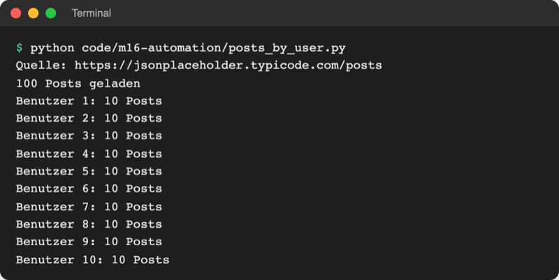
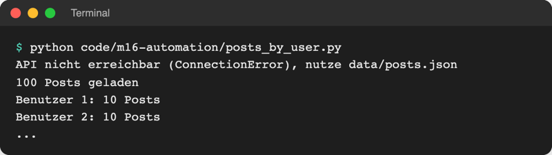

# Lab 16.1 – Lösung: Posts laden und zählen

Fertiges Skript: [project/code/m16-automation/posts_by_user.py](../../project/code/m16-automation/posts_by_user.py) (die überarbeitete Fassung des alten `code/http/main.py`). Das Spiel ändert sich in diesem Lab nicht.

## Aufgabe 1: Posts laden

```python
import os

import requests

BASE_URL = os.environ.get("API_BASE_URL", "https://jsonplaceholder.typicode.com")

response = requests.get(f"{BASE_URL}/posts", timeout=5)
response.raise_for_status()  # 404, 500 ... -> Fehler
posts = response.json()  # JSON-Text -> Liste von Dictionaries
print(f"{len(posts)} Posts geladen")
```

`response.json()` liefert hier eine Liste mit 100 Dictionaries, jedes mit `userId`, `id`, `title` und `body`.

## Aufgabe 2: Posts pro Benutzer zählen

```python
counts = {}  # Benutzer-ID -> Anzahl Posts
for post in posts:
    user_id = post["userId"]
    counts[user_id] = counts.get(user_id, 0) + 1

for user_id in sorted(counts):
    print(f"Benutzer {user_id}: {counts[user_id]} Posts")
```

`counts.get(user_id, 0)` liefert 0 beim ersten Post eines Benutzers (Lab 4.3). `sorted(counts)` sortiert die Schlüssel, also die Benutzer-IDs. Die Testdaten sind gleichmäßig: Jeder der zehn Benutzer hat genau zehn Posts.

## Aufgabe 3: Laden mit Fallback

```python
import json
import os
from pathlib import Path

import requests

BASE_URL = os.environ.get("API_BASE_URL", "https://jsonplaceholder.typicode.com")
LOCAL_COPY = Path("data") / "posts.json"  # Ersatz, wenn die API nicht antwortet


def load_posts():
    """Holt die Posts von der API; bei Netzproblemen aus der lokalen Datei."""
    try:
        response = requests.get(f"{BASE_URL}/posts", timeout=5)
        response.raise_for_status()  # 404, 500 ... -> Fehler
        print(f"Quelle: {BASE_URL}/posts")
        return response.json()  # JSON-Text -> Liste von Dictionaries
    except requests.RequestException as error:  # offline, Zeitüberschreitung ...
        print(f"API nicht erreichbar ({type(error).__name__}), nutze {LOCAL_COPY}")
        with open(LOCAL_COPY, encoding="utf-8") as file:
            return json.load(file)


posts = load_posts()
print(f"{len(posts)} Posts geladen")
```

`type(error).__name__` gibt den Namen der Fehlerklasse aus (`ConnectionError`, `HTTPError` …); ein schlichtes `API nicht erreichbar, nutze data/posts.json` erfüllt die Aufgabe ebenso. Der Pfad `data/posts.json` ist relativ zum Terminal: Das Skript startet deshalb im Ordner `project/` (Lab 8.1).

Lauf mit Netz:



_Quelle: eigener Screenshot, Kurs-Repo, 08.11.2026._

## Aufgabe 4: Fallback testen

```powershell
$env:API_BASE_URL = "http://localhost:9"     # PowerShell
python playground/posts_by_user.py
Remove-Item Env:API_BASE_URL
```

```bash
export API_BASE_URL=http://localhost:9       # macOS/Linux
python playground/posts_by_user.py
unset API_BASE_URL
```



_Quelle: eigener Screenshot, Kurs-Repo, 08.11.2026 (Ausgabe gekürzt)._

Unter `localhost:9` läuft kein Server, die Verbindung wird sofort abgelehnt (`ConnectionError`). Ohne Netz überhaupt erscheint dieselbe Meldung.

## Aufgabe 5: 404 testen

```text
API nicht erreichbar (HTTPError), nutze data/posts.json
100 Posts geladen
```

Der Server antwortet, aber mit `404` für `/nichtda/posts`. Erst `raise_for_status()` macht daraus einen `HTTPError`. Ohne diese Zeile käme eine Fehlerseite statt der Liste zurück, und die Auswertung scheitert später mit einem unverständlichen Fehler.

## Erweiterung

```python
# Zahl des Tages: alle bekommen heute dieselbe Zufallszahl
# Start im Ordner project/: python playground/number_of_the_day.py

import random
from datetime import date

import requests

URL = "https://www.random.org/integers/"


def number_of_the_day(low=1, high=100):
    """Holt die Zahl des Tages von random.org; ohne Netz eine Ersatzzahl."""
    params = {
        "num": 1,  # eine Zahl
        "min": low,
        "max": high,
        "col": 1,
        "base": 10,
        "format": "plain",  # Antwort als reiner Text, nicht JSON
        "rnd": f"date.{date.today()}",  # gleiche Zahl für alle an diesem Tag
    }
    try:
        response = requests.get(URL, params=params, timeout=30)
        response.raise_for_status()
        return int(response.text)  # "20\n" -> 20
    except (requests.RequestException, ValueError):  # offline oder kein Zahltext
        print("random.org nicht erreichbar, nutze Ersatzzahl.")
        return random.Random(date.today().toordinal()).randint(low, high)


print(f"Zahl des Tages: {number_of_the_day()}")
```

```text
Zahl des Tages: 20
```

Am 08.11.2026 lieferte random.org `20` (zweimal geprüft); an anderen Tagen kommt eine andere Zahl. Ohne Netz erscheint `random.org nicht erreichbar, nutze Ersatzzahl.` und z. B. `Zahl des Tages: 55`.

- `timeout=30` statt 5: random.org bittet automatische Clients um ein großzügiges Zeitlimit, weil ein abgebrochener Abruf dort trotzdem Arbeit verursacht. Offline kommt der Fehler ohnehin sofort.
- `ValueError` fängt den Fall ab, dass statt einer Zahl ein Hinweistext kommt (z. B. bei erschöpftem Kontingent).
- Als Bonusrunde im Spiel würde diese Zahl einmal pro Start als Geheimzahl einer Runde auf Stufe schwer dienen; die Spielkette des Kurses baut das nicht ein.
