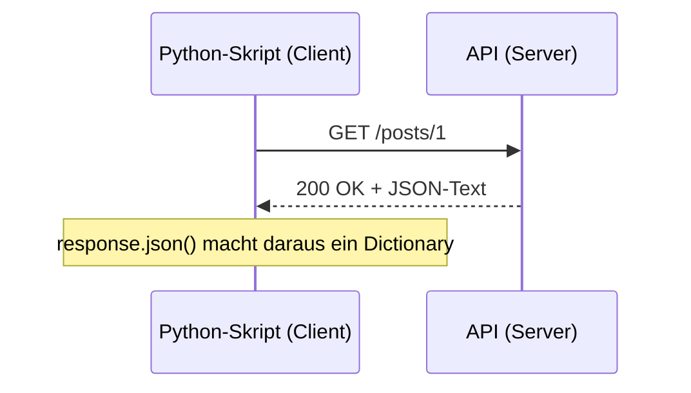
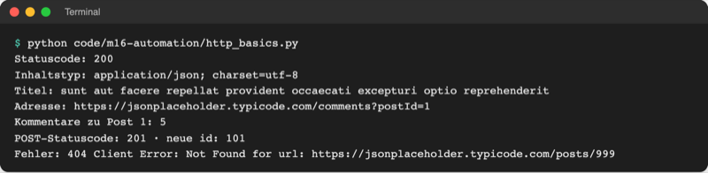

# Lab 16.1: HTTP-APIs

**Leitfragen:**

<details>
<summary>Wie bekommt eine Wetter-App ihre Daten?</summary>

Die App fragt über das Internet einen Rechner des Wetterdienstes („Wie wird das Wetter in Köln?“) und bekommt die Daten als Text zurück. Die Daten liegen also nicht in der App, sondern auf einem Server.

</details>

<details>
<summary>Was soll ein Skript tun, wenn der Server nicht antwortet?</summary>

Nicht ewig warten und nicht abstürzen: nach einer festen Zeit aufgeben, eine verständliche Meldung zeigen und, wo möglich, mit gespeicherten Daten weiterarbeiten.

</details>

<details>
<summary>Warum gehört ein Passwort nicht in eine Python-Datei?</summary>

Python-Dateien werden kopiert, verschickt und hochgeladen; das Passwort reist dann mit. Besser liest das Programm geheime Werte beim Start aus der Umgebung des Rechners (Umgebungsvariable).

</details>

- Bisher lagen alle Daten auf dem eigenen Rechner. Remote-Zugriff heißt: Ein Programm holt Daten von einem anderen Rechner im Netz.
- Die gemeinsame Sprache dafür ist HTTP. Python spricht sie mit dem Paket `requests` (seit Lab 6.2 installiert).

## Begriffe

| Begriff | Bedeutung |
| --- | --- |
| Client | Programm, das etwas anfragt: Browser, Wetter-App, eigenes Python-Skript; wie der Gast im Restaurant |
| Server | Programm (oder Rechner), das auf Anfragen wartet und antwortet; wie die Küche |
| HTTP | „Hypertext Transfer Protocol“: Regeln, wie Anfrage und Antwort als Text aussehen; HTTPS = dasselbe verschlüsselt |
| URL (Adresse) | vollständige Adresse einer Ressource, z. B. `https://jsonplaceholder.typicode.com/posts/1` |
| Anfrage (Request) | Nachricht des Clients: Methode, Adresse, Header, evtl. Daten |
| Antwort (Response) | Nachricht des Servers: Statuscode, Header, Inhalt (Body) |
| Methode | was die Anfrage will: `GET` = holen, `POST` = neu anlegen |
| Statuscode | dreistellige Zahl am Anfang der Antwort: `200` = OK, `404` = nicht gefunden |
| Header | Zusatzangaben als `Name: Wert`, z. B. `Content-Type: application/json` |
| API | „Application Programming Interface“: Schnittstelle, über die Programme (nicht Menschen) Daten abfragen |
| Endpunkt | eine Adresse einer API für eine Datenart, z. B. `/posts` oder `/comments` |
| Timeout | Zeitlimit: so lange wartet der Client höchstens auf eine Antwort |
| Umgebungsvariable | benannter Wert, den das Betriebssystem jedem gestarteten Programm mitgibt, z. B. `API_BASE_URL` |
| API-Schlüssel | geheime Zeichenkette, mit der sich ein Programm bei einer API ausweist; wie ein Passwort |

## Remote-Zugriff auf einen Blick


_Quelle: Wikimedia Commons, „Client-server model.svg“ von Lubaochuan (https://commons.wikimedia.org/wiki/File:Client-server_model.svg), CC BY-SA 4.0, abgerufen am 08.11.2026._

- Der Client beginnt immer: Er schickt eine Anfrage. Der Server antwortet genau einmal darauf und wartet dann auf die nächste Anfrage.
- Alltag: Browser (Client) fragt eine Webseite (Server); Wetter-App fragt den Wetterdienst; eine Banking-App fragt den Server der Bank.
- Eine **API** ist ein Server, der statt Webseiten für Menschen Daten für Programme liefert, meist als JSON (Lab 8.2).



## So sieht HTTP als Text aus

Anfrage und Antwort sind einfacher Text. So schickt `requests` die Anfrage `GET /posts/1` an die Test-API JSONPlaceholder, und so antwortet der Server (echter Mitschnitt, gekürzt auf die wichtigen Header):

```text
GET /posts/1 HTTP/1.1                          <- Methode, Pfad, HTTP-Version
Host: jsonplaceholder.typicode.com             <- Header der Anfrage
User-Agent: python-requests/2.34.2             <- wer fragt

HTTP/1.1 200 OK                                <- Statuscode: OK
Content-Type: application/json; charset=utf-8  <- Inhalt ist JSON
x-ratelimit-limit: 3600000                     <- so viele Anfragen erlaubt der Server
                                               <- Leerzeile: danach kommt der Inhalt
{
  "userId": 1,
  "id": 1,
  "title": "sunt aut facere repellat provident occaecati excepturi optio reprehenderit",
  "body": "quia et suscipit ..."
}
```

Wichtig sind der Statuscode, der Header `content-type` und der Inhalt. Die übrigen Header (Cache, Server-Name …) kann ein Skript zunächst ignorieren.

**Die Test-API:** [JSONPlaceholder](https://jsonplaceholder.typicode.com/) ist eine kostenlose Übungs-API ohne Anmeldung und ohne Schlüssel mit Beispieldaten (100 Posts, 500 Kommentare, 10 Benutzer). `POST` wird nur vorgetäuscht: Die Antwort sieht echt aus, gespeichert wird nichts. Stand: 08.11.2026, Quelle: jsonplaceholder.typicode.com.

## Methoden und Statuscodes

| Methode | Zweck | Beispiel |
| --- | --- | --- |
| `GET` | Daten holen | `GET /posts` liefert alle Posts |
| `POST` | neuen Eintrag anlegen | `POST /posts` mit JSON-Daten |
| `PUT` / `PATCH` | Eintrag ersetzen / teilweise ändern | `PATCH /posts/1` |
| `DELETE` | Eintrag löschen | `DELETE /posts/1` |

| Statuscode | Bedeutung | Was das Skript tun sollte |
| --- | --- | --- |
| `200` OK | alles gut, Inhalt folgt | Daten auswerten |
| `201` Created | neuer Eintrag angelegt (nach `POST`) | neue `id` lesen |
| `400` Bad Request | Anfrage fehlerhaft | eigene Parameter prüfen |
| `401` / `403` | nicht angemeldet / keine Berechtigung | API-Schlüssel prüfen |
| `404` Not Found | Adresse gibt es nicht | Tippfehler in der URL suchen |
| `429` Too Many Requests | zu viele Anfragen in kurzer Zeit | warten, seltener fragen |
| `500` / `503` | Fehler / Überlastung beim Server | später erneut versuchen |

Faustregel: `2xx` = Erfolg, `4xx` = Fehler beim Client, `5xx` = Fehler beim Server. Vollständige Liste: [MDN, HTTP response status codes](https://developer.mozilla.org/en-US/docs/Web/HTTP/Reference/Status).

## requests oder urllib?

Python bringt mit `urllib.request` ein eigenes HTTP-Modul mit. Die Python-Dokumentation selbst empfiehlt für die meisten Fälle das Paket `requests`:

Original: [Python-Dokumentation zu urllib.request mit dem Hinweis: The Requests package is recommended for a higher-level HTTP client interface](https://docs.python.org/3.14/library/urllib.request.html), Stand 08.11.2026.

| | `urllib.request` | `requests` |
| --- | --- | --- |
| Herkunft | Standardbibliothek, immer da | Paket von PyPI (`requirements.txt`, Version 2.34.2) |
| JSON lesen | Bytes lesen, dekodieren, `json.loads` | `response.json()` |
| Parameter | Adresse selbst zusammensetzen | `params={"postId": 1}` |
| Fehler bei 404 | wirft sofort `HTTPError` | erst bei `raise_for_status()` |
| Einsatz | Skripte ohne Zusatzpakete | Standard in fast allen Projekten |

## Anfragen mit requests

Datei: [code/m16-automation/http_basics.py](../../project/code/m16-automation/http_basics.py)

```python
import os

import requests

# Adresse der API aus einer Umgebungsvariable, sonst die öffentliche Test-API
BASE_URL = os.environ.get("API_BASE_URL", "https://jsonplaceholder.typicode.com")

# 1. GET: einen Post abrufen
response = requests.get(f"{BASE_URL}/posts/1", timeout=5)  # höchstens 5 s warten
print("Statuscode:", response.status_code)  # 200 = OK
print("Inhaltstyp:", response.headers["Content-Type"])  # ein Antwort-Header
post = response.json()  # JSON-Text -> Dictionary
print("Titel:", post["title"])

# 2. Parameter: requests hängt ?postId=1 an die Adresse an
response = requests.get(f"{BASE_URL}/comments", params={"postId": 1}, timeout=5)
print("Adresse:", response.url)
print("Kommentare zu Post 1:", len(response.json()))

# 3. POST: Daten an den Server schicken (die Test-API speichert nichts)
new_post = {"title": "Lerngruppe", "body": "Treffen Montag 18 Uhr", "userId": 1}
response = requests.post(f"{BASE_URL}/posts", json=new_post, timeout=5)
```

| Aufruf / Attribut | Wirkung |
| --- | --- |
| `requests.get(url, timeout=5)` | `GET`-Anfrage; liefert ein `Response`-Objekt |
| `requests.post(url, json=daten, timeout=5)` | `POST`-Anfrage; `json=` verwandelt das Dictionary in JSON-Text |
| `params={"postId": 1}` | hängt `?postId=1` an die Adresse an |
| `headers={"Authorization": "..."}` | eigene Header mitschicken, z. B. einen API-Schlüssel |
| `response.status_code` | Statuscode als Zahl |
| `response.headers["Content-Type"]` | ein Header der Antwort |
| `response.text` / `response.json()` | Inhalt als Text / als Python-Daten (Liste, Dictionary) |



_Quelle: eigener Screenshot, Kurs-Repo, 08.11.2026._

## Wenn der Server nicht antwortet

Ein Netz kann fehlen, ein Server überlastet sein, eine Adresse falsch. Drei Regeln machen ein Skript robust:

1. **Immer `timeout=`:** Ohne Zeitlimit wartet `requests` unter Umständen unbegrenzt; ein nächtliches Skript hängt dann für immer.
2. **`raise_for_status()`:** `requests` wirft bei `404` oder `500` von selbst keinen Fehler. Erst dieser Aufruf macht aus einem `4xx`/`5xx`-Statuscode eine Ausnahme.
3. **`except requests.RequestException`:** fängt alle Netzfehler auf einmal (Lab 7.2).

```python
try:
    response = requests.get(f"{BASE_URL}/posts/999", timeout=5)
    response.raise_for_status()  # 4xx oder 5xx -> requests.HTTPError
except requests.RequestException as error:  # auch: kein Netz, Zeitüberschreitung
    print("Fehler:", error)
```

| Ausnahme (alle erben von `RequestException`) | Auslöser |
| --- | --- |
| `ConnectionError` | kein Netz, Server aus, Adresse unbekannt |
| `Timeout` | keine Antwort innerhalb von `timeout` |
| `HTTPError` | `raise_for_status()` bei Statuscode `4xx`/`5xx` |

**Ersatzdaten (Fallback):** Manche Skripte können mit einer gespeicherten Kopie weiterarbeiten. Im `except`-Block lesen sie dann eine lokale JSON-Datei (Lab 8.2), z. B. `data/posts.json` mit denselben 100 Posts, und melden, woher die Daten stammen.

## Adresse und Schlüssel aus Umgebungsvariablen

Eine Umgebungsvariable ist ein benannter Wert, den das Terminal jedem Programm mitgibt, das es startet (ausführlich in Lab 15.1). `os.environ` ist ein Dictionary mit allen diesen Werten.

```python
import os

BASE_URL = os.environ.get("API_BASE_URL", "https://jsonplaceholder.typicode.com")
API_KEY = os.environ.get("WEATHER_API_KEY")  # None, wenn nicht gesetzt
```

Setzen im Terminal (gilt nur für dieses Terminalfenster):

| Shell | Befehl |
| --- | --- |
| PowerShell (Windows) | `$env:API_BASE_URL = "http://localhost:9"` |
| bash/zsh (macOS, Linux) | `export API_BASE_URL=http://localhost:9` |
| wieder entfernen | PowerShell `Remove-Item Env:API_BASE_URL`, bash/zsh `unset API_BASE_URL` |

- **Adresse in einer Umgebungsvariable:** Dasselbe Skript spricht ohne Codeänderung mit Test- und Echt-Server. `http://localhost:9` ist eine Adresse, unter der nichts antwortet: ideal, um den Fehlerfall zu testen.
- **Schlüssel nie im Code:** APIs mit Anmeldung erwarten den Schlüssel meist als Header, z. B. `headers={"Authorization": f"Bearer {API_KEY}"}`. Der Schlüssel steht nur in der Umgebung, nicht in der `.py`-Datei. Projekte legen ihn oft in einer Datei `.env` ab, die nie hochgeladen wird (`.env` steht in `project/.gitignore`).

> **Merksatz:** Jede Anfrage bekommt ein `timeout`, jede Antwort ein `raise_for_status()`, jeder Aufruf ein `try`/`except requests.RequestException`.

## Im Spiel: „Zahl des Tages“ als Idee

Das Zahlenraten bleibt in diesem Lab unverändert. Eine mögliche Erweiterung: Alle Spielenden raten an einem Tag dieselbe Geheimzahl, geholt von [random.org](https://www.random.org/integers/), einem Dienst für echte Zufallszahlen aus atmosphärischem Rauschen.

- Die Antwort ist hier kein JSON, sondern reiner Text wie `20` → `int(response.text)`.
- Der Parameter `rnd=date.2026-11-08` sorgt dafür, dass alle am selben Tag dieselbe Zahl bekommen.
- random.org bittet automatische Clients: keine gleichzeitigen Anfragen, großzügiges Zeitlimit, Kontingent (Quota) beachten. Ein Spiel mit **einer** Anfrage pro Start bleibt weit darunter. Stand: 08.11.2026, Quelle: [random.org/clients](https://www.random.org/clients/).
- Ohne Netz braucht das Spiel eine Ersatzzahl, damit es trotzdem startet.

## Typische Fehler

| Symptom | Ursache | Lösung |
| --- | --- | --- |
| `ModuleNotFoundError: No module named 'requests'` | `.venv` nicht aktiv | `.venv` aktivieren (Lab 1.2), ggf. `pip install -r requirements.txt` |
| Skript hängt, nichts passiert | kein `timeout=` und der Server antwortet nicht | `timeout=5` ergänzen, `Strg+C` |
| `KeyError: 'title'` bei einem 404 | Statuscode nicht geprüft, Fehlerseite statt Daten | `raise_for_status()` vor `.json()` |
| `requests.exceptions.ConnectionError … NameResolutionError` | Tippfehler im Rechnernamen oder kein Netz | Adresse im Browser testen, Netz prüfen |
| `JSONDecodeError` bei `.json()` | Antwort ist kein JSON (Text, HTML) | `response.text` ausgeben und ansehen |
| Umgebungsvariable wirkt nicht | in einem anderen Terminal gesetzt oder Tippfehler im Namen | im selben Terminal setzen und starten |

## Fazit

- Ein Client schickt eine Anfrage (Methode, Adresse, Header), der Server antwortet mit Statuscode, Headern und Inhalt.
- `requests.get/post` mit `timeout`, `raise_for_status()` und `except requests.RequestException` ergibt robuste Netzwerk-Skripte.
- Adressen und Schlüssel kommen aus Umgebungsvariablen, nicht aus dem Code.

In der Übung lädt ein eigenes Skript alle Posts der Test-API, zählt sie pro Benutzer und arbeitet ohne Netz mit der lokalen Kopie weiter.
