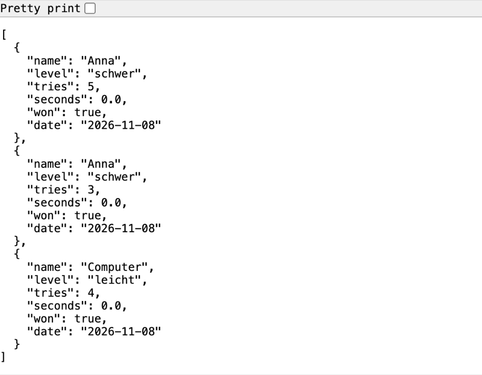
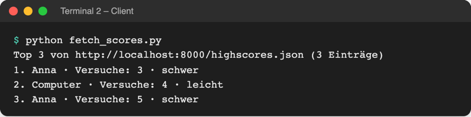
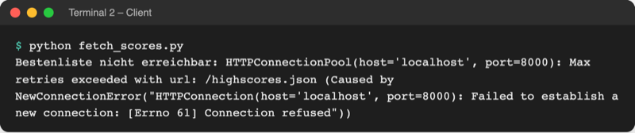

# Lab 16.2 – Lösung: Bestenliste über HTTP

Fertiger Stand: [project/examples/m16-automation/l02-server/](../../project/examples/m16-automation/l02-server/) mit `guess_game/` (Code unverändert seit Lab 15.3) und neu [fetch_scores.py](../../project/examples/m16-automation/l02-server/fetch_scores.py).

## Aufgabe 1: Server starten, im Browser ansehen

```bash
python -m http.server 8000 --bind 127.0.0.1
```

```text
Serving HTTP on 127.0.0.1 port 8000 (http://127.0.0.1:8000/) ...
```



_Quelle: eigener Screenshot, Browser mit `http://localhost:8000/highscores.json`, 08.11.2026 (Bestenliste aus zwei Spielen: Anna schwer 5 und 3 Versuche, Computer leicht 4)._

`http://localhost:8000/` zeigt die Verzeichnisliste mit `guess_game/`, `highscores.json`, `history.csv`, `game.log` und `fetch_scores.py` (Bild in der Theorie). Der Server gibt also jede Datei im Ordner heraus; `--bind 127.0.0.1` hält sie auf dem eigenen Rechner.

## Aufgabe 2: zweites Terminal

```powershell
.venv\Scripts\Activate.ps1    # Windows, im Ordner project/
cd playground
```

```bash
source .venv/bin/activate     # macOS/Linux, im Ordner project/
cd playground
```

Neue VS-Code-Terminals starten im Ordner, der in VS Code geöffnet ist; die Python-Erweiterung aktiviert `.venv` dort oft schon selbst (Prompt beginnt mit `(.venv)`).

## Aufgabe 3 und 4: fetch_scores.py

```python
# Bestenliste über HTTP laden statt aus der Datei
# Vorher im selben Ordner in einem zweiten Terminal: python -m http.server 8000
# Start: python fetch_scores.py

import sys

import requests

URL = "http://localhost:8000/highscores.json"  # anderer Rechner: nur die Adresse ändern


def main():
    """Lädt die Bestenliste vom Server und zeigt die Top 3."""
    try:
        response = requests.get(URL, timeout=5)  # höchstens 5 Sekunden warten
        response.raise_for_status()  # Statuscode 404, 500 ... -> Fehler
    except requests.RequestException as error:  # kein Server, Zeitüberschreitung ...
        print(f"Bestenliste nicht erreichbar: {error}")
        sys.exit(1)
    scores = response.json()  # JSON-Text -> Liste von Dictionaries
    best = sorted(scores, key=lambda item: item["tries"])[:3]
    print(f"Top 3 von {URL} ({len(scores)} Einträge)")
    place = 1
    for item in best:
        print(f"{place}. {item['name']} · Versuche: {item['tries']} · {item['level']}")
        place += 1


if __name__ == "__main__":
    main()
```

- `response.json()` liefert dieselbe Liste von Dictionaries wie `json.load` in `storage.py` (Lab 8.2); nur der Weg ist ein anderer.
- `sorted(..., key=lambda item: item["tries"])` sortiert nach Versuchen (Lab 12.2), `[:3]` nimmt die ersten drei (Lab 4.1).
- Der Kommentar im Example nennt den Startbefehl ohne `--bind`; im Kurs gilt immer `python -m http.server 8000 --bind 127.0.0.1`.



_Quelle: eigener Screenshot, Kurs-Repo, 08.11.2026._

Terminal 1 protokolliert dabei jeden Abruf:

```text
127.0.0.1 - - [08/Nov/2026 02:38:20] "GET /highscores.json HTTP/1.1" 200 -
```

## Aufgabe 5: ohne Server



_Quelle: eigener Screenshot, Kurs-Repo, 08.11.2026 (macOS; unter Windows `[WinError 10061]`)._

```text
$ echo $?
1
```

Die lange Meldung stammt von `requests`; entscheidend sind `localhost`, `port=8000` und `Connection refused`: Unter dieser Adresse lauscht kein Programm. Der Exit-Code `1` zeigt einem aufrufenden Programm, dass etwas schiefging (Lab 14.3). Mit falschem Dateinamen läuft der Server, antwortet aber mit `404`, und das Skript meldet `Bestenliste nicht erreichbar: 404 Client Error: File not found for url: http://localhost:8000/highscore.json`.

## Erweiterung

```bash
python -m guess_game --backup
python -m http.server 8000 --bind 127.0.0.1 --directory backups
```

```text
Kopieren: highscores.json -> backups/2026-11-08_0243
Kopieren: history.csv -> backups/2026-11-08_0243
Backup fertig: 2 Dateien in backups/2026-11-08_0243
```

`http://localhost:8000/` zeigt jetzt nur die Backup-Ordner, z. B. `2026-11-08_0243/`. Mit `URL = "http://localhost:8000/2026-11-08_0243/highscores.json"` (Ordnername aus dem eigenen Backup) lädt `fetch_scores.py` die gesicherte Liste:

```text
Top 3 von http://localhost:8000/2026-11-08_0243/highscores.json (2 Einträge)
1. Computer · Versuche: 3 · leicht
2. Computer · Versuche: 4 · leicht
```

`--directory` gibt nur diesen Unterordner frei: `game.log` und der Code bleiben unsichtbar.
