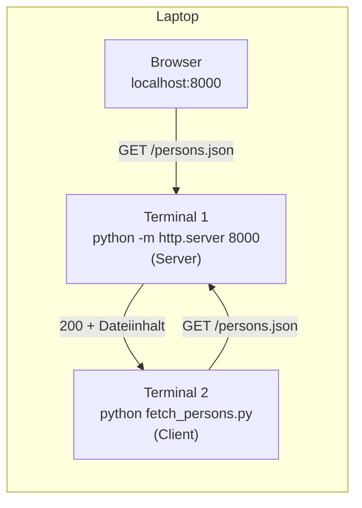
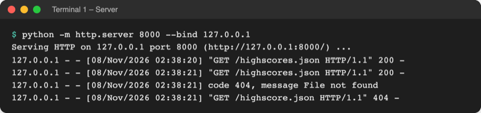
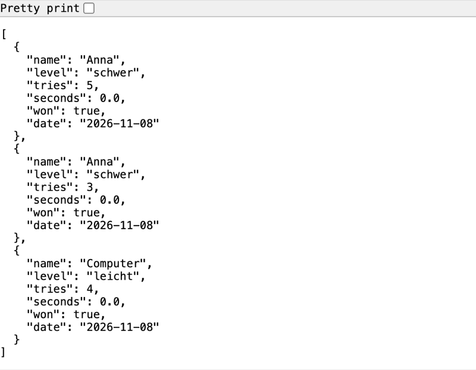

# Lab 16.2: Eigener lokaler Server

**Leitfragen:**

<details>
<summary>Was ist der Unterschied zwischen einer Datei öffnen und eine Datei über das Netz abrufen?</summary>

Beim Öffnen liest das Programm die Datei selbst von der Festplatte (Lab 8.1). Über das Netz bittet es ein anderes Programm, den Server, um den Inhalt; der Server entscheidet, was er herausgibt, und antwortet mit Statuscode und Text.

</details>

<details>
<summary>Was müsste sich ändern, wenn der Server bei einem Hoster stünde?</summary>

Im Client nur die Adresse: statt `http://localhost:8000` z. B. `https://spiel.example.org`. Auf der Serverseite kommen Verschlüsselung, Anmeldung und eine Firewall dazu.

</details>

<details>
<summary>Wie viele Rechner braucht man mindestens, um „Client und Server“ auszuprobieren?</summary>

Einen. Server und Client sind Programme, keine Geräte: Beide laufen auf demselben Laptop in zwei Terminals und sprechen über die Adresse `localhost` miteinander.

</details>

- Lab 16.1 hat einen fremden Server im Internet befragt. Dieses Lab startet den Server selbst, auf dem eigenen Rechner.
- Python bringt dafür einen fertigen Mini-Webserver mit: `python -m http.server` gibt einen Ordner per HTTP frei.

## Begriffe

| Begriff | Bedeutung |
| --- | --- |
| `localhost` | Name für „dieser Rechner selbst“; eine Anfrage an `localhost` verlässt den Laptop nicht |
| `127.0.0.1` | die Zahlenadresse (IP-Adresse) von `localhost` |
| IP-Adresse | Nummer eines Rechners im Netz, wie eine Hausadresse |
| Port | Nummer eines Programms auf dem Rechner, wie die Wohnungsnummer im Haus; Standard für Webseiten ist 80 bzw. 443, zum Üben z. B. 8000 |
| Netzwerkschnittstelle | Anschluss des Rechners an ein Netz: WLAN, Kabel, und die interne Schnittstelle nur für `localhost` |
| binden (`--bind`) | festlegen, auf welcher Schnittstelle der Server Anfragen annimmt |
| `http.server` | Modul der Standardbibliothek: einfacher Webserver, der Dateien eines Ordners ausliefert |
| Verzeichnisliste | Seite, die `http.server` für einen Ordner ohne `index.html` zeigt: alle Dateien als Links |
| SSH | „Secure Shell“: verschlüsselte Verbindung, um Befehle auf einem anderen Rechner auszuführen |

## Client und Server auf einem Rechner



Der Ablauf ist genau der aus Lab 16.1, nur mit der Adresse `http://localhost:8000` statt `https://jsonplaceholder.typicode.com`. Der Server läuft, bis er mit `Strg+C` beendet wird; deshalb braucht der Client ein zweites Terminal (in VS Code: **Terminal → New Terminal** oder `+` im Terminal-Bereich, dort ebenfalls `.venv` aktivieren).

## Einen Ordner per HTTP freigeben

Terminal 1, im Ordner `project/`:

```bash
python -m http.server 8000 --bind 127.0.0.1 --directory data
```

| Teil | Bedeutung |
| --- | --- |
| `-m http.server` | Modul als Programm starten (wie `python -m guess_game`, Lab 6.1) |
| `8000` | Port; ohne Angabe ebenfalls 8000 |
| `--bind 127.0.0.1` | nur Anfragen vom eigenen Rechner annehmen |
| `--directory data` | diesen Ordner freigeben; ohne Angabe den Ordner, in dem das Terminal steht |
| `Strg+C` | Server beenden |

**Immer `--bind 127.0.0.1`:** Ohne diese Angabe nimmt der Server Anfragen auf **allen** Schnittstellen an, auch im WLAN. Dann kann jedes Gerät im selben Netz (Hörsaal, Café, Wohnheim) den freigegebenen Ordner im Browser durchblättern und jede Datei herunterladen. Die Python-Dokumentation beschreibt das Standardverhalten so:

Original: [Python-Dokumentation zu http.server, Option -b/--bind: By default, the server binds itself to all interfaces; Beispiel python -m http.server --bind 127.0.0.1](https://docs.python.org/3.14/library/http.server.html#cmdoption-http.server-b), Stand 08.11.2026.

Dieselbe Seite warnt: `http.server` ist nicht für den Einsatz im echten Betrieb gedacht und prüft nur das Nötigste. Es ist ein Werkzeug zum Üben und für schnelle Tests.

Datei für den Client: [code/m16-automation/fetch_persons.py](../../project/code/m16-automation/fetch_persons.py). Terminal 2, im Ordner `project/`: `python code/m16-automation/fetch_persons.py`.

```python
URL = "http://localhost:8000/persons.json"  # localhost = dieser Rechner, Port 8000

try:
    response = requests.get(URL, timeout=5)
    response.raise_for_status()
except requests.RequestException as error:  # Server nicht gestartet?
    print(f"Server nicht erreichbar: {error}")
else:  # nur ohne Fehler: Daten auswerten
    persons = response.json()
```

```text
4 Personen von http://localhost:8000/persons.json
- Jonas, 15 Jahre
- Petra, 25 Jahre
- Marie, 12 Jahre
- Jülide, 31 Jahre
```

Der Server schreibt jede Anfrage als Zeile ins Terminal 1: wer gefragt hat, wann, was, und den Statuscode. Hier aus dem Spielordner, mit einem Tippfehler in der letzten Anfrage:



_Quelle: eigener Screenshot, Kurs-Repo, 08.11.2026._

## Was der Browser sieht

`http://localhost:8000/` zeigt die Verzeichnisliste des freigegebenen Ordners. Im Spielordner sind das alle Dateien, auch `game.log` und `history.csv` mit Namen und Spielzeiten:


_Quelle: eigener Screenshot, Browser mit `http://localhost:8000/` im Ordner `examples/m16-automation/l02-server`, 08.11.2026._

Genau diese Liste wäre ohne `--bind 127.0.0.1` für alle im selben WLAN sichtbar.

## Lokal oder beim Hoster

| | eigener Laptop | Server bei einem Hoster |
| --- | --- | --- |
| Adresse im Client | `http://localhost:8000/...` | `https://spiel.example.org/...` |
| Wer kann zugreifen | nur der eigene Rechner (`--bind 127.0.0.1`) | alle im Internet, sofern nicht gesperrt |
| Verschlüsselung | nicht nötig, Daten verlassen den Laptop nicht | HTTPS Pflicht |
| Anmeldung | keine | API-Schlüssel oder Login (Lab 16.1) |
| Server-Programm | `python -m http.server` | ausgereifte Webserver und Web-Frameworks |
| Client-Code | `requests.get(URL, timeout=5)` | **identisch**, nur `URL` anders |

## Im Spiel: Bestenliste über HTTP

Das Spiel bleibt auf dem Stand von Lab 15.3. Neu ist ein kleines Skript `fetch_scores.py` **neben** dem Paket `guess_game/`: Es lädt `highscores.json` nicht von der Festplatte, sondern vom Server, und zeigt die Top 3.

```python
URL = "http://localhost:8000/highscores.json"  # anderer Rechner: nur die Adresse ändern
...
    scores = response.json()  # JSON-Text -> Liste von Dictionaries
    best = sorted(scores, key=lambda item: item["tries"])[:3]
```



_Quelle: eigener Screenshot, Browser mit `http://localhost:8000/highscores.json` (Server mit `--bind 127.0.0.1` im Ordner `examples/m16-automation/l02-server`), 08.11.2026. Dauer 0,0 s, weil die Eingaben per Skript kamen._

## Einordnung: SSH

Wer Server wirklich betreibt, steuert sie meist nicht über HTTP, sondern über **SSH**: eine verschlüsselte Verbindung, über die Befehle auf dem fernen Rechner laufen, als säße man davor.

- **Befehl:** `ssh name@server.example.org` öffnet ein Terminal auf dem fernen Rechner. Unter macOS und Linux ist der Befehl vorhanden, unter Windows ab Windows 10 (Build 1809) als optionales Feature „OpenSSH“ (Quelle: [Microsoft Learn, OpenSSH for Windows overview](https://learn.microsoft.com/en-us/windows-server/administration/openssh/openssh-overview), Stand: 08.11.2026).
- **Python-Pakete:** [`paramiko`](https://www.paramiko.org/) (SSH-Verbindungen aus Python, Version 5.1.0) und [Fabric](https://www.fabfile.org/) (Befehle auf mehreren Servern ausführen, baut auf paramiko auf, Version 3.2.3); [Ansible](https://docs.ansible.com/) richtet ganze Serverlandschaften per Beschreibungsdatei ein. Stand: 08.11.2026, Quelle: pypi.org.
- Der Kurs braucht dafür einen zweiten Rechner mit SSH-Zugang und zeigt SSH deshalb nicht praktisch; das Prinzip „Client schickt Anfrage, Server antwortet“ ist dasselbe.

## Typische Fehler

| Symptom | Ursache | Lösung |
| --- | --- | --- |
| `OSError: [Errno 48] Address already in use` (Windows: `[WinError 10048]`) | auf Port 8000 läuft schon ein Server | anderen Server mit `Strg+C` beenden oder anderen Port wählen, z. B. `8001` |
| Client: `Connection refused` (Windows: `[WinError 10061]`) | Server nicht gestartet oder schon beendet | Terminal 1 prüfen, Server starten |
| `404 Client Error: File not found` | Server im falschen Ordner gestartet oder Tippfehler im Dateinamen | Verzeichnisliste `http://localhost:8000/` im Browser ansehen |
| Terminal 1 reagiert auf keine Eingabe mehr | der Server läuft und belegt das Terminal | zweites Terminal für den Client öffnen |
| Browser zeigt „Diese Website ist nicht erreichbar“ | `https://` statt `http://` eingegeben | `http://localhost:8000/` verwenden |

## Fazit

- `python -m http.server 8000 --bind 127.0.0.1` macht einen Ordner per HTTP erreichbar, nur für den eigenen Rechner.
- Client und Server können auf einem Laptop laufen; `localhost` ist die Adresse des eigenen Rechners, der Port wählt das Programm.
- Ein anderer Server bedeutet für den Client nur eine andere Adresse.

In der Übung gibt der Spielordner die Bestenliste frei, und `fetch_scores.py` lädt die Top 3 über HTTP.
