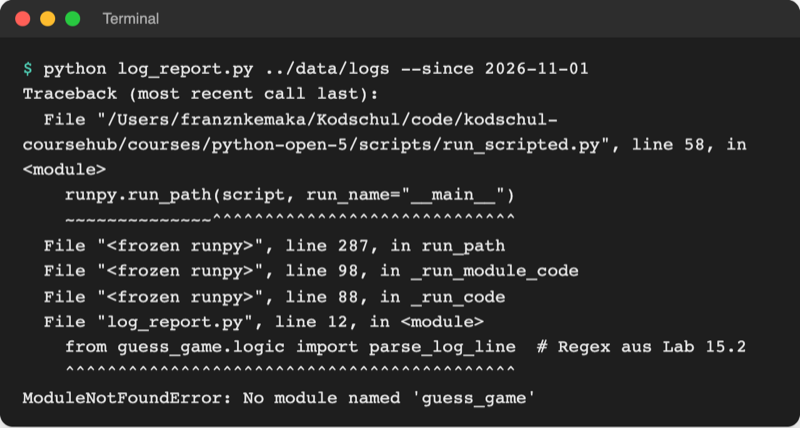
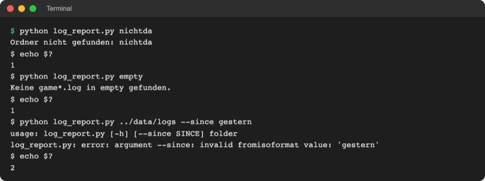

# Lab 16.3 – Lösung: Log-Bericht

Fertiger Stand (Spiel v4): [project/examples/m16-automation/l03-report/](../../project/examples/m16-automation/l03-report/) mit `guess_game/` (Code wie Lab 15.3), `fetch_scores.py` (Lab 16.2) und neu [log_report.py](../../project/examples/m16-automation/l03-report/log_report.py).

## Aufgabe 1: Ordner prüfen und Dateien finden

```python
    if not args.folder.is_dir():
        logger.error(f"Ordner fehlt: {args.folder}")
        print(f"Ordner nicht gefunden: {args.folder}")
        sys.exit(1)
    paths = sorted(args.folder.glob("game*.log"))
    if not paths:
        logger.warning(f"Keine game*.log in {args.folder}")
        print(f"Keine game*.log in {args.folder} gefunden.")
        sys.exit(1)
```

`args.folder` ist dank `type=Path` schon ein `Path`. `glob` liefert die Treffer in keiner festen Reihenfolge; `sorted` macht den Bericht auf jedem Rechner gleich. `notes.txt` passt nicht zu `game*.log` und bleibt außen vor.

## Aufgabe 2: read_results

```python
def read_results(paths, since):
    """Liest alle Ergebniszeilen der Dateien; ältere als since werden übersprungen."""
    results = []
    for path in paths:
        with open(path, encoding="utf-8") as file:
            for line in file:
                result = parse_log_line(line)  # None bei allen anderen Zeilen
                if result is None:
                    continue
                if since is not None and date.fromisoformat(result["date"]) < since:
                    continue
                results.append(result)
    return results
```

`result` ist ein Dictionary wie `{'date': '2026-11-01', 'result': 'Gewonnen', 'name': 'Ben', 'tries': '5', 'seconds': '28,5', 'level': 'mittel'}` (Lab 15.2). Das Datum ist Text; erst `date.fromisoformat` macht es mit `since` vergleichbar. `continue` springt zur nächsten Zeile (Lab 3.3).

## Aufgabe 3: build_report

```python
def build_report(results, since, paths):
    """Baut den Bericht als Liste von Zeilen aus den Ergebnis-Dictionaries."""
    outcomes = Counter([result["result"] for result in results])
    levels = Counter([result["level"] for result in results])
    winners = Counter(
        [result["name"] for result in results if result["result"] == "Gewonnen"]
    )
    period = f"seit {since}" if since is not None else "alle Einträge"
    lines = [f"Bericht Zahlenraten ({period})", f"Log-Dateien: {len(paths)}"]
    if not results:
        lines.append("Keine Spiele gefunden.")
        return lines
    level, count = levels.most_common(1)[0]  # [("mittel", 20)] -> erstes Paar
    lines.append(
        f"{len(results)} Spiele, {outcomes['Gewonnen']} gewonnen, "
        f"häufigste Stufe: {level} ({count} Spiele)"
    )
    lines.append("Meiste Gewinne:")
    for name, wins in winners.most_common(3):
        lines.append(f"  {name}: {wins}")
    return lines
```

- Die Listen entstehen per Comprehension (Lab 12.1), die Gewinnerliste mit Filter `if`.
- `levels.most_common(1)` liefert eine Liste mit einem Paar; `[0]` holt das Paar, das Entpacken trennt Stufe und Anzahl.
- Der Bericht ist eine Liste von Zeilen statt direkter `print`-Aufrufe: So landen Terminal und Datei garantiert beim selben Text.

## Aufgabe 4: Bericht ausgeben und speichern

```python
    results = read_results(paths, args.since)
    lines = build_report(results, args.since, paths)
    with open(REPORT_FILE, "w", encoding="utf-8") as file:
        for line in lines:
            print(line)
            file.write(line + "\n")
    print(f"Gespeichert in {REPORT_FILE}")
    logger.info(f"{len(paths)} Dateien, {len(results)} Spiele, Bericht {REPORT_FILE}")
```

`"w"` überschreibt `report.txt` bei jedem Lauf: Der Bericht zeigt immer den aktuellen Stand.

## Aufgabe 5: Testläufe



_Quelle: eigener Screenshot, Kurs-Repo, 08.11.2026._

Ohne `--since`:

```text
Bericht Zahlenraten (alle Einträge)
Log-Dateien: 3
38 Spiele, 28 gewonnen, häufigste Stufe: mittel (19 Spiele)
Meiste Gewinne:
  Anna: 9
  Computer: 8
  Ben: 4
Gespeichert in report.txt
```

Fehlerfälle mit Exit-Code (zusätzlich ein leerer Ordner `empty`):



_Quelle: eigener Screenshot, Kurs-Repo, 08.11.2026 (macOS/zsh; PowerShell zeigt den Code mit `$LASTEXITCODE`)._

`log_report.log` nach den vier Läufen:

```text
2026-11-08 02:45:30 INFO log_report: Start: Ordner ../data/logs, seit 2026-11-01
2026-11-08 02:45:30 INFO log_report: 3 Dateien, 28 Spiele, Bericht report.txt
2026-11-08 02:45:30 INFO log_report: Start: Ordner ../data/logs, seit None
2026-11-08 02:45:30 INFO log_report: 3 Dateien, 38 Spiele, Bericht report.txt
2026-11-08 02:45:30 INFO log_report: Start: Ordner nichtda, seit None
2026-11-08 02:45:30 ERROR log_report: Ordner fehlt: nichtda
```

Der Lauf mit `--since gestern` fehlt: argparse beendet das Skript schon in `parse_args()`, vor der ersten Log-Zeile. `report.txt` enthält den Bericht des letzten erfolgreichen Laufs. Das eigene Spiel lässt sich genauso auswerten: `python log_report.py .` liest `game.log` im Ordner `playground/`.

## Erweiterung

```python
    parser.add_argument(
        "--top", type=int, default=3, help="so viele Namen unter Meiste Gewinne"
    )
```

`build_report(results, since, paths, top=3)` bekommt den Wert als vierten Parameter, die Schleife nutzt `winners.most_common(top)`, und `main()` ruft `build_report(results, args.since, paths, args.top)` auf.

```text
$ python log_report.py ../data/logs --top 5
Bericht Zahlenraten (alle Einträge)
Log-Dateien: 3
38 Spiele, 28 gewonnen, häufigste Stufe: mittel (19 Spiele)
Meiste Gewinne:
  Anna: 9
  Computer: 8
  Ben: 4
  Deniz: 4
  Emil: 2
Gespeichert in report.txt
```

```text
$ python log_report.py --help
usage: log_report.py [-h] [--since SINCE] [--top TOP] folder

Erstellt einen Bericht aus den Spiel-Logs (game*.log).

positional arguments:
  folder         Ordner mit den Log-Dateien

options:
  -h, --help     show this help message and exit
  --since SINCE  nur Spiele ab diesem Datum (JJJJ-MM-TT)
  --top TOP      so viele Namen unter Meiste Gewinne
```
