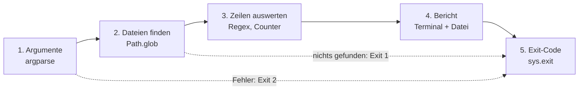
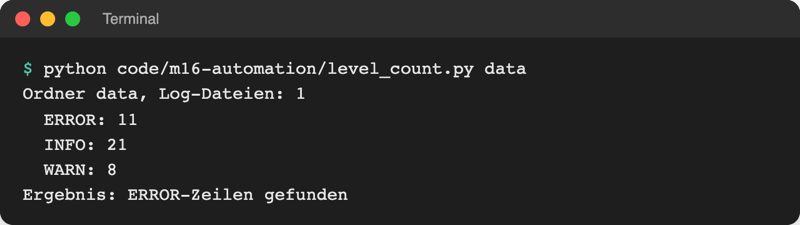

# Lab 16.3: Automatisierungsskript

**Leitfragen:**

<details>
<summary>Welche Teile von heute braucht ein Skript, das jeden Morgen einen Bericht erstellt?</summary>

Optionen beim Start statt Fragen (`argparse`, Lab 14.2), Dateien finden (`pathlib`, Lab 14.3), Zeilen zerlegen (Regex, Lab 15.2), ein eigenes Protokoll (`logging`, Lab 15.3) und einen Exit-Code, an dem der Zeitplaner Erfolg oder Fehler erkennt.

</details>

<details>
<summary>Wie testet man ein solches Skript, ohne auf echte Logs zu warten?</summary>

Mit vorbereiteten Testdateien im echten Format: einige Tage Spiele, auch ältere als das Stichdatum, dazu eine Datei, die nicht passt. Dann sind Ergebnis und Grenzfälle vorher bekannt.

</details>

- Dieses Lab bringt keine neue Python-Technik. Es setzt die Bausteine des Tages zu einem Werkzeug zusammen, das ohne Rückfragen läuft.
- Ergebnis ist `log_report.py`: Es liest alle Spiel-Logs eines Ordners und schreibt einen Bericht wie `28 Spiele, 21 gewonnen, häufigste Stufe: mittel`.

## Begriffe

| Begriff | Bedeutung |
| --- | --- |
| Admin-Skript | kleines Programm für wiederkehrende Aufgaben (aufräumen, sichern, auswerten), das ohne Eingaben läuft |
| Positionsargument | Angabe ohne `--` vor dem Namen, deren Bedeutung sich aus der Position ergibt: `log_report.py logs` |
| `type=` (argparse) | Funktion, die argparse auf den Text anwendet, z. B. `type=Path` oder `type=date.fromisoformat`; scheitert sie, endet das Skript mit Exit-Code 2 |
| `Path.glob("game*.log")` | findet alle Dateien eines Ordners, deren Name zum Muster passt; `*` steht für beliebig viele Zeichen |
| Stichdatum | Datum, ab dem gezählt wird (`--since 2026-11-01`) |
| Exit-Code | Zahl, mit der ein Programm endet: `0` = Erfolg, alles andere = Problem |
| Testdaten | vorbereitete Dateien mit bekanntem Inhalt, an denen ein Skript geprüft wird |
| Zeitplaner | Dienst des Betriebssystems, der Programme zu festen Zeiten startet: cron (Linux/macOS), Aufgabenplanung (Windows) |

## Aufbau eines Admin-Skripts



| Schritt | Werkzeug | Aus Lab |
| --- | --- | --- |
| 1. Argumente | `argparse`, Positionsargument, `type=` | 14.2 |
| 2. Dateien finden | `Path.is_dir()`, `Path.glob()` | 14.3 |
| 3. Zeilen auswerten | `for line in file`, `re`, `Counter` | 8.1, 15.2, 14.1 |
| 4. Bericht | `print` + Datei schreiben | 8.1 |
| 5. Exit-Code | `sys.exit(1)` | 14.3 |
| nebenbei | eigenes Protokoll mit `logging` | 15.3 |

## Das Muster im Kleinen: level_count.py

Datei: [code/m16-automation/level_count.py](../../project/code/m16-automation/level_count.py). Das Skript zählt die Stufen `INFO`, `WARN`, `ERROR` in allen `*.log` eines Ordners und meldet per Exit-Code, ob Fehler darin stehen.

```python
LINE_PATTERN = re.compile(r"^\d{4}-\d{2}-\d{2} [\d:]+ (?P<level>[A-Z]+) ")

# 1. Argumente
parser = argparse.ArgumentParser(description="Zählt Log-Stufen in *.log-Dateien.")
parser.add_argument("folder", type=Path, help="Ordner mit .log-Dateien")
args = parser.parse_args()

# 2. Dateien finden
paths = sorted(args.folder.glob("*.log"))  # nur dieser Ordner, ohne Unterordner
if not paths:
    print(f"Keine .log-Dateien in {args.folder}")
    sys.exit(1)

# 3. Zeilen auswerten ... 4. Bericht ... (siehe Datei)

# 5. Exit-Code: Ein Zeitplaner oder ein anderes Skript erkennt so ein Problem
if counts.get("ERROR", 0) > 0:
    print("Ergebnis: ERROR-Zeilen gefunden")
    sys.exit(1)
print("Ergebnis: alles in Ordnung")
```



_Quelle: eigener Screenshot, Kurs-Repo, 08.11.2026._

`type=Path` macht aus dem Text `data` gleich ein `Path`-Objekt; `.glob()` und `.is_dir()` lassen sich direkt aufrufen.

## Exit-Codes lesen

| Exit-Code | Bedeutung | Wer setzt ihn |
| --- | --- | --- |
| `0` | alles in Ordnung | Python am Ende des Skripts, ohne `sys.exit` |
| `1` | Problem bei der Arbeit (nichts gefunden, Fehler im Inhalt) | das Skript mit `sys.exit(1)` |
| `2` | falscher Aufruf (unbekannte Option, falsches Format) | argparse |

Anzeigen direkt nach dem Lauf: PowerShell `$LASTEXITCODE`, bash/zsh `echo $?`. Für `level_count.py data` ist das `1`, für `level_count.py data/logs` (keine ERROR-Zeile) `0`.

## Testen mit Beispiel-Logs

`project/data/logs/` enthält erfundene Spiel-Logs im exakten Format von `game.log` (Lab 15.3), verteilt um das Stichdatum 01.11.2026:

| Datei | Inhalt |
| --- | --- |
| `game_2026-10.log` | 5 Sitzungen vom 27.–31.10.2026 (vor dem Stichdatum) |
| `game_2026-11.log` | 8 Sitzungen vom 01.–06.11.2026 |
| `game.log` | 3 Sitzungen vom 07.11.2026 |
| `notes.txt` | Notizen; passt nicht zu `game*.log` und wird nicht gelesen |

Ausschnitt `game_2026-10.log`; ausgewertet werden nur die INFO-Zeilen mit `Gewonnen:` oder `Verloren:`, alle anderen liefert `parse_log_line` (Lab 15.2) als `None`:

```text
2026-10-27 18:12:15 INFO guess_game: Neue Runde: Stufe leicht
2026-10-27 18:12:20 DEBUG guess_game.ui: Tipp 5: zu hoch
2026-10-27 18:12:27 DEBUG guess_game.logic: play_round dauerte 12.4 s
2026-10-27 18:12:27 INFO guess_game: Gewonnen: Anna – 3 Versuche – 12,4 s · leicht   <- zählt
```

Weil die Testdaten feststehen, steht auch das Ergebnis fest: Seit 01.11.2026 sind es 28 Spiele, davon 21 gewonnen; ohne Stichdatum 38 Spiele.

## Zählen mit Counter

`Counter` aus `collections` (Lab 14.1) zählt, wie oft jeder Wert in einer Liste vorkommt; `most_common(n)` liefert die häufigsten als `(Wert, Anzahl)`:

```python
from collections import Counter

levels = Counter(["mittel", "leicht", "mittel", "schwer", "mittel"])
print(levels)                    # Counter({'mittel': 3, 'leicht': 1, 'schwer': 1})
print(levels.most_common(1))     # [('mittel', 3)]
print(levels["extrem"])          # 0: fehlender Wert ergibt 0 statt KeyError
```

## Im Spiel: log_report.py

Das Paket `guess_game/` bleibt auf dem Stand von Lab 15.3. Neu ist das Skript `log_report.py` **neben** dem Paket; es nutzt die Funktion `parse_log_line` aus Lab 15.2 wieder:

```python
from guess_game.logic import parse_log_line  # Regex aus Lab 15.2
```

Deshalb startet es nur in dem Ordner, der `guess_game/` enthält (`playground/`). Der Starter `starters/m16-l03-log_report.py` bringt die Imports, `parse_args()` und die Ablauf-Kommentare in `main()` schon mit:

```python
parser.add_argument("folder", type=Path, help="Ordner mit den Log-Dateien")
parser.add_argument(
    "--since",
    type=date.fromisoformat,  # "2026-11-01" -> date; falsches Format -> Fehler
    help="nur Spiele ab diesem Datum (JJJJ-MM-TT)",
)
```

`date.fromisoformat` (Lab 6.3) ist hier eine ganz normale Funktion als `type=`. Ein Datum wie `gestern` lehnt argparse mit Exit-Code 2 ab, bevor das Skript eine Datei anfasst. Ohne `--since` ist `args.since` `None`, und alle Einträge zählen.

Das Skript protokolliert den eigenen Lauf in `log_report.log` (Lab 15.3). Der Name passt bewusst nicht zum Muster `game*.log`, damit sich das Skript nicht selbst auswertet.

## Zeitgesteuert starten

Ein Admin-Skript entfaltet seinen Nutzen, wenn ein Zeitplaner es startet, z. B. jeden Morgen um 7 Uhr: unter Linux/macOS per cron (Eintrag mit `crontab -e`, Quelle: [crontab(5)](https://man7.org/linux/man-pages/man5/crontab.5.html)), unter Windows per Aufgabenplanung bzw. `schtasks /create` (Quelle: [Microsoft Learn, schtasks create](https://learn.microsoft.com/en-us/windows-server/administration/windows-commands/schtasks-create)). Stand: 08.11.2026. Der Kurs richtet das nicht ein; Voraussetzung ist genau das, was dieses Lab baut: keine Rückfragen, ein Exit-Code, ein eigenes Log.

## Typische Fehler

| Symptom | Ursache | Lösung |
| --- | --- | --- |
| `ModuleNotFoundError: No module named 'guess_game'` | `log_report.py` liegt nicht neben `guess_game/` | Skript nach `playground/` legen |
| `Keine game*.log in … gefunden.` | Pfad falsch, z. B. `data/logs` statt `../data/logs` aus `playground/` | Pfad relativ zum Terminal-Ordner angeben |
| `error: argument --since: invalid fromisoformat value` | Datum nicht im Format `JJJJ-MM-TT` | `--since 2026-11-01` |
| `Keine Spiele gefunden.` | Stichdatum liegt nach allen Einträgen | früheres Datum oder ohne `--since` |
| `TypeError: '<' not supported between instances of 'str' and 'datetime.date'` | Datum aus dem Log nicht umgewandelt | `date.fromisoformat(result["date"])` vergleichen |
| Bericht zählt 0 Spiele, obwohl Ergebniszeilen da sind | Log-Zeilen abgetippt statt kopiert (`-` statt `–`) | Zeilen aus dem echten Log verwenden |

## Fazit

- Ein Admin-Skript folgt dem Ablauf Argumente → Dateien finden → Zeilen auswerten → Bericht → Exit-Code.
- Testdaten mit bekanntem Inhalt machen das Ergebnis überprüfbar, ohne auf echte Spiele zu warten.
- Exit-Codes `0`/`1`/`2` und ein eigenes Log machen das Skript bereit für den Zeitplaner.

In der Übung entsteht aus dem Gerüst `log_report.py`, das die Beispiel-Logs auswertet.
