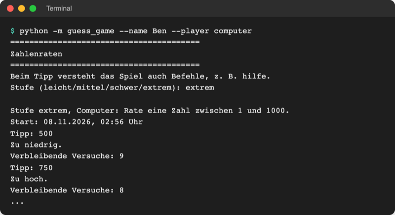
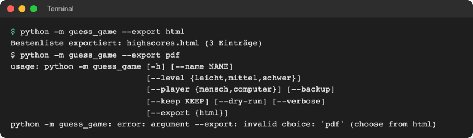
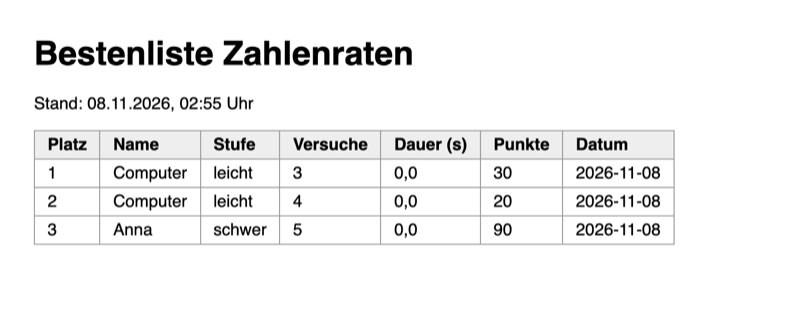

# Lab 17.1 – Lösung: Stufen aus XML, Bestenliste als HTML

Fertiger Stand: [project/examples/m17-data-formats/l01-xml-html/](../../project/examples/m17-data-formats/l01-xml-html/) mit geänderten `logic.py`, `ui.py`, `__main__.py` und neu [guess_game/levels.xml](../../project/examples/m17-data-formats/l01-xml-html/guess_game/levels.xml) und [guess_game/export.py](../../project/examples/m17-data-formats/l01-xml-html/guess_game/export.py).

## Aufgabe 1: Stufen mit ElementTree laden

`levels.xml` enthält dieselben Werte wie das alte Dictionary: `leicht` 1–10 mit 5 Versuchen, `mittel` 1–50 mit 7, `schwer` 1–100 mit 7.

```python
import xml.etree.ElementTree as ET
from pathlib import Path

# levels.xml gehört zum Programm: liegt im Paketordner neben logic.py,
# egal in welchem Ordner das Spiel startet (__file__ = Pfad dieser Datei)
LEVELS_FILE = Path(__file__).parent / "levels.xml"


def load_levels(path=LEVELS_FILE):
    """Liest die Stufen aus der XML-Datei: {"leicht": (1, 10, 5), ...}."""
    root = ET.parse(path).getroot()  # Wurzelelement <levels>
    levels = {}
    for element in root.findall("level"):  # alle <level>-Kinder
        low = int(element.find("low").text)  # Text zwischen <low> und </low>
        high = int(element.find("high").text)
        tries = int(element.find("tries").text)
        levels[element.get("name")] = (low, high, tries)  # Attribut name="..."
    return levels


# Stufe -> (kleinste Zahl, größte Zahl, Versuche), jetzt aus levels.xml
LEVELS = load_levels()
```

- `int(...)` ist nötig, weil `.text` immer ein String ist; ohne Umwandlung würde `random.randint("1", "10")` scheitern.
- Die Imports stehen oben in `logic.py` bei den anderen (`xml.etree...` alphabetisch nach `time`, `pathlib` nach `datetime`).
- Das Spiel läuft danach wie in Lab 16.3; `LEVELS` hat dieselbe Form wie vorher, deshalb ändern sich `Game`, `--level` und das `match`-Menü nicht.

## Aufgabe 2: Stufennamen zusammensetzen, Punkte für neue Stufen

`ui.py`:

```python
def show_help():
    ...
    names = "/".join(logic.LEVELS)  # "leicht/mittel/schwer" aus levels.xml
    print(f"  stufe schwer  Stufe der nächsten Runde ({names})")
    ...


def ask_level():
    """Fragt so lange nach der Stufe, bis es sie gibt, und gibt sie zurück."""
    names = "/".join(logic.LEVELS)  # Stufen aus levels.xml, mit / verbunden
    prompt = f"Stufe ({names}): "
    ...
```

`logic.py`, Methode `Score.points()`:

```python
    def points(self):
        """Berechnet die Punkte mit der Funktion, die zur Stufe gehört."""
        calculate = LEVEL_POINTS.get(self.level)  # eine Funktion aus dem Dictionary
        if calculate is None:  # neue Stufe aus levels.xml ohne Punkteregel
            return 0
        return calculate(self.tries)
```

Neue Stufe am Ende von `levels.xml`, vor `</levels>`:

```xml
  <level name="extrem">
    <low>1</low>
    <high>1000</high>
    <tries>10</tries>
  </level>
```



_Quelle: eigener Screenshot, Spielstand Lab 17.1 mit ergänzter Stufe, 08.11.2026._

Auch `python -m guess_game --help` zeigt jetzt `--level {leicht,mittel,schwer,extrem}`. Gewinnt jemand auf `extrem`, steht der Eintrag mit `0 Punkte` in der Bestenliste; ohne `.get` käme beim Anzeigen ein `KeyError: 'extrem'`.

## Aufgabe 3: Tabellenzeilen in export.py

```python
    place = 1
    for score in scores:
        name = html.escape(score.name)  # < > & im Namen als Text, nicht als HTML
        seconds = f"{score.seconds:.1f}".replace(".", ",")
        lines.append(
            f"<tr><td>{place}</td><td>{name}</td><td>{score.level}</td>"
            f"<td>{score.tries}</td><td>{seconds}</td><td>{score.points()}</td>"
            f"<td>{score.date}</td></tr>"
        )
        place += 1
    if not scores:
        lines.append('<tr><td colspan="7">Noch keine Einträge.</td></tr>')
```

`colspan="7"` lässt die eine Zelle über alle sieben Spalten laufen. Zwei f-Strings direkt hintereinander verbindet Python zu einem String; so bleibt jede Zeile kurz.

## Aufgabe 4: Meldung und Werkzeug-Modus

`ui.py`:

```python
def show_export(path, count):
    """Meldet, wohin die Bestenliste exportiert wurde."""
    word = "Eintrag" if count == 1 else "Einträge"
    print(f"Bestenliste exportiert: {path} ({count} {word})")
```

`__main__.py`:

```python
from guess_game import export, logic, players, storage, ui

    parser.add_argument(
        "--export", choices=["html"], help="Bestenliste als Datei speichern"
    )


def run_export(args):
    """Speichert die Top 10 der Bestenliste als Datei, ohne zu spielen."""
    with storage.Scoreboard("highscores.json") as board:
        scores = board.top(count=10)
    path = export.export_html(scores)
    ui.show_export(path, len(scores))
    logger.info(f"Export: {len(scores)} Einträge nach {path}")


def main():
    ...
    if args.backup:  # Werkzeug-Modus: sichern und fertig, ohne Spiel
        run_backup(args)
        return
    if args.export is not None:  # Werkzeug-Modus: exportieren und fertig
        run_export(args)
        return
    ui.show_banner()
```

`args.export` ist `None`, wenn die Option fehlt; deshalb `is not None`. `run_export` bekommt `args`, damit Lab 17.2 dort zwischen HTML und Excel wählen kann.

## Aufgabe 5: Export starten und ansehen



_Quelle: eigener Screenshot, Spielstand Lab 17.1 nach zwei Spielen (Anna schwer 5, Computer leicht 4 und 3), 08.11.2026._



_Quelle: eigener Screenshot, `highscores.html` im Browser (Chromium), 08.11.2026._

Erzeugtes HTML (Auszug):

```html
<tr><th>Platz</th><th>Name</th><th>Stufe</th><th>Versuche</th><th>Dauer (s)</th><th>Punkte</th><th>Datum</th></tr>
<tr><td>1</td><td>Computer</td><td>leicht</td><td>3</td><td>0,0</td><td>30</td><td>2026-11-08</td></tr>
<tr><td>2</td><td>Computer</td><td>leicht</td><td>4</td><td>0,0</td><td>20</td><td>2026-11-08</td></tr>
<tr><td>3</td><td>Anna</td><td>schwer</td><td>5</td><td>0,0</td><td>90</td><td>2026-11-08</td></tr>
```

`--export pdf` lehnt argparse wegen `choices` ab (Exit-Code 2, Lab 14.2), bevor das Spiel startet. Die Reihenfolge folgt `board.top()` (nach Versuchen). Ist noch keine `highscores.json` da, legt `with storage.Scoreboard(...)` eine leere an (Lab 13.2), und die Seite zeigt „Noch keine Einträge.“.

## Erweiterung

```python
# Artikel unter 2 € mit Einheit aus der lokalen Beispielseite
# Start im Ordner playground/: python cheap_items.py

from pathlib import Path

from bs4 import BeautifulSoup

PAGE = Path("..") / "data" / "shopping_items.html"  # .. = eine Ebene höher
LIMIT = 2.0

with open(PAGE, encoding="utf-8") as file:
    soup = BeautifulSoup(file, "html.parser")

for product in soup.select("div.product"):
    name = product.find("h2").get_text(strip=True)
    price_text = product.select_one(".price").get_text(strip=True)  # "0,99 €"
    unit = product.select_one(".unit").get_text(strip=True)
    price = float(price_text.replace("€", "").replace(",", ".").strip())
    if price < LIMIT:
        print(f"{name}: {price_text} ({unit})")
```

```text
$ python cheap_items.py
Orangen: 0,99 € (pro Stück)
Limonade: 1,99 € (0,5-l-Flasche)
Milch: 1,29 € (1 l)
```
